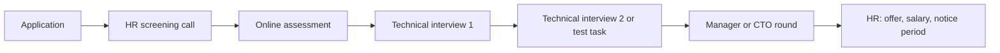
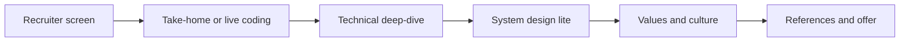

# Interview Formats

> What each interview round looks like, what it really tests, and which files prepare you for it. Formats vary by company, so treat this as a map of the common patterns, and ask the recruiter what the next round will be. They usually tell you.

## Two common pipelines

### Pakistani software houses (Lahore, Islamabad, Karachi)

A typical sequence:
1. **HR screening call (10-20 min):** availability, notice period, current and expected salary, onsite or remote, why you are looking.
2. **Online assessment (45-90 min):** MCQs on OOP, DBMS, OS and language output prediction, plus 2-3 coding problems on a platform such as HackerRank. Some companies use an onsite paper test instead.
3. **Technical interview (45-90 min):** OOP and DSA theory, SQL queries written live, framework questions (Rails, React, Django...), and a project walk-through.
4. **Second technical round or test task:** a deeper framework round, a take-home assignment, or a timed onsite "machine coding" build.
5. **Manager or CTO round:** projects, problem-solving approach, communication, culture fit.
6. **HR round:** offer discussion, benefits, joining date.

### Remote and international companies

The emphasis shifts: more practical coding (build an endpoint, fix a bug, extend a component), more weight on written and spoken English, async communication, and how you work with distributed teams. DSA puzzles are less common; a take-home or pair-programming session is more common.

## Round by round

### HR screening
- **Tests:** communication, motivation, logistics, salary fit.
- **Prepare:** [tell me about yourself](../18-behavioral-and-hr/01-tell-me-about-yourself.md), [common HR questions](../18-behavioral-and-hr/03-common-hr-questions.md), [salary and offers](../18-behavioral-and-hr/04-salary-and-offers.md).
- **Tip:** have your notice period, current salary and expected range ready before the call. Never invent a competing offer.

### Online assessment
- **Tests:** fundamentals under time pressure.
- **Prepare:** [CS 99](../01-cs-fundamentals/99-interview-questions.md), [C/C++ 99](../03-languages/c-cpp/99-interview-questions.md) output questions, [JavaScript 99](../03-languages/javascript/99-interview-questions.md) puzzles, [DB 99](../12-databases/99-interview-questions.md), and the [DSA practice list](../02-dsa/12-practice-problem-list.md).
- **Tips:**
  - Read every problem first and start with the one you are surest of.
  - Get a correct brute force submitted, then optimize. Partial credit is real on most platforms.
  - Test edge cases yourself (empty input, one element, duplicates, negatives, overflow with `long long`).
  - Know your C++ STL cold so you never waste minutes on syntax ([STL for DSA](../03-languages/c-cpp/04-stl-for-dsa.md)).

### Live coding (DSA)
- **Tests:** problem solving, communication, code quality, complexity analysis.
- **Prepare:** the [problem-solving framework](../02-dsa/00-big-o-and-problem-solving.md) and two problems a day from the [practice list](../02-dsa/12-practice-problem-list.md).
- **The script:** restate the problem, ask clarifying questions, walk an example, state the brute force and its complexity, find the bottleneck, propose the better idea, code it while narrating, test it on your example and an edge case, state the final complexity.
- **If stuck:** say what you are thinking, try a smaller example, ask whether a hint is OK. Silence hurts more than a hint.

### SQL round
- **Tests:** joins, grouping, window functions, NULL handling, indexing awareness.
- **Prepare:** [SQL from zero](../12-databases/02-sql-from-zero.md), [SQL practice problems](../12-databases/03-sql-practice-problems.md), [indexing](../12-databases/05-indexing-and-query-optimization.md).
- **Tip:** write the query in logical order (FROM, JOIN, WHERE, GROUP BY, HAVING, SELECT, ORDER BY), say which index would help, and mention how you would check with `EXPLAIN ANALYZE`.

### Framework deep-dive
- **Tests:** whether you understand your tools or only use them.
- **Prepare:** the `99-` bank for the role's stack, then the T1 files behind every question you miss. Typical favorites: N+1 and eager loading, callbacks and transactions, background job idempotency, React re-renders and hooks, the event loop, Django ORM performance, React Native architecture.
- **Tip:** connect answers to real work: "In the Colochousing app we used Sidekiq for..." (only what is true; see the project files).

### Take-home assignment
- **Tests:** how you work when nobody is watching: structure, tests, documentation, judgment about scope.
- **Prepare:** [testing fundamentals](../13-architecture-and-practices/09-testing-fundamentals.md), [RSpec](../05-ruby-on-rails/13-testing-rspec.md), [React testing](../06-react/10-testing.md), [Git](../14-devops-and-tools/01-git.md).
- **Tips:**
  - Ask how many hours they expect and stay close to it.
  - Write a README: setup steps, decisions and trade-offs, what you would do with more time.
  - Commit in small, well-named steps; reviewers read the history.
  - A few meaningful tests beat none; cover the core logic and one edge case.
  - Do not over-engineer. Clean, working and explained wins.

### Machine-coding round
- **Tests:** building a working feature fast (autocomplete, kanban board, CRUD) with sensible components and state.
- **Prepare:** [machine-coding rounds](../06-react/11-machine-coding-rounds.md), the live-coding section of [React 99](../06-react/99-interview-questions.md).
- **Tip:** get the core flow working end to end first, then handle edge cases, then polish. Talk through your component and state plan before typing.

### Project deep-dive
- **Tests:** ownership, depth, honesty, and whether your resume is accurate.
- **Prepare:** all six [project files](../17-projects-deep-dive/01-crystalcommerce.md), [resume defense](../18-behavioral-and-hr/06-resume-line-by-line-defense.md), [STAR stories](../18-behavioral-and-hr/02-star-stories-bank.md).
- **Tips:**
  - Use the structure: problem, architecture, your part, a hard moment, the result, what you would change.
  - Separate team work from your work ("the team built X; I built Y").
  - Respect client confidentiality: describe architecture and patterns, not secrets or private data.

### System design lite
- **Tests:** whether you can reason about components, data and trade-offs at a junior-to-mid level.
- **Prepare:** [system design fundamentals](../15-system-design/01-fundamentals.md), [classic case studies](../15-system-design/02-case-studies.md), [case studies from your projects](../15-system-design/03-case-studies-from-your-projects.md).
- **Tip:** start from requirements and a simple design that works, then scale it when asked. Name trade-offs explicitly.

### Behavioral and culture
- **Tests:** teamwork, conflict handling, learning speed, reliability, communication.
- **Prepare:** [STAR stories](../18-behavioral-and-hr/02-star-stories-bank.md), [questions to ask](../18-behavioral-and-hr/05-questions-to-ask.md).
- **Tip:** prepare 6-8 stories that can be re-angled for many questions (a hard bug, learning Rails in a month, a client misunderstanding, teaching as a TA).

## Remote interview logistics

- Test your camera, microphone and screen sharing 15 minutes early; close notifications.
- Keep a phone hotspot ready as a backup connection.
- Have an editor ready with C++, JavaScript, Ruby and Python able to run, in case they let you code locally.
- Keep a glass of water and a notepad nearby; jot down the interviewer's names and their questions.
- If the connection drops, rejoin quickly and summarize where you were.

## After every interview

1. Write down every question you were asked, and rate your answer (good, shaky, missed).
2. Study the files behind the shaky and missed ones within 48 hours.
3. Send a short thank-you note if you have the interviewer's contact, mentioning one specific topic from the conversation.
4. If you get rejected, politely ask for feedback. Some companies will share it, and it is the most valuable study guide you can get.
