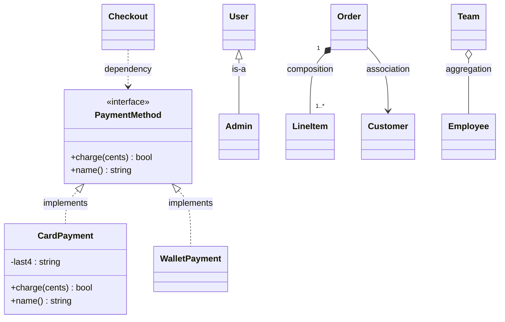

# Object-Oriented Programming

> **Tier:** T1 (know cold) · **Related:** [C++ OOP mechanics](../03-languages/c-cpp/03-cpp-oop.md), [SOLID and design principles](03-solid-and-design-principles.md), [Design patterns](04-design-patterns.md), [Ruby OOP and mixins](../03-languages/ruby/03-oop-modules-mixins.md), [Python OOP](../03-languages/python/02-oop.md), [JavaScript prototypes and classes](../03-languages/javascript/03-this-prototypes-classes.md)
> **On your resume:** Teaching assistant for the OOP lab at PUCIT; daily object design in Rails models and service objects, TypeScript classes and interfaces, plus C#, Java and C++ in your skills. The `SalesChannel` running example echoes your work integrating PriceCharting as a sales channel for CrystalCommerce.

## Quick revision
- OOP organizes a program as objects that bundle state (data) with behavior (methods) and interact through method calls.
- A class is a blueprint (a type); an object is an instance with its own state and identity.
- **Encapsulation:** keep state private and change it only through methods that protect invariants.
- **Abstraction:** expose what an object does, hide how it does it (interfaces, abstract classes).
- **Inheritance:** a subclass reuses and specializes a base class ("is-a").
- **Polymorphism:** one interface, many implementations; the call is dispatched to the right one.
- Abstraction is a design decision (which operations to expose); encapsulation is an implementation technique (how state is protected).
- C++ abstract class: at least one pure virtual function (`= 0`), cannot be instantiated. A class with only pure virtual functions and a virtual destructor acts as an interface.
- Java and C# have an `interface` keyword; TypeScript interfaces exist only at compile time and are structural.
- Overloading: same name, different parameters, chosen at compile time. Overriding: a subclass redefines a virtual method, chosen at runtime.
- Compile-time polymorphism: overloading, operator overloading, templates. Runtime polymorphism: virtual functions called through base pointers or references.
- Four "has or uses" relationships, from weakest to strongest: dependency (A only uses B briefly, for example as a parameter), association (A keeps a link to B), aggregation (A has B as a part, but B lives on its own), composition (A owns B and they live and die together).
- Prefer composition over inheritance: inheritance couples a subclass to its parent's internals; composition lets you swap behavior.
- Public inheritance keeps base access levels; protected and private inheritance narrow them.
- Static members belong to the class and are shared by all objects; static member functions have no `this`.
- Aim for high cohesion (a class does one thing) and low coupling (classes know little about each other).
- A base class used polymorphically needs a virtual destructor.
- Static (early) binding is decided at compile time from the declared type; dynamic (late) binding is decided at runtime from the object's real type. In C++ only virtual functions are dynamic; in Ruby, Python and JavaScript every method call is.
- Data hiding is the lock (private fields); encapsulation is the bundle (data and methods together, with the lock on).
- Several base classes: allowed in C++ and Python. Java, C# and TypeScript allow one base class plus many interfaces. Ruby has one superclass plus mixin modules.
- A constructor's job is to create a valid object. In Ruby, Python and JavaScript, `b = a` does not copy: both names point to the same object, so copy on purpose (shallow or deep).
- Identical means the same object; equal means the same value. If you define equality, define the hash too. Value objects are small, immutable and compared by value.
- UML in one line: solid line with hollow triangle = inheritance, dashed line with hollow triangle = implements, hollow diamond = aggregation, filled diamond = composition, dashed arrow = dependency.
- "Design the classes for X" questions: nouns become classes, verbs become methods, and the part that will change becomes an interface.

## 1. Why OOP

Procedural code passes data structures to functions; as a system grows, any function can modify any data and invariants leak everywhere. OOP puts data and the code allowed to change it in one unit, so rules live in one place, implementations can be swapped behind a stable interface, and the code mirrors the domain (Order, Listing, PaymentMethod). Functional programming takes a different route (immutable data, pure functions); modern codebases mix both, for example React components with hooks or Ruby objects using Enumerable pipelines.

## 2. Class vs object

```cpp
#include <iostream>
#include <string>
using namespace std;

class Product {                      // the blueprint: data members plus member functions
public:
    Product(string sku, long long priceCents) : sku(sku), priceCents(priceCents) {}
    void applyDiscount(int percent) { priceCents -= priceCents * percent / 100; }
    string sku;
    long long priceCents;
};

int main() {
    Product a("ZELDA-01", 5000);     // two objects, each with its own state
    Product b("MARIO-02", 3000);
    a.applyDiscount(10);
    cout << a.priceCents << ' ' << b.priceCents << '\n';   // 4500 3000
}
```

Each object has **state** (its data), **behavior** (its methods, shared by all instances of the class) and **identity** (it is a distinct object even if another has equal data). In C++, `struct` and `class` differ only in default access: `struct` members and bases are public by default, `class` ones private. By convention `struct` is used for plain data and `class` for types with invariants. (Public fields are used above only to keep the first example short; the next section fixes that.)

## 3. Encapsulation: protecting invariants

```cpp
#include <stdexcept>
#include <string>
#include <utility>
using namespace std;

class InventoryItem {
public:
    InventoryItem(string sku, int quantity) : sku_(move(sku)), quantity_(quantity) {
        if (quantity_ < 0) throw invalid_argument("quantity cannot be negative");
    }

    void reserve(int units) {                     // the only way to change reserved_
        if (units <= 0) throw invalid_argument("units must be positive");
        if (reserved_ + units > quantity_) throw runtime_error("not enough stock");
        reserved_ += units;
    }

    void release(int units) {
        if (units <= 0 || units > reserved_) throw invalid_argument("invalid release");
        reserved_ -= units;
    }

    int available() const { return quantity_ - reserved_; }  // read-only view
    const string& sku() const { return sku_; }

private:
    string sku_;
    int quantity_;
    int reserved_ = 0;                            // invariant: 0 <= reserved_ <= quantity_
};
```

If `reserved_` were public, any code could set it to -5 or above the stock and the bug would surface far away. Encapsulation is not "private fields plus a getter and setter for each": a public setter for every field is a public field with extra steps. Expose operations that mean something in the domain (`reserve`, `release`) and keep the rules inside them.

**Data hiding vs encapsulation** (a very common question): encapsulation means keeping the data and the methods that use it together in one class. Data hiding means outsiders cannot touch that data directly (`private`). Encapsulation is the bundle; data hiding is the lock on the bundle. A class with public fields plus methods is bundled but not hidden, so nothing protects its rules.

> **In your web stack:** Ruby instance variables are always private, so you expose only what you choose with `attr_reader` and domain methods such as `listing.reserve!(2)`; Rails validations guard invariants at the persistence boundary. TypeScript `private` is checked only at compile time, while `#field` is truly private at runtime. Python has no real private: `_name` means "internal, please do not touch" by convention, `__name` is renamed to `_ClassName__name` to avoid clashes in subclasses, and `@property` lets you add validation later without changing how callers use the attribute.

## 4. Abstraction: pure virtual classes

```cpp
#include <iostream>
#include <string>
#include <utility>
using namespace std;

class PaymentMethod {                       // abstract: cannot be instantiated
public:
    virtual ~PaymentMethod() = default;     // virtual destructor for safe polymorphic deletion
    virtual bool charge(long long cents) = 0;   // pure virtual: "what", not "how"
    virtual string name() const = 0;
};

class CardPayment : public PaymentMethod {
public:
    explicit CardPayment(string last4) : last4_(move(last4)) {}
    bool charge(long long cents) override {
        cout << "charging " << cents << " to card ending " << last4_ << '\n';
        return true;                        // a real class would call the card gateway
    }
    string name() const override { return "card"; }
private:
    string last4_;
};

class WalletPayment : public PaymentMethod {
public:
    explicit WalletPayment(long long balance) : balance_(balance) {}
    bool charge(long long cents) override {
        if (cents > balance_) return false;
        balance_ -= cents;
        return true;
    }
    string name() const override { return "wallet"; }
private:
    long long balance_;
};

bool checkout(PaymentMethod& method, long long cents) {
    return method.charge(cents);            // depends only on the abstraction
}
```

`checkout` knows nothing about cards or wallets, so adding `BankTransfer` requires no change to it. The abstraction is the set of operations (`charge`, `name`); every subclass hides its own details.

> **In your web stack:** Ruby relies on duck typing: any object with a `charge(cents)` method works, and the contract lives in tests (or a base class raising `NotImplementedError`). In TypeScript you would write `interface PaymentMethod { charge(cents: number): Promise<boolean>; name: string }` and any object of the right shape satisfies it. In Python, `class PaymentMethod(ABC)` with `@abstractmethod` on `charge` makes the class abstract: you get a `TypeError` if you try to create one before a subclass overrides every abstract method.

## 5. Inheritance

```cpp
#include <string>
#include <utility>
using namespace std;

class User {
public:
    explicit User(string email) : email_(move(email)) {}
    virtual ~User() = default;
    virtual string role() const { return "member"; }
    const string& email() const { return email_; }
protected:
    string displayName() const { return email_.substr(0, email_.find('@')); }  // helper for subclasses only
private:
    string email_;                   // data stays private, even from subclasses
};

class Admin : public User {          // single, public inheritance: an Admin is-a User
public:
    using User::User;                // reuse the base constructor
    string role() const override { return "admin"; }
    string greeting() const { return "Hello, admin " + displayName(); }   // allowed: protected helper
};
```

Keep data `private` even in a base class. If subclasses need something, give them a `protected` function (like `displayName`). Protected data lets every subclass, now and in the future, break the base class's rules.

| Type | Shape | Example |
|---|---|---|
| Single | B derives from A | `Admin : User` |
| Multilevel | C from B from A | `SuperAdmin : Admin : User` |
| Hierarchical | several classes from one base | `CardPayment`, `WalletPayment` from `PaymentMethod` |
| Multiple | one class from several bases | `class Kiosk : public Printer, public Scanner` (allowed in C++ and Python; Java, C# and TypeScript allow one base class plus many interfaces; Ruby has one superclass plus mixins) |
| Hybrid | a mix, can produce the diamond problem | B and C from A, D from B and C |

| Base member | `public` inheritance | `protected` inheritance | `private` inheritance |
|---|---|---|---|
| public | public | protected | private |
| protected | protected | protected | private |
| private | not accessible | not accessible | not accessible |

Public inheritance models "is-a"; private inheritance means "implemented in terms of" and is usually better replaced by composition. Base classes are constructed first and destroyed last. In the **diamond problem**, D inherits two copies of A through B and C, and calls to A's members become ambiguous; C++ solves it with `virtual` inheritance, Java and C# avoid it by allowing a single base class plus multiple interfaces, and Python orders all the bases in one line (the MRO) so each class appears once. Constructors, vtables, slicing and the rule of three/five are covered in [C++ OOP mechanics](../03-languages/c-cpp/03-cpp-oop.md) (and in section 14 below, in a language-neutral way).

A **mixin** is a small piece of reusable behavior that you add to a class without making it a "child" in an is-a hierarchy: Ruby modules (`include Comparable`), Python mixin classes (Django's `LoginRequiredMixin`) and TypeScript mixin functions all do this. Inheritance says what a thing *is*, an interface says what it must be *able to do* (no code), and a mixin hands it ready-made code for one ability.

> **In your web stack:** Ruby has single inheritance plus modules (mixins) whose linear `ancestors` chain sidesteps the diamond; Rails models inherit from `ApplicationRecord`, and Single Table Inheritance (`class Admin < User` with a `type` column) maps a hierarchy onto one table. TypeScript classes `extend` one class and can `implement` many interfaces. Python allows several bases, `class ArticleList(LoginRequiredMixin, ListView)` is normal Django, and `super()` follows the MRO (C3 linearization) so every class in the diamond runs exactly once; Django models inherit from `models.Model`.

## 6. Polymorphism

### Compile time: overloading, operators and templates

```cpp
#include <string>
using namespace std;

long long priceAfterTax(long long cents) { return cents * 117 / 100; }        // overload 1
long long priceAfterTax(long long cents, int ratePercent) {                   // overload 2
    return cents * (100 + ratePercent) / 100;
}

struct Money {
    long long cents;
    Money operator+(const Money& other) const { return {cents + other.cents}; }  // operator overloading
};

template <typename T>
T maxOf(T a, T b) { return a > b ? a : b; }   // one definition, a version generated per type
```

The compiler picks the overload or template instantiation from the static types, so there is no runtime cost.

### Runtime: virtual functions (the `SalesChannel` example)

```cpp
#include <iostream>
#include <memory>
#include <string>
#include <utility>
#include <vector>
using namespace std;

struct Listing { string sku; int quantity; long long priceCents; };

class SalesChannel {
public:
    virtual ~SalesChannel() = default;
    virtual string name() const = 0;
    virtual void publish(const Listing& listing) = 0;
    virtual void syncStock(const string& sku, int quantity) {   // default behavior
        cout << name() << ": stock " << sku << " -> " << quantity << '\n';
    }
};

class StorefrontChannel : public SalesChannel {     // the store's own website
public:
    string name() const override { return "storefront"; }
    void publish(const Listing& l) override { cout << "storefront: show product page for " << l.sku << '\n'; }
};

class MarketplaceChannel : public SalesChannel {    // an external marketplace reached over an API
public:
    explicit MarketplaceChannel(string apiBase) : apiBase_(move(apiBase)) {}
    string name() const override { return "marketplace"; }
    void publish(const Listing& l) override { cout << "marketplace: POST " << apiBase_ << "/listings " << l.sku << '\n'; }
    void syncStock(const string& sku, int quantity) override {
        cout << "marketplace: PATCH stock " << sku << " = " << quantity << '\n';
    }
private:
    string apiBase_;
};

int main() {
    vector<unique_ptr<SalesChannel>> channels;
    channels.push_back(make_unique<StorefrontChannel>());
    channels.push_back(make_unique<MarketplaceChannel>("https://api.marketplace.example"));

    Listing listing{"ZELDA-01", 3, 4999};
    for (const auto& channel : channels) {          // one loop; behavior chosen at runtime
        channel->publish(listing);
        channel->syncStock(listing.sku, listing.quantity);
    }
}
```

The loop calls through `SalesChannel*`, and each object's dynamic type decides which `publish` runs (dynamic dispatch, implemented with a vtable in practice). Adding a third channel means writing one new class; the loop never changes. Because objects are deleted through `unique_ptr<SalesChannel>`, the base destructor must be virtual. Without it, deleting through the base pointer is undefined behavior (in practice the derived part is never destroyed and its resources leak).

### Static vs dynamic binding

"Binding" means connecting a function call to the code that actually runs.

| | Static (early) binding | Dynamic (late) binding |
|---|---|---|
| Decided | at compile time | at runtime |
| Decided by | the declared type of the variable (`Base*`) | the real type of the object (`Derived`) |
| C++ examples | overloads, templates, non-virtual functions | virtual functions called through a pointer or reference |
| Cost | none, can be inlined | one extra step (vtable lookup) |
| Ruby, Python, JS | not used for method calls | every method call works this way |

```cpp
#include <iostream>
using namespace std;

struct Base {
    void hello() { cout << "base hello\n"; }              // not virtual
    virtual void hi() { cout << "base hi\n"; }            // virtual
    virtual ~Base() = default;
};
struct Derived : Base {
    void hello() { cout << "derived hello\n"; }           // hides Base::hello, does not override it
    void hi() override { cout << "derived hi\n"; }        // overrides Base::hi
};

int main() {
    Derived d;
    Base* p = &d;
    p->hello();   // base hello    (static binding: decided by the pointer type Base*)
    p->hi();      // derived hi    (dynamic binding: decided by the real object)
}
```

To get overriding in C++ you need `virtual` and a call through a pointer or reference. Without `virtual`, redefining the function in the derived class only *hides* the base version. Writing `override` turns that mistake into a compile error.

### Three kinds of polymorphism

- **Subtype polymorphism:** one base type, many subclasses (virtual functions, interfaces). Chosen at runtime.
- **Ad hoc polymorphism:** the same name with different code per argument type (function and operator overloading). Chosen at compile time.
- **Parametric polymorphism:** one piece of code that works for any type (C++ templates, Java, C# and TypeScript generics). Chosen at compile time.

Duck typing (Ruby, Python, JavaScript) gives you the subtype effect without any declared base type.

> **In your web stack:** in Ruby every method call is dynamically dispatched, so polymorphism needs no `virtual` keyword: `channels.each { |c| c.publish(listing) }` works for any objects that respond to `publish`. A sales-channel integration in Rails is often exactly this shape: one service object per channel behind a common interface, chosen by a strategy lookup (see [SOLID](03-solid-and-design-principles.md)). Python works the same way, and operator overloading is done with dunder methods such as `__add__` and `__eq__`.

## 7. Abstraction vs encapsulation

| | Abstraction | Encapsulation |
|---|---|---|
| Question it answers | What should the outside world see? | How do we stop the outside world from breaking our state? |
| Level | design: choosing interfaces and operations | implementation: access control and invariants |
| Tools | abstract classes, interfaces, well-named public methods | `private`/`protected`, validation in methods, immutability |
| Example | `PaymentMethod::charge` hides gateway details | `InventoryItem::reserved_` can change only through `reserve` |
| Without it | callers depend on internals and break when they change | any code can put the object into an invalid state |

They work together: abstraction decides the shape of the public surface, encapsulation enforces it.

## 8. Abstract class vs interface

| | C++ abstract class | C++ pure abstract class ("interface") | Java / C# interface | TypeScript interface |
|---|---|---|---|---|
| Keyword | at least one `virtual ... = 0` | only pure virtual functions plus a virtual destructor | `interface` | `interface` or `type` |
| State (fields) | yes | no (by convention) | constants only (static) | describes the shape of properties |
| Implemented methods | yes | no | default methods (Java 8+, C# 8+); Java also allows static and private methods | no, types only |
| Constructors | yes (called by subclasses) | none needed | no | no |
| How many per class | one or more (C++ allows multiple inheritance) | many | many | many (`implements A, B`) |
| Exists at runtime | yes | yes | yes | no, erased after compilation |
| Use when | sharing code and state among related classes | defining a capability any class can provide | contracts across unrelated classes | describing object shapes for type checking |

Rule of thumb: use an abstract class when subclasses share implementation and state ("is-a" with a common core); use an interface when unrelated classes must offer the same capability ("can do"). Neither can be instantiated directly.

**The same idea in other languages:**
- **Java and C#:** an `abstract class` can have fields, constructors and implemented methods, and a class extends only one. An interface is mostly a contract (modern versions also allow default methods).
- **TypeScript:** an `interface` disappears at runtime, but an `abstract class` does not: it can hold real code and cannot be created with `new`.
- **Python:** `abc.ABC` plus `@abstractmethod` (no object can be created until a subclass overrides every abstract method). `typing.Protocol` is the "has the right shape" option, like a TypeScript interface.
- **Ruby:** no keyword. The usual way is to raise `NotImplementedError` in the base method, or to rely on duck typing.

## 9. Overloading vs overriding

| | Overloading | Overriding |
|---|---|---|
| What | same name, different parameter lists, same scope | subclass redefines a base class's virtual method with the same signature |
| Resolved | compile time (static types) | runtime (dynamic type of the object) |
| Requires inheritance | no | yes |
| C++ keywords | none | `virtual` in the base, `override` (and optionally `final`) in the derived class |
| Return type | can differ, but return type alone cannot distinguish overloads | same (or covariant for pointers and references) |

```cpp
#include <iostream>
#include <string>
using namespace std;

class Logger {
public:
    virtual ~Logger() = default;
    void log(const string& msg) { write("INFO", msg); }                        // overload 1
    void log(const string& level, const string& msg) { write(level, msg); }    // overload 2
protected:
    virtual void write(const string& level, const string& msg) {
        cout << "[" << level << "] " << msg << '\n';
    }
};

class JsonLogger final : public Logger {        // final: no further subclassing
protected:
    void write(const string& level, const string& msg) override {   // override
        cout << "{\"level\":\"" << level << "\",\"msg\":\"" << msg << "\"}\n";
    }
};
```

`override` makes the compiler verify that a matching virtual function exists, catching typos and signature drift. A C++ gotcha: declaring any `log` in a derived class hides all base overloads named `log` unless you add `using Logger::log;`.

> **In your web stack:** Ruby has no overloading (the last `def` with a name wins), so use default and keyword arguments instead; overriding plus `super` is everywhere in Rails (`def save(...)` calling `super`). TypeScript supports overload signatures but only one implementation body. Python has no overloading either (the last `def` wins): use default arguments, `*args`, or `functools.singledispatch`; a subclass overrides by redefining the method and calls the parent with `super().method()`.

## 10. Dependency, association, aggregation and composition

These four describe how strongly one class is tied to another, from weakest to strongest. A quick test: *does A keep B as a field?* If no, it is a dependency. If yes, ask how tightly they are bound.

| | Dependency | Association | Aggregation | Composition |
|---|---|---|---|---|
| Meaning | A only uses B for a moment | A keeps a link to B | A has B as a part, but B exists on its own | A owns B; B cannot exist without A |
| In code | B appears as a parameter, local variable or return type | B is a field (pointer or reference) | B is a field, shared or non-owning | B is a field held by value, or owned pointer |
| Lifetime | independent | independent | independent | B is created and destroyed with A |
| UML | dashed arrow | solid line (arrow) | hollow diamond at A | filled diamond at A |
| Example | a `Customer` pays using a `PaymentMethod` passed in | an `Order` knows its `Customer` | a `Team` has `Employee`s | an `Order` has `LineItem`s |

```cpp
#include <vector>
using namespace std;

struct LineItem { int quantity; long long priceCents; };
struct Employee { /* ... */ };
class PaymentMethod;                         // declared in section 4
class Customer;

class Order {
    vector<LineItem> items_;                 // composition: line items live and die with the order
    const Customer* customer_ = nullptr;     // association: the order knows its customer, does not own it
};

class Team {                                 // aggregation: employees outlive the team
    vector<Employee*> members_;              // non-owning pointers
};

class Customer {
public:
    void pay(PaymentMethod& method, long long cents);   // dependency: PaymentMethod is only a parameter
};
```

Many people (and many interviewers) say "association" for any "uses" relationship. If you are asked, answer simply ("A uses B"), then show you know the UML difference: a dependency is a short-lived use, an association is a stored link. Section 16 has the diagram notation.

> **In your web stack:** in Rails, `has_many :line_items, dependent: :destroy` expresses composition (deleting the order deletes its items), `belongs_to :customer` is an association, and `has_many :members` without `dependent` is aggregation because members survive when the team is removed. The `dependent:` option decides the lifetime, not `through:`. A model that only receives another object as a method argument is a dependency. In Django, `ForeignKey(on_delete=models.CASCADE)` gives composition-like behavior, while `SET_NULL` or `PROTECT` keeps the related object independent.

## 11. Is-a vs has-a: composition over inheritance

Inheritance is "is-a" and is fixed at compile time; composition is "has-a" and can be changed at runtime. Inheritance problems in practice:

- **Fragile base class:** changing the parent silently changes every child.
- **Rigid hierarchies:** behavior combinations explode (`EmailNotifier`, `SmsNotifier`, `EmailAndSmsNotifier`, `LoggedEmailAndSmsNotifier` ...).
- **Leaky reuse:** a child inherits methods that make no sense for it, which also violates the Liskov principle (see [SOLID](03-solid-and-design-principles.md)).

```cpp
#include <iostream>
#include <memory>
#include <string>
#include <utility>
#include <vector>
using namespace std;

class DeliveryChannel {
public:
    virtual ~DeliveryChannel() = default;
    virtual void send(const string& to, const string& msg) = 0;
};
class EmailChannel : public DeliveryChannel {
public:
    void send(const string& to, const string& msg) override { cout << "email " << to << ": " << msg << '\n'; }
};
class PushChannel : public DeliveryChannel {
public:
    void send(const string& to, const string& msg) override { cout << "push " << to << ": " << msg << '\n'; }
};

class Notifier {                              // has-a list of channels instead of being a subclass
public:
    void addChannel(unique_ptr<DeliveryChannel> c) { channels_.push_back(move(c)); }
    void notify(const string& to, const string& msg) {
        for (auto& c : channels_) c->send(to, msg);
    }
private:
    vector<unique_ptr<DeliveryChannel>> channels_;
};
```

Any combination of channels is now configuration, not a new subclass. Use inheritance when there is a genuine, stable is-a relationship and you want substitutability; otherwise compose.

> **In your web stack:** React's official guidance is composition over inheritance: components receive children and props, and logic is shared with hooks rather than base components. In Rails, behavior is composed with service objects and modules (concerns) rather than deep model hierarchies. A resident app sending events by push and email is naturally a notifier composed of delivery channels. In Python and Django, the same idea is a class that receives its collaborators in `__init__` (or plain service functions) instead of inheriting from a big base class; mixins are fine when they stay small.

## 12. Static members and `this`

```cpp
#include <string>
#include <vector>
using namespace std;

class Order {
public:
    Order() : id_(++nextId_) {}
    static int createdCount() { return nextId_; }    // no `this`: cannot touch id_ or notes_
    Order& addNote(const string& note) {             // returning *this enables chaining
        notes_.push_back(note);
        return *this;
    }
    int id() const { return this->id_; }             // `this` is implicit; written out here for clarity
private:
    inline static int nextId_ = 0;                   // one copy shared by all Orders (C++17 inline)
    int id_;
    vector<string> notes_;
};

// Order o; o.addNote("gift wrap").addNote("fragile");  Order::createdCount() == 1
```

`this` is a pointer to the object the member function was called on; it is how members are found, how you return the object for chaining (`return *this;`) and how you disambiguate a parameter that shadows a member. Static data members are shared class-wide (counters, configuration, caches) and static functions behave like namespaced free functions.

> **In your web stack:** Ruby's `self` plays the role of `this`, and class methods (`def self.find_by_sku`) are its "static" methods, though they are really methods on the class object. JavaScript's `this` depends on how a function is called, a frequent bug source (see [JavaScript this and prototypes](../03-languages/javascript/03-this-prototypes-classes.md)). In Python, `self` is written out as the first parameter; `@classmethod` receives the class (`cls`) and `@staticmethod` receives nothing, and class attributes are shared by all instances like C++ static members (a mutable class-level list is a classic bug).

## 13. Coupling and cohesion

| | Cohesion | Coupling |
|---|---|---|
| Definition | how closely the responsibilities inside one module belong together | how much one module depends on the internals of another |
| Goal | high | low |
| Smell | a `Utils` or `Manager` class doing pricing, emails and CSV exports | a class reaching through `order.customer.address.city`, or sharing global state |
| Fix | split by responsibility | depend on interfaces, pass dependencies in, tell objects what to do |

High cohesion and low coupling make code easier to test (fewer dependencies to fake), easier to change (fewer ripple effects) and easier to reuse. Most SOLID principles are ways to get there. The `order.customer.address.city` smell has a name, the Law of Demeter, explained together with "tell, don't ask" in [SOLID and design principles](03-solid-and-design-principles.md).

## 14. Constructors, destructors and copying (any language)

A **constructor** runs when an object is created. Its one job is to give you a *valid* object: set the fields and check the rules (like the `quantity < 0` check in `InventoryItem`). A **destructor** or cleanup step runs when the object goes away.

| | Constructor | Cleanup of resources (files, sockets) |
|---|---|---|
| C++ | function named like the class, with an initializer list | destructor `~T()` runs automatically at the end of scope (RAII) |
| Java, C# | function named like the class | garbage collector frees memory; `try-with-resources` / `using` closes files |
| Ruby | `initialize` (you call `new`) | garbage collector; `ensure`, or the block form `File.open { ... }` |
| Python | `__init__` (runs after `__new__` creates the object) | garbage collector; the `with` statement |
| JS / TS | `constructor` | garbage collector; `try/finally` |

Facts that interviewers ask about:
- **Kinds (C++, Java, C#):** default (no arguments), parameterized, copy (build a new object from another of the same class) and, in C++, move. Ruby, Python and JS allow only one constructor, so they use default arguments or a class method such as `Order.from_csv(row)`.
- **Return type and virtual:** a constructor has no return type and cannot be virtual (the object's real type is still being built).
- **Private constructor:** allowed. It is how a singleton or a `create(...)` factory method controls who can make objects.
- **Inheritance:** in C++, Java and C#, constructors are not inherited (C++ can pull them in with `using Base::Base`, as `Admin` does). In Ruby and Python, `initialize` and `__init__` are normal methods, so a subclass inherits them unless it defines its own, and then it should call `super`. The base part is always built first.
- **Keep them small:** set up state and validate. Do not do network calls or heavy work, and in C++ do not call virtual functions from a constructor (it runs the base version).

### Copying: one object or two?

In C++, `b = a` copies the object. In Java, Ruby, Python and JavaScript, variables hold *references*, so `b = a` only gives the same object a second name. To get a real copy you must ask for one, and then choose shallow or deep:
- A **shallow copy** copies the outer object but still shares the objects inside it.
- A **deep copy** copies everything inside too.

```js
const a = { name: "Zelda", tags: ["rpg"] };
const b = { ...a };               // shallow copy: new outer object, same inner array
b.tags.push("switch");
console.log(a.tags);              // [ 'rpg', 'switch' ]  <- a changed too, the array is shared
const c = structuredClone(a);     // deep copy: the inner array is copied as well
c.tags.push("deep");              // a.tags is unaffected
```

| | Shallow copy | Deep copy |
|---|---|---|
| Ruby | `dup`, `clone` | `Marshal.load(Marshal.dump(obj))` (plain data only), or `deep_dup` in Rails |
| Python | `copy.copy(obj)` | `copy.deepcopy(obj)` |
| JS / TS | `{ ...obj }`, `Object.assign` | `structuredClone(obj)` |
| C++ | the default copy constructor (copies pointers, not what they point to) | write your own copy constructor, or hold `std::vector`, `std::string` and smart pointers that copy themselves (see [C++ OOP mechanics](../03-languages/c-cpp/03-cpp-oop.md), section 4) |

The best fix for accidental sharing is often to make the object immutable (next section). Quick answers are also in the [rapid-fire bank](99-interview-questions.md) (Q10 and Q11).

## 15. Identity, equality, immutability and value objects

**Identity** asks "is this the same object?". **Equality** asks "do these have the same value?". Two `Money(500, "USD")` objects are equal but not identical.

| | Identity (same object?) | Equality (same value?) |
|---|---|---|
| C++ | compare addresses: `&a == &b` | `operator==` that you define |
| Java | `==` | `.equals()` |
| Ruby | `a.equal?(b)` | `==` (hash keys use `eql?` and `hash`) |
| Python | `a is b` | `==` (`__eq__`) |
| JS / TS | `===` on objects | no built-in value equality, compare the fields yourself |

**The key rule:** objects that are equal must have the same hash. If you define equality, define the hash too (Java `equals` + `hashCode`, Ruby `eql?` + `hash`, Python `__eq__` + `__hash__`). Otherwise sets and hash maps treat equal objects as different. (Python helps here: if you define `__eq__` but not `__hash__`, your objects become unhashable instead of silently misbehaving.)

**Entity vs value object:**
- An **entity** has an identity that stays the same while its data changes (Order #42, a `User`). You compare entities by id.
- A **value object** has no identity; it is defined only by its values (`Money`, `Address`, `DateRange`). You compare it by value, and you make it **immutable**.

An **immutable** object cannot change after it is created. That makes it safe to share (nobody can change it behind your back), free of copy bugs, easy to reason about and safe across threads. To "change" it you create a new one.

```cpp
#include <stdexcept>
#include <string>
#include <utility>
using namespace std;

class Money {                                 // value object: defined by its values, never changes
public:
    Money(long long cents, string currency) : cents_(cents), currency_(move(currency)) {}
    long long cents() const { return cents_; }
    const string& currency() const { return currency_; }

    Money plus(const Money& other) const {    // returns a NEW Money, this one stays the same
        if (currency_ != other.currency_) throw invalid_argument("currency mismatch");
        return Money(cents_ + other.cents_, currency_);
    }
    bool operator==(const Money& other) const {   // equality by value, not by address
        return cents_ == other.cents_ && currency_ == other.currency_;
    }
private:
    long long cents_;                         // no setters, so the state is fixed after construction
    string currency_;
};
```

(The plain `Money` in section 6 was only there to show operator overloading; this one is the design version.) How to build immutable value objects in each language: Ruby `Data.define(:cents, :currency)` or `freeze` (see [Ruby OOP](../03-languages/ruby/03-oop-modules-mixins.md)), Python `@dataclass(frozen=True)` (see [Python OOP](../03-languages/python/02-oop.md)), TypeScript `readonly` fields, C++ private fields with no setters and `const` methods.

## 16. UML class diagram cheat sheet

You may be asked to draw a class diagram on a whiteboard. Each box is a class: name on top, fields in the middle, methods at the bottom. The lines between boxes carry the meaning.

| Notation | Meaning |
|---|---|
| `+` / `-` / `#` before a member | public / private / protected |
| solid line, hollow triangle at the parent | inheritance (generalization): "is-a" |
| dashed line, hollow triangle at the interface | realization: "implements" |
| solid line, plain or open arrow | association: A keeps a link to B |
| dashed line, open arrow | dependency: A only uses B briefly |
| hollow diamond at the whole | aggregation: parts can live on their own |
| filled diamond at the whole | composition: parts die with the whole |
| numbers at the line ends: `1`, `0..1`, `*`, `1..*` | multiplicity: how many of each |
| `<<interface>>` or an italic name | interface or abstract class |
| underlined member | static member |

The diagram below uses Mermaid syntax, which GitHub and the VS Code Markdown preview can draw:



How to talk while drawing: name each box, say which arrow you are drawing and why ("`Order` owns its `LineItem`s, so a filled diamond"), and say the multiplicity out loud.

## 17. Designing classes from requirements

"Design the classes for a parking lot (or a library, or a vending machine)" is the most common practical OOP question. The interviewer is not looking for a perfect answer. They want to see a calm, repeatable method:

1. **Clarify.** Ask who uses it and what they can do. Say your assumptions out loud ("one lot, two spot sizes, price per hour").
2. **Find the nouns.** Each important noun is a candidate class (lot, spot, ticket).
3. **Find the verbs.** Each verb is a candidate method, placed on the class that owns the data it needs (`park`, `leave`, `canFit`).
4. **Find what will change.** Where will the rules differ later (pricing, vehicle types, payment)? Put an interface there, so a new rule is a new class and not an edit to old code.
5. **Pick the relationships.** Is-a (inheritance), owns (composition), knows (association), uses (dependency). Prefer composition.
6. **Walk through scenarios.** Park a bike, fill the lot, leave and pay. Name the rules that must always hold (a spot never holds two vehicles).
7. **Say what you would add next** (floors, payments, locking for concurrent cars). Do not build all of it now.

Worked example, step by step:

| Noun or verb | Becomes | Why |
|---|---|---|
| parking lot | class `ParkingLot` | owns the spots and the price rule; has `park` and `leave` |
| spot | class `Spot` | knows its size and whether it is taken; `canFit` lives next to that data |
| vehicle size | `enum Size` | only the size matters here; a `Vehicle` hierarchy would add nothing yet |
| ticket | plain `Ticket` struct | just data, no behavior |
| price rule | interface `FeePolicy` plus `HourlyFee` | pricing is the part that will change (flat rate, weekend rate) |

```cpp
#include <iostream>
#include <memory>
#include <stdexcept>
#include <string>
#include <utility>
#include <vector>
using namespace std;

enum class Size { Small, Large };            // a bike fits a small spot; a car needs a large one

class Spot {
public:
    Spot(int id, Size size) : id_(id), size_(size) {}
    bool canFit(Size vehicle) const { return !taken_ && (size_ == Size::Large || vehicle == Size::Small); }
    void occupy() { taken_ = true; }
    void release() { taken_ = false; }
    int id() const { return id_; }
private:
    int id_;
    Size size_;
    bool taken_ = false;
};

class FeePolicy {                            // the part that varies, so it becomes an interface
public:
    virtual ~FeePolicy() = default;
    virtual long long feeCents(int hours) const = 0;
};

class HourlyFee : public FeePolicy {
public:
    explicit HourlyFee(long long centsPerHour) : rate_(centsPerHour) {}
    long long feeCents(int hours) const override { return rate_ * (hours < 1 ? 1 : hours); }
private:
    long long rate_;
};

struct Ticket { string plate; int spotId; int entryHour; };   // plain data, no behavior needed

class ParkingLot {
public:
    ParkingLot(vector<Spot> spots, unique_ptr<FeePolicy> policy)
        : spots_(move(spots)), policy_(move(policy)) {}

    Ticket park(const string& plate, Size vehicle, int nowHour) {
        for (auto& spot : spots_) {
            if (spot.canFit(vehicle)) {
                spot.occupy();
                return {plate, spot.id(), nowHour};
            }
        }
        throw runtime_error("lot is full");
    }

    long long leave(const Ticket& ticket, int nowHour) {
        for (auto& spot : spots_) {
            if (spot.id() == ticket.spotId) spot.release();
        }
        return policy_->feeCents(nowHour - ticket.entryHour);
    }

private:
    vector<Spot> spots_;                     // composition: the lot owns its spots
    unique_ptr<FeePolicy> policy_;           // swap the pricing rule without touching ParkingLot
};

int main() {
    ParkingLot lot({Spot(1, Size::Small), Spot(2, Size::Large)}, make_unique<HourlyFee>(200));

    Ticket bike = lot.park("BK-1", Size::Small, 9);        // gets spot 1
    Ticket car = lot.park("LEA-123", Size::Large, 10);     // gets spot 2
    cout << "bike spot " << bike.spotId << ", car spot " << car.spotId << '\n';

    try {
        lot.park("KHI-9", Size::Large, 11);                // nothing left
    } catch (const runtime_error& e) {
        cout << "error: " << e.what() << '\n';
    }

    cout << "car pays " << lot.leave(car, 13) << " cents\n";   // 3 hours * 200 = 600
    Ticket next = lot.park("KHI-9", Size::Large, 13);          // spot 2 is free again
    cout << "new car spot " << next.spotId << '\n';
}
```

Why this is a good answer, in plain words:
- **One job per class** (high cohesion): `Spot` knows about one spot, `ParkingLot` coordinates, `Ticket` carries data.
- **The changing part is behind an interface:** adding a `FlatFee` is one new class, and `ParkingLot` is not edited. This is the Strategy pattern (see [Design patterns](04-design-patterns.md)).
- **Ownership is clear:** the lot owns its spots and its pricing rule (composition).
- **No class hierarchy for its own sake:** we did not invent `Car` and `Bike` subclasses because nothing needed them. Say that out loud; it shows judgment.

The same steps work for other prompts:

| Prompt | Main classes | What varies (put an interface here) |
|---|---|---|
| Library system | `Library`, `Book`, `BookCopy`, `Member`, `Loan` | late-fee rules, search |
| Vending machine | `Machine`, `Slot`, `Product`, `Payment` | machine state (idle, has money, dispensing): the State pattern |
| Movie ticket booking | `Theatre`, `Show`, `Seat`, `Booking`, `Customer` | pricing, payment method |

Your own work already contains these shapes: `InventoryItem`, `PaymentMethod`, an `Order` with `LineItem`s and `SalesChannel` from the sections above are exactly the nouns of an e-commerce checkout. Practise designing it out loud with the seven steps.

## Common pitfalls
- Public setters for every field, which defeats encapsulation.
- Deep inheritance hierarchies built for code reuse rather than a real is-a relationship.
- Forgetting the virtual destructor in a polymorphic base class.
- Calling virtual functions from a constructor and expecting the derived version (C++ calls the base version during construction; see [C++ OOP mechanics](../03-languages/c-cpp/03-cpp-oop.md), section 9).
- Object slicing: copying a derived object into a base object by value loses the derived part; use references or pointers (see [C++ OOP mechanics](../03-languages/c-cpp/03-cpp-oop.md), section 11).
- Overloads hidden by a derived-class declaration with the same name.
- Redefining a non-virtual function in a subclass and expecting it to override. It only hides the base version, and the call is bound at compile time (section 6). Use `override` so the compiler catches it.
- Making base-class data `protected`: every subclass can then break the base class's rules. Keep data private and offer protected functions.
- Using `instanceof`/`dynamic_cast`/`is_a?` switches instead of polymorphism.
- "God objects" with low cohesion that everything depends on.
- Calling every "uses" relationship an association. Know the difference between a dependency (passed in for a moment) and an association (stored as a field).
- Thinking `b = a` copies an object in Ruby, Python or JavaScript (it shares it), or making a shallow copy where a deep one is needed.
- Defining equality without the matching hash, so sets and hash maps misbehave.
- Starting to code in a design round before clarifying requirements, or inventing a deep class hierarchy that the problem does not need.

## How to talk about this in an interview
- You assisted the OOP lab at PUCIT, so be ready to explain each pillar in two sentences plus an example, and to draw a small class diagram on request. Prefer domain examples from your own work (sales channels, payment methods, inventory) over cars and animals.
- Show you know how OOP looks outside C++: duck typing in Ruby and Python, structural interfaces in TypeScript, composition in React, concerns and service objects in Rails, mixins and the MRO in Django.
- When asked "abstract class or interface?" or "inheritance or composition?", answer with the trade-off and a rule of thumb, not just definitions.
- In a "design the classes for X" round, follow the seven steps in section 17 and think out loud: clarify, list nouns and verbs, put an interface where the rules will change, then walk through a scenario. Offer your sales channel or checkout work as a real example of the same method.
- For "what is X?" questions, give the one-sentence definition first, then a tiny example, then the trade-off. Short and clear beats long and complete.
- > **Fill in:** which language the PUCIT OOP lab used and one exercise you helped students with (for example designing a class hierarchy) that you can describe in a sentence.
- > **Fill in:** one real class design from Devntech you can sketch: for example how a sales channel integration or a payment flow is split into classes or service objects in the codebase you worked on.

## Interview questions

**Q1. What are the four pillars of OOP? Give a real example of each.**
Encapsulation: an `InventoryItem` keeps `reserved` private and changes it only through `reserve`, which enforces stock rules. Abstraction: checkout depends on a `PaymentMethod` interface with `charge`, not on card gateway details. Inheritance: `Admin` is-a `User` and overrides `role()`. Polymorphism: a loop calls `publish` on every `SalesChannel`, and the storefront and marketplace each run their own version.
*Follow-up:* Which pillar matters most in practice? Encapsulation and polymorphism; inheritance is the most overused.

**Q2. What is the difference between abstraction and encapsulation?**
Abstraction decides what to expose: a minimal set of meaningful operations that hide complexity. Encapsulation enforces it: data is private and changes only through methods that protect invariants. Abstraction is a design-level idea, encapsulation an implementation mechanism, and they reinforce each other.
*Follow-up:* Can you have encapsulation without abstraction? Yes, a class can hide its fields but still expose a confusing, low-level interface.

**Q3. Abstract class vs interface?**
An abstract class can hold state, constructors and implemented methods shared by its subclasses, and a class (in Java or C#) can extend only one. An interface is mainly a contract that unrelated classes can implement, many at a time (modern Java and C# also allow default methods). In C++ both are expressed with pure virtual functions; a class with only pure virtual functions acts as an interface. TypeScript interfaces exist only at compile time, while Python uses `abc.ABC` for abstract classes and `Protocol` for shape-based contracts.
*Follow-up:* When do you pick each? Abstract class for shared code among related types; interface for a capability across unrelated types.

**Q4. Overloading vs overriding?**
Overloading means several functions with the same name and different parameters in the same scope, resolved at compile time. Overriding means a subclass redefines a virtual method with the same signature, resolved at runtime based on the object's actual type.
*Follow-up:* Does Ruby support overloading? No; the last definition wins, so you use default and keyword arguments.

**Q5. What is the difference between dependency, association, aggregation and composition?**
All describe how strongly one class is tied to another. Dependency: A only uses B for a moment, for example as a method parameter (a customer pays with a payment method passed in). Association: A keeps a link to B as a field (an order knows its customer). Aggregation: A has B as a part, but B lives on its own (a team and its employees). Composition: A owns B and they die together (an order and its line items).
*Follow-up:* How would you express composition in Rails? `has_many :line_items, dependent: :destroy`. The `dependent:` option decides the lifetime.

**Q6. Why prefer composition over inheritance?**
Inheritance couples a subclass to its parent's implementation, fixes behavior at compile time, and leads to hierarchy explosions when behaviors combine. Composition assembles behavior from small objects that can be swapped at runtime and tested in isolation. Keep inheritance for true, stable is-a relationships where substitutability holds.
*Follow-up:* Where do you see this in React? Components compose children and hooks instead of extending base components.

**Q7. Compile-time vs runtime polymorphism?**
Compile-time polymorphism is resolved by the compiler from static types: function overloading, operator overloading and templates, with no runtime cost. Runtime polymorphism uses virtual functions called through a base pointer or reference, with the implementation chosen by the object's dynamic type through a vtable lookup.
*Follow-up:* What is the cost of a virtual call? An indirect call through the vtable, which also prevents some inlining.

**Q8. Why does a polymorphic base class need a virtual destructor?**
When a derived object is deleted through a base pointer (including through `unique_ptr<Base>`), a non-virtual destructor runs only the base part, which is undefined behavior and typically leaks the derived part's resources. A virtual destructor ensures the derived destructor runs first.
*Follow-up:* Should every class have a virtual destructor? No, only classes meant to be used polymorphically; it adds a vtable pointer.

**Q9. Can you instantiate an abstract class? Can it have a constructor?**
You cannot instantiate it directly, but it can (and often should) have a constructor that initializes shared state; derived classes call it during their own construction. You can still hold pointers and references of the abstract type.
*Follow-up:* What makes a C++ class abstract? At least one pure virtual function, declared with `= 0`.

**Q10. What is the diamond problem, and how do languages handle it?**
When D inherits from B and C, which both inherit from A, D contains two A subobjects and calls to A's members are ambiguous. C++ fixes it with virtual inheritance (one shared A). Java and C# allow only single class inheritance plus interfaces. Ruby uses mixins resolved by a single linear ancestor chain. Python allows several base classes and puts them in one fixed order (the MRO, from C3 linearization), so each class appears once and `super()` follows that order.
*Follow-up:* What happens with default methods in two Java interfaces? The class must override the method to resolve the conflict.

**Q11. Is-a vs has-a: how do you decide?**
Use is-a (inheritance) when the subclass can be used anywhere the base class is expected without surprises, for example `CardPayment` is a `PaymentMethod`. Use has-a (composition) when one object merely uses or contains another, for example a `Notifier` has delivery channels. If substitution would need special cases, it is not a real is-a.
*Follow-up:* Is a `Square` a `Rectangle`? Mathematically yes, but not if rectangles have independent width and height setters (see the Liskov principle).

**Q12. What are static members, and can a static method use instance members?**
Static data members belong to the class and are shared by all instances, such as an id counter; static member functions are called on the class and have no `this`, so they cannot access instance members directly. They can access other static members or instance members of an object passed to them.
*Follow-up:* What is the Ruby equivalent? Class methods (`def self.x`) and class instance variables.

**Q13. What is `this`?**
A pointer to the object on which a non-static member function was called. It resolves members, disambiguates parameters that shadow members, and enables chaining by returning `*this`.
*Follow-up:* How is JavaScript's `this` different? It depends on how a function is called, not where it is defined (arrow functions capture it lexically).

**Q14. What are coupling and cohesion?**
Cohesion measures how well a module's responsibilities belong together; coupling measures how much modules depend on each other's internals. You want high cohesion and low coupling so changes stay local and classes can be tested in isolation.
*Follow-up:* Give a coupling smell. A method chaining through several objects (`order.customer.address.city`) depends on all of their structures.

**Q15. Explain public, protected and private, and inheritance access modes.**
Public members are accessible everywhere, protected ones in the class and its subclasses, private ones only in the class (and friends in C++). Public inheritance keeps base access levels (is-a); protected inheritance turns public into protected; private inheritance makes everything inherited private, meaning "implemented in terms of".
*Follow-up:* What is Ruby's twist on private? It is per object: you cannot call another instance's private method, even of the same class.

**Q16. What is the difference between `class` and `struct` in C++?**
Only defaults: `struct` members and base classes are public by default, `class` ones private. Convention uses `struct` for passive data aggregates and `class` for types with invariants and behavior.
*Follow-up:* Is that true in C#? No, C# structs are value types with different semantics.

**Q17. How do Ruby, Python and TypeScript do OOP without classic interfaces?**
Ruby uses duck typing: any object that responds to the required methods works, enforced by tests rather than declarations. Python is the same by default, and adds `abc.ABC` (abstract base classes that refuse to be created until every abstract method is implemented) and `typing.Protocol` (a shape-based contract). TypeScript uses structural typing: an object satisfies an interface if it has the right shape, checked at compile time and erased at runtime.
*Follow-up:* What is the risk of duck typing? Contract violations show up at runtime, so test coverage matters.

**Q18. What is object slicing?**
Copying a derived object into a base-class object by value keeps only the base part, losing derived data and overridden behavior. Pass polymorphic objects by reference or pointer (or smart pointer) to avoid it.
*Follow-up:* Does this happen in Java or Ruby? No, objects are always handled through references.

**Q19. What is a constructor, and what kinds are there? Can it be private or virtual?**
A constructor runs when an object is created and makes sure the object starts in a valid state. Common kinds are default (no arguments), parameterized, copy (build from another object of the same class) and, in C++, move. Ruby, Python and JavaScript allow only one constructor, so they use default arguments or class methods such as `from_csv`. A constructor has no return type and cannot be virtual (the real type is still being built), but it can be private, which is how a singleton or a factory method controls who creates objects.
*Follow-up:* Are constructors inherited? Not in C++, Java or C# (C++ can pull them in with `using Base::Base`). In Ruby and Python, `initialize` and `__init__` are normal methods, so a subclass inherits them unless it defines its own, and then it should call `super`.

**Q20. What is the difference between a shallow copy and a deep copy? What does `b = a` do in Ruby, Python or JavaScript?**
In those languages `b = a` makes no copy: both names point to the same object, so a change through one is visible through the other. A shallow copy (`dup`, `copy.copy`, `{ ...a }`) copies only the outer object and still shares the objects inside it. A deep copy (`copy.deepcopy`, `structuredClone`) copies everything inside too. Use a deep copy, or better an immutable object, when changes must not leak back to the original.
*Follow-up:* What goes wrong in C++? The default copy constructor copies pointer members as they are, so two objects point to the same memory and both destructors free it (see the rule of three in [C++ OOP mechanics](../03-languages/c-cpp/03-cpp-oop.md)).

**Q21. What is the difference between static (early) and dynamic (late) binding?**
Binding connects a call to the code that runs. Static binding happens at compile time using the declared type of the variable (overloads, templates, non-virtual functions). Dynamic binding happens at runtime using the real type of the object (virtual functions called through a pointer or reference). In Ruby, Python and JavaScript every method call is dynamic.
*Follow-up:* What happens if the base function is not `virtual` and the derived class redefines it? The derived function only hides the base one, and a call through a base pointer runs the base version. `override` makes the compiler catch this.

**Q22. What is the difference between data hiding and encapsulation?**
Encapsulation means keeping data and the methods that use it together in one class. Data hiding means outsiders cannot reach that data directly (private fields). Encapsulation is the bundle; data hiding is the lock on it. Both support abstraction, which decides what the public surface looks like.
*Follow-up:* Is a class with public fields and methods encapsulated? It is bundled, but nothing hides the data, so the class cannot protect its rules.

**Q23. What is the difference between identity and equality? Why must you override the hash when you override equality?**
Identity means "the same object"; equality means "the same value". Two `Money(500, "USD")` objects are equal but not identical. Hash maps and sets first compute the hash to find a bucket, so two equal objects with different hashes land in different buckets and are treated as different. That is why `equals` pairs with `hashCode` (Java), `eql?` with `hash` (Ruby) and `__eq__` with `__hash__` (Python).
*Follow-up:* What does Python do if you define `__eq__` but not `__hash__`? The class becomes unhashable, so you get an error instead of a silent bug.

**Q24. What is an immutable object, and what is a value object? Why use them?**
An immutable object cannot change after it is created; to "change" it you build a new one. A value object has no identity and is defined by its values (`Money`, `Address`), so it is compared by value and should be immutable. They are safe to share, have no copy bugs and are safe across threads. The cost is creating new objects, which is almost never a problem in practice.
*Follow-up:* How do you build one in your stack? Ruby `Data.define` or `freeze`, Python `@dataclass(frozen=True)`, TypeScript `readonly`, C++ private fields with no setters.

**Q25. How do you read a UML class diagram?**
Each box is a class (name, fields, methods; `+` public, `-` private, `#` protected). A solid line with a hollow triangle is inheritance, a dashed line with a hollow triangle is "implements", a plain solid line is association, a dashed arrow is dependency, a hollow diamond is aggregation and a filled diamond is composition. Numbers at the line ends (`1`, `0..1`, `*`) say how many.
*Follow-up:* Which diamond is which? Filled means the whole owns the part (composition, the part dies with it); hollow means the part can live on its own (aggregation).

**Q26. What is a mixin, and how is it different from inheritance and an interface?**
A mixin is a small bundle of reusable behavior that you add to a class without making it a child in an is-a hierarchy. Examples: Ruby modules (`include Comparable`), Python mixin classes (Django's `LoginRequiredMixin`), TypeScript mixin functions. Inheritance says what a thing is, an interface says what it must be able to do (no code), and a mixin gives it ready-made code for one ability.
*Follow-up:* What can go wrong? Name clashes and hidden assumptions about the class it is mixed into; the lookup order (Ruby `ancestors`, Python MRO) decides which method wins, so keep mixins small and independent.

**Q27. How would you design the classes for a parking lot?**
Clarify the requirements first (sizes, pricing, one lot or many). Nouns become classes: `ParkingLot`, `Spot`, `Ticket`. Verbs become methods on the class that owns the data: `park`, `leave`, `canFit`. The part that will change, pricing, goes behind a `FeePolicy` interface so a new rule is a new class. The lot owns its spots (composition). Then walk through a scenario (park a bike, fill the lot, leave and pay) and say what you would add next: floors, payments, locking for concurrent cars. The full code is in section 17.
*Follow-up:* Why no `Car` and `Bike` subclasses? Nothing in the requirements needed different behavior, only a size, so an enum is simpler. Add subclasses only when behavior really differs.

**Q28. What kinds of polymorphism are there?**
Subtype polymorphism: one base type, many subclasses, chosen at runtime (virtual functions, interfaces). Ad hoc polymorphism: the same name with different code per argument type, chosen at compile time (function and operator overloading). Parametric polymorphism: one piece of code that works for any type (C++ templates, Java, C# and TypeScript generics). Duck typing gives the subtype effect without a declared base type.
*Follow-up:* Which one is the "classic" OOP polymorphism? Subtype polymorphism.

## Further reading
- [Standard C++ FAQ: inheritance and virtual functions](https://isocpp.org/wiki/faq/virtual-functions)
- [C++ Core Guidelines: classes and class hierarchies](https://isocpp.github.io/CppCoreGuidelines/CppCoreGuidelines#S-class)
- [TypeScript handbook: classes](https://www.typescriptlang.org/docs/handbook/2/classes.html)
- [Python docs: abc, abstract base classes](https://docs.python.org/3/library/abc.html)
- [Python docs: the data model (special methods)](https://docs.python.org/3/reference/datamodel.html)
- [Django docs: using mixins with class-based views](https://docs.djangoproject.com/en/stable/topics/class-based-views/mixins/)
- [Mermaid docs: class diagrams](https://mermaid.js.org/syntax/classDiagram.html)
