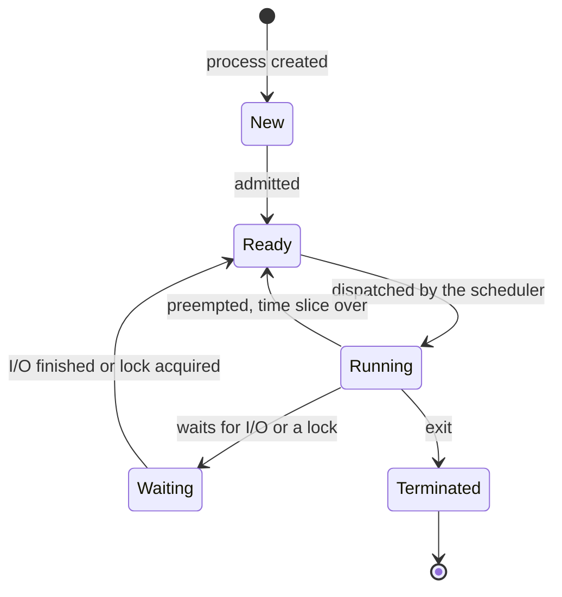

# Operating Systems Essentials

> **Tier:** T3 (essentials) · **Related:** [Ruby concurrency and the GVL](../03-languages/ruby/06-advanced-internals.md), [Node.js fundamentals](../09-nodejs-backend/01-nodejs-fundamentals.md), [Background jobs with Sidekiq](../05-ruby-on-rails/09-background-jobs-sidekiq.md), [Transactions and concurrency](../12-databases/06-transactions-and-concurrency.md), [Networking](06-networking.md), [Docker](../14-devops-and-tools/03-docker.md)
> **On your resume:** Rails apps served by Puma with Sidekiq workers, Node and TypeScript services, and Docker at Devntech: all of them are processes and threads scheduled by an operating system.

## Quick revision
- A **process** is a running program with its own address space; a **thread** is a unit of execution inside a process that shares its memory but has its own stack and registers.
- **Concurrency** is making progress on many tasks by interleaving them; **parallelism** is running tasks at the same instant on multiple cores.
- A **context switch** saves one task's CPU state and restores another's; switching processes also switches address spaces, so it costs more than switching threads.
- Process states: new, ready, running, waiting (blocked), terminated.
- Scheduling: FCFS (simple, convoy effect), SJF (lowest average wait, starvation risk), Round Robin (time slices, responsive), Priority (starvation, fixed by aging).
- A **race condition** is a result that depends on timing between unsynchronized accesses to shared data; the code touching that data is the **critical section**.
- **Mutex:** one owner at a time. **Semaphore:** a counter that admits up to N holders.
- **Deadlock** needs all four Coffman conditions: mutual exclusion, hold and wait, no preemption, circular wait. Break any one (lock ordering is the practical fix).
- **Virtual memory** gives every process a private address space mapped to physical memory in pages; a **page fault** loads a missing page; **thrashing** is paging so much that no work gets done.
- **User mode vs kernel mode:** programs request privileged work (files, sockets, processes) through **system calls**.
- **IPC:** pipes, sockets, shared memory, message queues, signals.
- Web mapping: Puma runs worker processes times threads; Sidekiq runs job threads in its own process; Node runs one JavaScript thread with an event loop plus a libuv thread pool; Ruby's GVL lets one thread run Ruby code at a time per process.

## 1. Process vs thread

| | Process | Thread |
|---|---|---|
| Memory | its own address space | shares the process heap and globals; own stack and registers |
| Creation cost | higher (`fork`, `exec`) | lower |
| Isolation | a crash is usually contained | a crash can take down the whole process |
| Communication | IPC: pipes, sockets, shared memory | shared variables, which need synchronization |
| Context switch | more expensive (address space and TLB changes) | cheaper |
| Web example | each Puma worker, each Sidekiq process | Puma's threads inside a worker, Sidekiq's job threads |

`fork()` creates a child process as a copy of the parent. Pages are shared copy-on-write until one side modifies them, which is why Puma's `preload_app!` (load the app, then fork workers) saves memory.

## 2. Concurrency vs parallelism

One cashier alternating between customers is concurrency; two cashiers serving at once is parallelism. A Node server handles thousands of connections concurrently on one JavaScript thread by never waiting idle on I/O. Ruby threads in one process are concurrent but, because of the GVL, not parallel for Ruby code; Puma gets parallelism by running several worker processes.

## 3. Context switching and process states



On a context switch the kernel saves the running task's registers, program counter and stack pointer (in the process control block), picks the next task, restores its state and, for a different process, switches page tables. The direct cost is small, but caches and the TLB go cold, so thousands of busy threads waste time switching. That is one reason thread pools are sized deliberately.

## 4. CPU scheduling

| Algorithm | How it works | Strength | Weakness |
|---|---|---|---|
| First-Come, First-Served | run in arrival order to completion | simple | convoy effect: short jobs wait behind long ones |
| Shortest Job First (or its preemptive form, SRTF) | shortest expected burst runs next | lowest average waiting time | needs burst estimates; long jobs can starve |
| Round Robin | each task gets a fixed time slice, then goes to the back of the queue | fair and responsive | tiny slices waste time switching; huge slices behave like FCFS |
| Priority | highest priority runs first | urgent work first | low-priority starvation, solved by aging (raising priority while waiting) |

General-purpose operating systems use preemptive, multilevel schemes that favor interactive tasks. The same trade-offs show up in job queues: Sidekiq queue weights decide how often each queue is checked, and one huge job can still hog a thread.

## 5. Race conditions, mutexes and semaphores

```cpp
#include <iostream>
#include <mutex>
#include <thread>
#include <vector>
using namespace std;

int counter = 0;
mutex m;

void work() {
    for (int i = 0; i < 100000; ++i) {
        lock_guard<mutex> lock(m);   // critical section: one thread at a time
        ++counter;                   // read-modify-write; without the lock, updates are lost
    }
}

int main() {
    vector<thread> threads;
    for (int t = 0; t < 4; ++t) threads.emplace_back(work);
    for (auto& th : threads) th.join();
    cout << counter << '\n';         // always 400000 with the lock; usually less without it
}
```

| | Mutex | Semaphore |
|---|---|---|
| Holders | one at a time | up to N (a binary semaphore allows 1) |
| Ownership | the thread that locked it must unlock it | no owner; any thread can signal |
| Typical use | protect a critical section | limit concurrent use of a pool (connections, API calls) |

Related tools: condition variables (wait until a condition holds), read-write locks (many readers or one writer) and atomics (`std::atomic<int>` for simple counters without a lock).

The same bugs appear one level up, between web requests: two requests read a stock count and both decrement it (lost update), or both check that an email is free and both insert it (check-then-act). Fixes are database-level: unique indexes, `SELECT ... FOR UPDATE` (`lock!` in Rails), optimistic locking with a `lock_version` column, and idempotency keys for payments. See [Transactions and concurrency](../12-databases/06-transactions-and-concurrency.md).

## 6. Deadlock, starvation and livelock

Thread A locks X and waits for Y while thread B locks Y and waits for X: neither can proceed. A deadlock requires all four conditions at once:

| Coffman condition | Meaning | How to break it |
|---|---|---|
| Mutual exclusion | a resource can be held by only one task | use shareable resources where possible (read-only data) |
| Hold and wait | a task holds one resource while waiting for another | acquire everything at once, or release before waiting |
| No preemption | resources cannot be taken away | use timeouts (`try_lock`) and back off |
| Circular wait | a cycle of tasks each waiting on the next | impose a global lock order (always X before Y) |

- **Prevention** breaks a condition by design; lock ordering is the most practical. In C++17, `std::scoped_lock both(a, b);` locks several mutexes with a deadlock-avoidance algorithm.
- **Avoidance** grants a request only if the system stays in a safe state (the Banker's algorithm), which is mostly of theoretical interest.
- **Detection and recovery** finds cycles in a wait-for graph and aborts one participant. PostgreSQL does exactly this: it aborts one transaction with a "deadlock detected" error, which the application should retry. Updating rows in a consistent order (for example sorted by id) prevents most of these.
- **Starvation:** a task waits indefinitely because others keep winning (low priority, unfair locks). **Livelock:** tasks stay busy reacting to each other but make no progress, like two people stepping aside in the same direction.

## 7. Virtual memory, paging and thrashing

Each process sees a large private address space. The OS splits it into pages (commonly 4 KB) and maps them to physical frames through page tables, with the TLB caching recent translations. Pages are loaded on demand: touching one that is not in RAM triggers a **page fault**, and the kernel loads it (from disk for a major fault) or, for an invalid address, kills the process with a segmentation fault. Benefits: isolation between processes, more virtual memory than physical RAM, and copy-on-write sharing after `fork`.

**Thrashing** happens when the combined working sets do not fit in RAM, so the system spends its time swapping pages instead of running code. In containers you usually hit a hard memory limit first: the kernel's OOM killer terminates the process, which shows up as a killed worker or exit code 137 (128 + SIGKILL). Growing Ruby process memory and too many Puma workers per container are common causes.

## 8. User mode, kernel mode and system calls

The CPU runs application code in unprivileged user mode. Anything privileged (reading files, opening sockets, creating processes, allocating memory from the OS) goes through a **system call** such as `read`, `write`, `open`, `fork`, `execve`, `mmap`, `socket` or `accept`, which switches to kernel mode and back. Each switch has overhead, which is why I/O libraries buffer. Event loops rely on kernel readiness APIs (epoll on Linux, kqueue on macOS, IOCP on Windows) to watch many sockets with one thread. On Linux, `strace` shows the system calls a process makes.

## 9. Inter-process communication

| Mechanism | What it is | Where you meet it |
|---|---|---|
| Pipes | one-way byte stream between related processes | a shell pipeline such as `ps aux` piped into `grep puma` |
| Sockets | bidirectional streams over TCP or local Unix domain sockets | Nginx talking to Puma, apps talking to Postgres and Redis |
| Shared memory | the same physical pages mapped into several processes | fastest IPC; needs explicit synchronization |
| Message queues | the OS or an external broker stores messages | Redis-backed Sidekiq queues are an application-level version |
| Signals | asynchronous notifications to a process | `SIGTERM` for graceful shutdown (it can be caught), `SIGKILL` (it cannot); Sidekiq treats `TSTP` as "stop fetching new jobs" and `TERM` as "shut down" |

## 10. How this maps to web servers

| Runtime | Model | Implication |
|---|---|---|
| Puma (Rails) | cluster mode: a master process forks worker processes, each running a thread pool | parallelism comes from workers; threads overlap on I/O; the database pool must cover the threads |
| Ruby GVL | one thread executes Ruby code at a time per process | threads help I/O-bound requests, not CPU-bound work |
| Sidekiq | separate processes, each with a configurable number of job threads pulling from Redis | job code must be thread-safe; scale with more processes |
| Node.js | one JavaScript thread runs the event loop; network I/O uses the kernel's async APIs; libuv's thread pool (4 threads by default, `UV_THREADPOOL_SIZE`) handles file system work, `dns.lookup`, some crypto and zlib | never block the loop with CPU-heavy code; use worker threads or a queue |
| Nginx | a few event-driven worker processes | handles many slow clients cheaply in front of app servers |

## Common pitfalls
- Saying threads always run in parallel; on CRuby, only one runs Ruby code at a time per process, and Node has one JavaScript thread.
- Assuming `count += 1` is atomic.
- Acquiring locks in different orders in different code paths.
- Holding a lock (or a database transaction) while making a slow network call.
- Sizing thread pools without matching the database connection pool.
- Blocking Node's event loop with CPU-heavy work such as large JSON transformations or synchronous hashing.
- Treating out-of-memory container restarts as random crashes instead of checking memory limits and the OOM killer.

## How to talk about this in an interview
- Keep definitions crisp, then connect each concept to the stack you run: Puma processes and threads, Sidekiq concurrency, Node's event loop, PostgreSQL deadlock errors, containers killed for exceeding memory.
- Operating systems were not one of the labs you assisted, so be honest that your depth here comes from coursework and production debugging rather than kernel work.
- > **Fill in:** a concurrency issue you have seen or prevented at Devntech (for example duplicate background jobs, a race on stock or payment records, or a database deadlock) and how it was handled.
- > **Fill in:** how Puma and Sidekiq are configured on your projects (workers, threads, concurrency), or where you would look to find out.

## Interview questions

**Q1. What is the difference between a process and a thread?**
A process has its own address space and resources; threads live inside a process, share its memory and have their own stacks and registers. Processes are isolated and heavier to create and switch; threads are cheaper but need synchronization for shared data. Puma workers are processes, and the threads inside each worker share its memory.
*Follow-up:* What does copy-on-write do after `fork`? Parent and child share pages until one writes, so forked workers start cheaply.

**Q2. Concurrency vs parallelism?**
Concurrency is structuring work so several tasks make progress by interleaving, even on one core. Parallelism is executing tasks simultaneously on multiple cores. Node is concurrent on one JavaScript thread; Puma with several workers is parallel.
*Follow-up:* Can you have parallelism without concurrency? Yes, for example one data-parallel computation split across cores.

**Q3. What is a deadlock, and how do you prevent it?**
A set of tasks each waiting for a resource held by another, so none proceeds. It needs mutual exclusion, hold and wait, no preemption and circular wait at the same time. Prevent it by breaking one condition, most practically with a global lock order, lock timeouts, or acquiring all locks at once.
*Follow-up:* How do databases handle it? PostgreSQL detects the cycle and aborts one transaction, which the application should retry.

**Q4. Mutex vs semaphore?**
A mutex lets one thread at a time into a critical section, and only the owner unlocks it. A semaphore is a counter that admits up to N holders and has no owner, which suits limiting concurrent access to a pool of resources.
*Follow-up:* Is a binary semaphore a mutex? It behaves similarly but lacks ownership, so any thread can release it.

**Q5. What is a race condition, and how do you fix one?**
A bug where the outcome depends on the timing of unsynchronized access to shared state, such as two threads incrementing a counter or two requests decrementing the same stock. Fix it with locks or atomics in code, and with unique constraints, row locks, optimistic locking or idempotency keys in the database.
*Follow-up:* Does Ruby's GVL prevent races? No; a thread switch can happen between the read and the write.

**Q6. What are virtual memory and page faults, and what is thrashing?**
Virtual memory gives each process a private address space mapped to physical frames in pages, loaded on demand. A page fault occurs when a process touches a page that is not in RAM, and the OS loads it or kills the process for an invalid address. Thrashing is when the system spends most of its time paging because the working sets do not fit in memory.
*Follow-up:* What does exit code 137 in a container usually mean? The process was killed with SIGKILL, typically by the OOM killer.

**Q7. What is the difference between user mode and kernel mode, and what is a system call?**
User mode runs application code without direct hardware access; kernel mode runs the OS with full privileges. A system call is the controlled entry point from user code into the kernel for operations like reading files, opening sockets or creating processes.
*Follow-up:* Why are system calls relatively expensive? Each involves a mode switch and checks, which is why I/O is buffered.

**Q8. How do Puma and Node.js handle many concurrent requests?**
Puma forks worker processes and runs a thread pool in each; while one thread waits on the database, the GVL lets another run, and multiple workers give true parallelism. Node runs one JavaScript thread with an event loop that registers callbacks for I/O and uses libuv's thread pool for blocking tasks like file access and some crypto.
*Follow-up:* What kills Node throughput? CPU-heavy synchronous code that blocks the event loop.

**Q9. What happens during a context switch, and why can too many threads hurt?**
The kernel saves the current task's registers, program counter and stack pointer, chooses another task, restores its state and, for a different process, switches page tables. Beyond the direct cost, caches and the TLB lose locality, so huge numbers of runnable threads spend more time switching than working.
*Follow-up:* How do servers avoid that? Fixed-size thread pools, event loops and asynchronous I/O.

**Q10. Starvation vs deadlock vs livelock?**
In a deadlock, tasks are blocked forever waiting on each other. In starvation, one task never gets the resource because others keep winning, often due to priorities or unfair locks. In livelock, tasks keep changing state in response to each other without making progress.
*Follow-up:* How does aging fix starvation? It gradually raises the priority of tasks that have waited a long time.

## Further reading
- [Node.js: the event loop, timers and process.nextTick](https://nodejs.org/en/learn/asynchronous-work/event-loop-timers-and-nexttick)
- [Rails guides: threading and code execution](https://guides.rubyonrails.org/threading_and_code_execution.html)
