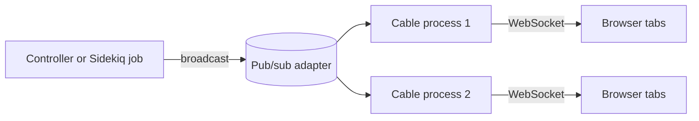

# Action Cable, Action Mailer and Active Storage

> **Tier:** T1 (know cold) · **Related:** [Hotwire](08-hotwire-turbo-stimulus.md), [Realtime and WebSockets](../04-web-fundamentals/09-realtime-websockets.md), [Background jobs](09-background-jobs-sidekiq.md), [Caching, performance and security](14-caching-performance-security.md), [Push notifications](../08-react-native-expo/05-push-notifications.md), [Colochousing](../17-projects-deep-dive/02-colochousing-web-and-api.md)
> **On your resume:** the Colochousing Rails 7 web app and API (house events, tasks, bills and rent reminders that need emails, uploads and live updates), Sidekiq for background delivery, and Hotwire from the Visnext training.

## Quick revision
- **Action Cable** = WebSockets inside Rails. A **connection** (one per browser tab) is authenticated once; **channels** are like controllers for topics; a subscription **streams** from named pub/sub topics; the server **broadcasts** JSON to a stream from anywhere (controller, model, job).
- `identified_by :current_user` + `reject_unauthorized_connection` in `ApplicationCable::Connection`; authenticate with the session cookie (`cookies.signed`, or `env["warden"].user` with Devise).
- `stream_from "house_5"` uses a literal name; `stream_for house` derives the name from a record and pairs with `HouseChannel.broadcast_to(house, data)`. Authorize in `subscribed` and call `reject` when not allowed.
- Adapters (`config/cable.yml`): `async` (development, single process), `redis` (classic production choice), `postgresql` (LISTEN/NOTIFY), `solid_cable` (Rails 8 default, database-backed and polled).
- Scaling: capacity is about concurrent sockets; pub/sub is fire-and-forget, so clients refetch state after reconnecting; consider a standalone cable server or AnyCable at scale.
- Turbo Stream broadcasts (`broadcasts_to`, `turbo_stream_from`) are Action Cable underneath.
- **Action Mailer:** mailer classes plus views (`.html.erb` and `.text.erb` = multipart); parameterized `RentMailer.with(payment: p).reminder`; `deliver_later` (job, serialized args, use after commit) vs `deliver_now` (synchronous).
- Previews at `/rails/mailers`; interceptors rewrite or block mail (staging); delivery via SMTP or provider gems; `default_url_options[:host]` for links; test with `ActionMailer::Base.deliveries` and `have_enqueued_mail`.
- **Active Storage:** `has_one_attached` / `has_many_attached`; tables for blobs (file metadata), attachments (polymorphic join) and variant records; services in `config/storage.yml` (Disk, S3, GCS, Mirror).
- **Direct uploads:** the browser asks Rails for a signed URL, PUTs the file straight to S3, then submits only the blob's `signed_id`. Needs bucket CORS; saves app servers from streaming big files.
- Variants: `variant(:thumb)` or `variant(resize_to_limit: [300, 300])`, generated lazily with image_processing (libvips by default since Rails 7.0).
- Default blob URLs redirect to short-lived service URLs, but the redirect URL itself has no authorization: serve private files through your own authorized controller.
- N+1: `Listing.with_attached_photos`; no built-in type or size validations, so validate `content_type` and `byte_size` yourself.
- **Action Text:** `has_rich_text :description`, the Trix editor, sanitized rendering, `with_rich_text_description` to preload.

## 1. How Action Cable works

| Piece | What it is |
|---|---|
| Cable server | Handles WebSockets at `/cable`, inside Puma or as a standalone process |
| Connection | One WebSocket per browser tab; authenticated once in `connect` |
| Channel | A Ruby class per topic (`HouseChannel`), like a controller |
| Subscription | A client joining a channel with params (`house_id: 5`) |
| Stream | A named pub/sub topic a subscription listens to |
| Broadcast | Publishing a message to a stream; every subscriber on every process receives it |
| Pub/sub adapter | Redis, PostgreSQL or Solid Cable, which carries broadcasts between processes |



A broadcast can come from any process (a web request, a job, the console). It goes through the pub/sub adapter, so every cable process receives it and pushes it to the clients subscribed to that stream. WebSocket fundamentals (handshake, frames, polling vs SSE) are in [realtime and WebSockets](../04-web-fundamentals/09-realtime-websockets.md).

## 2. Connections and authentication

```ruby
# app/channels/application_cable/connection.rb
module ApplicationCable
  class Connection < ActionCable::Connection::Base
    identified_by :current_user                    # available in every channel of this connection

    def connect
      self.current_user = find_verified_user || reject_unauthorized_connection
    end

    private

    def find_verified_user
      Session.find_by(id: cookies.signed[:session_id])&.user   # Rails 8 auth generator cookie
      # Devise apps: env["warden"].user
    end
  end
end
```

- The WebSocket handshake is an HTTP request, so the browser sends your cookies and the connection can reuse the web session.
- Native clients may not have cookies; a common approach is a short-lived, single-purpose token in the connection URL, filtered from logs.
- Set `config.action_cable.allowed_request_origins` in production so other sites cannot open sockets with your users' cookies (cross-site WebSocket hijacking).

## 3. Channels, streams and broadcasting

```ruby
# app/channels/house_channel.rb
class HouseChannel < ApplicationCable::Channel
  def subscribed
    house = current_user.houses.find_by(id: params[:house_id])
    return reject unless house                     # authorize every subscription
    stream_for house                               # stream name derived from the record
  end

  def mark_read(data)                              # called by the client: subscription.perform("mark_read", ...)
    current_user.task_reads.find_or_create_by!(task_id: data["task_id"])
  end
end

# Anywhere on the server, typically after commit or in a job:
HouseChannel.broadcast_to(house, { type: "task.created", task_id: task.id, title: task.title })
ActionCable.server.broadcast("announcements", { body: "Maintenance tonight" })  # for stream_from "announcements"
```

```js
// app/javascript/channels/house_channel.js
import consumer from "./consumer"   // createConsumer() from @rails/actioncable; path depends on importmap or bundler

const subscription = consumer.subscriptions.create(
  { channel: "HouseChannel", house_id: 5 },
  {
    connected() {},                 // socket ready (also after a reconnect)
    disconnected() {},              // the consumer retries automatically
    received(data) {
      if (data.type === "task.created") addTaskToList(data)
    },
  }
)
subscription.perform("mark_read", { task_id: 12 })
```

- Broadcast IDs and small payloads, or rendered HTML (Turbo Streams); do not broadcast data the subscriber is not allowed to see. Stream names must encode the audience (per house, per user), because everyone on a stream gets everything.
- Broadcast after commit (`after_create_commit`) or from a job, so clients never receive data that later rolls back.

## 4. Pub/sub adapters

| Adapter | Use | Notes |
|---|---|---|
| `async` | Development and tests | In-process only; broadcasts from a job process never arrive |
| `redis` | Production, the long-time default | Fast pub/sub; no message history |
| `postgresql` | Production without Redis | `LISTEN`/`NOTIFY`; payload size is limited (around 8 KB) |
| `solid_cable` | Rails 8 default | Messages stored in a database table and polled; keeps messages for a retention window |
| `test` | Tests | Lets you assert broadcasts |

```yaml
# config/cable.yml
development:
  adapter: async
test:
  adapter: test
production:
  adapter: redis
  url: <%= ENV.fetch("REDIS_URL", "redis://localhost:6379/1") %>
  channel_prefix: myapp_production
# Rails 8 default instead:
#   adapter: solid_cable
#   polling_interval: 0.1.seconds
#   message_retention: 1.day
```

## 5. Scaling and operating Action Cable

- **Capacity is concurrent sockets**, not requests per second: each open connection costs memory and a file descriptor, even when idle.
- Channel actions run on Action Cable's own worker pool (`config.action_cable.worker_pool_size`) and use database connections; include them when sizing the pool.
- At scale, run cable as a **standalone server** (a separate Puma process serving `cable/config.ru`) so WebSocket load cannot starve HTTP requests, or use **AnyCable**, which moves socket handling to a separate high-performance server while keeping your channel code.
- **Pub/sub is fire-and-forget:** a client that was offline misses messages. On `connected()`, refetch the current state (or use Turbo 8 page refreshes) instead of assuming you saw every event.
- Load balancers and proxies must allow WebSocket upgrades and keep idle connections open longer than Action Cable's heartbeat (a ping every few seconds).
- Mobile apps only hold sockets while in the foreground; for anything a resident must see while the app is closed, send a push notification (see [push notifications](../08-react-native-expo/05-push-notifications.md)).

## 6. Turbo Stream broadcasts and testing channels

`broadcasts_to :house` on a model plus `<%= turbo_stream_from @house %>` in a view is Action Cable underneath: the server renders a partial and broadcasts a Turbo Stream that Turbo applies to the page, so you write no channel or JavaScript. Details, `_later` variants and morphing refreshes are in [Hotwire](08-hotwire-turbo-stimulus.md).

```ruby
RSpec.describe HouseChannel, type: :channel do
  let(:resident) { create(:resident) }

  it "streams for the resident's house" do
    stub_connection current_user: resident
    subscribe(house_id: resident.house.id)
    expect(subscription).to be_confirmed
    expect(subscription).to have_stream_for(resident.house)
  end

  it "rejects another house" do
    stub_connection current_user: resident
    subscribe(house_id: create(:house).id)
    expect(subscription).to be_rejected
  end
end
# Broadcasts: expect { create_task }.to have_broadcasted_to(house).from_channel(HouseChannel)
```

## 7. Action Mailer

```ruby
class ApplicationMailer < ActionMailer::Base
  default from: "Example Homes <no-reply@example.com>"
  layout "mailer"
end

# bin/rails generate mailer Rent reminder
class RentMailer < ApplicationMailer
  def reminder
    @payment = params[:payment]                    # parameterized mailer: RentMailer.with(payment: p)
    @resident = @payment.resident
    mail(to: email_address_with_name(@resident.email, @resident.full_name),
         subject: "Rent due on #{I18n.l(@payment.due_on)}")
  end
end
```

```erb
<%# app/views/rent_mailer/reminder.html.erb (plus reminder.text.erb for the plain-text part) %>
<p>Hi <%= @resident.first_name %>,</p>
<p>Your rent of <%= number_to_currency(@payment.amount_cents / 100.0, unit: "€") %> is due on <%= l(@payment.due_on) %>.</p>
<p><%= link_to "Pay now", payment_url(@payment) %></p>   <%# _url, not _path: emails need absolute links %>
```

Having both `.html.erb` and `.text.erb` produces a multipart email automatically. Mailers have no request, so set `config.action_mailer.default_url_options = { host: "app.example.com", protocol: "https" }` for `*_url` helpers.

| | `deliver_now` | `deliver_later` |
|---|---|---|
| When it sends | Immediately, in the current process | Enqueues `ActionMailer::MailDeliveryJob` through Active Job |
| Request impact | Adds provider latency; a provider error fails the request | Fast; failures are retried by the job backend |
| Arguments | Live objects | Serialized (records as GlobalID), so they must be committed and still exist |
| Use it | In the console, in tests, inside a job already running in the background | From requests and callbacks (after commit) |

`RentMailer.with(payment: payment).reminder.deliver_later(wait: 1.hour)` delays delivery; `wait_until:` and `queue:` also work. Enqueue from `after_commit` (or after the transaction) so the job never runs before the payment row exists.

## 8. Previews, interceptors, providers and testing

```ruby
# test/mailers/previews/rent_mailer_preview.rb (folder is configurable; RSpec apps often use spec/mailers/previews)
class RentMailerPreview < ActionMailer::Preview
  def reminder
    RentMailer.with(payment: RentPayment.first).reminder     # open /rails/mailers/rent_mailer/reminder
  end
end

# Staging: never email real residents
class StagingEmailInterceptor
  def self.delivering_email(message)
    message.subject = "[STAGING to #{message.to.join(', ')}] #{message.subject}"
    message.to = ["qa@example.com"]
  end
end
ActionMailer::Base.register_interceptor(StagingEmailInterceptor) if Rails.env.staging?   # in an initializer
```

- **Delivery:** `config.action_mailer.delivery_method = :smtp` with `smtp_settings` (address, port 587, user_name and password from credentials, `authentication: :plain`, `enable_starttls_auto: true`) works with SendGrid, Mailgun, Postmark or SES; provider gems add API-based delivery methods. In development, the letter_opener gem opens mail in the browser instead of sending it.
- **Deliverability:** configure SPF, DKIM and DMARC for the sending domain, or messages land in spam.
- **Testing:** the test environment uses `delivery_method = :test`, so sent mail collects in `ActionMailer::Base.deliveries`; mailer specs build the message and check `to`, `subject` and body; `have_enqueued_mail(RentMailer, :reminder)` asserts enqueueing (see [testing](13-testing-rspec.md)).

## 9. Active Storage: attachments

```ruby
# bin/rails active_storage:install && bin/rails db:migrate
# Tables: active_storage_blobs (key, filename, content_type, byte_size, checksum, service_name),
#         active_storage_attachments (name, record_type, record_id, blob_id), active_storage_variant_records
class Resident < ApplicationRecord
  has_one_attached :avatar                      # dependent: :purge_later by default
end

class Listing < ApplicationRecord
  has_many_attached :photos do |attachable|
    attachable.variant :thumb, resize_to_limit: [300, 300]   # named variant
  end
end

params.expect(listing: [:title, photos: []])    # attach through mass assignment from a form
listing.photos.attach(io: File.open("front.jpg"), filename: "front.jpg", content_type: "image/jpeg")
resident.avatar.attached?                       # => true
resident.avatar.purge_later                     # delete the file and blob in a job
```

Assigning `photos` through params replaces the existing set; call `attach` to append. A blob is the file's metadata and storage key; an attachment is the polymorphic join row linking a blob to any record, so no attachment columns are added to your tables.

## 10. Storage services

```yaml
# config/storage.yml
local:
  service: Disk
  root: <%= Rails.root.join("storage") %>

amazon:
  service: S3
  access_key_id: <%= Rails.application.credentials.dig(:aws, :access_key_id) %>
  secret_access_key: <%= Rails.application.credentials.dig(:aws, :secret_access_key) %>
  region: eu-west-1
  bucket: myapp-production

google:
  service: GCS
  project: myapp
  credentials: <%= Rails.root.join("config/gcs.json") %>
  bucket: myapp-production

mirror:                                   # write to both while migrating providers
  service: Mirror
  primary: amazon
  mirrors: [google]
```

Choose per environment with `config.active_storage.service = :amazon` in `production.rb`. S3 needs the aws-sdk-s3 gem and GCS the google-cloud-storage gem. S3-compatible providers (Cloudflare R2, DigitalOcean Spaces, MinIO) use the S3 service with an `endpoint`. Never use the Disk service with several app servers or ephemeral containers.

## 11. Direct uploads

Without direct uploads, a 20 MB photo travels browser -> Rails -> S3, tying up a Puma thread for the whole transfer and risking request timeouts. With them:

1. Active Storage's JavaScript computes the file's checksum and POSTs its metadata to `/rails/active_storage/direct_uploads`.
2. Rails creates the blob record and returns a short-lived signed upload URL plus headers.
3. The browser PUTs the bytes straight to S3 (or GCS).
4. The form submits only the blob's `signed_id`, and the attachment is created like any other.

```erb
<%= form_with model: @listing do |form| %>
  <%= form.file_field :photos, multiple: true, direct_upload: true %>
  <%= form.submit %>
<% end %>
```

```js
import * as ActiveStorage from "@rails/activestorage"
ActiveStorage.start()            // also emits direct-upload events you can use for progress bars
```

```json
[
  {
    "AllowedOrigins": ["https://app.example.com"],
    "AllowedMethods": ["PUT"],
    "AllowedHeaders": ["Content-Type", "Content-MD5", "Content-Disposition"],
    "MaxAgeSeconds": 3600
  }
]
```

- The bucket needs a CORS rule like the one above, or the browser blocks the PUT.
- The built-in endpoint does not check who the user is. For mobile apps or stricter control, expose your own authenticated endpoint that calls `ActiveStorage::Blob.create_before_direct_upload!` and returns the blob's `signed_id`, `service_url_for_direct_upload` and `service_headers_for_direct_upload`; the app uploads, then sends the `signed_id` to `attach`.
- Abandoned uploads leave unattached blobs; clean them up with a scheduled job: `ActiveStorage::Blob.unattached.where(created_at: ..2.days.ago).find_each(&:purge_later)`.

## 12. Variants and image processing

```erb
<%= image_tag listing.photos.first.variant(:thumb) %>
<%= image_tag resident.avatar.variant(resize_to_fill: [96, 96], format: :webp) %>
```

- Needs the image_processing gem plus libvips (the default processor since Rails 7.0) or ImageMagick.
- Variants are generated lazily: the first request for a variant processes and stores it (tracked in `active_storage_variant_records`), later requests reuse it. Rails 7.1+ can generate named variants right after upload with `preprocessed: true`.
- `resize_to_limit` keeps the aspect ratio within a box; `resize_to_fill` crops to exactly fill it.
- PDFs and videos get previews through `representation` when the right tools (poppler, ffmpeg) are installed.

## 13. URLs, access control and private files

`url_for(listing.photos.first)` (or `rails_blob_path(photo, disposition: "attachment")`) produces `/rails/active_storage/blobs/redirect/<signed_id>/front.jpg`, which redirects to a signed service URL that expires after a few minutes (`config.active_storage.service_urls_expire_in`).

The catch: the Rails URL with the signed blob ID does not expire by default and performs no authorization, so anyone who has the link can fetch the file. That is fine for listing photos, not for leases, ID documents or invoices.

```ruby
class DocumentsController < ApplicationController
  def show
    document = current_user.house.documents.find(params[:id])          # authorization first
    redirect_to document.file.url(expires_in: 5.minutes, disposition: "attachment"),
                allow_other_host: true                                  # needed for the storage host (Rails 7.0+)
  end
end
```

- For strictly private files you can turn off the default routes (`config.active_storage.draw_routes = false`) so every access goes through your controllers.
- Proxy mode (`rails_storage_proxy_path`) streams files through your app, so a CDN can cache them under your domain.
- Public buckets: `public: true` on a service in `storage.yml` gives permanent public URLs, appropriate only for truly public assets.

## 14. N+1, validations and cleanup

```ruby
@listings = current_store.listings.with_attached_photos.limit(50)   # preloads attachments and blobs
@residents = house.residents.with_attached_avatar

class Listing < ApplicationRecord
  validate :acceptable_photos

  private

  def acceptable_photos
    photos.each do |photo|
      errors.add(:photos, "must be JPEG, PNG or WebP") unless photo.content_type.in?(%w[image/jpeg image/png image/webp])
      errors.add(:photos, "must be under 10 MB") if photo.byte_size > 10.megabytes
    end
  end
end
```

- Without `with_attached_*`, every `photo.url` or `attached?` in a loop queries attachments and blobs. Variants add lookups in `active_storage_variant_records`; check the guide for preloading them in your version when rendering many thumbnails.
- Active Storage has no built-in type or size validations; write them (as above) or use the active_storage_validations gem, and do not rely on a client-supplied content type for anything security-sensitive.
- `purge` deletes immediately; `purge_later` deletes in a job. Destroying a record purges its attachments later by default.

## 15. Action Text, briefly

```ruby
# bin/rails action_text:install
class Event < ApplicationRecord
  has_rich_text :description          # stored in action_text_rich_texts, not in the events table
end
```

```erb
<%= form.rich_text_area :description %>   <%# Trix editor; uploads embedded images through Active Storage %>
<%= @event.description %>                 <%# rendered as sanitized HTML %>
```

Preload with `Event.with_rich_text_description` to avoid N+1s in lists, and use `@event.description.to_plain_text` for previews, push notifications and search.

## Common pitfalls
- No `reject` in `subscribed`, so any user can subscribe to any house's stream by changing the ID.
- Broadcasting before commit, or broadcasting data the audience may not see.
- Using the `async` adapter in production, so broadcasts from Sidekiq never reach browsers.
- Assuming clients receive every message; not refetching state after reconnects.
- `deliver_now` in requests (slow, fails the request) or `deliver_later` inside an open transaction.
- `_path` helpers in emails, or no `default_url_options` host.
- Staging environments emailing real users because no interceptor or sandbox is configured.
- Disk storage on multiple servers or containers; files vanish on redeploy.
- Private documents served through permanent blob URLs.
- Lists of images without `with_attached_*`; no type or size validation; orphaned direct-upload blobs piling up.

## How to talk about this in an interview
- Colochousing has natural fits for all three frameworks: rent reminder and application emails delivered by Sidekiq, photos and documents for houses and residents, and live updates for events, tasks or bills. Describe what the app really uses and what you would design differently.
- Connect realtime web features with mobile: WebSockets for the open web page, push notifications for the resident app when it is in the background.
- For uploads, explain the direct-upload flow and private-file authorization; they show you think about server load and data protection.
- If you have not run Action Cable in production, say so and talk through the scaling concerns you would plan for.

> **Fill in:** which emails the Colochousing app sends, how they are delivered (provider, `deliver_later` through Sidekiq) and how they are tested or previewed.

> **Fill in:** where Active Storage (or another upload solution) is used, which storage service backs it, and whether uploads are direct.

> **Fill in:** whether any live updates exist (Action Cable, Turbo Streams, polling) and how the resident app gets notified instead.

## Interview questions

**Q1. How does Action Cable work?**
It adds WebSockets to Rails. Each browser opens one connection to `/cable`, authenticated in `ApplicationCable::Connection`; clients subscribe to channels, which stream from named topics; server code broadcasts messages to a stream, and a pub/sub adapter (Redis, PostgreSQL or Solid Cable) delivers them to every cable process, which pushes them to subscribed clients.
*Follow-up:* Why is an adapter needed? Broadcasts often come from other processes (jobs, other servers) than the one holding the socket.

**Q2. How do you authenticate an Action Cable connection?**
In `connect`, read the session cookie (signed session ID, or Warden's user with Devise), set `current_user` via `identified_by`, and call `reject_unauthorized_connection` when there is none. Restrict `allowed_request_origins` in production.
*Follow-up:* And for native clients without cookies? A short-lived token in the connection URL, filtered from logs.

**Q3. What is the difference between `stream_from` and `stream_for`, and where do you authorize?**
`stream_from "announcements"` listens to a literal stream name; `stream_for house` derives a name from a record and pairs with `HouseChannel.broadcast_to(house, data)`. Authorize in `subscribed`: look up the house through the current user and `reject` if it is not found.
*Follow-up:* What if you skip that check? Anyone can subscribe to any house by changing the ID in the subscription params.

**Q4. Redis, PostgreSQL or Solid Cable?**
Redis is fast pub/sub and the long-time standard; PostgreSQL uses LISTEN/NOTIFY with small payload limits; Solid Cable (Rails 8 default) stores messages in a database table that servers poll, removing Redis at the cost of polling latency and database load. `async` is for development only.
*Follow-up:* Why does `async` break with Sidekiq? It is in-process, so broadcasts from the job process never reach the web process.

**Q5. How do you scale Action Cable?**
Plan for concurrent connections (memory and file descriptors), run it as a standalone server or with AnyCable at scale, size the database pool for channel actions, make the load balancer WebSocket-friendly, and design clients to refetch state after reconnecting because pub/sub does not replay missed messages.
*Follow-up:* What about mobile apps in the background? Use push notifications instead of sockets.

**Q6. How do Turbo Stream broadcasts relate to Action Cable?**
`turbo_stream_from` subscribes the page through Action Cable, and model broadcasts (`broadcasts_to`, `broadcast_append_later_to`) render a partial into a Turbo Stream and broadcast it; Turbo applies it to the DOM. You get realtime updates without writing channels or JavaScript.
*Follow-up:* Why use the `_later` variants? Rendering happens in a background job, keeping the request fast.

**Q7. What is the difference between `deliver_later` and `deliver_now`?**
`deliver_now` sends synchronously in the current process; `deliver_later` enqueues a delivery job through Active Job, serializing arguments (records as GlobalID) so it runs later with retries. Use `deliver_later` from requests, and enqueue after commit so the job finds the record.
*Follow-up:* When is `deliver_now` right? Inside a job that already runs in the background, in the console, or in tests.

**Q8. How do you preview and test emails?**
`ActionMailer::Preview` classes render messages at `/rails/mailers` during development (letter_opener can open real deliveries locally). In tests the `:test` delivery method collects mail in `ActionMailer::Base.deliveries`; mailer specs check recipients, subject and body, and `have_enqueued_mail` checks enqueueing.
*Follow-up:* Why test the text part too? Some clients show only plain text, and a broken text template still fails delivery.

**Q9. How do you stop a staging server from emailing real users?**
Register an interceptor that rewrites recipients to a team inbox (and tags the subject), or use a sandbox provider or letter_opener-style delivery in non-production environments.
*Follow-up:* Observers vs interceptors? Interceptors run before delivery and can change the message; observers run after delivery for logging.

**Q10. How does Active Storage store files?**
The file goes to a storage service (Disk, S3, GCS); a blob row stores its key, filename, content type, size and checksum; an attachment row joins the blob to any record polymorphically by name. `has_one_attached` and `has_many_attached` add the associations, so your tables need no file columns.
*Follow-up:* How do you switch providers safely? The Mirror service writes to both while you copy existing files.

**Q11. How do Active Storage direct uploads work, and why use them?**
The browser posts file metadata to Rails, receives a signed upload URL, PUTs the file directly to the storage service, then submits only the blob's `signed_id` with the form. App servers never stream the bytes, avoiding blocked Puma threads and timeouts on large files; it requires CORS on the bucket.
*Follow-up:* What about mobile clients? Same flow through your own authenticated endpoint that creates the blob and returns the signed URL and headers.

**Q12. How do variants work?**
`attachment.variant(resize_to_limit: [300, 300])` or a named variant describes a transformation; on first request Active Storage processes the original with image_processing (libvips or ImageMagick), stores the result and records it, then serves the stored copy afterwards.
*Follow-up:* How do you avoid slow first loads? Preprocess named variants after upload (Rails 7.1+ `preprocessed: true`) or warm them in a job.

**Q13. How do you protect private files?**
Do not hand out the default blob URLs, which do not expire and do not authorize. Serve files through your own controller that checks access and then redirects to a short-lived service URL (or streams the file), and optionally disable the default routes.
*Follow-up:* Are signed service URLs enough by themselves? They expire quickly, which limits sharing, but authorization still has to happen before you issue one.

**Q14. How do you avoid N+1 queries with attachments?**
Preload with `with_attached_photos` (attachments and blobs) or the equivalent `includes(photos_attachments: :blob)`, and be aware that variants add their own lookups when rendering many thumbnails.
*Follow-up:* And for Action Text? `with_rich_text_<name>`.

**Q15. How do you validate uploads?**
Custom validations on `content_type` and `byte_size` (Active Storage has none built in) or the active_storage_validations gem, limits on the number of files, and processing images server-side rather than trusting client metadata.
*Follow-up:* Where else do you enforce limits? In the direct-upload endpoint before issuing a URL, and in bucket policies.

**Q16. What is Action Text?**
Rich text content for any model via `has_rich_text`, edited with Trix, stored in its own polymorphic table, with embedded images handled by Active Storage and output sanitized on render.
*Follow-up:* How do you show a plain preview? `to_plain_text`.

## Further reading
- [Action Cable Overview](https://guides.rubyonrails.org/action_cable_overview.html)
- [Action Mailer Basics](https://guides.rubyonrails.org/action_mailer_basics.html)
- [Active Storage Overview](https://guides.rubyonrails.org/active_storage_overview.html)
- [Action Text Overview](https://guides.rubyonrails.org/action_text_overview.html)
