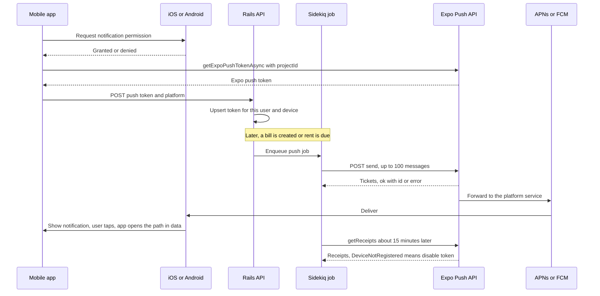

# Push Notifications

> **Tier:** T1 (know cold) · **Related:** [Navigation and deep links](03-navigation-expo-router.md), [State, storage and auth](04-state-storage-auth-offline.md), [EAS credentials](08-eas-build-submit-update.md), [Sidekiq background jobs](../05-ruby-on-rails/09-background-jobs-sidekiq.md), [Rails API development](../05-ruby-on-rails/10-api-development.md), [Background processing patterns](../13-architecture-and-practices/06-background-processing-patterns.md), [Coloc resident app](../17-projects-deep-dive/03-coloc-resident-app.md)
> **On your resume:** push notifications in the Coloc resident app (React Native, Expo), backed by the Colochousing Rails 7 REST API with Sidekiq.

## Quick revision
- End to end: ask permission, get a push token, send it to the backend, store tokens per user and device, send from a background job through the Expo Push API (or APNs/FCM directly), read tickets and receipts, clean up dead tokens.
- **Expo push token** (`ExponentPushToken[...]`) from `getExpoPushTokenAsync({ projectId })`: one format and one HTTP API for both platforms. **Native token** from `getDevicePushTokenAsync()` when you send through APNs or FCM yourself.
- **APNs** (Apple): token-based `.p8` key (Key ID + Team ID, does not expire), sandbox vs production environments. **FCM** (Google): HTTP v1 API with a service account; the legacy server-key API was shut down in 2024. EAS stores both credentials (`eas credentials`).
- Android 13+ needs the runtime `POST_NOTIFICATIONS` permission, and the prompt only appears once a notification channel exists: create channels first.
- iOS asks once. After a denial only Settings can change it (`Linking.openSettings()`). **Provisional** authorization delivers quietly to Notification Center without a prompt.
- `setNotificationHandler` decides what happens when a notification arrives **in the foreground** (banner, sound, badge). Without it, foreground notifications are not shown.
- Listeners: `addNotificationReceivedListener` (arrived while the app is open), `addNotificationResponseReceivedListener` (user tapped). For taps that launched a killed app, read the last notification response at startup.
- Local notifications: `scheduleNotificationAsync({ content, trigger })` with typed triggers (`SchedulableTriggerInputTypes.DATE`, `TIME_INTERVAL`, `DAILY`...). iOS keeps at most 64 pending.
- Android channels group notifications (rent, events, tasks); users control each channel, and the app cannot raise a channel's importance after creating it.
- Deep link on tap: put an internal path in `data` (`{ url: '/bills/12' }`) and `router.push` it.
- Expo Push API: up to **100 messages per request**, tickets come back in the same order; check **receipts** about 15 minutes later (up to 1000 IDs per request); on `DeviceNotRegistered` stop sending to that token.
- Rails: fan out one Sidekiq job per chunk so a retry never resends other chunks; raise on HTTP 429 and 5xx to get Sidekiq's backoff; keep payloads small and free of sensitive data.
- Testing needs a development build on a physical device; Expo Go has no Android remote push from SDK 53.
- Classic bugs: token rotation, duplicates after reinstall or user switch, no foreground handler, cold-start taps ignored, wrong channel, grey square icon on Android.

## 1. The end-to-end architecture



In words:
1. The app asks for permission at a moment that makes sense ("Get notified when a housemate adds a bill?").
2. The OS registers the app with APNs or FCM and hands it a native token; `getExpoPushTokenAsync` exchanges that for an Expo push token tied to your EAS project.
3. The app sends the token to the Rails API, which stores it per user and per device (one user often has a phone and a tablet).
4. When something happens (a bill is created, rent is due), the API enqueues a Sidekiq job instead of calling Expo inside the web request.
5. The job sends messages in chunks of up to 100 to the Expo Push API and gets one **ticket** per message.
6. Expo forwards each message to APNs or FCM, which deliver it to the device. Delivery is best effort: not guaranteed, not instant, and possibly collapsed.
7. Later, the job fetches **receipts** for the ticket IDs to learn whether APNs and FCM accepted the messages, and disables tokens that are no longer registered.
8. The user taps the notification and the app opens the screen named in the payload.

## 2. APNs and FCM fundamentals

| | APNs (Apple) | FCM (Google) |
|---|---|---|
| Device identifier | APNs device token, per app install | FCM registration token |
| Server authentication | Token-based `.p8` key with Key ID and Team ID, never expires (legacy certificates expire yearly) | HTTP v1 API with a Google service account key (OAuth 2); legacy server keys were shut down in 2024 |
| App setup | Push Notifications capability and the `aps-environment` entitlement | `google-services.json` in the app (`android.googleServicesFile` in the app config) |
| Environments | Sandbox for development builds, production for TestFlight and App Store | One environment |
| With Expo | EAS can create and store the push key (during `eas build` or with `eas credentials`) | Upload the service account key for FCM V1 to EAS with `eas credentials` |

Payloads on both are limited to about 4 KB. Both services can throttle or drop notifications, especially silent ones, so never rely on push alone for anything important: also show the information inside the app (an in-app notification list backed by the API).

## 3. Expo push tokens vs native device tokens

| | Expo push token | Native device token |
|---|---|---|
| Get it with | `getExpoPushTokenAsync({ projectId })` | `getDevicePushTokenAsync()` |
| Send through | Expo Push API: one HTTP endpoint for both platforms | APNs and FCM directly, or Firebase Admin SDK, or a vendor such as OneSignal |
| Pros | Simple, one payload format, tickets and receipts, Expo handles platform credentials | No intermediary, every platform feature, no dependency on Expo's service |
| Cons | An extra hop and Expo's rate limits | Two integrations, credential handling, APNs environments |

For a small team, the Expo Push API is the pragmatic choice. Moving to direct FCM/APNs later means changing only the sending job and the token type.

## 4. Registering a device

```ts
// lib/push.ts
import * as Notifications from 'expo-notifications';
import * as Device from 'expo-device';
import Constants from 'expo-constants';
import { Platform } from 'react-native';

export async function getPushTokenAsync(): Promise<string | null> {
  if (!Device.isDevice) return null; // use a physical device for remote push

  if (Platform.OS === 'android') {
    // Create channels before asking: on Android 13+ the prompt only appears once a channel exists
    await Notifications.setNotificationChannelAsync('default', {
      name: 'General',
      importance: Notifications.AndroidImportance.DEFAULT,
    });
    await Notifications.setNotificationChannelAsync('payments', {
      name: 'Rent and bills',
      importance: Notifications.AndroidImportance.HIGH,
    });
  }

  const current = await Notifications.getPermissionsAsync();
  let allowed = current.granted || current.ios?.status === Notifications.IosAuthorizationStatus.PROVISIONAL;
  if (!allowed && current.canAskAgain) {
    allowed = (await Notifications.requestPermissionsAsync()).granted;
  }
  if (!allowed) return null; // respect the choice; offer a Settings button elsewhere

  const projectId = Constants.expoConfig?.extra?.eas?.projectId ?? Constants.easConfig?.projectId;
  if (!projectId) throw new Error('EAS projectId missing from the app config');
  const { data } = await Notifications.getExpoPushTokenAsync({ projectId });
  return data; // "ExponentPushToken[...]"
}
```

```ts
// lib/use-push-registration.ts: run while signed in
import { useEffect } from 'react';
import { Platform } from 'react-native';
import * as Notifications from 'expo-notifications';
import { api } from './api';
import { getPushTokenAsync } from './push';

async function registerWithBackend() {
  const token = await getPushTokenAsync();
  if (!token) return;
  await api('/api/v1/push_token', { method: 'POST', body: JSON.stringify({ token, platform: Platform.OS }) });
}

export function usePushRegistration(isSignedIn: boolean) {
  useEffect(() => {
    if (!isSignedIn) return;
    registerWithBackend().catch((e) => console.warn('Push registration failed', e)); // upsert on every launch
    // The native token can rotate; fetch a fresh Expo token and upsert again
    const sub = Notifications.addPushTokenListener(() => {
      registerWithBackend().catch(() => undefined);
    });
    return () => sub.remove();
  }, [isSignedIn]);
}
```

Ask with context, not on first launch: a short in-app explanation before the system prompt (a "soft ask") gets far more opt-ins, and on iOS you only get one system prompt.

## 5. Foreground handling, listeners and cold starts

```ts
// At module scope, for example in app/_layout.tsx, before any notification can arrive
import * as Notifications from 'expo-notifications';

Notifications.setNotificationHandler({
  handleNotification: async () => ({
    shouldShowBanner: true, // SDK 53+ field names; older SDKs used shouldShowAlert
    shouldShowList: true,
    shouldPlaySound: false,
    shouldSetBadge: false,
  }),
});
```

| App state when the notification arrives | What happens | Your code |
|---|---|---|
| Foreground | Nothing is shown unless the handler allows it | `setNotificationHandler`; `addNotificationReceivedListener` to refresh data, such as invalidating the bills query |
| Background | The OS shows it; your JS does not run | Handle the tap with `addNotificationResponseReceivedListener` |
| Killed | The OS shows it; a tap launches the app | Read the last notification response at startup (`getLastNotificationResponseAsync()` or the `useLastNotificationResponse()` hook) |

Listeners return subscriptions: call `.remove()` in effect cleanups, or you collect duplicate listeners and handle each tap twice. The navigation code for taps is in [Navigation and Expo Router](03-navigation-expo-router.md).

## 6. Local notifications

```ts
export async function scheduleEventReminder(event: { id: number; title: string; startsAt: Date }) {
  const fireAt = new Date(event.startsAt.getTime() - 60 * 60 * 1000); // one hour before
  if (fireAt <= new Date()) return null;
  return Notifications.scheduleNotificationAsync({
    content: { title: `${event.title} starts in 1 hour`, body: 'Tap for details', data: { url: `/events/${event.id}` } },
    trigger: { type: Notifications.SchedulableTriggerInputTypes.DATE, date: fireAt, channelId: 'default' },
  });
}
// Store the returned id: Notifications.cancelScheduledNotificationAsync(id) when the RSVP or time changes
```

| | Local (scheduled on the device) | Remote (sent by the server) |
|---|---|---|
| Works offline | Yes | No |
| Changes after scheduling | You must cancel and reschedule on the device | The server always sends current data |
| Other devices and accounts | Only this device; clear on logout | Every registered device of the user |
| Limits | iOS keeps at most 64 pending | Provider rate limits |
| Good for | Personal reminders the user set | Anything triggered by other people or by the backend |

The typed `trigger` objects with a `type` field come from recent SDKs (around SDK 52); older code passed bare objects such as `{ seconds: 60 }`.

## 7. Android channels and badges

- **Channels** (Android 8+): every notification belongs to a channel, and the user controls sound, vibration and importance per channel. Plan channels by what users want to mute separately: payments, events, tasks, general. The app cannot change a channel's importance after creating it; to change it, create a channel with a new ID. Send `channelId` in each push message.
- **Badges:** `Notifications.setBadgeCountAsync(n)` locally, or `badge` in the payload (iOS). Derive the count from the server's unread count and reset it when the user opens the relevant screen. Android launchers vary in badge support.
- **Android icon:** the small notification icon must be a white-on-transparent image, configured through the `expo-notifications` config plugin (`icon`, `color`); otherwise it shows as a grey square.

## 8. Deep linking on tap

Keep payloads small and navigational:

```json
{
  "to": "ExponentPushToken[xxxxxxxxxxxxxxxxxxxxxx]",
  "title": "New shared bill",
  "body": "Groceries: your share is 12.40",
  "data": { "url": "/bills/12" },
  "sound": "default",
  "channelId": "payments"
}
```

The app validates that `url` is an internal path and pushes it with Expo Router. Never put secrets or full personal details in the payload: it is visible on the lock screen and passes through Apple, Google and Expo. Send an ID and load the details from the API after authentication.

## 9. The Rails backend

Data model: one row per device token, owned by the user who registered it last.

```ruby
# db/migrate/20250101000000_create_push_tokens.rb
class CreatePushTokens < ActiveRecord::Migration[7.0]
  def change
    create_table :push_tokens do |t|
      t.references :user, null: false, foreign_key: true
      t.string :token, null: false
      t.string :platform, null: false # "ios" or "android"
      t.datetime :last_registered_at, null: false
      t.datetime :disabled_at
      t.timestamps
    end
    add_index :push_tokens, :token, unique: true
  end
end

# app/models/push_token.rb
class PushToken < ApplicationRecord
  belongs_to :user
  scope :active, -> { where(disabled_at: nil) }
end
```

```ruby
# config/routes.rb: resource :push_token, only: %i[create destroy]
class Api::V1::PushTokensController < Api::V1::BaseController
  # Upsert: a token moves to whoever is signed in on that device now
  def create
    push_token = PushToken.find_or_initialize_by(token: params.require(:token))
    push_token.update!(user: current_user, platform: params.require(:platform),
                       last_registered_at: Time.current, disabled_at: nil)
    head :no_content
  end

  # Called on logout so the next user of the phone does not get this user's notifications
  def destroy
    current_user.push_tokens.where(token: params.require(:token)).delete_all
    head :no_content
  end
end
```

The HTTP client raises on errors that deserve a retry, so Sidekiq's exponential backoff handles them:

```ruby
# app/clients/expo_push_client.rb
require "net/http"

module ExpoPushClient
  class RetryableError < StandardError; end

  def self.post(uri, payload)
    headers = { "Content-Type" => "application/json", "Accept" => "application/json" }
    token = ENV["EXPO_ACCESS_TOKEN"] # needed only if "enhanced push security" is enabled
    headers["Authorization"] = "Bearer #{token}" if token.present?

    response = Net::HTTP.start(uri.host, uri.port, use_ssl: true, open_timeout: 5, read_timeout: 15) do |http|
      http.post(uri.path, JSON.generate(payload), headers)
    end

    code = response.code.to_i
    raise RetryableError, "Expo returned #{code}" if code == 429 || code >= 500
    raise "Expo returned #{code}: #{response.body}" unless response.is_a?(Net::HTTPSuccess)

    JSON.parse(response.body)
  end
end
```

Fan out: one small job per chunk of 100 tokens, so a failure in chunk 7 retries only chunk 7 instead of resending chunks 1 to 6 (Sidekiq jobs run at least once, so design for retries):

```ruby
# app/jobs/notify_users_job.rb
class NotifyUsersJob
  include Sidekiq::Job
  sidekiq_options queue: :push

  # payload uses string keys only: Sidekiq arguments must be plain JSON types
  def perform(user_ids, payload)
    PushToken.active.where(user_id: user_ids).in_batches(of: 100) do |batch|
      SendPushChunkJob.perform_async(batch.pluck(:id), payload)
    end
  end
end

# app/jobs/send_push_chunk_job.rb
class SendPushChunkJob
  include Sidekiq::Job
  sidekiq_options queue: :push, retry: 8

  SEND_URL = URI("https://exp.host/--/api/v2/push/send")

  def perform(token_ids, payload)
    tokens = PushToken.active.where(id: token_ids).to_a
    return if tokens.empty?

    messages = tokens.map do |t|
      { to: t.token, title: payload["title"], body: payload["body"], data: { url: payload["url"] },
        sound: "default", channelId: payload.fetch("channel", "default") }
    end

    tickets = ExpoPushClient.post(SEND_URL, messages).fetch("data") # same order as messages
    receipt_map = {}

    tokens.zip(tickets).each do |token, ticket|
      if ticket["status"] == "ok"
        receipt_map[ticket["id"]] = token.id
      elsif ticket.dig("details", "error") == "DeviceNotRegistered"
        token.update!(disabled_at: Time.current) # app uninstalled or token invalid
      else
        Rails.logger.warn("Expo ticket error for push_token=#{token.id}: #{ticket['message']}")
      end
    end

    CheckPushReceiptsJob.perform_in(15.minutes, receipt_map) if receipt_map.any?
  end
end

# app/jobs/check_push_receipts_job.rb
class CheckPushReceiptsJob
  include Sidekiq::Job
  sidekiq_options queue: :push, retry: 5

  RECEIPTS_URL = URI("https://exp.host/--/api/v2/push/getReceipts")

  # receipt_map: { "receipt-id" => push_token_id }
  def perform(receipt_map)
    receipt_map.keys.each_slice(1000) do |ids|
      receipts = ExpoPushClient.post(RECEIPTS_URL, { ids: ids }).fetch("data")
      receipts.each do |receipt_id, receipt|
        next if receipt["status"] == "ok"

        case receipt.dig("details", "error")
        when "DeviceNotRegistered"
          PushToken.where(id: receipt_map[receipt_id]).update_all(disabled_at: Time.current)
        when "MessageTooBig", "InvalidCredentials", "MismatchSenderId"
          Rails.logger.error("Push misconfiguration: #{receipt['message']}") # alert: needs a code or config fix
        else
          Rails.logger.warn("Push receipt error: #{receipt['message']}")
        end
      end
    end
  end
end
```

Triggering it: `NotifyUsersJob.perform_async(bill.participant_ids, { "title" => "New shared bill", "body" => "...", "url" => "/bills/#{bill.id}", "channel" => "payments" })`, enqueued after the transaction commits (for example from an `after_create_commit` callback or a service object) so the job never runs before the bill exists.

Operational notes:
- **Rate limits:** Expo enforces a per-project send rate (its docs give the number) and returns `429` when exceeded; the retryable error plus Sidekiq backoff absorbs bursts. A dedicated `push` queue with limited concurrency keeps big fan-outs from starving other jobs. Sidekiq Enterprise has rate limiters; the open-source version relies on queue concurrency.
- **Receipts** become available after a delay (Expo suggests checking after about 15 minutes) and are kept only for a limited time (about a day), so do not wait too long.
- **Preferences:** let users mute categories in the app and respect them in `NotifyUsersJob`; also store an in-app notification record so nothing important lives only in a push.
- See [Sidekiq background jobs](../05-ruby-on-rails/09-background-jobs-sidekiq.md) for retries, idempotency and queues.

### Going deeper: sending directly through FCM and APNs
Direct sending uses the native token from `getDevicePushTokenAsync()`. FCM HTTP v1 needs an OAuth access token minted from a service account; APNs needs a JWT signed with the `.p8` key, an HTTP/2 connection and the right environment (a sandbox token sent to production fails with `BadDeviceToken`). You gain platform features (notification service extensions for rich media, critical alerts, fine-grained collapse keys) at the cost of two integrations to maintain.

## 10. Testing push notifications

- Use a **development build on a physical device**. Expo Go has no Android remote push from SDK 53, and simulator support is limited.
- Send a test message with Expo's push notification tool on its website, or with curl:

```bash
curl -H "Content-Type: application/json" -X POST "https://exp.host/--/api/v2/push/send" \
  -d '{"to":"ExponentPushToken[xxxxxxxxxxxxxxxxxxxxxx]","title":"Test","body":"Hello","data":{"url":"/bills/12"}}'
```

- Test every app state: foreground (handler), background (tap opens the screen), killed (cold-start tap), and logged out (tap waits until login).
- Test permission paths: first prompt, denied, denied forever (Settings link), iOS provisional, Android 13+ prompt after channel creation.
- Test identity changes: reinstall (new token), logout and login as another user on the same phone (no notifications for the old user), and a second device for the same user.
- Development builds talk to the APNs sandbox; TestFlight and App Store builds use production, so do a final check on a TestFlight build.

## 11. Common bugs

| Symptom | Likely cause | Fix |
|---|---|---|
| Nothing shows while the app is open | No `setNotificationHandler` | Set it at module scope |
| Tap does nothing when the app was killed | Only a live listener, no last-response check | Read the last response at startup |
| Duplicate notifications | Old tokens kept after reinstall, a token registered for two users on a shared phone, retries resending whole batches, or local plus remote for the same event | Upsert by token, unregister on logout, chunked jobs, one source per notification type |
| Handled twice per tap | Listeners added without cleanup | Remove subscriptions in effect cleanups |
| Users stop receiving notifications | Token rotated and never re-registered | Register on every launch and on token changes |
| Android permission prompt never appears | No channel created before requesting (Android 13+) | Create channels first |
| Grey square icon on Android | Icon not configured or not monochrome | Set `icon` and `color` in the `expo-notifications` plugin |
| iOS user "denied" but receives quiet notifications | Provisional authorization | Check `ios.status` for `PROVISIONAL` alongside `granted` |
| `getExpoPushTokenAsync` throws | Missing `projectId` | Pass `Constants.expoConfig?.extra?.eas?.projectId` |
| Works in development, fails in production | Missing FCM V1 or APNs credentials for the production app | Check `eas credentials` for that bundle ID |

## 12. Use cases in a co-living app

| Trigger | Recipients | Timing | Tap opens |
|---|---|---|---|
| Event published, event reminder | House members, attendees | On publish; before start (scheduled job or local notification) | `/events/:id` |
| Task assigned or due | The assignee | On assignment; morning of the due date | `/tasks/:id` |
| Bill split request | Bill participants | When the bill is created | `/bills/:id` |
| Rent due, payment failed or confirmed | The resident | Days before the due date; on payment webhooks | `/payments` |

Reminders like "rent due in 3 days" usually come from a scheduled job (sidekiq-cron or a similar scheduler) that finds due charges and enqueues `NotifyUsersJob`, so the server stays the source of truth.

## Common pitfalls
- Asking for permission on first launch with no context, burning the single iOS prompt.
- Forgetting the foreground handler, then assuming push "does not work".
- Calling Expo synchronously inside a Rails request, slowing the request and losing messages on errors.
- One giant job for thousands of tokens, so one failure resends everything.
- Never reading receipts, so dead tokens pile up and delivery quietly degrades.
- Sensitive data (amounts with names, private messages) in the notification body or payload.
- Not unregistering on logout, so a shared phone keeps getting the previous user's notifications.
- Testing only in Expo Go or only in the foreground.

## How to talk about this in an interview
- Draw the pipeline: permission, token, backend storage, job, Expo Push API, APNs/FCM, tap handling, receipts. Then go deep on one part, such as fan-out with Sidekiq or cold-start tap handling.
- Connect it to the Coloc resident app: push notifications were a listed feature, with a Rails 7 API and Sidekiq on the backend. Explain the design you know, and fill in what you personally built.
- Mention the failure modes you plan for (rotated tokens, duplicates, rate limits); interviewers like candidates who think beyond the happy path.

> **Fill in:** whether the app uses Expo push tokens or native FCM/APNs tokens, and how the backend sends them (Sidekiq job, gem, direct HTTP).

> **Fill in:** which events trigger notifications in the resident app, and which part you built (client registration, tap handling, backend job).

> **Fill in:** one push bug you investigated (missing notifications, duplicates, wrong screen on tap) and how you fixed it.

## Interview questions

**Q1. Walk me through push notifications end to end.**
The app asks permission, gets a push token (an Expo token via `getExpoPushTokenAsync({ projectId })`, or a native APNs/FCM token) and posts it to the API, which stores it per user and device. When an event happens, the API enqueues a background job that sends chunks of up to 100 messages to the Expo Push API, which forwards them to APNs or FCM. The job reads tickets immediately and receipts later, disabling tokens reported as `DeviceNotRegistered`. On the device, a foreground handler decides how to display it, and a tap opens the path in the payload.
*Follow-up:* Why a background job? Sending is slow and can fail; a job keeps requests fast and retries safely.

**Q2. Expo push token or native FCM/APNs token?**
The Expo token works with one HTTP API for both platforms, and Expo manages the platform credentials and gives tickets and receipts. Native tokens let you call FCM and APNs directly with no intermediary and full platform features, but you maintain two integrations and the APNs environments. Small teams usually start with Expo.
*Follow-up:* Can you switch later? Yes; the app sends a different token type and the backend job changes, the rest stays.

**Q3. What credentials do iOS and Android push need, and how does EAS help?**
iOS needs an APNs key (`.p8`, with Key ID and Team ID) and the push entitlement; Android needs `google-services.json` in the app and an FCM V1 service account key for sending. EAS can generate and store the APNs key and holds the FCM key, so the Expo Push API can send on your behalf; you manage them with `eas credentials`.
*Follow-up:* What happened to FCM server keys? The legacy FCM API was shut down in 2024; use HTTP v1.

**Q4. How do you handle a notification that arrives while the app is in the foreground?**
By default nothing is shown, so call `setNotificationHandler` at module scope and return whether to show a banner, play a sound or set the badge (`shouldShowBanner` and `shouldShowList` in SDK 53+, `shouldShowAlert` before). Use `addNotificationReceivedListener` to refresh data, for example invalidating the bills query when a bill notification arrives.
*Follow-up:* Would you always show a banner in the foreground? Not if the user is already on the relevant screen; update it in place instead.

**Q5. How do you open the right screen when a notification is tapped, even if the app was killed?**
Put an internal path in `data`. Register `addNotificationResponseReceivedListener` for taps while the app runs, and on startup read the last notification response for the tap that launched the app. Validate the path, wait for the session, then `router.push` it.
*Follow-up:* What if the user is logged out? Keep the path and navigate after login.

**Q6. What are Android notification channels, and why plan them?**
Since Android 8, every notification belongs to a channel, and users control sound, vibration and importance per channel. Planning channels by category (payments, events, tasks) lets users mute events without missing rent reminders. The app cannot raise a channel's importance after creation, so changes require a new channel ID.
*Follow-up:* What do channels have to do with Android 13 permissions? The permission prompt appears only after the app has created a channel.

**Q7. Local or remote notifications: when do you use each?**
Local notifications are scheduled on the device and work offline, ideal for personal reminders; they must be rescheduled when data changes and exist only on that device (iOS caps pending ones at 64). Remote notifications come from the server, reflect current data and reach all of the user's devices, so they suit anything triggered by other people or by backend state.
*Follow-up:* An event's time changes after reminders were scheduled. Cancel the old local notification by its ID and schedule a new one, or let the server send reminders.

**Q8. How does a Rails backend send pushes reliably at scale?**
Enqueue a job after the triggering transaction commits; that job fans out one Sidekiq job per chunk of 100 tokens, so a retry resends only one chunk. Each chunk job posts to the Expo Push API, raises on 429 and 5xx to use Sidekiq's exponential backoff, processes tickets and schedules a receipts check. A dedicated queue with limited concurrency keeps fan-outs from starving other work.
*Follow-up:* Why after commit? Otherwise the job can run before the bill exists or after a rollback.

**Q9. What are push tickets and receipts, and what do you do with DeviceNotRegistered?**
A ticket is Expo's immediate answer per message: accepted with an ID, or an error. A receipt, fetched later with the ticket IDs, says whether APNs or FCM accepted the message. `DeviceNotRegistered` means the app was uninstalled or the token is invalid, so disable the token and stop sending to it.
*Follow-up:* Which errors need human attention? `InvalidCredentials`, `MismatchSenderId` and `MessageTooBig`: they mean configuration or payload bugs, not device problems.

**Q10. Why might users receive duplicate notifications?**
Several tokens for the same device (an old token never cleaned up after reinstall), one token attached to two accounts on a shared phone, a retried job resending a whole batch, or both a local and a remote notification for the same event. Fix with token upserts, unregistering on logout, per-chunk jobs and one source per notification type.
*Follow-up:* Duplicate taps handled twice? Listeners registered without cleanup; remove subscriptions on unmount.

**Q11. The user denied notification permission. What now?**
Respect it: on iOS the system prompt will not appear again, and on Android 11+ two denials have the same effect. Explain the value in the UI where it matters and offer a button that calls `Linking.openSettings()`; re-check the permission when the app returns to the foreground and register the token if it was granted.
*Follow-up:* How do you improve opt-in rates? Ask at a meaningful moment with a soft prompt first, or use iOS provisional authorization.

**Q12. What is iOS provisional authorization?**
Since iOS 12, an app can request provisional authorization and deliver notifications quietly to Notification Center without showing a prompt; the user then chooses to keep or turn them off from the notification itself. Check `ios.status === IosAuthorizationStatus.PROVISIONAL`, because `granted` alone does not reflect it.
*Follow-up:* When is it useful? Low-urgency notifications where you want users to see the value before committing.

**Q13. How do you test push notifications?**
On a development build on a real device: send through Expo's push tool or curl, then cover foreground, background, killed, logged-out, denied and provisional states, token rotation after reinstall, and switching users on one phone. Do a final check on a TestFlight build because production uses the production APNs environment.
*Follow-up:* Why not Expo Go? It lacks Android remote push from SDK 53 and does not use your app's identity or credentials.

**Q14. When do push tokens change, and how do you keep the backend in sync?**
Tokens can change on reinstall, restore to a new device, clearing app data on Android or token rotation by the platform. Register on every launch (the API upserts by token and reassigns the user), listen with `addPushTokenListener` to re-register, and disable tokens that tickets or receipts report as unregistered.
*Follow-up:* Why upsert instead of insert? The same token must not create duplicates or remain attached to a previous user.

**Q15. Can you rely on silent or data-only notifications to run code?**
No. iOS throttles background pushes and does not deliver them to an app the user force-quit; Android may delay data messages under battery restrictions. Use them for opportunistic refreshes only, and keep the source of truth on the server, fetched when the app opens.
*Follow-up:* What about guaranteed reminders? Visible notifications plus an in-app list, or local notifications for user-owned schedules.

**Q16. What should and should not go into a push payload?**
A short title and body, a category or channel, and navigational data such as an internal path or ID. Not secrets, tokens or detailed personal or financial information, since the content appears on the lock screen and passes through Apple, Google and Expo. Load details from the API after the user opens the app.
*Follow-up:* What limits the size? About 4 KB on APNs and FCM; Expo returns `MessageTooBig` above that.

## Further reading
- [Expo push notifications overview](https://docs.expo.dev/push-notifications/overview/)
- [Sending notifications with the Expo Push API](https://docs.expo.dev/push-notifications/sending-notifications/)
- [expo-notifications reference](https://docs.expo.dev/versions/latest/sdk/notifications/)
- [Sidekiq best practices](https://github.com/sidekiq/sidekiq/wiki/Best-Practices)
