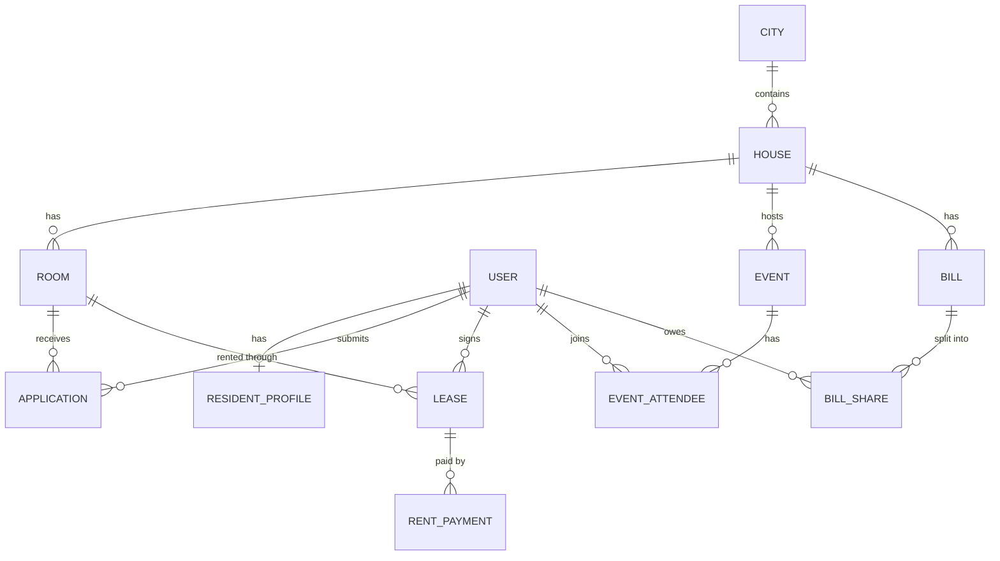

# DBMS Fundamentals and Data Modeling

> **Tier:** T1 (know cold) · **Related:** [SQL from zero](02-sql-from-zero.md), [Transactions and concurrency](06-transactions-and-concurrency.md), [MongoDB schema design](09-mongodb-schema-design-aggregation-mongoose.md), [ActiveRecord associations](../05-ruby-on-rails/04-activerecord-associations.md), [E-commerce domain](../13-architecture-and-practices/07-ecommerce-domain.md)
> **On your resume:** SQL, PostgreSQL, MySQL and MongoDB skills; Databases lab TA at PUCIT; the data models behind CrystalCommerce (catalog, sales channels) and Colochousing (houses, applications, rent payments).

## Quick revision
- **DB** = the organized data. **DBMS** = the software that stores, queries and protects it. **RDBMS** = a DBMS built on the relational model (tables, keys, SQL): PostgreSQL, MySQL, SQL Server.
- Relation = table, tuple = row, attribute = column, domain = allowed values. Rows have no inherent order.
- **Super key**: any column set that uniquely identifies a row. **Candidate key**: a minimal super key. **Primary key**: the candidate you pick (NOT NULL, unique, one per table). **Alternate key**: the other candidates (enforce with UNIQUE).
- **Foreign key**: a column that must match a key in another table. ON DELETE: `NO ACTION` (default) / `RESTRICT` block the delete, `CASCADE` deletes children, `SET NULL` / `SET DEFAULT` detach them.
- **Surrogate key** (`id bigint` identity, UUID) vs **natural key** (email, ISBN). Use surrogates as PKs and put UNIQUE constraints on natural keys.
- Primary key vs UNIQUE: both unique; PK is NOT NULL and one per table; UNIQUE allows NULLs (several NULLs in Postgres by default) and you can have many.
- Cardinality: 1:1 (UNIQUE foreign key), 1:N (foreign key on the "many" side), M:N (junction table with two foreign keys).
- **1NF** atomic values, no repeating groups. **2NF** 1NF + no partial dependency on part of a composite key. **3NF** 2NF + no transitive dependency (non-key depends only on the key). **BCNF** every determinant is a candidate key. **4NF** no independent multi-valued facts in one table.
- Anomalies that normalization removes: **update** (same fact in many rows), **insert** (cannot store a fact without an unrelated one), **delete** (deleting one fact loses another).
- Denormalize deliberately for read speed: counter caches, cached totals, reporting tables, materialized views. Always keep a source of truth and a way to rebuild.
- **ACID**: Atomicity, Consistency, Isolation, Durability (details in [06](06-transactions-and-concurrency.md)).
- **OLTP** = many small reads/writes (your app's Postgres). **OLAP** = big scans and aggregates (warehouse, columnar).
- **View** = saved query, always fresh, no storage. **Materialized view** = stored result, fast, stale until `REFRESH`.
- Triggers and stored procedures keep logic close to data but hide it from app code; most app teams use them sparingly (audit logs, `updated_at`, hard invariants).

## 1. DB vs DBMS vs RDBMS

A **database** is just organized, persistent data. A **DBMS** is the software that manages it and gives you things a folder of files cannot: a query language, concurrent access, transactions, crash recovery, access control and integrity rules.

An **RDBMS** stores data as relations (tables) and enforces keys and constraints. Non-relational DBMSs (MongoDB, Redis, Cassandra) store documents, key-value pairs or wide rows instead.

| | File system | DBMS | RDBMS |
|---|---|---|---|
| Structure | Whatever your code writes | Defined by the engine | Tables with typed columns |
| Concurrency | Your problem | Locks, MVCC | Locks, MVCC |
| Integrity | Your problem | Varies | Keys, FKs, CHECK, transactions |
| Query | Read and parse files | Engine API | SQL |
| Examples | CSV, JSON files | MongoDB, Redis | PostgreSQL, MySQL, SQL Server, SQLite |

## 2. The relational model

E. F. Codd's model (1970) says: store data as **relations** (sets of tuples), refer between them by **values** (keys), not pointers, and query with set operations.

| Formal term | Everyday term |
|---|---|
| Relation | Table |
| Tuple | Row (record) |
| Attribute | Column (field) |
| Domain | Type plus allowed values |
| Degree | Number of columns |
| Cardinality | Number of rows (also used for relationship types, see section 5) |

Consequences you rely on daily: rows have **no guaranteed order** (always `ORDER BY`), duplicates are prevented only by keys, and every value should be atomic.

## 3. Keys

Use a `users` table with columns `id`, `email`, `cnic`, `name`:

| Key type | Definition | Example |
|---|---|---|
| Super key | Any set of columns that uniquely identifies a row | `{id}`, `{id, name}`, `{email, name}` |
| Candidate key | A super key with no removable column | `{id}`, `{email}`, `{cnic}` |
| Primary key | The candidate key you choose as the main identifier | `id` |
| Alternate key | Candidate keys not chosen as primary | `email`, `cnic` (add UNIQUE) |
| Foreign key | Column(s) referencing a key in another (or the same) table | `orders.user_id -> users.id` |
| Composite key | A key made of 2+ columns | `(event_id, user_id)` in a junction table |
| Surrogate key | Meaningless generated value | identity `bigint`, UUID |
| Natural key | Value with business meaning | email, ISBN, SKU |

**Surrogate vs natural.** Natural keys change (people change emails, SKUs get renamed) and are often wide strings, so every foreign key copying them gets heavier and every change cascades. Surrogates never change and keep joins cheap. The common rule: surrogate primary key plus a UNIQUE constraint on the natural key, so you still cannot insert duplicates.

**Integer vs UUID surrogates.** `bigint` identity is small and ordered (good B-tree locality) but guessable and needs the database to generate it. UUIDs can be generated anywhere (mobile offline, distributed systems) and hide counts, but are 16 bytes and, as random v4, scatter index inserts. Time-ordered UUIDs (v7) fix most of the locality problem. See [PostgreSQL types](04-postgresql.md).

## 4. Constraints

Constraints are rules the database enforces on every write, from every client. Application validations (Rails `validates`, Zod) give friendly errors; constraints give guarantees, because two concurrent requests can both pass an app-level check.

```sql
CREATE TABLE users (
  id         bigint GENERATED ALWAYS AS IDENTITY PRIMARY KEY,
  email      text NOT NULL UNIQUE,
  role       text NOT NULL DEFAULT 'resident' CHECK (role IN ('resident', 'manager', 'admin')),
  age        integer CHECK (age >= 18),          -- NULL passes a CHECK (unknown is not false)
  created_at timestamptz NOT NULL DEFAULT now()
);

CREATE TABLE applications (
  id      bigint GENERATED ALWAYS AS IDENTITY PRIMARY KEY,
  user_id bigint NOT NULL REFERENCES users(id) ON DELETE CASCADE,
  room_id bigint REFERENCES rooms(id) ON DELETE SET NULL,
  status  text NOT NULL DEFAULT 'submitted'
);
```

| ON DELETE option | What happens to child rows when the parent is deleted | Typical use |
|---|---|---|
| `NO ACTION` (default) | Delete fails if children exist (checked at end of statement, can be deferred) | Safe default |
| `RESTRICT` | Delete fails immediately, cannot be deferred | Financial records, orders |
| `CASCADE` | Children are deleted too | Junction rows, comments of a deleted post |
| `SET NULL` | FK column becomes NULL (column must be nullable) | Optional links: "assigned manager" |
| `SET DEFAULT` | FK column gets its default | Rare |

`ON UPDATE` has the same options but matters only when key values change, which surrogate keys never do.

Two details interviewers like: a UNIQUE column in Postgres accepts **many NULLs** by default (NULL is not equal to NULL; PostgreSQL 15 added `UNIQUE NULLS NOT DISTINCT` to change that), and a CHECK constraint passes when the expression is NULL.

Rails note: `dependent: :destroy` on a `has_many` deletes children in Ruby (callbacks run, one query per child), while `ON DELETE CASCADE` deletes them inside the database (fast, no callbacks). Pick one owner for the rule and be consistent.

## 5. ER modeling

### 5.1 Building blocks
- **Entity**: a thing you store facts about (User, House). **Weak entity**: cannot exist without its owner (a Room only makes sense inside a House).
- **Attributes**: simple (`name`), composite (`address` = street + city), derived (`age` from `birth_date`, usually not stored), multivalued (phone numbers, which become a separate table).
- **Relationship cardinality**:

| Type | Example | How you implement it |
|---|---|---|
| 1:1 | user and resident_profile | FK with UNIQUE on one side (`resident_profiles.user_id UNIQUE`) |
| 1:N | house has many rooms | FK on the "many" side (`rooms.house_id`) |
| M:N | users attend many events, events have many users | Junction table `event_attendees(event_id, user_id)` |

- **Participation**: total (every room must belong to a house, so `house_id NOT NULL`) or partial (a room may have no current lease).
- A junction table often carries its own data (an RSVP status, a share amount, a role). Once it has data, give it a real name (`memberships`, `bill_shares`) and in Rails use `has_many :through` rather than `has_and_belongs_to_many`.

### 5.2 Worked model A: a co-living platform (illustrative)

A typical design for a co-living product with houses, rooms, applications, leases, rent, events and split bills. It is an exercise, not a description of any real system.



| Relationship | Type | Implementation |
|---|---|---|
| City to houses, house to rooms | 1:N | `houses.city_id`, `rooms.house_id` (NOT NULL) |
| User to resident profile | 1:1 | `resident_profiles.user_id` UNIQUE |
| User and room through applications | M:N with data | `applications(user_id, room_id, status, submitted_at)` |
| User and room through leases | M:N over time | `leases(user_id, room_id, starts_on, ends_on, rent_cents)` |
| Lease to rent payments | 1:N | `rent_payments.lease_id` |
| Users and events | M:N | `event_attendees(event_id, user_id, rsvp)` |
| Bill and users (split bills) | M:N with data | `bill_shares(bill_id, user_id, amount_cents, paid_at)` |

```sql
CREATE TABLE event_attendees (
  event_id bigint NOT NULL REFERENCES events(id) ON DELETE CASCADE,
  user_id  bigint NOT NULL REFERENCES users(id)  ON DELETE CASCADE,
  rsvp     text   NOT NULL DEFAULT 'going' CHECK (rsvp IN ('going', 'maybe', 'declined')),
  PRIMARY KEY (event_id, user_id)              -- composite key: one RSVP per user per event
);

CREATE TABLE bill_shares (
  id           bigint GENERATED ALWAYS AS IDENTITY PRIMARY KEY,
  bill_id      bigint  NOT NULL REFERENCES bills(id) ON DELETE CASCADE,
  user_id      bigint  NOT NULL REFERENCES users(id),
  amount_cents integer NOT NULL CHECK (amount_cents >= 0),
  paid_at      timestamptz,
  UNIQUE (bill_id, user_id)
);

CREATE TABLE rent_payments (
  id           bigint GENERATED ALWAYS AS IDENTITY PRIMARY KEY,
  lease_id     bigint  NOT NULL REFERENCES leases(id) ON DELETE RESTRICT,  -- never cascade money
  period       date    NOT NULL,                                          -- first day of the month
  amount_cents integer NOT NULL CHECK (amount_cents > 0),
  status       text    NOT NULL CHECK (status IN ('pending', 'succeeded', 'failed'))
);

-- Failed attempts may repeat, but only one successful payment per lease per month:
CREATE UNIQUE INDEX one_paid_rent_per_period
  ON rent_payments (lease_id, period) WHERE status = 'succeeded';
```

Design decisions worth saying out loud: money as integer cents (or `numeric`), never floats; RESTRICT on financial rows; a **partial unique index** turns "no double rent payment" into a database guarantee (the concurrency side is in [06](06-transactions-and-concurrency.md)); lease dates make occupancy queryable over time instead of overwriting `rooms.tenant_id`.

### 5.3 Worked model B: a multi-store catalog with external sales channels (illustrative)

A typical design for a platform hosting many stores that share one product catalog and sell on their own website plus external marketplaces. Again an exercise, not a real schema.

| Table | Purpose | Key constraints |
|---|---|---|
| `stores` | Tenants | `slug` UNIQUE |
| `categories` | Tree via `parent_id` (self-referencing FK) | |
| `products` | Shared catalog item (one row per real-world product) | UNIQUE on an external catalog ID if you import one |
| `inventory_items` | A store's stock of a product: condition, price, quantity | UNIQUE `(store_id, product_id, condition)`, CHECK `quantity >= 0` |
| `channels` | Sales channels: own website, marketplace A, marketplace B | `code` UNIQUE |
| `channel_listings` | An inventory item published on a channel | UNIQUE `(channel_id, external_listing_id)` |
| `orders`, `order_items` | Orders from any channel | UNIQUE `(channel_id, external_order_id)` |
| `market_prices` | Price history per product from a pricing source | UNIQUE `(product_id, source, captured_on)` |

```sql
CREATE TABLE channel_listings (
  id                  bigint GENERATED ALWAYS AS IDENTITY PRIMARY KEY,
  inventory_item_id   bigint NOT NULL REFERENCES inventory_items(id) ON DELETE CASCADE,
  channel_id          bigint NOT NULL REFERENCES channels(id),
  external_listing_id text,                    -- NULL until the channel confirms
  sync_status         text NOT NULL DEFAULT 'pending',
  last_synced_at      timestamptz,
  UNIQUE (inventory_item_id, channel_id),      -- one listing per item per channel
  UNIQUE (channel_id, external_listing_id)     -- the external ID maps to exactly one row
);
```

Why it is shaped this way: stores and products are M:N through `inventory_items` (a junction table with a lot of payload). Inventory items and channels are M:N through `channel_listings`. The UNIQUE constraints on external IDs make background sync jobs **idempotent**: re-importing the same marketplace order becomes an upsert instead of a duplicate (see [upserts in PostgreSQL](04-postgresql.md) and [third-party API integration](../13-architecture-and-practices/05-third-party-api-integration.md)). `order_items` copies the unit price at purchase time, because the catalog price will change and the order must not.

## 6. Normalization

Normalization organizes columns so each fact is stored once. It is driven by **functional dependencies** (FDs): `A -> B` means "knowing A determines B".

### 6.1 The running example
A course-registration sheet from an LMS, before any design:

| student_id | student_name | enrollments |
|---|---|---|
| 1 | Ali | DB101 Databases (Dr. Khan, room 12): A; WEB201 Web Dev (Ms. Sara, room 7): B |
| 2 | Hina | DB101 Databases (Dr. Iqbal, room 3): B+ |

Business rules (the FDs): `student_id -> student_name`, `course_code -> course_title`, `(student_id, course_code) -> instructor, grade`, `instructor -> room`, and each instructor teaches exactly one course, so `instructor -> course_code` (DB101 has two instructors, Dr. Khan and Dr. Iqbal).

### 6.2 1NF: atomic values, no repeating groups
The `enrollments` cell holds a list, so you cannot index, filter or constrain it. Make one row per student per course and give the table a key, `(student_id, course_code)`:

| student_id | student_name | course_code | course_title | instructor | room | grade |
|---|---|---|---|---|---|---|
| 1 | Ali | DB101 | Databases | Dr. Khan | 12 | A |
| 1 | Ali | WEB201 | Web Dev | Ms. Sara | 7 | B |
| 2 | Hina | DB101 | Databases | Dr. Iqbal | 3 | B+ |
| 3 | Omar | DB101 | Databases | Dr. Khan | 12 | A- |

It is 1NF, but full of anomalies:
- **Update anomaly**: Dr. Khan moves to room 15, so you must update every one of their rows; miss one and the data contradicts itself.
- **Insert anomaly**: you cannot record a new course ML301 until a student enrolls, because `student_id` is part of the key.
- **Delete anomaly**: if Hina drops DB101, you also lose the only record that Dr. Iqbal exists and sits in room 3.

### 6.3 2NF: no partial dependencies
With a composite key, every non-key column must depend on the **whole** key. `student_name` depends only on `student_id` and `course_title` only on `course_code`, so split them out:

- `students(student_id PK, student_name)`
- `courses(course_code PK, course_title)`
- `enrollments(student_id, course_code, instructor, room, grade)`, PK `(student_id, course_code)`

A table with a single-column key is automatically in 2NF.

### 6.4 3NF: no transitive dependencies
`room` depends on `instructor`, which depends on the key: `key -> instructor -> room`. A non-key column must depend on "the key, the whole key, and nothing but the key".

- `instructors(instructor PK, room)`
- `enrollments(student_id, course_code, instructor, grade)`

### 6.5 BCNF: every determinant is a candidate key
`enrollments` still has `instructor -> course_code`. Its candidate keys are `(student_id, course_code)` and `(student_id, instructor)`. 3NF tolerates the dependency because `course_code` is part of a candidate key; BCNF does not, because `instructor` alone is not a key. The symptom: "Dr. Iqbal teaches DB101" is repeated for every student and cannot exist without one.

- `instructors(instructor PK, course_code FK, room)`
- `enrollments(student_id, instructor, grade)`, PK `(student_id, instructor)`

The trade-off: BCNF decompositions are not always **dependency preserving**. The rule "a student takes a course with only one instructor" is no longer a simple UNIQUE constraint. Going deeper: you can restore it by keeping `course_code` in `enrollments` with a composite FK `(instructor, course_code)` referencing a UNIQUE `(instructor, course_code)` on `instructors`, plus UNIQUE `(student_id, course_code)`.

### 6.6 4NF (briefly)
4NF removes independent **multi-valued** facts stored together. `instructor_skills(instructor, skill, language)` where skills and teaching languages are unrelated forces you to store every skill x language combination. Split into `instructor_skills(instructor, skill)` and `instructor_languages(instructor, language)`. 5NF and DKNF exist but rarely come up.

In real schemas you would use surrogate IDs (`instructors.id`) and aim for 3NF/BCNF, then denormalize deliberately where reads demand it.

## 7. Denormalization

Denormalization stores redundant data on purpose to make reads cheaper. It is a trade, not a sin:

| Technique | Example | Cost |
|---|---|---|
| Counter cache | `houses.residents_count`, Rails `belongs_to :house, counter_cache: true` | Extra write per change; drift if rows change via raw SQL (`reset_counters` repairs) |
| Cached totals | `orders.total_cents` computed from items | Must update on every item change |
| Copied attributes | `orders.customer_name` for fast listing | Stale when the source changes |
| Reporting / rollup tables | `daily_sales(store_id, day, revenue)` built by a nightly job | Lag, rebuild jobs |
| Materialized views | See section 11 | Stale until refreshed |
| Search documents | Product data copied into a search index | Sync pipeline |

Note that a **snapshot** is not denormalization: `order_items.unit_price` records the price at purchase time, which is a different fact from today's `products.price`.

Rules: denormalize only after measuring a real read problem, keep one source of truth, update copies in the same transaction or via a reliable job, and have a rebuild script.

## 8. ACID in one minute

A **transaction** groups statements into one unit. **Atomicity**: all or nothing. **Consistency**: constraints and invariants hold before and after. **Isolation**: concurrent transactions do not see each other's half-done work (to a degree set by the isolation level). **Durability**: once committed, it survives a crash (write-ahead log). Isolation levels, anomalies and locking are covered in [Transactions and concurrency](06-transactions-and-concurrency.md).

## 9. SQL vs NoSQL

| | SQL (relational) | NoSQL |
|---|---|---|
| Data model | Tables, rows, typed columns | Document (MongoDB), key-value (Redis, DynamoDB), wide-column (Cassandra), graph (Neo4j) |
| Schema | Enforced on write, changed by migrations | Flexible; enforced by app code or optional validators |
| Relationships | Joins and foreign keys | Embedding, references, app-side joins |
| Transactions | Multi-row ACID is the default | Single-document atomic; multi-document varies (MongoDB supports it with a cost) |
| Scaling | Vertical first, read replicas, partitioning; sharding is harder | Many are designed for horizontal sharding |
| Query | SQL, ad hoc queries are easy | Engine-specific API, best for known access patterns |
| Good fit | Orders, payments, inventory, anything relational and consistent | Flexible content, event logs, caches, very high write volume, per-entity documents |

"NoSQL scales, SQL doesn't" is outdated: Postgres handles very large workloads, and MongoDB has transactions. Choose by data shape and access patterns. Default to Postgres for business data; reach for MongoDB when documents really are self-contained, for Redis when you need in-memory speed. The CAP trade-offs of distributed databases are covered in [system design fundamentals](../15-system-design/01-fundamentals.md).

## 10. OLTP vs OLAP

| | OLTP | OLAP |
|---|---|---|
| Workload | Many short transactions: insert order, update stock | Few huge queries: revenue by month by region |
| Rows touched | A handful per query | Millions per query |
| Storage | Row-oriented (whole row together) | Column-oriented (scan only needed columns, compresses well) |
| Schema | Normalized | Star/snowflake schemas, denormalized fact and dimension tables |
| Examples | PostgreSQL, MySQL | BigQuery, Snowflake, Redshift, ClickHouse |

Running heavy reports on the production OLTP database competes with user traffic; the usual progression is: read replica, then reporting tables or materialized views, then an ETL/ELT pipeline into a warehouse.

## 11. Views vs materialized views

```sql
-- A view: a named query, executed every time you select from it
CREATE VIEW active_products AS
SELECT id, name, price FROM products WHERE active;

-- A materialized view: the result is stored on disk
CREATE MATERIALIZED VIEW daily_revenue AS
SELECT date_trunc('day', o.ordered_at) AS day, sum(oi.quantity * oi.unit_price) AS revenue
FROM orders o
JOIN order_items oi ON oi.order_id = o.id
WHERE o.status IN ('paid', 'shipped')
GROUP BY 1;

CREATE UNIQUE INDEX ON daily_revenue (day);           -- required for CONCURRENTLY
REFRESH MATERIALIZED VIEW CONCURRENTLY daily_revenue; -- does not block readers
```

| | View | Materialized view |
|---|---|---|
| Storage | None | Full result stored |
| Freshness | Always current | Stale until `REFRESH` |
| Speed | Same as the underlying query | Fast reads, indexable |
| Use | Simplify queries, hide columns, permissions | Expensive dashboards and reports |

Simple views are updatable in Postgres. MySQL has views but no native materialized views (you build a table and refresh it with a job). In Rails, the `scenic` gem versions views as migrations, and you can back a read-only model with a view.

## 12. Stored procedures, functions and triggers

A **function** returns a value and can be used in queries; a **procedure** (`CREATE PROCEDURE`, PostgreSQL 11+) is invoked with `CALL` and can commit inside. A **trigger** runs a function automatically on INSERT, UPDATE, DELETE or TRUNCATE.

```sql
CREATE OR REPLACE FUNCTION set_updated_at() RETURNS trigger AS $$
BEGIN
  NEW.updated_at := now();
  RETURN NEW;
END;
$$ LANGUAGE plpgsql;

CREATE TRIGGER products_set_updated_at
BEFORE UPDATE ON products
FOR EACH ROW EXECUTE FUNCTION set_updated_at();
```

Why many app teams avoid putting business logic there:
- Logic is invisible from the app code; a developer reading a Rails model does not see that a trigger rewrites a column.
- Harder to test, review, debug and deploy (migrations instead of normal code review, no stack traces).
- Hard to scale out: the database is the hardest tier to scale, and CPU spent there is the most expensive.
- Vendor lock-in (PL/pgSQL vs T-SQL vs MySQL procedures).

Where they earn their place: audit logs that must capture every write (including manual SQL), invariants that must hold for every client, `updated_at` maintenance, high-volume set-based work that would otherwise move millions of rows over the network.

## Common pitfalls
- Relying only on app validations for uniqueness: two concurrent requests both pass `validates :email, uniqueness: true`. Add a UNIQUE index.
- Forgetting that Postgres does not index foreign key columns automatically (MySQL InnoDB does). Joins and cascading deletes get slow. Rails `references` adds the index for you.
- `ON DELETE CASCADE` on financial or historical data. One admin delete wipes payment history. Use RESTRICT or soft deletes.
- Storing lists in a string (`"tag1,tag2"`) or numbered columns (`phone1`, `phone2`, `phone3`). That violates 1NF; use a child table (or a Postgres array/JSONB when you really never query it relationally).
- Storing money as `float`. Rounding errors. Use integer cents or `numeric(12,2)`.
- Using a natural key (email) as the primary key, then needing to change it everywhere it was copied.
- Over-normalizing lookups that never change and are never queried independently, creating joins with no benefit.
- Denormalized counters drifting because some code path updates rows with `update_all` or raw SQL.
- Treating a view as a performance feature. A plain view is just the query; only a materialized view stores results.

## How to talk about this in an interview
- Lead with the TA angle when it fits: you assisted in the Databases lab at PUCIT, where ER diagrams and normalization are core material, so you can explain them rather than recite them. Offer to draw the schema while you talk.
- Tie modeling to real work: both Devntech client projects (CrystalCommerce and Colochousing) run on PostgreSQL, so you read and extend real schemas with junction tables, foreign keys and constraints.
- When asked to design a schema live, narrate: entities, then relationships and cardinality, then keys and constraints, then indexes for the main queries, then what you would denormalize and why.
- Be honest about scope: if you mostly extended existing schemas in legacy Rails apps rather than designing them from scratch, say so, then say what you would change.

> **Fill in:** one table or association you added on CrystalCommerce or Colochousing (for example around sales channels, listings, rent payments or split bills), and which constraints or indexes you put on it.

> **Fill in:** a data-integrity bug you saw or fixed (duplicate rows, orphaned records, a missing unique index) and how it was caught.

## Interview questions

**Q1. What is the difference between a primary key and a unique key?**
Both reject duplicate values. A primary key is the main identifier: implicitly NOT NULL, only one per table, and the usual target of foreign keys. A unique constraint is an alternate key: you can have many, and it allows NULLs (several NULLs in Postgres by default, since NULL is not equal to NULL). Both are backed by a unique index.
*Follow-up:* Can a foreign key reference a unique column instead of the PK? Yes, any column set with a PRIMARY KEY or UNIQUE constraint.

**Q2. What is a foreign key, and what do the ON DELETE options do?**
A foreign key requires a column's value to exist in the referenced key column (or be NULL), which prevents orphans. ON DELETE decides what happens to children when the parent row is deleted: NO ACTION/RESTRICT block it, CASCADE deletes children, SET NULL clears the reference, SET DEFAULT sets the default.
*Follow-up:* NO ACTION vs RESTRICT? NO ACTION is checked at the end of the statement and can be deferred to commit; RESTRICT is checked immediately.

**Q3. Explain super key, candidate key, primary key and alternate key.**
A super key is any column set that uniquely identifies rows. A candidate key is a minimal super key (remove any column and it stops being unique). The primary key is the candidate you pick; the remaining candidates are alternate keys, which you enforce with UNIQUE constraints.
*Follow-up:* Is `{id, name}` a candidate key? No, it is a super key; `{id}` alone is already unique.

**Q4. Surrogate or natural key: which do you use?**
Usually a surrogate primary key (identity bigint or UUID) plus a UNIQUE constraint on the natural key. Natural keys change and are wide, and every change ripples through foreign keys. Natural keys still make sense for stable codes like ISO country codes.
*Follow-up:* Integer or UUID? Integer is smaller and ordered; UUID can be generated client-side and hides record counts; UUIDv7 keeps insert locality.

**Q5. Explain 1NF, 2NF and 3NF with an example.**
1NF: atomic values, no repeating groups (no "DB101, WEB201" in one cell). 2NF: no column depends on only part of a composite key (student name depends only on student_id, so it moves to `students`). 3NF: no transitive dependency (room depends on instructor, not the enrollment key, so it moves to `instructors`). The goal is each fact stored once, which removes update, insert and delete anomalies.
*Follow-up:* Is a table with a single-column PK always in 2NF? Yes, if it is in 1NF, since partial dependency needs a composite key.

**Q6. What is the difference between 3NF and BCNF?**
3NF allows a dependency `X -> Y` where X is not a key if Y is part of a candidate key. BCNF requires every determinant to be a candidate key. Example: `enrollments(student, course, instructor)` where each instructor teaches one course: `instructor -> course` violates BCNF. Fix by moving course into `instructors`, accepting that "one instructor per student per course" is harder to enforce.
*Follow-up:* Is BCNF always better? Not always: BCNF decomposition can lose a dependency that 3NF preserves.

**Q7. When would you denormalize? Give an example.**
When a measured read path is too slow or too complex and the redundancy is controllable. Examples: a counter cache for "residents per house" shown on every listing card, `orders.total_cents` instead of summing items on every page, or a nightly `daily_sales` rollup for dashboards. Keep a source of truth, update copies in the same transaction or a reliable job, and keep a rebuild script.
*Follow-up:* What breaks first? Drift: code paths like `update_all` or raw SQL skip the callback that maintains the copy.

**Q8. What are insertion, update and deletion anomalies?**
Update: the same fact lives in many rows, so a change must hit all of them. Insert: you cannot record a fact without an unrelated one (a course without a student). Delete: removing one fact destroys another (dropping the last enrollment loses the instructor's room). Normalization removes them by giving each fact its own table.

**Q9. How do you model a many-to-many relationship?**
With a junction table holding two foreign keys and a composite primary key or UNIQUE on the pair, for example `event_attendees(event_id, user_id)`. If the relationship has its own data (RSVP, role, share amount), name it as an entity (`memberships`, `bill_shares`) and in Rails use `has_many :through`.
*Follow-up:* Why not HABTM? It cannot hold extra columns or validations and has no model to put logic in.

**Q10. How do you model a one-to-one relationship, and why split a table 1:1 at all?**
Put a foreign key with a UNIQUE constraint on the dependent side (`resident_profiles.user_id UNIQUE`). Split when the second part is optional, large (a big JSON or text blob), accessed rarely, or has different access permissions.

**Q11. Why is storing comma-separated tags in a column a bad idea?**
It breaks 1NF: you cannot index individual tags, enforce foreign keys, count usage, or rename a tag safely, and queries degrade to `LIKE '%tag%'`. Use a `tags` table plus a `taggings` junction. In Postgres a `text[]` with a GIN index is acceptable for simple tag filters when you do not need tag metadata.

**Q12. What is the difference between a view and a materialized view?**
A view is a stored query that runs every time you read it, so it is always fresh and costs nothing to store. A materialized view stores the result, so reads are fast and indexable but stale until `REFRESH MATERIALIZED VIEW` (CONCURRENTLY needs a unique index and avoids blocking readers). Use materialized views for expensive dashboards refreshed by a scheduled job.

**Q13. What are the pros and cons of stored procedures and triggers?**
Pros: logic runs next to the data (fewer round trips), and rules apply to every client, including manual SQL. Cons: hidden from application code, harder to test, debug, version and deploy, harder to scale, and vendor-specific. Use them for audit trails, `updated_at`, and invariants that must never be bypassed; keep business workflows in the app.

**Q14. SQL vs NoSQL: how do you choose?**
Look at the data shape and access patterns. Relational, consistency-critical data with ad hoc queries (orders, payments, inventory) fits Postgres. Self-contained documents with flexible fields read as a whole fit MongoDB. Caching, counters and queues fit Redis. Many systems use several. See [MongoDB fundamentals](08-mongodb-fundamentals.md).
*Follow-up:* Does MongoDB support transactions? Yes, multi-document transactions since 4.0, but schema design should make most writes single-document.

**Q15. What is the difference between OLTP and OLAP?**
OLTP serves the application: many short transactions touching few rows, normalized row-oriented storage. OLAP serves analytics: scans and aggregates over millions of rows, usually in a columnar warehouse with star schemas. Heavy reports on the OLTP primary hurt users, so move them to a replica, rollup tables or a warehouse.

**Q16. What is the difference between a DBMS and an RDBMS?**
A DBMS is any software that manages persistent data with querying, concurrency and recovery. An RDBMS is a DBMS based on the relational model: tables, keys, constraints, SQL and (normally) ACID transactions. MongoDB is a DBMS but not an RDBMS.

**Q17. How would you model a split-bill feature for a shared house?**
`bills(id, house_id, paid_by_user_id, total_cents, description, created_at)` and `bill_shares(bill_id, user_id, amount_cents, settled_at)` with UNIQUE `(bill_id, user_id)` and CHECK `amount_cents >= 0`. Validate in a transaction that shares sum to the total. Balances per user are derived with a query, or cached in a balance table if reads get heavy.
*Follow-up:* How do you split 100 among 3 people? Integer division gives 33 each; assign the remaining cent deterministically (for example to the payer) so shares always sum to the total.

**Q18. Should application validations or database constraints enforce data rules?**
Both. App validations give good error messages and run first; constraints are the guarantee, because concurrent requests, background jobs, `update_all` and manual SQL all bypass app code. Uniqueness in particular needs a unique index; catch the violation (`ActiveRecord::RecordNotUnique`) and turn it into a friendly error.

## Further reading
- PostgreSQL docs, constraints: https://www.postgresql.org/docs/current/ddl-constraints.html
- PostgreSQL docs, materialized views: https://www.postgresql.org/docs/current/rules-materializedviews.html
- Rails guides, Active Record associations: https://guides.rubyonrails.org/association_basics.html
