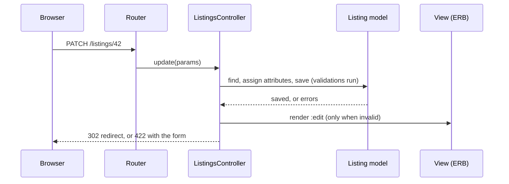
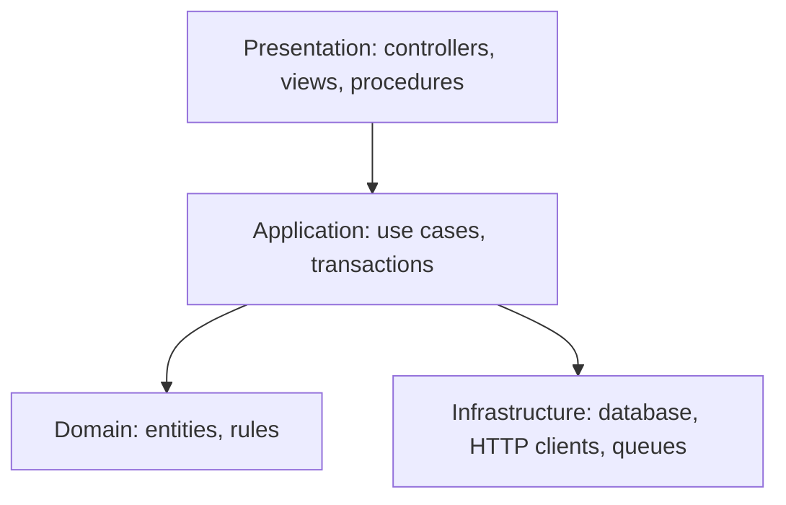

# MVC and Layered Architecture

> **Tier:** T2 (working knowledge) · **Related:** [Clean architecture](02-clean-architecture.md), [SOLID and design principles](../01-cs-fundamentals/03-solid-and-design-principles.md), [Design patterns](../01-cs-fundamentals/04-design-patterns.md), [Rails fundamentals](../05-ruby-on-rails/01-rails-fundamentals.md), [Rails architecture patterns](../05-ruby-on-rails/12-architecture-patterns.md), [ASP.NET Core MVC](../11-dotnet/01-aspnet-core-mvc.md), [React patterns](../06-react/07-patterns-and-architecture.md), [System design fundamentals](../15-system-design/01-fundamentals.md)
> **On your resume:** MVC in your skills list; the Rails MVC training at Visnext; legacy Rails monoliths at Devntech (CrystalCommerce, Colochousing); Django REST Framework for the PureLogics LMS; ASP.NET Core MVC and Blazor in your skills.

## Quick revision
- **Separation of concerns:** split code by reason to change (HTTP handling, business rules, persistence, presentation) so each part can change and be tested on its own.
- **MVC:** Model = data plus business rules; View = presentation; Controller = receives input, calls the model, chooses the response. On the web, a router maps each request to one controller action.
- **Rails request flow:** router -> controller action (params, authentication, authorization) -> models (ActiveRecord) -> view (ERB, Jbuilder, Turbo Stream) -> response.
- **Django MTV:** Model, Template (the presentation), View (the controller role); the URLconf routes and the framework itself acts as the dispatcher.
- **ASP.NET Core MVC:** controllers, Razor views, models and view models, built-in dependency injection. Razor Pages is the page-centric alternative.
- **Express** enforces nothing; teams build routes -> controllers -> services -> data access by convention.
- **MVP:** a passive view behind an interface, the presenter holds the logic. **MVVM:** the view binds to a view model that exposes state and commands (WPF, Blazor components, and a React custom hook is view-model-ish).
- **React** was launched as "the V in MVC"; in an SPA or mobile app the server becomes a JSON API and the client has its own architecture.
- **Layers:** presentation, application, domain, infrastructure. Layers are logical groupings of code; **tiers** are physical deployment units (browser, app server, database).
- **Business logic** lives in the domain (models, value objects) or in service objects for orchestration, not in controllers or views. Thin controller = parse input, authorize, call one thing, render.
- **Anemic model:** data bags with all logic in services. **Rich model:** objects guard their own invariants (`order.cancel!`). Use rich models for core rules and services to coordinate several models or external systems.
- **Monolith:** one deployable. **Modular monolith:** one deployable with enforced internal boundaries. **Microservices:** many independently deployable services, each owning its data.
- Microservices buy independent deploys, scaling and team autonomy at the cost of network failures, distributed data, eventual consistency and much more operations work.
- Split out a service only when a part has a clearly different scaling profile, release cadence, owning team or compliance boundary, and its boundary is already clean inside the monolith.

## 1. Separation of concerns

A feature touches several kinds of work: reading HTTP input, checking who the user is, applying business rules, saving data, calling other systems and producing HTML or JSON. If one method does all of it, every change risks breaking something unrelated, nothing can be reused from a job or an API endpoint, and tests need a browser, a database and the network at once.

Separation of concerns means grouping code by its **reason to change**. Pricing rules change when the business changes; templates change when the design changes; the HTTP client changes when the provider's API changes. Keeping these apart is the idea behind MVC, layered architecture and [clean architecture](02-clean-architecture.md), and it is the architectural cousin of the Single Responsibility Principle in [SOLID](../01-cs-fundamentals/03-solid-and-design-principles.md).

## 2. MVC: from desktop GUIs to web frameworks

MVC was described in the Smalltalk community at Xerox PARC in the late 1970s for desktop GUIs. In that original form the view **observed** the model and redrew itself whenever the model changed, and the controller translated mouse and keyboard input into model updates.

Web frameworks adapted it to request/response (an approach once called "Model 2" in Java web apps): there is no long-lived view watching the model, so each request runs a controller action that loads models and renders a fresh view.



In words: the router matches verb and path to `listings#update`, the controller loads the listing through the current store (which also enforces access), assigns the permitted params and saves; the model validates; the controller redirects on success or re-renders the form with errors. The full lifecycle (Rack, middleware, Puma) is in [Rails fundamentals](../05-ruby-on-rails/01-rails-fundamentals.md).

## 3. MVC in different frameworks

| | Rails | Django | ASP.NET Core MVC | Express |
|---|---|---|---|---|
| Routing | `config/routes.rb` | URLconf (`urls.py`) | Conventional or attribute routes | `app.get()`, `express.Router()` |
| Controller role | `ApplicationController` subclasses | "Views": functions, class-based views, DRF ViewSets | `Controller` subclasses | Route handlers or controller modules |
| Model | ActiveRecord models | Django ORM models | EF Core entities plus view models | Whatever you choose (Mongoose, Drizzle, Prisma) |
| View | ERB, Jbuilder, Hotwire | Templates; DRF serializers for JSON | Razor `.cshtml` | EJS or Pug templates, or `res.json()` |
| Structure | Strong conventions | Strong conventions | Strong conventions plus DI | None; you design it |

The same "show one listing of the current store" in three stacks:

```ruby
# Rails: the controller scopes the lookup and renders app/views/listings/show.html.erb
class ListingsController < ApplicationController
  def show
    @listing = current_store.listings.find(params[:id])   # another store's id raises RecordNotFound (404)
  end
end
```

```python
# Django: the "view" function plays the controller; the template is the presentation
from django.shortcuts import get_object_or_404, render

def listing_detail(request, pk):
    listing = get_object_or_404(Listing, pk=pk, store=request.user.store)
    return render(request, "listings/detail.html", {"listing": listing})
```

```ts
// Express: no built-in MVC, so the layering is a team convention
router.get("/listings/:id", requireStore, async (req, res) => {
  const listing = await listingService.findForStore(res.locals.storeId, req.params.id);
  if (!listing) return res.status(404).json({ error: "Not found" });
  res.json(toListingDto(listing));            // the "view" is a JSON serializer
});
```

In API-only apps (Rails API mode, DRF, an oRPC backend) the "view" is the serializer or response type; the controller and model roles stay the same.

## 4. MVP, MVVM and where React fits

| | MVC | MVP | MVVM |
|---|---|---|---|
| Middle piece | Controller handles input and picks a view | Presenter drives a passive view through an interface | View model exposes state and commands |
| View knows | The model (desktop MVC) or nothing (web MVC) | Only the presenter interface | The view model, through data binding |
| Testability | Controllers need request setup | Presenter testable with a fake view | View model testable without UI |
| Seen in | Rails, Django, ASP.NET Core MVC, Spring MVC | WinForms, older Android apps | WPF, .NET MAUI, Knockout; Blazor and React behave similarly |

- **MVVM in Blazor:** a component's `@code` block holds state and event handlers and the markup binds to it with `@bind`, so the component acts as view plus view model; MVVM libraries can split them further. See [Blazor](../11-dotnet/03-blazor.md).
- **React as the "V":** React's original pitch was that it only handles the view. In practice a component renders UI from state, and a **custom hook** can play the view model: it owns state and exposes values and commands, with no JSX.

```tsx
import { useState } from "react";

// View model: state and commands, no markup. The component that calls it is the view.
export function useBillSplit(totalCents: number, residentIds: string[]) {
  const [excluded, setExcluded] = useState<Set<string>>(new Set());
  const payers = residentIds.filter((id) => !excluded.has(id));
  const shareCents = payers.length ? Math.floor(totalCents / payers.length) : 0;  // remainder handling omitted

  const toggle = (id: string) =>
    setExcluded((prev) => {
      const next = new Set(prev);
      if (next.has(id)) next.delete(id);
      else next.add(id);
      return next;
    });

  return { payers, shareCents, toggle };
}
```

When the frontend is React (React on Rails, an Expo app, TanStack Start), the server side usually stops rendering HTML for those screens and becomes an API; MVC still describes the server, and the client gets its own structure (components, hooks, a data layer such as TanStack Query). Splitting cents fairly is covered in [payments and split bills](../08-react-native-expo/06-payments-and-split-bills.md).

## 5. Layered (n-tier) architecture

| Layer | Responsibility | Rails example | TypeScript platform example |
|---|---|---|---|
| Presentation | HTTP, input parsing, rendering, auth checks at the edge | Controllers, views, serializers | oRPC procedures, TanStack Start routes and server functions |
| Application | Use cases: orchestrate, transactions, authorization, enqueue jobs | Service objects in `app/services` | Use-case functions called by procedures |
| Domain | Business rules and invariants | Models (validations, state transitions), POROs, value objects | Plain TS modules and types |
| Infrastructure | Databases, HTTP clients, queues, email, storage | ActiveRecord persistence, API client wrappers, Sidekiq | Drizzle queries, fetch clients, queue clients |



- **Strict layering:** a layer only calls the one directly below. **Relaxed layering:** it may skip layers (a controller reading a model directly for a simple page). Most Rails apps are relaxed, and that is fine for CRUD.
- **Layers vs tiers:** "three-tier" usually means browser, application server and database as separate machines. You can deploy a four-layer codebase as one process.
- In classic layering the domain depends on the data layer. [Clean architecture](02-clean-architecture.md) inverts this so the domain depends on nothing.

## 6. Where business logic belongs

| Code | Belongs in |
|---|---|
| Reading params, status codes, redirects, cookies | Controller (or procedure) |
| "Price may not go below cost", "an order can only be cancelled before shipping" | Model or domain object |
| "Reprice, then push the new price to every sales channel" | Service object or use case |
| Slow or retryable steps (API calls, emails) | A job that calls the same service code |
| Formatting money and dates for display | View helpers, presenters, serializers |

A fat controller tangles all of this together and hides security bugs:

```ruby
class ListingsController < ApplicationController
  def update
    @listing = Listing.find(params[:id])                     # unscoped: any store's listing can be edited
    price = params[:listing][:price_cents].to_i
    price = @listing.market_price_cents * 90 / 100 if params[:listing][:use_market_price] == "1"
    return render(:edit, status: 422) if price < @listing.cost_cents   # business rule hidden in HTTP code
    @listing.update!(price_cents: price)
    ChannelPushJob.perform_async(@listing.id)
    redirect_to @listing
  end
end
```

The refactor puts each concern where it belongs:

```ruby
class Listing < ApplicationRecord
  validate :price_not_below_cost                              # invariant guarded by the model

  def market_based_price_cents(percent: 90)
    market_price_cents * percent / 100                        # integer cents, no floats
  end

  private

  def price_not_below_cost
    return unless price_cents && cost_cents && price_cents < cost_cents
    errors.add(:price_cents, "is below cost")
  end
end

module Listings
  class Reprice                                               # orchestration: model change + side effect
    def self.call(listing, price_cents:, use_market_price:)
      listing.price_cents = use_market_price ? listing.market_based_price_cents : price_cents
      return false unless listing.save
      ChannelPushJob.perform_async(listing.id)                # after the row is committed
      true
    end
  end
end

class ListingsController < ApplicationController
  def update
    @listing = current_store.listings.find(params[:id])       # scoping doubles as authorization
    permitted = params.require(:listing).permit(:price_cents, :use_market_price)
    if Listings::Reprice.call(@listing, price_cents: permitted[:price_cents].to_i,
                              use_market_price: permitted[:use_market_price] == "1")
      redirect_to @listing, notice: "Price updated"
    else
      render :edit, status: 422
    end
  end
end
```

Now the same `Listings::Reprice` works from an API endpoint, a bulk repricing job or the console, and each piece is testable alone. "Fat model, skinny controller" was the classic Rails advice; taken too far it produces 2,000-line god models and callbacks that send emails on every save. Keep invariants in models, move multi-step workflows into services, and see [Rails architecture patterns](../05-ruby-on-rails/12-architecture-patterns.md) for form objects, query objects and concerns.

## 7. Anemic vs rich domain models

```ruby
# Anemic: the model is a data bag; every caller must remember the rules
order.status = "cancelled"
order.save!

# Rich: the model owns the rule, so no caller can skip it
class Order < ApplicationRecord
  enum :status, { pending: 0, paid: 1, shipped: 2, cancelled: 3 }

  def cancel!(reason:)
    raise InvalidTransition, "cannot cancel a #{status} order" if shipped? || cancelled?
    update!(status: :cancelled, cancel_reason: reason, cancelled_at: Time.current)
  end
end
```

| | Anemic | Rich |
|---|---|---|
| Logic lives in | Services that manipulate data | The objects that own the data |
| Risk | Rules duplicated or skipped across services | Models grow too large if they also do orchestration and I/O |
| Fits | Thin CRUD apps, data pipelines | Core domain rules (orders, payments, bookings) |

The name "anemic domain model" is usually meant as a criticism, but the practical answer is balance: rich models for invariants, services for workflows that span several models or external systems. (The `enum :status, {...}` positional form is Rails 7+; older apps write `enum status: {...}`.)

## 8. Monolith vs modular monolith vs microservices

| | Monolith | Modular monolith | Microservices |
|---|---|---|---|
| Deployable units | One | One | Many |
| Data | One database | One database, tables owned by modules | A database per service |
| Calls between parts | In-process method calls | In-process calls through module public APIs | Network: HTTP, gRPC, messages |
| Transactions | ACID across everything | ACID, but cross-module writes discouraged | Sagas and eventual consistency |
| Operations cost | Lowest | Low | High: per-service CI/CD, tracing, service discovery, on-call |
| Failure modes | A bad deploy affects everything | Same | Partial failures, timeouts, cascading failures |
| Typical fit | Small team, early product | Growing product, several teams | Many teams, parts with very different scale or release needs |

**Why most teams at your scale run monoliths:** one codebase is faster to change, a function call never times out, a database transaction keeps data consistent, and one deploy pipeline is enough. Many large products still run on monoliths, and legacy Rails monoliths like the ones you work on at Devntech are the norm, not an embarrassment.

**Modular monolith:** keep one deployable but give each domain (catalog, orders, billing, channels) a clear public API and private internals. In Rails: namespaces, engines, and Shopify's packwerk gem to flag cross-package references. In a TypeScript monorepo: workspace packages plus lint rules that restrict imports.

**When to split a service out:**
- A part needs very different scaling (an image pipeline, a high-volume sync worker) or runtime.
- A team needs to release independently and the coupling slows everyone down.
- A compliance or security boundary (payments, personal data) benefits from isolation.
- The boundary is already clean inside the monolith; otherwise you create a **distributed monolith**: services that must deploy together and call each other synchronously for every request, with the costs of both worlds.

Prerequisites before going distributed: automated CI/CD, centralized logs, metrics and tracing, versioned API contracts, and a plan for data that used to be joined. Conway's law applies: systems end up mirroring the communication structure of the teams that build them.

## Common pitfalls
- Business rules in controllers or views, so the API, jobs and console each reimplement them differently.
- Unscoped lookups (`Listing.find(params[:id])`) in controllers: an authorization bug, not just a style issue.
- Fat models full of callbacks that send emails or call APIs on every save, which makes imports and tests trigger side effects.
- Service objects that only wrap one `update!` call: ceremony without benefit.
- Treating MVC as "three folders" while the real logic sits in helpers, concerns and JavaScript.
- Splitting into microservices to look modern, then needing distributed transactions for every feature.
- Shared databases between "microservices", which couple them more tightly than a monolith.
- Confusing layers with tiers in an answer ("we have three layers because we have three servers").

## How to talk about this in an interview
- Lead with the Devntech reality: you work in legacy Rails monoliths for international clients, so you read MVC code daily and know where logic tends to leak (callbacks, helpers, controllers).
- Use the Visnext month (MVC, ActiveRecord, Hotwire) as your structured foundation, and PureLogics as the Django/DRF comparison point (MTV, serializers as the view layer).
- Show judgment: "In a monolith I keep controllers thin, put invariants in models and multi-step workflows in service objects. I would not split into microservices without a clear scaling or team reason."
- If asked about microservices experience, be honest: your production work is in monoliths plus integrations with external systems (PriceCharting, a new TypeScript platform), which already teaches network failures and data sync.

> **Fill in:** one fat controller, god model or callback chain you refactored or worked around in a Devntech codebase, and what you moved where.

> **Fill in:** how CrystalCommerce or Colochousing organizes non-MVC code (`app/services`, `lib`, concerns, jobs), so you can describe it concretely.

## Interview questions

**Q1. What is MVC, and how does a request flow through a Rails app?**
MVC separates data and rules (Model), presentation (View) and input handling (Controller). In Rails the router maps verb and path to a controller action; the action reads params, authenticates and authorizes, works with ActiveRecord models, then renders a view (HTML or JSON) or redirects. The response travels back through the middleware stack to the client.
*Follow-up:* Where do validations run? In the model, when you call `save` or `valid?`; the controller only decides what to do with the result.

**Q2. Where should business logic live?**
Not in controllers or views. Invariants that belong to one entity live in the model (validations, state transitions such as `order.cancel!`). Workflows that coordinate several models, transactions or external systems live in service objects (use cases), which controllers, APIs and jobs all call. Views only format.
*Follow-up:* Why not in the controller? It cannot be reused from a job or API endpoint, it is hard to test without HTTP, and rules end up duplicated.

**Q3. Is "fat model, skinny controller" still good advice?**
Half of it. Skinny controllers, yes. Fat models become god objects with callback-driven side effects. The modern version is: thin controllers, models that guard their own data, and service, form and query objects for the rest.
*Follow-up:* What is wrong with an `after_save` that calls an API? It runs on every save (imports, console, tests), inside the transaction, and slows or breaks writes when the API is down. Use `after_commit` plus a job, or an explicit service.

**Q4. What is the difference between MVC, MVP and MVVM?**
They differ in how the view talks to the logic. MVC: a controller handles input and selects a view. MVP: the view is passive and implements an interface the presenter drives, which makes the presenter testable. MVVM: the view binds to a view model's state and commands (WPF, MAUI; Blazor components and React hooks work in a similar spirit).
*Follow-up:* Which is React closest to? A component is the view; a custom hook that owns state and exposes commands is effectively a view model.

**Q5. How does Django's MTV map to MVC?**
Django's model is the model, its template is the MVC view, and its "view" function or class plays the controller role, with the URLconf routing requests. In DRF, serializers act as the view layer for JSON and ViewSets as controllers.
*Follow-up:* Where would you put business logic in Django? In model methods or a service module, not in views or serializers.

**Q6. Is React an MVC framework?**
No. React is a UI library: it covers the view and leaves routing, data fetching and state management to other tools. In a React or React Native app the backend usually becomes a JSON API (Rails API, DRF, oRPC), and the client has its own structure of components, hooks and a server-state cache.
*Follow-up:* What changes on the server when the frontend becomes React? Controllers render JSON through serializers; HTML views remain only for pages not yet migrated.

**Q7. What is a layered architecture, and what is the difference between layers and tiers?**
Code is grouped into presentation, application (use cases), domain (rules) and infrastructure (database, HTTP clients, queues), and each layer depends only on layers below it. Layers are logical code boundaries; tiers are physical deployment units such as browser, app server and database.
*Follow-up:* Strict or relaxed layering? Relaxed is common in Rails CRUD screens; strict pays off for complex domains and integrations.

**Q8. What is an anemic domain model?**
Domain objects that only hold data while all logic lives in services. It is easy to start with, but rules get duplicated and skipped. A rich model enforces its invariants itself. Balance them: rich models for rules, services for orchestration.
*Follow-up:* Show a rich method. `order.cancel!` that raises unless the order is pending or paid, then records the reason and timestamp.

**Q9. Monolith or microservices: which would you choose for a new product, and why?**
A monolith, ideally modular. One deployable, in-process calls and ACID transactions make a small team fast and keep data consistent. Microservices add network failures, eventual consistency, distributed tracing and per-service pipelines, which pay off only with many teams or parts that need very different scaling or release cycles.
*Follow-up:* What would make you change your mind? A part with a different scaling or compliance profile and a clean boundary, plus the operational maturity to run it.

**Q10. What is a modular monolith, and how do you enforce boundaries in Rails?**
One deployable split into modules with public APIs and private internals, each module owning its tables. In Rails: namespaces or engines per domain, packwerk to detect cross-package references, and a rule that modules talk through service interfaces or events rather than reaching into each other's models.
*Follow-up:* Why do this before microservices? It finds the right boundaries cheaply; extracting a well-isolated module later is far easier.

**Q11. How would you extract a service from a monolith?**
Pick a module whose boundary is already clean, define its API, move its data ownership (other parts stop querying its tables), route callers through the API inside the monolith first, then deploy it separately using a strangler approach: route traffic gradually and keep a rollback path. See [platform migration strategies](04-platform-migration-strategies.md).
*Follow-up:* How do other parts get its data? Through its API or events it publishes, not shared tables.

**Q12. What is a distributed monolith?**
Services that are deployed separately but are so coupled (shared database, synchronous call chains, lockstep releases) that they behave like one system, with the network's costs added. It usually comes from splitting before boundaries were understood.
*Follow-up:* One warning sign? A single feature regularly needs coordinated deploys of several services.

## Further reading
- Rails guides, Getting Started and Action Controller overview: https://guides.rubyonrails.org/
- Django design philosophies and FAQ on MTV: https://docs.djangoproject.com/en/stable/misc/design-philosophies/
- ASP.NET Core MVC overview: https://learn.microsoft.com/aspnet/core/mvc/overview
