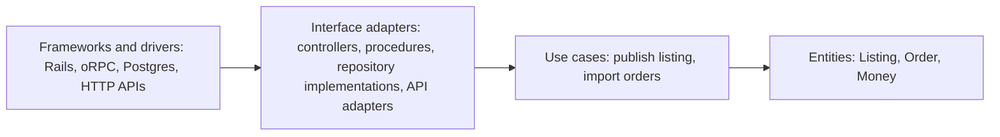

# Clean Architecture, Hexagonal and DDD-Lite

> **Tier:** T2 (working knowledge) · **Related:** [MVC and layered architecture](01-mvc-and-layered-architecture.md), [SOLID: dependency inversion](../01-cs-fundamentals/03-solid-and-design-principles.md), [Design patterns](../01-cs-fundamentals/04-design-patterns.md), [Third-party API integration](05-third-party-api-integration.md), [Testing fundamentals](09-testing-fundamentals.md), [Drizzle ORM](../12-databases/13-drizzle-orm.md), [oRPC and type-safe APIs](../09-nodejs-backend/05-orpc-and-typesafe-apis.md), [ASP.NET Core MVC](../11-dotnet/01-aspnet-core-mvc.md), [Rails architecture patterns](../05-ruby-on-rails/12-architecture-patterns.md)
> **On your resume:** Clean Architecture and MVC in your skills list; service objects and API client wrappers in the Devntech Rails apps (the PriceCharting integration is a natural adapter); oRPC procedures and Drizzle on the new multi-tenant TypeScript platform; C# and ASP.NET Core in your skills.

## Quick revision
- **Goal:** business rules that do not depend on frameworks, databases, UIs or third-party APIs, so those details can change and the rules can be tested in milliseconds.
- **Dependency rule:** source-code dependencies point **inward only**. Inner circles (entities, use cases) never import outer ones (controllers, ORMs, HTTP clients).
- **Circles:** Entities (enterprise rules) -> Use cases (application rules) -> Interface adapters (controllers, presenters, repositories' implementations) -> Frameworks and drivers (web framework, DB, external APIs).
- **Hexagonal (ports and adapters):** the core defines **ports** (interfaces); **adapters** implement them. Driving adapters call in (HTTP, CLI, jobs, tests); driven adapters are called out to (database, payment provider, marketplace API).
- **Onion:** same idea drawn as rings: domain model, domain services, application services, infrastructure and UI outside.
- **Dependency inversion (principle):** high-level policy owns the abstraction; low-level detail implements it. **Dependency injection (technique):** pass collaborators in instead of creating them. **IoC container:** a library that wires the graph (the .NET built-in container). The **composition root** (`Program.cs`, a `deps` module) is the one place that picks concrete implementations.
- **Repository = a port** for persistence with domain-shaped methods (`findById(orgId, id)`), implemented with Drizzle, EF Core or ActiveRecord, faked in memory for tests.
- **Third-party APIs sit behind a port** such as `SalesChannel`; the marketplace adapter translates their vocabulary into yours (an anti-corruption layer).
- **DDD-lite:** entities (identity), value objects (equal by value, immutable: `Money`), aggregates (consistency boundary changed through a root), bounded contexts (a term means one thing per context), ubiquitous language (code uses the business's words).
- **Pragmatic use:** Rails keeps ActiveRecord models and adds POROs, service objects and injected adapters; TypeScript has oRPC procedures call use-case functions that receive Drizzle repositories and API clients; .NET splits Domain, Application, Infrastructure and Web projects whose references enforce the rule.
- **Overkill** for CRUD screens and prototypes; worth it for complex rules, several delivery mechanisms (web, mobile API, jobs) and many integrations.

## 1. The problem it solves

In many legacy apps a rule such as "a listing can only be published if it has a positive price and is not archived" is scattered across a controller, a model callback, a Sidekiq job and an API client, each calling the database and the marketplace directly. Testing the rule then needs a database, Redis and HTTP stubs; swapping the marketplace client or upgrading the framework touches business code; and the mobile API and a background job each reimplement the rule slightly differently.

Clean architecture (Robert C. Martin's name for it), hexagonal architecture (Alistair Cockburn) and onion architecture (Jeffrey Palermo) are three framings of one answer: put the rules in the middle, make everything else a replaceable detail, and point dependencies toward the rules.

## 2. The dependency rule



Arrows show "depends on / knows about". Entities hold core types and invariants; use cases hold workflows plus the interfaces (ports) they need, such as a repository or a sales channel; adapters implement those interfaces; frameworks are wired in at the edge. At runtime calls flow outward to the database, while source dependencies still point inward: **dependency inversion** applied at the architecture level. Data crossing a boundary should be plain objects or DTOs, never ORM records or HTTP request objects.

## 3. Hexagonal and onion: same idea, different vocabulary

| Concept | Clean | Hexagonal | Onion |
|---|---|---|---|
| Business core | Entities plus use cases | The application inside the hexagon | Domain model and domain services |
| Interfaces the core needs | Gateways, repository interfaces | Driven (secondary) ports | Repository and service interfaces in the core |
| Things that call the core | Controllers | Driving (primary) adapters: HTTP, CLI, jobs, tests | UI ring |
| Things the core calls | Gateway implementations | Driven adapters: DB, queues, external APIs | Infrastructure ring |

Hexagonal's best contribution is symmetry: an HTTP controller, a Sidekiq job and a test are all just **driving adapters** for the same use case, and the database and a marketplace API are both **driven adapters**.

## 4. Dependency inversion and injection

- **Constructor injection** (the default): collaborators are constructor arguments, so dependencies are explicit and a test passes fakes.
- **Parameter injection:** pass collaborators to a function (`publishListing(deps, input)`), natural in TypeScript.
- **Setter injection** (rare, hides required dependencies) and the **service locator** (a class looks dependencies up in a global registry) both work but hide what a class needs; avoid them in new code.
- **Ruby:** keyword arguments with a real default, `def initialize(channel: SalesChannels::Marketplace.new)`, keep call sites simple while specs pass a fake (example in [SOLID](../01-cs-fundamentals/03-solid-and-design-principles.md)).

```ts
// composition.ts: the only module that names concrete implementations
import { drizzleListingRepository } from "./infrastructure/drizzle-listing-repository";
import { marketplaceChannel } from "./infrastructure/marketplace-channel";

export const deps = {
  listings: drizzleListingRepository,
  channel: marketplaceChannel({ baseUrl: process.env.MARKETPLACE_URL ?? "", apiKey: process.env.MARKETPLACE_API_KEY ?? "" }),
};
```

In .NET the built-in container does the wiring: register `services.AddScoped<IListingRepository, EfListingRepository>()` and every constructor that asks for `IListingRepository` receives one per request. Lifetimes (transient, scoped, singleton) and the captive-dependency bug are covered in [ASP.NET Core MVC](../11-dotnet/01-aspnet-core-mvc.md). Ruby and TypeScript rarely need a container: modules, default arguments and a composition root are enough. The principle itself, with the DIP vs DI vs IoC distinction, is in [SOLID](../01-cs-fundamentals/03-solid-and-design-principles.md).

## 5. A worked example in TypeScript: ports, use case, adapters

```ts
// domain/listing.ts: no framework imports
export type ListingStatus = "draft" | "published" | "archived";
export interface Listing {
  id: string; orgId: string; sku: string; title: string;
  priceCents: number; quantity: number; status: ListingStatus; externalId: string | null;
}
export class DomainError extends Error {}

export function assertPublishable(listing: Listing): void {
  if (listing.status === "archived") throw new DomainError("Archived listings cannot be published");
  if (listing.priceCents <= 0) throw new DomainError("Price must be positive");
}
```

```ts
// application/ports.ts: interfaces owned by the core, implemented outside
import type { Listing } from "../domain/listing";

export interface ListingRepository {
  findById(orgId: string, id: string): Promise<Listing | null>;
  save(listing: Listing): Promise<void>;
}

export interface SalesChannel {
  publish(listing: Listing): Promise<{ externalId: string }>;
  updateStock(externalId: string, quantity: number): Promise<void>;
}
```

```ts
// application/publish-listing.ts: the use case
import { assertPublishable } from "../domain/listing";
import type { ListingRepository, SalesChannel } from "./ports";

export class ListingNotFound extends Error {}

export async function publishListing(
  deps: { listings: ListingRepository; channel: SalesChannel },
  input: { orgId: string; listingId: string },
) {
  const listing = await deps.listings.findById(input.orgId, input.listingId);
  if (!listing) throw new ListingNotFound(`Listing ${input.listingId} not found`);
  assertPublishable(listing);

  const { externalId } = await deps.channel.publish(listing);
  await deps.listings.save({ ...listing, status: "published", externalId });
  return { externalId };
}
```

**Repository adapter (Drizzle).** The org filter lives here, so no caller can forget it (more in [multi-tenancy](03-multi-tenancy.md)):

```ts
// infrastructure/drizzle-listing-repository.ts
import { and, eq } from "drizzle-orm";
import { db } from "./db";
import { listings } from "./schema";
import type { ListingRepository } from "../application/ports";

export const drizzleListingRepository: ListingRepository = {
  async findById(orgId, id) {
    const [row] = await db.select().from(listings).where(and(eq(listings.orgId, orgId), eq(listings.id, id)));
    return row ?? null;                       // map columns to the domain type here if they differ
  },
  async save(l) {
    await db.update(listings)
      .set({ status: l.status, externalId: l.externalId, priceCents: l.priceCents, quantity: l.quantity })
      .where(and(eq(listings.orgId, l.orgId), eq(listings.id, l.id)));
  },
};
```

**Sales channel adapter.** It translates between your model and a marketplace's API; the paths and fields below are illustrative, not any real provider's API (provider details belong in [third-party API integration](05-third-party-api-integration.md)):

```ts
// infrastructure/marketplace-channel.ts
import type { SalesChannel } from "../application/ports";

export function marketplaceChannel(cfg: { baseUrl: string; apiKey: string }): SalesChannel {
  async function call<T>(path: string, init: RequestInit): Promise<T> {
    const res = await fetch(new URL(path, cfg.baseUrl), {
      ...init,
      headers: { "Content-Type": "application/json", Authorization: `Bearer ${cfg.apiKey}` },
      signal: AbortSignal.timeout(10_000),    // never wait forever on a third party
    });
    if (!res.ok) throw new Error(`Marketplace ${init.method ?? "GET"} ${path} failed with ${res.status}`);
    return (res.status === 204 ? undefined : await res.json()) as T;
  }

  return {
    async publish(l) {
      const body = JSON.stringify({ sku: l.sku, title: l.title, price_cents: l.priceCents, quantity: l.quantity });
      const created = await call<{ id: string }>("/listings", { method: "POST", body });
      return { externalId: created.id };      // their "id" becomes our externalId
    },
    async updateStock(externalId, quantity) {
      await call<void>(`/listings/${externalId}/stock`, { method: "PUT", body: JSON.stringify({ quantity }) });
    },
  };
}
```

**Driving adapter (oRPC procedure).** It handles transport concerns only: auth, input validation, mapping errors to protocol errors. oRPC's API is summarized in [oRPC and type-safe APIs](../09-nodejs-backend/05-orpc-and-typesafe-apis.md); check the docs for your version.

```ts
import { os, ORPCError } from "@orpc/server";
import { z } from "zod";
import { DomainError } from "../domain/listing";
import { ListingNotFound, publishListing } from "../application/publish-listing";
import { deps } from "./composition";

const authed = os.$context<{ session: { orgId: string; userId: string } | null }>().use(({ context, next }) => {
  if (!context.session) throw new ORPCError("UNAUTHORIZED");
  return next({ context: { session: context.session } });
});

export const listingRouter = {
  publish: authed
    .input(z.object({ listingId: z.string().min(1) }))
    .handler(async ({ input, context }) => {
      try {
        return await publishListing(deps, { orgId: context.session.orgId, listingId: input.listingId });
      } catch (e) {
        if (e instanceof ListingNotFound) throw new ORPCError("NOT_FOUND");
        if (e instanceof DomainError) throw new ORPCError("BAD_REQUEST", { message: e.message });
        throw e;
      }
    }),
};
```

A Sidekiq job, a CLI script or a TanStack Start server function could call the same `publishListing` with the same `deps`.

## 6. Testability with fakes

Because the use case only sees ports, a test can run it with in-memory fakes: no database, no network, milliseconds per test.

```ts
import { describe, expect, it } from "vitest";
import { publishListing } from "../application/publish-listing";
import type { ListingRepository, SalesChannel } from "../application/ports";
import type { Listing } from "../domain/listing";

const draft: Listing = { id: "l1", orgId: "org-a", sku: "SKU1", title: "Game", priceCents: 1999,
  quantity: 3, status: "draft", externalId: null };

function fakes(seed: Listing[]) {
  const rows = new Map(seed.map((l) => [l.id, l]));
  const published: string[] = [];
  const listings: ListingRepository = {
    async findById(orgId, id) { const l = rows.get(id); return l && l.orgId === orgId ? l : null; },
    async save(l) { rows.set(l.id, l); },
  };
  const channel: SalesChannel = {
    async publish(l) { published.push(l.sku); return { externalId: `ext-${l.sku}` }; },
    async updateStock() {},
  };
  return { rows, published, listings, channel };
}

describe("publishListing", () => {
  it("publishes and stores the external id", async () => {
    const f = fakes([draft]);
    await publishListing(f, { orgId: "org-a", listingId: "l1" });
    expect(f.published).toEqual(["SKU1"]);
    expect(f.rows.get("l1")).toMatchObject({ status: "published", externalId: "ext-SKU1" });
  });
  it("treats another org's listing as not found", async () => {
    await expect(publishListing(fakes([draft]), { orgId: "org-b", listingId: "l1" })).rejects.toThrow("not found");
  });
});
```

Keep a few integration tests for the real adapters (the Drizzle repository against a test database, the marketplace adapter against recorded responses), and contract tests that run the same assertions against the fake and the real implementation so they cannot drift. More in [testing fundamentals](09-testing-fundamentals.md).

## 7. DDD-lite: the parts worth knowing

**Entities** have an identity that persists while attributes change (an order is the same order after its status changes). **Value objects** are defined by their values, immutable and compared by value:

```ruby
Money = Data.define(:cents, :currency) do      # Ruby 3.2+ Data: immutable, value equality
  def +(other)
    raise ArgumentError, "currency mismatch" unless currency == other.currency
    with(cents: cents + other.cents)           # returns a new object
  end
end

Money.new(cents: 1999, currency: "EUR") == Money.new(cents: 1999, currency: "EUR")  # => true
```

**Aggregates** are clusters of objects changed together through one **root** that enforces their invariants, saved in one transaction, and referenced from outside by ID only:

```ruby
class Order < ApplicationRecord                 # aggregate root; OrderItem is never edited directly
  has_many :items, class_name: "OrderItem"

  def add_item(listing, quantity:)
    raise InvalidTransition, "order is #{status}" unless pending?
    items.build(listing_id: listing.id, unit_price_cents: listing.price_cents, quantity: quantity)
    self.total_cents = items.to_a.sum { |i| i.unit_price_cents * i.quantity }   # invariant kept in one place
  end
end
```

**Bounded contexts** draw lines where a word changes meaning:

| Term | Catalog context | Sales channel context | Billing context |
|---|---|---|---|
| Listing | Title, condition, images, store price | External ID, channel price, sync status | Not used |
| Customer | Not used | A marketplace buyer on an imported order | A payer with payment methods and invoices |

Each context keeps its own model and talks to others through explicit interfaces or events. **Ubiquitous language** means code, tickets and conversations use the same domain words ("listing", "condition grade", "house", "lease"), not invented technical synonyms. An **anti-corruption layer** translates an external or legacy model into yours at the boundary, which is exactly what a marketplace adapter or a sync from a legacy Rails app into a new platform does ([platform migration](04-platform-migration-strategies.md)).

## 8. Pragmatic application per stack

**Rails.** ActiveRecord follows the Active Record pattern (a model is both the entity and its persistence), so a strict "domain knows no database" split fights the framework. The pragmatic version: models keep validations, associations and state transitions; POROs hold pure logic (pricing calculators, `Money`, condition-grade mapping); service objects in `app/services` are the use cases (`Listings::Publish`, `Orders::ImportFromChannel`); API client wrappers are adapters injected with a default so specs can pass a fake; jobs and controllers are thin driving adapters that call services.

**Node/TypeScript (oRPC, Drizzle).** Procedures validate input and resolve the session and org; use-case functions receive their dependencies; Drizzle queries live in repository modules that always apply the org scope; external APIs sit behind adapter modules. TanStack Start server functions are another driving adapter for the same use cases.

**.NET.** Project references make the dependency rule a compile error:

```text
Shop.Domain            no project references (entities, value objects)
Shop.Application    -> Shop.Domain (use cases, ports such as ISalesChannel, IListingRepository)
Shop.Infrastructure -> Shop.Application (EF Core DbContext, repositories, HTTP adapters)
Shop.Web            -> Shop.Application, Shop.Infrastructure (controllers, Program.cs composition root)
```

```csharp
// Shop.Application: the port, plus a plain record that crosses the boundary
public interface ISalesChannel { Task<string> PublishAsync(ListingSnapshot listing, CancellationToken ct); }
public sealed record ListingSnapshot(string Sku, string Title, long PriceCents, int Quantity);

// Shop.Infrastructure: the adapter, using a typed HttpClient (illustrative API)
public sealed class MarketplaceChannel(HttpClient http) : ISalesChannel
{
    private sealed record CreatedListing(string Id);

    public async Task<string> PublishAsync(ListingSnapshot listing, CancellationToken ct)
    {
        using var response = await http.PostAsJsonAsync("listings", listing, ct);
        response.EnsureSuccessStatusCode();
        var created = await response.Content.ReadFromJsonAsync<CreatedListing>(cancellationToken: ct);
        return created?.Id ?? throw new InvalidOperationException("Empty response from marketplace");
    }
}

// Shop.Web/Program.cs: the composition root
builder.Services.AddHttpClient<ISalesChannel, MarketplaceChannel>(client =>
    client.BaseAddress = new Uri(builder.Configuration["Marketplace:BaseUrl"]!));
builder.Services.AddScoped<IListingRepository, EfListingRepository>();   // EF Core lives in Infrastructure
```

## 9. Over-engineering risks

| Worth it | Overkill |
|---|---|
| Complex, long-lived business rules (pricing, billing, sync) | CRUD admin screens |
| Several delivery mechanisms (web, mobile API, jobs, CLI) | One delivery mechanism and simple flows |
| Many integrations that may change or need fakes | A prototype or a short-lived internal tool |
| A team that agrees on the boundaries | A solo dev adding layers nobody else understands |

Warning signs: an interface for every class with exactly one implementation and no test fake; DTO-to-entity-to-model mapping code that dwarfs the logic; a generic `Repository<T>` wrapping an ORM that already is one; every feature touching eight files. Apply the ideas where change and testing pain are real (integrations, money, sync), and let simple screens stay simple.

## Common pitfalls
- Inner code importing outer code ("just this once" a use case calls `fetch` or a Drizzle table directly), which quietly breaks the dependency rule.
- Leaking ORM records, `Request` objects or SDK types across boundaries instead of plain data.
- Repositories that expose query builders, so every caller writes its own queries and forgets the tenant filter.
- Fakes that behave differently from the real adapter (no contract tests), so green tests hide production bugs.
- Fighting Rails conventions with full repository layers over ActiveRecord.
- Value objects that are mutable, or compared by identity.
- Huge aggregates (an `Organization` root that owns everything), which serialize all writes for a tenant.

## How to talk about this in an interview
- Clean Architecture is in your skills list, so expect "explain the dependency rule" and "show me how you would structure X". Answer with the `SalesChannel` port example: it maps onto CrystalCommerce's PriceCharting sales-channel work without claiming how that code is organized.
- Show pragmatism: "In Rails I do not wrap ActiveRecord in repositories. I keep rules in models and POROs, use cases in service objects, and put third-party APIs behind injected adapters so specs use fakes."
- For the TypeScript platform, describe the layering you would expect (procedures, use cases, scoped Drizzle repositories) and fill in what it actually looked like.
- Be honest about scale: you have applied these ideas at feature level, not designed a whole system's architecture alone.

> **Fill in:** how the new multi-tenant TypeScript platform organizes oRPC procedures, business logic and Drizzle queries (for example, did procedures call shared service functions?).

> **Fill in:** where you injected a dependency or used a fake in a Devntech codebase (a PriceCharting client in specs, a payment client, a push-notification sender).

> **Fill in:** whether your final year project's .NET part followed a layered or clean structure, and how the projects referenced each other.

## Interview questions

**Q1. What is clean architecture, and what is the dependency rule?**
It organizes code in concentric circles: entities, use cases, interface adapters, frameworks and drivers. The dependency rule says source-code dependencies only point inward: business rules never import the web framework, ORM or HTTP clients. Inner layers define interfaces (ports), outer layers implement them, so details can be swapped and rules tested without infrastructure.
*Follow-up:* If calls go outward to the database, how do dependencies point inward? The use case depends on a repository interface it owns; the infrastructure implements it and is injected at the composition root.

**Q2. Explain hexagonal architecture.**
The application core sits inside the hexagon and talks to the world only through ports (interfaces). Driving adapters (HTTP controllers, jobs, CLI, tests) call into the core; driven adapters (database, queues, payment or marketplace APIs) are called by it. Any adapter can be replaced, for example a real marketplace client by a fake in tests.
*Follow-up:* How does it differ from clean and onion architecture? Mostly vocabulary: all three keep rules at the center with dependencies pointing inward; clean names four circles, hexagonal stresses ports and adapters, onion draws rings around the domain model.

**Q3. What is dependency injection, and why use it?**
Passing an object's collaborators in (usually through the constructor) instead of creating them inside. Dependencies become explicit, implementations can be swapped (a different provider, a fake in tests) and lifetimes can be managed centrally. In Ruby you use keyword arguments with defaults, in TypeScript function parameters or a composition root, in .NET the built-in container.
*Follow-up:* Dependency inversion vs injection? Inversion is the principle (policy depends on abstractions it owns); injection is one technique for supplying the implementation.

**Q4. How would you integrate a third-party API so it can be swapped or tested?**
Define a port in your terms, such as `SalesChannel` with `publish` and `updateStock`. Implement a marketplace adapter that handles auth, timeouts, retries and translation of fields and errors. Inject it into use cases, and use an in-memory fake in tests plus a few recorded-response tests for the adapter itself.
*Follow-up:* Where do rate limiting and retries go? In the adapter or the job infrastructure around it, never in the use case.

**Q5. What is a repository, and do you need one with ActiveRecord or Drizzle?**
A persistence port with domain-shaped methods (`findById(orgId, id)`, `save`) that hides how data is stored. With ActiveRecord, the model already plays that role, so a separate repository is usually ceremony. With Drizzle, small repository modules are worth it because they centralize queries and enforce rules such as the tenant filter.
*Follow-up:* What makes a repository leaky? Returning query builders or ORM rows so callers build their own queries.

**Q6. What is the difference between an entity and a value object?**
An entity has an identity that persists while its attributes change (an order, a user). A value object is defined only by its values, is immutable and is compared by value (`Money`, an address, a date range). Value objects remove primitive obsession: `Money` carries its currency and refuses to add EUR to USD.
*Follow-up:* How do you make a value object in Ruby? `Data.define(:cents, :currency)` (Ruby 3.2+) gives immutability and value equality.

**Q7. What is an aggregate?**
A cluster of objects treated as one unit for changes, with a root that enforces invariants. Outside code changes items only through the root (`order.add_item`), the whole aggregate is saved in one transaction, and other aggregates reference it by ID. Keep aggregates small to avoid contention.
*Follow-up:* Why reference other aggregates by ID? So each can be loaded, locked and saved independently.

**Q8. What are bounded contexts and an anti-corruption layer?**
A bounded context is a part of the system where each domain term has one precise meaning ("listing" in catalog vs in a sales channel). An anti-corruption layer translates between your model and another context, a legacy system or a third-party API, so their concepts do not leak into your core.
*Follow-up:* Example from integration work? A marketplace adapter mapping their condition codes and IDs to yours, or a sync layer translating legacy Rails records into the new platform's schema.

**Q9. How do you apply clean architecture in Rails without fighting the framework?**
Keep ActiveRecord models for persistence, validations and state transitions; put pure logic in POROs and value objects; write use cases as service objects; wrap external APIs in adapters injected with defaults; keep controllers and jobs as thin callers. Skip repository layers over ActiveRecord.
*Follow-up:* How do you stop models from calling APIs? Move side effects into services or jobs triggered after commit, never model callbacks that do I/O.

**Q10. When is clean architecture overkill?**
For CRUD screens, prototypes and short-lived tools, where interfaces with one implementation and mapping layers add files without reducing risk. It pays off for complex, long-lived rules, many integrations and several entry points (web, mobile API, jobs).
*Follow-up:* What is your middle ground? Apply ports and adapters at the boundaries that hurt (external APIs, payments, sync) and keep the rest conventional.

## Further reading
- .NET dependency injection: https://learn.microsoft.com/dotnet/core/extensions/dependency-injection
- Common web application architectures (.NET guide): https://learn.microsoft.com/dotnet/architecture/modern-web-apps-azure/common-web-application-architectures
