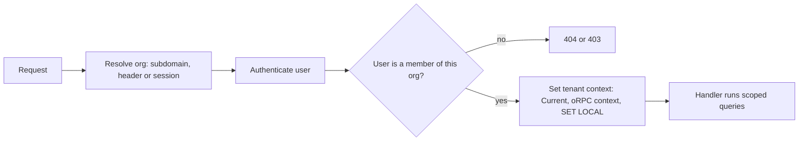

# Multi-Tenancy

> **Tier:** T1 (know cold) · **Related:** [PostgreSQL (row-level security)](../12-databases/04-postgresql.md), [Drizzle ORM (scoped queries)](../12-databases/13-drizzle-orm.md), [ActiveRecord advanced (default_scope)](../05-ruby-on-rails/06-activerecord-advanced.md), [Rails authentication and authorization](../05-ruby-on-rails/11-authentication-authorization.md), [Indexing](../12-databases/05-indexing-and-query-optimization.md), [Platform migration strategies](04-platform-migration-strategies.md), [Background processing patterns](06-background-processing-patterns.md), [Multi-tenant platform migration deep dive](../17-projects-deep-dive/04-multi-tenant-platform-migration.md)
> **On your resume:** the multi-tenant platform migration at Devntech: moving Colochousing onto a new multi-tenant TypeScript platform (oRPC, TanStack Start, Drizzle) with org-scoped access control; CrystalCommerce serving 700+ stores from one platform; Multi-tenancy in your skills list.

## Quick revision
- **Tenant** = a customer organization (a store, a property operator, a school). **Multi-tenant** = one codebase and deployment serve many tenants whose data must stay isolated.
- **Three data models:** database per tenant (strongest isolation, highest cost), schema per tenant (Postgres schemas plus `search_path`; the Apartment gem, django-tenants), shared schema with a `tenant_id`/`org_id` column on every tenant-owned row (cheapest, most common, isolation enforced in code and optionally by RLS).
- **Tenant resolution:** subdomain, custom domain, URL path, header, or the user's current org stored in the session or token. The identifier is only a claim: always verify the user's **membership** in that org.
- **Defense in depth:** scoped data access by default (`current_org.bills`, a Drizzle helper that always adds `org_id = ?`), a framework guard that raises when no tenant is set (acts_as_tenant `require_tenant`), Postgres **row-level security** as the safety net, and tests that try to read another org's data.
- **default_scope** for tenancy is fragile: `unscoped` removes every condition, and code that runs without a tenant (console, jobs) raises, sees nothing or, in some setups, silently sees every org's rows.
- **RLS per request:** `SELECT set_config('app.current_org_id', $1, true)` (or `SET LOCAL`) inside the transaction; the app role must not own the tables or have `BYPASSRLS`; policies **fail closed** when the setting is missing.
- **Pooling caveat:** a session-level `SET` stays on a pooled connection and leaks to the next request (Rails pool, node-postgres pool) or disappears (PgBouncer transaction mode). Use transaction-local settings only.
- **Schema rules:** `org_id NOT NULL` on every tenant table (join tables too), unique constraints become `(org_id, slug)`, composite foreign keys `(org_id, house_id) REFERENCES houses (org_id, id)` make cross-tenant references impossible, and indexes lead with `org_id`.
- **Access control:** users are global, **memberships** link users to organizations with a role; RBAC is per org; super admins use audited, separate tooling.
- **Tenant context everywhere:** jobs take `org_id` as an argument, cache keys and storage paths are namespaced, search queries filter by org server-side, logs carry `org_id`.
- **Single-tenant to multi-tenant:** add organizations, add nullable `org_id`, backfill in batches, validate FKs and NOT NULL without long locks, rework unique indexes, rewrite every query, then roll out gradually behind flags.
- **Noisy neighbors:** per-tenant rate limits and job fairness, statement timeouts, partitioning or moving the biggest tenants to their own database.
- **GDPR:** per-tenant export and deletion tooling is much easier when every row (and every file path) carries `org_id`.

## 1. What multi-tenancy is

A **single-tenant** product runs a separate installation (code, database, servers) for each customer. A **multi-tenant** product runs one installation for everyone and tells customers apart by a tenant ID. Most B2B SaaS products are multi-tenant because one deploy updates every customer, onboarding is a database insert instead of a server setup, and infrastructure is shared.

The cost is risk concentration. A missing `WHERE org_id = ?` shows one customer another customer's data: the most serious bug a SaaS can ship, often contract-ending and reportable under privacy law. Everything in this file is about making that bug hard to write and easy to catch.

Vocabulary you may hear: **silo** (dedicated resources per tenant), **pool** (shared resources) and **bridge** (a mix), used in cloud SaaS guidance.

## 2. The three data models

**Database per tenant.** Each org has its own database (or even server). Isolation is physical, per-tenant backup, restore and data residency are easy, and one tenant's heavy query cannot lock another's tables. But you pay per database, run every migration N times, need a connection pool per tenant, and cross-tenant reporting needs a separate warehouse. Rails supports switching connections with multiple databases and horizontal sharding (`connected_to(shard: ...)`, Rails 6.1+).

**Schema per tenant.** One Postgres database, one schema per tenant with identical tables; the `search_path` decides which schema unqualified table names resolve to.

```sql
CREATE SCHEMA tenant_acme;
CREATE TABLE tenant_acme.bills (id bigint GENERATED ALWAYS AS IDENTITY PRIMARY KEY, title text NOT NULL);
SET search_path TO tenant_acme, public;   -- session setting: same pooling caveats as RLS settings
SELECT * FROM bills;                      -- reads tenant_acme.bills
```

```ruby
# ros-apartment, the maintained fork of the Apartment gem (check its README for your version)
Apartment.configure do |config|
  config.excluded_models = %w[Organization User]     # global tables stay in the public schema
  config.tenant_names = -> { Organization.pluck(:subdomain) }
end
# config/application.rb: config.middleware.use Apartment::Elevators::Subdomain  (switches per request)
Apartment::Tenant.switch("acme") { Bill.count }      # runs with acme's schema first in search_path
```

Migrations run once per schema (slow with thousands of tenants), thousands of schemas bloat the system catalog and slow some tools, and `search_path` is session state that must be set correctly on every pooled connection.

**Shared schema.** One set of tables; every tenant-owned row carries `org_id`. It is the cheapest and simplest to operate, migrations run once, and cross-tenant analytics is a `GROUP BY`. Isolation depends on your code (and on RLS if you add it), and big tenants share indexes and I/O with small ones.

| | Database per tenant | Schema per tenant | Shared schema + `org_id` |
|---|---|---|---|
| Isolation | Physical | Logical, by `search_path` | Logical, by every query (plus RLS) |
| Cost per tenant | Highest | Medium | Lowest |
| Migrations | N runs, need orchestration | N runs | One run |
| Noisy neighbors | Contained | Shared server, separate tables | Shared tables and indexes |
| Compliance, data residency | Easiest (own DB, own region) | Medium | Hardest; needs strong controls |
| Per-tenant backup and restore | Trivial | `pg_dump --schema` | Custom export tooling |
| Cross-tenant reporting | Needs a warehouse | `UNION` across schemas or a warehouse | A simple `GROUP BY org_id` |
| Scales to many small tenants | Poorly | Hundreds to low thousands | Very well |
| Typical tools | Rails multi-db sharding, a connection per tenant | ros-apartment, django-tenants | acts_as_tenant, scoped repositories, RLS |

A common hybrid: pool small tenants in the shared schema and give the largest or most regulated tenants their own database, with the tenant record storing where its data lives.

## 3. Resolving the tenant on each request

| Strategy | Example | Notes |
|---|---|---|
| Subdomain | `acme.app.com` | Clean; needs wildcard DNS and TLS; cookies can be per subdomain |
| Custom domain | `shop.acme.com` | A `domains` table maps hostnames to orgs; certificates per domain |
| Path | `/orgs/acme/bills` | Easy locally and in APIs; every link carries the slug |
| Header | `X-Org-Id: ...` | Common for APIs and mobile apps; must be checked against membership |
| Session or token | `session[:org_id]`, a token claim | Fits users who switch between orgs in one UI (an org switcher) |



The resolved org is a **claim**; authorization is verifying the membership. For writes, take `org_id` from the verified context, never from the request body.

```ruby
class Current < ActiveSupport::CurrentAttributes
  attribute :user, :organization, :membership
end

class ApplicationController < ActionController::Base
  before_action :authenticate_user!                   # Devise or your own authentication
  before_action :set_current_organization

  private

  def set_current_organization
    org = Organization.find_by!(subdomain: request.subdomain)
    Current.membership = current_user.memberships.find_by(organization: org)
    raise ActiveRecord::RecordNotFound unless Current.membership    # non-members get a 404, not a hint
    Current.organization = org
  end
end
```

`CurrentAttributes` are reset around each request by Rails, so tenant state does not leak between requests on the same thread.

## 4. Enforcing the scope

### 4.1 Association scoping (the Rails baseline)
```ruby
@bill = Current.organization.bills.find(params[:id])   # another org's id raises RecordNotFound
Bill.find(params[:id])                                  # the bug: any org's bill
```
Explicit and readable, but it relies on every developer remembering it in every controller, job, report and rake task.

### 4.2 default_scope and acts_as_tenant
A hand-written `default_scope { where(org_id: Current.organization.id) }` breaks in subtle ways: `unscoped` removes **all** conditions (including association scoping), code with no current org raises or returns nothing, and the scope is invisible when reading queries ([details](../05-ruby-on-rails/06-activerecord-advanced.md)). The acts_as_tenant gem packages the pattern with guard rails:

```ruby
class Bill < ApplicationRecord
  acts_as_tenant :organization                 # scopes queries, sets organization on create
  validates_uniqueness_to_tenant :reference    # uniqueness checked within the org
end

ActsAsTenant.configure { |config| config.require_tenant = true }   # raise if a query runs with no tenant

class ApplicationController < ActionController::Base
  set_current_tenant_through_filter
  before_action { set_current_tenant(Current.organization) }       # after set_current_organization
end

ActsAsTenant.with_tenant(org) { Bill.count }   # jobs, console, scripts
ActsAsTenant.without_tenant { Bill.count }     # explicit escape hatch: grep-able, reviewable
```

It still uses a default scope internally, so `unscoped` remains dangerous. Without `require_tenant`, a query that runs while no tenant is set is simply not scoped and returns every org's rows; `require_tenant` turns that forgotten tenant into a loud error instead of a leak.

### 4.3 A Drizzle helper that always filters by orgId
In the TypeScript stack there is no default scope, so make the scoped path the only convenient one: a tiny condition helper plus repository functions that take the org context.

```ts
import { and, eq, type SQL } from "drizzle-orm";
import type { AnyPgColumn } from "drizzle-orm/pg-core";
import { db } from "./client";
import { bills } from "./schema";

// Works for any tenant-owned table: builds "org_id = $1 AND <extra conditions>"
export function inOrg(table: { orgId: AnyPgColumn }, orgId: string, ...extra: (SQL | undefined)[]) {
  return and(eq(table.orgId, orgId), ...extra);
}

export function billsFor(ctx: { orgId: string }) {
  return {
    list: (status?: "open" | "paid") =>
      db.select().from(bills).where(inOrg(bills, ctx.orgId, status ? eq(bills.status, status) : undefined)),
    get: async (id: string) =>
      (await db.select().from(bills).where(inOrg(bills, ctx.orgId, eq(bills.id, id))))[0] ?? null,
    create: (input: { title: string; amountCents: number }) =>
      db.insert(bills).values({ ...input, orgId: ctx.orgId }).returning(),   // orgId from context, never input
  };
}
```

Procedures receive `ctx` from middleware (section 6) and never import `db` directly; a lint rule can forbid importing the raw client outside the data layer. A fuller repository is in [Drizzle ORM](../12-databases/13-drizzle-orm.md).

### 4.4 Row-level security as the safety net
RLS makes Postgres add the tenant filter to every query on a table, so a forgotten `WHERE` returns nothing instead of another org's rows. Basics and syntax are in [PostgreSQL](../12-databases/04-postgresql.md); the multi-tenant wiring is:

```sql
-- The app connects as app_user: not the table owner, no BYPASSRLS. Migrations use a separate owner role.
GRANT SELECT, INSERT, UPDATE, DELETE ON bills TO app_user;
ALTER TABLE bills ENABLE ROW LEVEL SECURITY;
ALTER TABLE bills FORCE ROW LEVEL SECURITY;           -- apply to the owner too
CREATE POLICY tenant_isolation ON bills
  USING (org_id = NULLIF(current_setting('app.current_org_id', true), '')::uuid)
  WITH CHECK (org_id = NULLIF(current_setting('app.current_org_id', true), '')::uuid);
```

- **Per transaction:** `SELECT set_config('app.current_org_id', $1, true)` accepts a bind parameter; `SET LOCAL app.current_org_id = '...'` does not, so you would have to quote the literal yourself. Custom settings need a dotted name such as `app.current_org_id`.
- **Fails closed:** with no setting, `org_id = NULL` matches nothing, and `WITH CHECK` rejects inserts for another org ("new row violates row-level security policy").
- **Pooling:** connections are reused. A session-level `SET` survives on a Rails or node-postgres pooled connection and the next request inherits the previous org; under PgBouncer transaction pooling it may vanish mid-request. Transaction-local settings avoid both, but then **every** tenant query must run inside that transaction.
- **Who bypasses:** superusers, roles with `BYPASSRLS`, and table owners unless `FORCE` is set. Keep admin and migration roles separate and audited.

```ruby
# Rails: run each request's queries in a transaction with the org set
class ApplicationController < ActionController::Base
  around_action :with_tenant_rls                    # declared after the before_action that sets Current

  private

  def with_tenant_rls
    ActiveRecord::Base.transaction do
      conn = ActiveRecord::Base.connection
      conn.execute("SELECT set_config('app.current_org_id', #{conn.quote(Current.organization.id.to_s)}, true)")
      yield
    end
  end
end
```

```ts
// Drizzle: a wrapper every request handler or job uses
import { sql } from "drizzle-orm";
import { db } from "./client";

type Tx = Parameters<Parameters<typeof db.transaction>[0]>[0];

export function withOrg<T>(orgId: string, fn: (tx: Tx) => Promise<T>): Promise<T> {
  return db.transaction(async (tx) => {
    await tx.execute(sql`select set_config('app.current_org_id', ${orgId}, true)`);
    return fn(tx);
  });
}
```

Trade-offs of a request-wide transaction: it holds a connection for the whole request, slow external calls inside it lengthen the transaction, and jobs enqueued inside it must wait for the commit (see [background processing](06-background-processing-patterns.md)). Many teams keep application scoping as the primary mechanism and add RLS on the most sensitive tables first.

## 5. Schema rules: composite uniques and foreign keys

```sql
CREATE TABLE houses (
  id      uuid PRIMARY KEY DEFAULT gen_random_uuid(),
  org_id  uuid NOT NULL REFERENCES organizations (id),
  slug    text NOT NULL,
  UNIQUE (org_id, slug),                 -- unique per org: two orgs may both have "central"
  UNIQUE (org_id, id)                    -- target for composite foreign keys
);

CREATE TABLE rooms (
  id       uuid PRIMARY KEY DEFAULT gen_random_uuid(),
  org_id   uuid NOT NULL,
  house_id uuid NOT NULL,
  name     text NOT NULL,
  FOREIGN KEY (org_id, house_id) REFERENCES houses (org_id, id)   -- a room cannot point at another org's house
);
CREATE INDEX rooms_org_house_idx ON rooms (org_id, house_id);
```

- Every tenant-owned table gets `org_id NOT NULL`, including join tables (`bill_shares`, `memberships`): it makes scoping, RLS, exports and deletion uniform.
- A global `UNIQUE (email)` or `UNIQUE (sku)` becomes `UNIQUE (org_id, ...)`; in Rails pair it with `validates :slug, uniqueness: { scope: :organization_id }`.
- Composite foreign keys turn "a room in org A references a house in org B" into a database error, whatever the code does.
- Lead composite indexes with `org_id` (`(org_id, status, created_at)`) because almost every query filters by org first ([indexing](../12-databases/05-indexing-and-query-optimization.md)).
- Truly global tables (plans, currencies, a shared product reference catalog) have no `org_id`.

## 6. Org-scoped access control

```sql
CREATE TABLE organizations (id uuid PRIMARY KEY DEFAULT gen_random_uuid(), name text NOT NULL, subdomain text UNIQUE);
CREATE TABLE users (id uuid PRIMARY KEY DEFAULT gen_random_uuid(), email text NOT NULL UNIQUE);   -- global identity
CREATE TABLE memberships (
  org_id  uuid NOT NULL REFERENCES organizations (id),
  user_id uuid NOT NULL REFERENCES users (id),
  role    text NOT NULL CHECK (role IN ('owner', 'admin', 'member')),
  PRIMARY KEY (org_id, user_id)
);
```

- **Users are global, roles are per org:** the same person can be an admin in one org and a member in another, so authorization asks "what is this user's role **in the current org**?"
- **Per-org RBAC:** map roles to permissions (`bills.create`, `members.invite`) in code or a table; check permissions, not role names, in features.
- **Super admins** (platform staff) are not members: give them a separate flag or table, a separate admin surface, read-only access by default, impersonation that is logged with who, when and why, and database access through an audited role.

```ts
import { os, ORPCError } from "@orpc/server";
import { and, eq } from "drizzle-orm";
import { db } from "./db/client";
import { memberships } from "./db/schema";

type Role = "owner" | "admin" | "member";
const rank: Record<Role, number> = { member: 1, admin: 2, owner: 3 };

const authed = os.$context<{ session: { userId: string; activeOrgId: string } | null }>().use(({ context, next }) => {
  if (!context.session) throw new ORPCError("UNAUTHORIZED");
  return next({ context: { session: context.session } });
});

export const orgProcedure = authed.use(async ({ context, next }) => {
  const { userId, activeOrgId } = context.session;     // activeOrgId chosen with an org switcher
  const [m] = await db.select().from(memberships)
    .where(and(eq(memberships.userId, userId), eq(memberships.orgId, activeOrgId)));
  if (!m) throw new ORPCError("FORBIDDEN");
  return next({ context: { org: { id: activeOrgId, role: m.role as Role } } });
});

export const requireRole = (min: Role) =>
  orgProcedure.use(({ context, next }) => {
    if (rank[context.org.role] < rank[min]) throw new ORPCError("FORBIDDEN");
    return next();
  });
// usage: requireRole("admin").input(schema).handler(({ context }) => billsFor({ orgId: context.org.id }).list())
```

Check oRPC's middleware API against [oRPC and type-safe APIs](../09-nodejs-backend/05-orpc-and-typesafe-apis.md) and the docs for your version. In Rails the same check lives in a before_action or a policy object (Pundit-style) that receives `Current.membership`.

## 7. Tenant context everywhere, not just in controllers

| Place | What to do |
|---|---|
| Background jobs | Pass `org_id` as an argument; inside `perform`, load the org and run scoped (`ActsAsTenant.with_tenant(org) { ... }` or `withOrg`); verify loaded records belong to it |
| Scheduled jobs | Fan out one job per org instead of one job looping over every tenant's data unscoped |
| Cache keys | Namespace: `"org:#{org.id}:dashboard:v2"`, or Rails `cache [Current.organization, house]` |
| File storage | Prefix paths `orgs/<org_id>/receipts/...`; serve through authorization checks and short-lived signed URLs |
| Search indexes | Filter by `org_id` on every query server-side (or an index per tenant); never trust a client-sent filter |
| Logs, traces, errors | Put `org_id` in every structured log line and error report (Rails `config.log_tags`) |
| WebSockets | Authorize subscriptions against membership; stream names include the org |
| Emails and webhooks | Org branding and per-org webhook secrets; never mix recipients across orgs |
| Rate limits and metrics | Per tenant, which also reveals noisy neighbors and usage for billing |

```ruby
class GenerateMonthlyBillsJob
  include Sidekiq::Job

  def perform(organization_id, month)           # the tenant travels as a plain argument
    org = Organization.find(organization_id)
    ActsAsTenant.with_tenant(org) do            # every query inside is scoped; the previous tenant is restored after
      House.find_each { |house| Bills::GenerateForHouse.call(house, month: month) }
    end
  end
end
```

## 8. Testing tenant isolation

Every tenant feature test should involve **two orgs**: one the user belongs to and one they must never see.

```ruby
RSpec.describe "Bills", type: :request do
  let(:org_a) { create(:organization) }
  let(:org_b) { create(:organization) }
  let(:user)  { create(:user, member_of: org_a) }                # transient factory attribute that adds a membership
  let!(:foreign_bill) { ActsAsTenant.with_tenant(org_b) { create(:bill) } }

  before do
    sign_in user                                                 # Devise test helper or your own
    host! "#{org_a.subdomain}.example.com"
  end

  it "returns 404 for another org's bill" do
    get bill_path(foreign_bill)
    expect(response).to have_http_status(:not_found)             # needs show_exceptions = :rescuable (new 7.1+ apps);
  end                                                            # with false, the spec raises RecordNotFound instead

  it "never lists another org's bills" do
    get bills_path
    expect(response.body).not_to include(foreign_bill.reference)
  end
end

RSpec.shared_examples "a tenant-scoped model" do |factory|
  it "never returns another organization's rows" do
    org_a, org_b = create_list(:organization, 2)
    ActsAsTenant.with_tenant(org_b) { create(factory) }
    ActsAsTenant.with_tenant(org_a) { expect(described_class.count).to eq(0) }
  end
end
RSpec.describe(Bill) { it_behaves_like "a tenant-scoped model", :bill }
```

- **Repository tests (TypeScript):** seed org A and org B, then assert every repository method called with A's context returns nothing (or `null`) for B's IDs, including updates and deletes (zero rows affected).
- **RLS tests:** in a transaction with org A set, `SELECT` B's rows (expect zero) and `INSERT` a row with B's `org_id` (expect an error).
- **Guard tests in CI:** fail the build if a table has an `org_id` column but RLS is off, or a model with `organization_id` is not tenant-scoped.

```sql
-- Tables with an org_id column but row-level security disabled (run in CI, expect zero rows)
SELECT c.relname
FROM pg_class c
JOIN pg_namespace n ON n.oid = c.relnamespace
JOIN information_schema.columns col ON col.table_schema = n.nspname AND col.table_name = c.relname
WHERE n.nspname = 'public' AND c.relkind = 'r' AND col.column_name = 'org_id' AND NOT c.relrowsecurity;
```

## 9. Migrating a single-tenant app to multi-tenant

1. **Model the tenant:** create `organizations` and `memberships`; create the first org for the existing customer and a membership for each existing user.
2. **Add nullable `org_id`** to every tenant-owned table (instant in Postgres).
3. **Backfill in batches** from a job, deriving from parents where possible (bills get their house's org).
4. **Constrain without long locks:** foreign key `NOT VALID` then `VALIDATE`; NOT NULL through a validated check constraint.
5. **Rework uniqueness:** build `(org_id, ...)` unique indexes concurrently, then drop the global ones.
6. **Rewrite queries:** grep for `.find(`, `.where(`, `find_by_sql`, raw SQL, counters, reports, rake tasks and jobs; switch to scoped access; enable acts_as_tenant with `require_tenant` in tests to surface every miss.
7. **Make context flow:** jobs get `org_id`, caches and storage paths get namespaced, logs get tagged.
8. **Roll out gradually:** create an internal demo org first, then onboard real tenants one at a time behind feature flags; add RLS once queries are scoped; watch logs for "no tenant set" errors.

```sql
ALTER TABLE bills ADD COLUMN org_id uuid;                                  -- nullable: no table rewrite
UPDATE bills SET org_id = houses.org_id                                    -- run in batches from a job
FROM houses WHERE bills.house_id = houses.id AND bills.org_id IS NULL AND bills.id BETWEEN 1 AND 10000;

ALTER TABLE bills ADD CONSTRAINT bills_org_fk FOREIGN KEY (org_id) REFERENCES organizations (id) NOT VALID;
ALTER TABLE bills VALIDATE CONSTRAINT bills_org_fk;                        -- scans without blocking writes
ALTER TABLE bills ADD CONSTRAINT bills_org_present CHECK (org_id IS NOT NULL) NOT VALID;
ALTER TABLE bills VALIDATE CONSTRAINT bills_org_present;
ALTER TABLE bills ALTER COLUMN org_id SET NOT NULL;                        -- PG 12+ uses the check, skipping a full scan
ALTER TABLE bills DROP CONSTRAINT bills_org_present;

CREATE UNIQUE INDEX CONCURRENTLY bills_org_reference_uq ON bills (org_id, reference);
DROP INDEX CONCURRENTLY bills_reference_uq;
```

In Rails, concurrent index migrations need `disable_ddl_transaction!`, and the strong_migrations gem flags unsafe steps. Also plan for: users who should now belong to several orgs, API tokens that must map to an org, merging data from several former single-tenant installs (ID collisions: see ID mapping in [platform migration](04-platform-migration-strategies.md)), and URLs that change when subdomains appear.

## 10. Performance and noisy neighbors

- **Indexes lead with `org_id`**, so each tenant's queries touch only its slice of the index.
- **Skew:** one tenant with millions of rows next to thousands of tiny ones; a plan that is good for small tenants can be terrible for the giant. Watch slow-query logs per tenant.
- **Partitioning** very large tables by tenant keeps each partition's indexes small and makes dropping a tenant cheap:

```sql
CREATE TABLE activity_events (
  org_id     uuid NOT NULL,
  id         uuid NOT NULL DEFAULT gen_random_uuid(),
  payload    jsonb NOT NULL,
  created_at timestamptz NOT NULL DEFAULT now(),
  PRIMARY KEY (org_id, id)                     -- unique keys must include the partition key
) PARTITION BY HASH (org_id);
CREATE TABLE activity_events_p0 PARTITION OF activity_events FOR VALUES WITH (MODULUS 4, REMAINDER 0);
-- p1 to p3 likewise; LIST partitioning can give one huge tenant its own partition
```

- **Move the biggest tenants out:** a dedicated database (the hybrid model) or a distributed Postgres such as Citus, which shards tables by the tenant column.
- **Contain noisy neighbors:** per-tenant API rate limits, per-tenant job concurrency or fair queues so one org's 100,000-row import does not starve everyone, statement timeouts, and per-tenant usage dashboards.

### Going deeper: generic plans and tenant skew
Prepared statements can switch to a generic plan after several executions, chosen without knowing which `org_id` you pass. For heavily skewed data that plan may suit small tenants and hurt the large one; Postgres's `plan_cache_mode` setting can force custom plans for specific queries. Measure with `EXPLAIN ANALYZE` per tenant before tuning.

## 11. Per-tenant export and deletion

- **Export** (data portability, offboarding): a job walks tenant tables in dependency order, streams rows filtered by `org_id` (for example `COPY (SELECT ... WHERE org_id = '...') TO STDOUT` as CSV), adds files under the org's storage prefix, uploads a zip to private storage and sends a short-lived signed link. Log who requested it.
- **Deletion:** disable the org first (contractual grace period), then hard-delete in batches child tables first, delete the storage prefix, search documents, cache keys and copies held by third parties (email, analytics). Keep records the law requires (invoices, accounting) and document how long backups retain deleted data.
- **Individuals vs tenants:** a person can ask for access to or erasure of their personal data; in B2B SaaS the customer org usually controls the data and you process it on its behalf. Involve legal for the exact obligations.
- Database per tenant makes this a dump or a `DROP DATABASE`; the shared schema needs tooling, which is one more reason to put `org_id` on every table.

## 12. Multi-tenancy by stack

| Stack | Shared schema | Schema per tenant | Database per tenant |
|---|---|---|---|
| Rails | acts_as_tenant, `Current.organization`, association scoping | ros-apartment | Multiple databases with horizontal sharding (`connected_to(shard:)`) |
| Django | Custom managers or middleware storing the tenant (for example in a context variable); django-multitenant for Citus | django-tenants | Database routers |
| Node, Drizzle | Scoped repository helpers plus RLS with `set_config` in transactions | `pgSchema` for fixed schemas; dynamic per-tenant schemas are awkward | A connection pool per tenant (watch total connections) |
| .NET, EF Core | Global query filters (`HasQueryFilter(b => b.OrgId == _orgId)`; `IgnoreQueryFilters()` to escape) | Schema set per `DbContext` | Connection string chosen per tenant |

```python
# settings.py with django-tenants (one Postgres schema per tenant; check the docs for your version)
DATABASES = {"default": {"ENGINE": "django_tenants.postgresql_backend", "NAME": "app"}}
DATABASE_ROUTERS = ("django_tenants.routers.TenantSyncRouter",)
MIDDLEWARE = [
    "django_tenants.middleware.main.TenantMainMiddleware",   # first: resolves the tenant from the hostname
    "django.middleware.security.SecurityMiddleware",
    # ... the rest of your middleware
]
TENANT_MODEL = "customers.Client"          # model inheriting TenantMixin
TENANT_DOMAIN_MODEL = "customers.Domain"   # model inheriting DomainMixin
SHARED_APPS = ["django_tenants", "customers", "django.contrib.contenttypes", "django.contrib.auth"]
TENANT_APPS = ["houses", "bills"]
INSTALLED_APPS = SHARED_APPS + [app for app in TENANT_APPS if app not in SHARED_APPS]
# python manage.py migrate_schemas --shared   (then tenant schemas are migrated per tenant)
```

## Common pitfalls
- Trusting an `org_id` from the request body, URL or header without checking membership.
- `Model.find(params[:id])` anywhere in a tenant app, including admin screens, jobs and rake tasks.
- Relying on `default_scope`, then calling `unscoped` to remove an unrelated condition and dropping the tenant filter with it.
- Session-level `SET app.current_org_id` (or `search_path`) on pooled connections, which leaks one org's context into the next request.
- Connecting the app as the table owner or a superuser, which silently bypasses RLS.
- Global unique indexes (`email`, `slug`, `sku`) that block a second org from using the same value, or uniqueness checked only in app code.
- Cache keys, storage paths or search queries without the org, so one org sees another's cached dashboard or file.
- Jobs that loop over all tenants unscoped, or that forget to restore the tenant context.
- Testing with a single org, so leaks are invisible in the test suite.
- Forgetting `org_id` on join tables, which makes scoping, RLS and deletion inconsistent.

## How to talk about this in an interview
- This is one of your strongest topics: you contributed to migrating Colochousing onto a new multi-tenant TypeScript platform (oRPC, TanStack Start, Drizzle), including org-scoped access control. Structure the story as: tenancy model, how the org is resolved, how queries are scoped, how roles work, how you tested isolation.
- Use the defense-in-depth phrase: "scoped data access by default, a guard that fails loudly when no tenant is set, RLS as a database safety net, and tests that try to read another org's data."
- CrystalCommerce (700+ stores on one platform) is also a tenancy story; talk about store-scoped data only as far as you saw it.
- If you did not implement RLS or a schema-per-tenant setup yourself, say so and explain when you would choose it.

> **Fill in:** which tenancy model the new platform uses (shared tables with `org_id`? RLS?) and how the current org is chosen (subdomain, org switcher, token claim).

> **Fill in:** what "org-scoped access control" meant in your work: the roles, the middleware or procedures you protected, and how you tested that one org cannot see another's data.

> **Fill in:** how CrystalCommerce keeps each store's data separate (a store ID on every table, something else) and one place where scoping mattered.

## Interview questions

**Q1. What is multi-tenancy, and how does it differ from single-tenant deployment?**
Multi-tenancy means one codebase and one deployment serve many customer organizations, with each tenant's data isolated by a tenant ID, schema or database. Single-tenant means a separate installation per customer. Multi-tenant is cheaper to run and update and faster to onboard; the main risk is cross-tenant data leaks.
*Follow-up:* When would you still choose single-tenant? Strict contractual or regulatory isolation, heavy per-customer customization, or on-premises requirements.

**Q2. Compare database per tenant, schema per tenant and a shared schema with tenant_id.**
Database per tenant gives physical isolation, easy per-tenant backup and data residency, but costs the most and multiplies migrations and connection pools. Schema per tenant isolates tables inside one database via `search_path`, but migrations run per schema and thousands of schemas strain the catalog. A shared schema with `org_id` is cheapest and simplest to migrate and report on, but isolation depends on every query (plus RLS) and tenants share indexes and I/O.
*Follow-up:* Can you mix them? Yes: pool small tenants in the shared schema and give large or regulated ones a dedicated database.

**Q3. Which model would you pick for 700 small stores, and which for five regulated enterprise customers?**
For hundreds of small stores, the shared schema with `org_id`: one migration, cheap onboarding, easy cross-store reporting, with scoping, RLS and tests for isolation. For a handful of regulated enterprises, database per tenant (or a hybrid), because isolation, data residency and per-customer restore outweigh the operational cost.
*Follow-up:* What changes as the small-store platform grows? Partition the biggest tables, add per-tenant rate limits, and move outlier tenants to their own database.

**Q4. How do you determine the current tenant on a request, and what is the security risk?**
From the subdomain or custom domain, a path segment, a header, or the user's current org in the session or token. The value is only a claim: you must verify the authenticated user has a membership in that org before setting the tenant context. Never take `org_id` for writes from the request body.
*Follow-up:* What should a non-member get? A 404 rather than a 403, so the response does not confirm the resource exists.

**Q5. How do you enforce tenant isolation in a Rails app?**
Resolve the org and membership in a `before_action` and store them in `Current`; query through associations (`Current.organization.bills.find`) or acts_as_tenant with `require_tenant = true` so unscoped queries raise; scope uniqueness to the org; pass `org_id` to jobs; add Postgres RLS as a safety net; and write tests with two orgs that try to read across.
*Follow-up:* Is association scoping enough? It works, but it depends on discipline everywhere; a guard that raises plus tests catch the places someone forgets.

**Q6. Why is default_scope risky for tenancy?**
It is invisible when reading code, it applies its conditions to new records, and `unscoped` removes every condition, including association scoping, so removing an unrelated filter can drop the tenant filter too. Code that runs with no current tenant (console, jobs) either raises or silently returns everything. Use explicit scoping or a gem with a `require_tenant` guard.
*Follow-up:* How do you allow an admin to query across tenants then? An explicit, reviewable escape hatch such as `ActsAsTenant.without_tenant`, used only in audited admin code.

**Q7. How would you scope queries in a Node and Drizzle app?**
There is no default scope, so I would route all access through repository functions that take an org context derived from the verified session in middleware, use a helper that always adds `eq(table.orgId, ctx.orgId)`, set `orgId` on inserts from the context, and forbid importing the raw client outside the data layer. RLS adds a second layer via `set_config` in a transaction.
*Follow-up:* What about joins? Every tenant table in the join needs the org condition (or RLS), not only the first table.

**Q8. What is row-level security, and how do you use it for multi-tenancy?**
RLS lets Postgres attach a policy predicate to every query on a table. You enable it, create a policy comparing `org_id` with `current_setting('app.current_org_id', true)`, set that value per transaction with `set_config(..., true)` or `SET LOCAL`, and connect as a role that does not own the tables and lacks `BYPASSRLS`. If the app forgets a filter, the database still returns only the current org's rows, and the policy fails closed when nothing is set.
*Follow-up:* Does RLS replace app-level scoping? No. It is a safety net; app scoping gives clear errors, good query plans and correct behavior in tools that bypass RLS.

**Q9. What can go wrong with RLS and connection pooling?**
Settings are per connection. A session-level `SET` stays on a pooled connection, so the next request using it inherits the previous org's context: a cross-tenant leak. Under PgBouncer transaction pooling, session settings may not even apply to your next statement. Use transaction-local settings and run every tenant query inside that transaction, including in jobs.
*Follow-up:* How do you verify it? A test that sets org A in one transaction, then checks a following transaction on the same connection sees no setting.

**Q10. How do you test that one tenant cannot see another tenant's data?**
Create two orgs in every relevant test: request specs asserting 404s and absent rows for the other org's resources, shared examples run against every tenant-scoped model, repository tests that call each method with org A's context on org B's IDs, RLS tests that select and insert across orgs, and CI guard queries that fail if a table with `org_id` lacks RLS or a model lacks scoping.
*Follow-up:* What about production? Log and alert on "no tenant set" errors and audit admin cross-tenant access.

**Q11. How do unique constraints and foreign keys change in a multi-tenant schema?**
Uniqueness becomes per org (`UNIQUE (org_id, slug)`), so two orgs can reuse values. Foreign keys can include the tenant (`FOREIGN KEY (org_id, house_id) REFERENCES houses (org_id, id)`, which needs `UNIQUE (org_id, id)` on houses), making cross-tenant references impossible. Indexes lead with `org_id`.
*Follow-up:* What about emails? Users are usually global, so `users.email` stays globally unique while memberships link users to orgs.

**Q12. How do you model users who belong to several organizations with different roles?**
A global `users` table, an `organizations` table and a `memberships` join table with `(org_id, user_id)` as the key and a `role`. The active org comes from the session (an org switcher) or the subdomain, and every authorization check uses the membership for that org. Super admins are modeled separately, not as members.
*Follow-up:* How do you check permissions? Map roles to permissions and check the permission (`bills.create`), so roles can change without touching features.

**Q13. How do background jobs, caches and file storage stay tenant-aware?**
Jobs take `org_id` as an argument and run inside an explicit tenant context, re-checking that records belong to that org. Cache keys include the org ID. Files live under an org prefix and are served through authorization with short-lived signed URLs. Search queries filter by org on the server, and logs carry `org_id`.
*Follow-up:* What is the classic job bug? A nightly job that iterates every tenant's rows unscoped or reuses the previous tenant's context; fan out one job per org instead.

**Q14. Walk me through migrating a single-tenant app to multi-tenant.**
Create organizations and memberships with a first org for the existing customer; add nullable `org_id` columns; backfill in batches; add foreign keys `NOT VALID` then validate, and set NOT NULL through a validated check constraint; replace global unique indexes with `(org_id, ...)` ones built concurrently; rewrite every query to be scoped, using a `require_tenant` guard in tests to find misses; make jobs, caches and storage tenant-aware; then onboard tenants gradually behind flags and add RLS.
*Follow-up:* What is the riskiest part? The long tail of unscoped queries in reports, jobs and raw SQL, which is why the guard and two-org tests matter more than the schema change.

**Q15. How do you deal with one huge tenant slowing everyone down?**
Measure per-tenant load first. Then contain it: per-tenant rate limits and job concurrency, statement timeouts, indexes leading with `org_id`, caching its heavy pages, partitioning large tables, and if needed moving that tenant to a dedicated database (the hybrid model).
*Follow-up:* How do you keep job queues fair? Per-tenant concurrency limits or splitting work into small batches interleaved across tenants.

**Q16. How would you export or delete all data for one tenant?**
With `org_id` on every table and an org prefix on every file path, a job can stream each table's rows for that org in dependency order and package files for export, or delete child tables first in batches plus the storage prefix, search documents and caches. Keep legally required records and document backup retention.
*Follow-up:* Which model makes this easiest? Database per tenant: export is a dump and deletion is dropping the database.

**Q17. How should platform staff (super admins) access tenant data?**
Through a separate, audited admin surface: explicit cross-tenant escape hatches, read-only by default, impersonation that records who, when and why, and a database role with `BYPASSRLS` only for that tooling. Normal application paths must never bypass tenant checks.
*Follow-up:* Why log impersonation? Customers and auditors need to know when staff viewed their data, and it deters misuse.

## Further reading
- PostgreSQL row security policies: https://www.postgresql.org/docs/current/ddl-rowsecurity.html
- PostgreSQL `set_config` and configuration functions: https://www.postgresql.org/docs/current/functions-admin.html
- Rails `ActiveSupport::CurrentAttributes`: https://api.rubyonrails.org/classes/ActiveSupport/CurrentAttributes.html
- EF Core global query filters: https://learn.microsoft.com/ef/core/querying/filters
