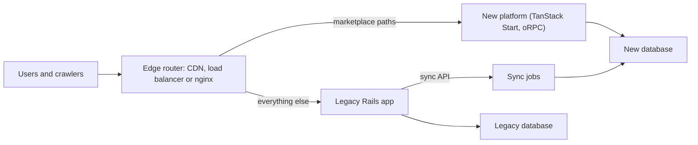

# Platform Migration Strategies

> **Tier:** T1 (know cold) · **Related:** [Multi-tenancy](03-multi-tenancy.md), [Clean architecture (anti-corruption layer)](02-clean-architecture.md), [Background processing patterns (outbox)](06-background-processing-patterns.md), [Third-party API integration (sync patterns)](05-third-party-api-integration.md), [Legacy Rails codebases and upgrades](../05-ruby-on-rails/17-legacy-codebases-and-upgrades.md), [PostgreSQL](../12-databases/04-postgresql.md), [TanStack Start](../07-nextjs-and-tanstack/05-tanstack-start.md), [Authentication and authorization](../04-web-fundamentals/06-authentication-authorization.md), [Multi-tenant platform migration deep dive](../17-projects-deep-dive/04-multi-tenant-platform-migration.md), [Colochousing web and API](../17-projects-deep-dive/02-colochousing-web-and-api.md)
> **On your resume:** at Devntech you contributed to migrating Colochousing's Rails 7 app onto a new multi-tenant TypeScript platform (oRPC, TanStack Start, Drizzle): Rails sync APIs, the marketplace page migration and org-scoped access control.

## Quick revision
- **Default to refactoring in place.** Migrate to a new platform only when the change is structural (tenancy model, stack, product direction) or the new platform exists for other reasons.
- **Big-bang rewrites fail** through moving targets, lost edge-case knowledge, long periods with no user value and one risky cutover. Prefer incremental migration.
- **Strangler fig:** put a routing layer in front, move one slice (route, page, feature or tenant) at a time to the new system, verify, retire the old code for that slice, repeat.
- **Side by side:** separate databases with a sync (clear ownership) beat a shared database (schema coupling, two writers), except as a short transitional step.
- **Sync options:** the new system **pulls from sync APIs** on the old one; **CDC** from the database log (logical replication, Debezium); **events** published through an outbox; **batch backfills** for the initial load.
- **Dual writes** (application writes to both systems) cannot be atomic: a crash or failure between writes leaves them diverged forever. Write once, propagate asynchronously, reconcile.
- **ID mapping:** `legacy_id` columns with unique indexes or a mapping table `(entity, legacy_id, new_id)`; keep legacy IDs for redirects and debugging.
- **Idempotent upserts:** `INSERT ... ON CONFLICT (legacy_id) DO UPDATE ... WHERE existing.version < EXCLUDED.version`, so retries, overlaps and late arrivals are harmless.
- **One source of truth per entity per phase;** the other side is a read-only mirror. Avoid bidirectional sync; if forced, use field ownership, versions and loop prevention.
- **Cursor = (updated_at, id)**, compared as a row value, ordered by both, with a safety lag and periodic full reconciliation. Bulk updates that skip `updated_at` and hard deletes are invisible to it.
- **Deletes:** tombstone records, soft deletes, or periodic ID diffs.
- **Verify:** reconciliation reports (counts and sums per org), checksums per bucket, shadow reads, canaries.
- **SEO:** keep URLs or 301 each one to its exact new equivalent, server-render content and metadata (title, description, canonical, structured data), update sitemaps, watch Search Console and 404 logs.
- **Shared auth:** a shared server-side session on the parent domain, short-lived signed tokens, a central identity provider, or a one-time handoff link.
- **Roll out with flags** per tenant or percentage, rehearse the cutover, define rollback triggers, and plan what happens to writes made in the new system if you roll back.

## 1. Why migrate, and "why not just refactor?"

| Driver | Example |
|---|---|
| Product direction | A single-customer app must become a multi-tenant SaaS for many operators |
| Architecture limits | Tenancy, data model or integrations would need changes in nearly every file |
| Stack and team | One TypeScript stack across web and mobile; easier hiring; end-of-life framework versions |
| Performance and cost | Hot paths that the old design cannot scale without a redesign |

The interviewer's follow-up is almost always "why not just refactor?". A strong answer respects both options: in-place refactoring keeps delivering value and avoids running two systems, so it is the default. Migration wins when the change is so structural that refactoring would amount to a rewrite anyway, or when a new platform is being built for other reasons and the legacy app becomes one of its tenants. Either way, migrate **incrementally**.

## 2. Rewrite vs refactor: the risks

| | Big-bang rewrite | Incremental migration (strangler) | Refactor in place |
|---|---|---|---|
| First user value | After months, at cutover | After the first slice | Continuous |
| Risk | Concentrated in one cutover | Spread over many small cutovers | Low per change |
| Old system | Frozen or a moving target | Shrinks slice by slice | Evolves |
| Rollback | Hard | Per slice | Normal deploy rollback |
| Extra cost | Two teams or a long feature freeze | Routing, sync and running two systems for a while | Working inside legacy constraints |

Why big-bang rewrites fail: the old system keeps changing while you chase parity; years of bug fixes and edge cases live in code nobody has documented; teams over-design the "second system"; and everything rides on one weekend. The legacy codebase is also the best specification you have, which is why [characterization tests](09-testing-fundamentals.md) and reading the old code ([legacy Rails codebases](../05-ruby-on-rails/17-legacy-codebases-and-upgrades.md)) matter.

## 3. The strangler fig pattern

The name comes from a vine that grows around a tree until the tree can be removed. You put a **routing layer** in front of the legacy system and move traffic slice by slice:

1. Choose a slice with a clear boundary (a page, a route group, a feature, or one tenant).
2. Build it in the new system, reading data synced from the old one.
3. Route that slice's traffic to the new system, behind a flag or at the edge.
4. Verify (errors, data, user feedback), then delete the old code for that slice.
5. Repeat until the legacy system serves nothing and can be shut down.



Where routing can live:
- **At the edge** (CDN rules, load-balancer path rules, nginx): cleanest, invisible to users, keeps URLs stable.
- **In the legacy app:** it redirects or proxies migrated routes; easy to start, but the old app stays in the request path.
- **In the new app:** it serves what it knows and proxies everything else to the legacy app.

```text
# nginx at the edge during the migration
location /marketplace/ { proxy_pass http://new_platform; }   # migrated pages
location /              { proxy_pass http://legacy_rails; }  # everything not migrated yet
location ~ ^/listings/(\d+)$ { return 301 /marketplace/rooms/$1; }   # moved URL, permanent redirect
```

## 4. Running old and new side by side

| Option | Pros | Cons |
|---|---|---|
| New system uses the legacy database directly | Fast start, no sync | Legacy schema leaks into the new model; two writers to the same tables; cannot re-model (for example add tenancy) |
| Separate databases plus sync | Each system owns its schema; the new model can be redesigned (multi-tenant, new IDs) | Sync, mapping and verification work; eventual consistency |
| New system calls legacy APIs at request time | No data copy | Latency, availability coupling, load on the old app |

For a migration onto a re-modeled multi-tenant platform, separate databases with a one-way sync is the usual answer, with direct database reads at most as a short read-only bridge.

## 5. Data sync options

### 5.1 The new system pulls from sync APIs on the old one
The legacy app exposes read-only, incremental endpoints per entity; jobs in the new system page through them with a saved cursor and upsert. The legacy database stays private behind a contract you control.

```ruby
# Legacy Rails app: GET /api/sync/v1/houses?after_time=...&after_id=...
class Api::Sync::V1::HousesController < Api::Sync::V1::BaseController   # BaseController checks a service token
  PAGE_SIZE  = 500
  SAFETY_LAG = 30.seconds                       # leave very recent rows for the next run (late commits)

  def index
    after_time = params[:after_time].present? ? Time.iso8601(params[:after_time]) : Time.at(0)
    rows = House.where("(updated_at, id) > (?, ?)", after_time, params[:after_id].to_i)
                .where("updated_at < ?", SAFETY_LAG.ago)
                .order(:updated_at, :id).limit(PAGE_SIZE).to_a
    last = rows.last
    render json: {
      data: rows.map { |h| { id: h.id, name: h.name, city: h.city, updated_at: h.updated_at.iso8601(6) } },
      next: last && { after_time: last.updated_at.iso8601(6), after_id: last.id }   # microsecond precision
    }
  end
end
```

```ts
// New platform: a scheduled job pulls pages and checkpoints after each one
import { sql } from "drizzle-orm";
import { db } from "./db/client";
import { houses } from "./db/schema";

export async function syncHouses(orgId: string) {
  let cursor = await loadCursor("houses");                  // opaque strings, stored in a sync_state table
  for (;;) {
    const page = await legacyApi.get("/api/sync/v1/houses", cursor);   // service token, timeouts, retries
    if (page.data.length === 0) break;
    await db.insert(houses)
      .values(page.data.map((h) => ({ legacyId: h.id, orgId, name: h.name, city: h.city, legacyUpdatedAt: h.updated_at })))
      .onConflictDoUpdate({
        target: houses.legacyId,
        set: { name: sql`excluded.name`, city: sql`excluded.city`, legacyUpdatedAt: sql`excluded.legacy_updated_at` },
      });
    cursor = page.next;
    await saveCursor("houses", cursor);                     // a crash resumes from the last finished page
  }
}
```

Keep cursors and timestamps as strings (or a microsecond-precision column in string mode): a JavaScript `Date` has millisecond precision and can silently shift a cursor. Pull sync is simple and safe for the old system, but it adds latency (the polling interval), loads the legacy database, and needs a separate mechanism for deletes (section 9).

### 5.2 Dual writes and why they are dangerous
"Every time the legacy app saves a booking, also write it to the new platform" sounds simple:

```ruby
booking.save!                       # 1. legacy database: committed
NewPlatform.create_booking(booking) # 2. HTTP call: times out, or the process dies here
```

- **No atomicity:** if step 2 fails after step 1 committed (or succeeds after step 1 rolls back), the systems disagree, and nothing records that they do.
- **Ordering races:** two concurrent updates can reach the systems in different orders, leaving different final values.
- **Coupled availability:** the new platform being down now breaks legacy writes, or you swallow errors and diverge.

Fixes: write to one system only and propagate from its log or an **outbox** row written in the same transaction ([background processing patterns](06-background-processing-patterns.md)), make consumers idempotent, and reconcile periodically to catch whatever still slips through.

### 5.3 Change data capture
CDC streams row changes from the database's write-ahead log, so the application needs no changes and nothing is missed, deletes included.

```sql
-- Postgres logical replication between same-shaped tables (old server -> new server)
-- Publisher needs wal_level = logical
CREATE PUBLICATION legacy_pub FOR TABLE houses, rooms;
-- On the subscriber: tables must already exist with compatible columns
CREATE SUBSCRIPTION legacy_sub CONNECTION 'host=legacy-db dbname=app user=replicator' PUBLICATION legacy_pub;
```

- **Logical replication** copies rows table to table: great for moving a database, poor for re-modeling (no transformation, DDL is not replicated, sequences are not copied).
- **Debezium** (and similar tools) read the log through a replication slot and emit change events, usually into Kafka; your consumers transform rows into the new model.
- Risks: a stalled consumer makes the replication slot retain WAL until the disk fills; schema changes must be coordinated; events are row-level, so business meaning ("lease signed") must be inferred.

### 5.4 Event-driven sync
The legacy app publishes domain events (`lease.signed`, `room.price_changed`) through an outbox; the new platform consumes them. Events carry intent and decouple schemas better than raw rows, but you must change legacy code to emit them and still need a backfill for history.

### 5.5 Batch backfills
Every approach starts with an initial load: page through the sync API, or export and `COPY` in bulk, then switch to incremental sync from a recorded starting cursor. Make backfills resumable (checkpoints), idempotent (upserts) and throttled so they do not hurt the live legacy database.

| Approach | Latency | Legacy changes | Handles deletes | Complexity | Good for |
|---|---|---|---|---|---|
| Pull sync API | Minutes (poll interval) | New endpoints | Needs tombstones | Low | Controlled, incremental migration |
| Dual writes | Instant | Every write path | Partially | Looks low, is high | Avoid |
| CDC | Seconds | None in app code | Yes | Medium to high (infra) | Many tables, low latency |
| Outbox events | Seconds | Emit events | If you emit them | Medium | Semantic sync, long coexistence |
| Batch backfill | Hours, one-off | None | Snapshot only | Low | Initial load, repairs |

## 6. ID mapping

```sql
-- Option A: a legacy_id column on each table (simple, fast lookups)
ALTER TABLE houses ADD COLUMN legacy_id bigint;
CREATE UNIQUE INDEX houses_legacy_id_uq ON houses (legacy_id);   -- the upsert target

-- Option B: one mapping table (keeps legacy concepts out of the new schema)
CREATE TABLE id_mappings (
  entity    text   NOT NULL,          -- 'house', 'room', 'lease'
  legacy_id bigint NOT NULL,
  new_id    uuid   NOT NULL,
  PRIMARY KEY (entity, legacy_id),
  UNIQUE (entity, new_id)
);
```

- New systems usually use UUIDs, so legacy integer IDs cannot simply be copied; if several legacy installs merge into one platform, add the source to the key.
- **Foreign keys:** a synced room arrives with `house_legacy_id`; resolve it through the mapping. Sync parents before children, or park children whose parent has not arrived yet and retry them.
- Keep the mapping after cutover: redirects (`/listings/123` to the new slug), support tickets and debugging all need it.

## 7. Idempotent upserts

Syncs retry, overlap and replay, so applying the same record twice must give the same result, and an **older** version arriving late must not overwrite a newer one:

```sql
INSERT INTO houses (legacy_id, org_id, name, city, legacy_updated_at)
VALUES ($1, $2, $3, $4, $5)
ON CONFLICT (legacy_id) DO UPDATE
SET name = EXCLUDED.name, city = EXCLUDED.city, legacy_updated_at = EXCLUDED.legacy_updated_at
WHERE houses.legacy_updated_at < EXCLUDED.legacy_updated_at;   -- stale versions are ignored
```

Drizzle's `onConflictDoUpdate` can express the same guard with a condition option; the option's name has changed between versions, so check the docs. Without the guard, a slow retry of an old page can roll a record back.

## 8. Source of truth and conflict resolution

Decide, per entity and per phase, which system **owns writes**. The other system shows a read-only mirror (edit buttons hidden or linking to the owning system). An illustrative plan for a co-living style app:

| Entity | Phase 1 | Phase 2 | Phase 3 |
|---|---|---|---|
| Houses, rooms, prices | Legacy owns; synced to new | Legacy owns | New owns; legacy retired for these screens |
| Public marketplace page | Legacy renders | New renders from synced data | New |
| Applications and leases | Legacy | Legacy | New |
| Organizations and roles | New only (new concept) | New | New |

### Going deeper: when both systems accept writes
Avoid this if you can. If both systems must accept writes for a while:
- **Field-level ownership:** each field has one owner (prices from the new system, descriptions from the old).
- **Versions, not wall clocks:** compare a version counter or the source's `updated_at` from one clock; last-writer-wins across servers with skewed clocks loses data.
- **Loop prevention:** tag changes with their origin and skip changes made by the sync user, or a record will bounce back and forth forever.
- **Conflict queue:** when automatic rules cannot decide, park the record for a human.

## 9. Sync cursors and deletes

```sql
SELECT id, name, updated_at
FROM houses
WHERE (updated_at, id) > ($1, $2)     -- row-value comparison: strictly after the last row seen
ORDER BY updated_at, id
LIMIT 500;                            -- backed by an index on (updated_at, id)
```

Why `WHERE updated_at > last_seen` alone breaks:
- **Ties:** a bulk update gives thousands of rows the same timestamp; a page boundary in the middle skips or repeats rows. Adding `id` as a tiebreaker fixes it.
- **Late commits:** a transaction that set `updated_at` earlier but commits after your cursor passed that time is never seen. A safety lag (only read rows older than N seconds), overlapping windows with idempotent upserts, and periodic reconciliation cover it.
- **Silent updates:** Rails `update_all`, `update_columns` and raw SQL do not touch `updated_at`; neither do some data fixes. Set it explicitly in those paths or use a database trigger.
- **Precision:** serialize timestamps with microseconds (`iso8601(6)`) or use an opaque cursor; truncation causes repeats or misses.

**Deletes** never appear in an "updated since" query:

| Strategy | How | Trade-off |
|---|---|---|
| Tombstones | A `deleted_records` table filled on delete; a sync endpoint pages through it | `delete_all` skips callbacks, so a database trigger is more complete |
| Soft deletes | A `deleted_at` column; deletions sync as normal updates | Every query must exclude deleted rows; unique indexes become partial |
| ID diff | Periodically compare all IDs per org on both sides | Expensive, but catches everything; good as a nightly safety net |

```ruby
class House < ApplicationRecord
  after_destroy_commit { DeletedRecord.create!(record_type: "House", record_id: id) }   # tombstone for the sync
end
```

## 10. Verification

- **Reconciliation reports:** per org and entity, compare counts and business sums (rooms, open applications, total monthly rent) on both sides every day; alert on drift.
- **Checksums:** hash normalized fields per bucket on both sides, then drill into mismatching buckets.
- **Shadow reads:** the new code path computes its answer alongside the old one, logs differences and still serves the old answer until diffs reach zero.
- **Canaries:** internal users or one friendly tenant first, then widen.

```sql
-- Run the equivalent query on both databases and compare per org and id bucket
SELECT org_id, id / 10000 AS bucket, count(*) AS row_count,
       md5(string_agg(id::text || '|' || coalesce(name, '') || '|' || rent_cents::text, ',' ORDER BY id)) AS checksum
FROM rooms
GROUP BY org_id, id / 10000;
```

(With UUIDs on the new side, bucket by the mapped legacy ID instead.)

## 11. Migrating a public page without losing SEO

A public marketplace page (houses, rooms, availability) earns traffic from search engines; a careless migration can erase years of rankings.

- **URLs:** keep them identical by routing at the edge, or 301 every old URL to its exact new equivalent using the ID or slug mapping. No redirect chains, and never send everything to the homepage (search engines treat that like a 404).
- **Rendering:** server-side render or pre-render so crawlers get the content and metadata without running JavaScript; TanStack Start supports SSR (check its docs for the details in your version).
- **Metadata parity:** titles, meta descriptions, canonical URLs, Open Graph tags, `hreflang` if the site serves several languages, structured data (JSON-LD), and the same `robots` directives. Never ship a staging `noindex` to production.
- **Sitemaps and robots.txt:** publish the new URLs in the sitemap, keep migrated paths crawlable, resubmit in Search Console.
- **Status codes:** 200 for real pages, 404 or 410 for listings that are gone, 301 for moved ones; avoid "soft 404" pages that return 200 with an empty state.
- **Performance:** match or beat Core Web Vitals (LCP, INP, CLS); a slower page can rank lower.
- **Monitoring:** compare organic traffic and rankings for key pages before and after, watch crawl errors and 404 logs, and keep redirects for a long time (a year or more).

```ruby
# Legacy config/routes.rb: permanent redirects for pages that moved
get "/listings/:slug", to: redirect("/marketplace/%{slug}")     # redirect() defaults to 301
get "/listings",       to: redirect("/marketplace")
```

## 12. Sharing authentication across the two systems

| Option | How | Watch out for |
|---|---|---|
| Shared server-side session | An opaque session ID cookie on the parent domain; both apps read the session from Redis or a table | Rails' default cookie store is encrypted with Rails-specific keys, so move to a store both stacks can read |
| Short-lived signed tokens | One system issues a JWT; the other verifies it with the public key | Revocation and logout are harder; keep lifetimes short |
| Central identity provider (OIDC) | Both apps are clients of one identity provider | More setup, but the clean long-term answer |
| One-time handoff link | The old app creates a single-use token valid for seconds and redirects; the new app exchanges it for its own session | Single use, short TTL, HTTPS only, bound to the user |

Serving both apps under one domain (path routing at the edge) makes cookies easier to share; subdomains need cookie `Domain` and `SameSite` settings planned. Logout must end both sessions, and mobile apps may need tokens accepted by both APIs during the transition. Background: [authentication and authorization](../04-web-fundamentals/06-authentication-authorization.md).

## 13. Feature flags and gradual rollout

Flags let you move tenant by tenant, start with internal users, roll out to a percentage, and switch back in seconds:

```ruby
Flipper.enable_actor(:new_marketplace, organization)        # actors respond to flipper_id
Flipper.enable_percentage_of_actors(:new_marketplace, 10)
redirect_to new_marketplace_url if Flipper.enabled?(:new_marketplace, current_organization)
```

Tenant-by-tenant rollout fits a multi-tenant target well: each org moves when its data is verified. Remove flags and dead code once a slice is complete; long-lived flags become their own debt.

## 14. Cutover and rollback plans

1. **Before:** freeze schema changes on the legacy side for the entities being moved; rehearse the cutover on staging with production-sized data; write go/no-go criteria; announce the window (mind every stakeholder's time zone).
2. **Cutover:** switch legacy writes for the entity to read-only (banner), run the final delta sync, run reconciliation (counts and checksums must match), flip ownership (flags or routing), smoke-test the key flows, watch errors, latency and business metrics.
3. **Rollback triggers:** decided in advance (error rate, data mismatch, a broken payment or booking flow), with the exact steps written down.
4. **The data question:** once the new system accepts writes, rolling back means syncing those writes back or replaying them by hand. Keep the legacy system runnable (read-only) and the sync code alive until you are confident.
5. **Decommission:** remove old routes and code, archive the legacy data, shut the old pieces down, update documentation.

## 15. Stakeholder communication

- A written plan: phases, slices, owners, dates, risks and the rollback strategy.
- Short weekly status updates: done, next, risks, decisions needed (async-friendly for international clients).
- A demo per slice, and explicit sign-off before each cutover.
- User-facing notices for changed URLs, downtime windows or new logins; a briefing for the support team.
- A post-cutover note with verification results and what remains.

## 16. Anti-patterns

- A big-bang cutover with no rehearsal and no rollback path.
- Dual writes from application code with no reconciliation.
- The new system reading and writing the legacy database "temporarily" for a year.
- Copying legacy bugs and odd data verbatim, or redesigning everything at once so nothing ships.
- Letting the legacy system keep changing the entities being migrated without a freeze or a sync plan.
- Sync code with no owner, no monitoring and no alerting.
- Measuring success by "deployed" instead of "verified": counts, checksums, traffic and SEO metrics.

## Common pitfalls
- Cursors on `updated_at` alone, missing rows on ties, late commits or bulk updates that skip timestamps.
- Ignoring deletes, so removed rooms or users live on in the new system.
- No stale-write guard on upserts, so a retried old page rolls records back.
- Parsing cursor timestamps into JavaScript `Date` objects and losing microseconds.
- Syncing children before parents with no retry, leaving orphans or failed rows.
- Losing legacy IDs, which breaks redirects and makes support tickets impossible to trace.
- Redirecting all old URLs to the homepage, or forgetting server rendering, and watching organic traffic collapse.
- Cookie and session assumptions that break when the two apps live on different subdomains.
- A sync job that loads the legacy production database so hard it slows the live app.

## How to talk about this in an interview
- You contributed to a real migration: Colochousing's Rails 7 app moving onto a new multi-tenant TypeScript platform. Your named pieces are the Rails sync APIs, the marketplace page migration and org-scoped access control; the strategy itself was a team and client decision, so say "we" for strategy and "I" for your parts.
- Walk through it as a strangler migration: the new platform takes over slices (the marketplace page was one), legacy data reaches it through sync APIs, and access is scoped per org.
- Show depth with the hard parts: cursor design, deletes, idempotent upserts, ID mapping, source of truth per entity, SEO on the public page, and verification.
- If asked what you would do differently, pick something concrete such as adding reconciliation reports earlier or planning tombstones from day one, but only if it is true for your project.

> **Fill in:** which entities the Rails sync APIs exposed, how the new platform pulled them (schedule, cursor fields, page size), and how deletes and failures were handled.

> **Fill in:** what the marketplace page migration involved: URL strategy (same URLs or redirects), server rendering in TanStack Start, metadata, and how you checked nothing broke for SEO.

> **Fill in:** why the client moved to the new platform, how traffic was switched (edge routing, links, flags), and what the cutover looked like.

## Interview questions

**Q1. Why would a company migrate to a new platform instead of refactoring the existing one?**
Refactoring in place is the default because it delivers value continuously and avoids running two systems. Migration makes sense when the change is structural (a single-tenant app becoming a multi-tenant SaaS, a stack change, an end-of-life framework) so refactoring would effectively be a rewrite, or when a new platform is being built anyway. Even then, migrate incrementally.
*Follow-up:* How would you justify it to a client? In business terms: what the old system blocks, the cost and risk of each option, and how incremental delivery limits that risk.

**Q2. What are the risks of a big-bang rewrite?**
The old system keeps changing so parity is a moving target, undocumented edge cases and bug fixes get lost, there is no user value until the end, the second system gets over-designed, and everything rides on one cutover that is hard to roll back.
*Follow-up:* What do you do instead? A strangler migration: move one slice at a time behind a routing layer, with verification and rollback per slice.

**Q3. What is the strangler fig pattern, and how do you route traffic?**
You put a routing layer in front of the legacy system and move functionality slice by slice (page, route group, feature or tenant) to the new system until the old one can be removed. Routing can happen at the edge (CDN, load balancer, nginx path rules), inside the legacy app (redirects or proxying), or in the new app (proxying unknown routes back).
*Follow-up:* How do you pick the first slice? Low risk, clear boundary, visible value, and few writes; a read-heavy public page is a common choice.

**Q4. How would you sync data between an old and a new system?**
Usually one-way from the system of record: an initial batch backfill, then incremental sync by pulling from sync APIs with a cursor, by CDC from the database log, or by events from an outbox. Writes are idempotent upserts keyed on legacy IDs with a stale-version guard; deletes come through tombstones or soft deletes; daily reconciliation catches drift.
*Follow-up:* Which would you start with? A pull sync API is simple and keeps the legacy database private; CDC when many tables need low latency and you can run the infrastructure.

**Q5. What is the dual-write problem, and how do you avoid it?**
Writing the same change to two systems from application code cannot be atomic: if the second write fails after the first commits (or the process dies in between), the systems silently diverge, and concurrent writes can arrive in different orders. Avoid it by writing to one place and propagating asynchronously from its log or a transactional outbox, with idempotent consumers and reconciliation.
*Follow-up:* Is dual writing ever acceptable? Only with reconciliation that detects and repairs divergence, and never for data where a mismatch costs money.

**Q6. What is change data capture, and when would you use it?**
CDC reads committed changes from the database's write-ahead log and streams them (Postgres logical replication, or Debezium into Kafka). It needs no application changes and captures every insert, update and delete. Use it for many tables or low latency; watch replication slots that retain WAL when consumers stall, and coordinate schema changes.
*Follow-up:* Logical replication or Debezium? Logical replication copies same-shaped tables (moving a database); Debezium-style events let consumers transform rows into a new model.

**Q7. How would you design a sync API on the legacy system?**
Read-only, versioned endpoints per entity, authenticated with a service token, paginated by an `(updated_at, id)` cursor with microsecond precision, returning a stable serialized shape plus a `next` cursor, with a safety lag for late commits and a separate tombstones endpoint for deletes. Keep page sizes modest and indexes on `(updated_at, id)` so it does not hurt the live app.
*Follow-up:* Why not offset pagination? Rows inserted or updated during the sync shift offsets, causing skipped or duplicated records.

**Q8. Why is `updated_at` alone a bad sync cursor?**
Many rows can share a timestamp (bulk updates), so page boundaries skip or repeat rows; transactions can commit after the cursor passed their timestamp; and `update_all` or raw SQL may not touch `updated_at` at all. Use `(updated_at, id)` with a row-value comparison, a safety lag, idempotent overlap and periodic full reconciliation.
*Follow-up:* How do you handle `update_all` in Rails? Set `updated_at: Time.current` explicitly in those calls, or maintain it with a trigger.

**Q9. How do you handle deletes in an incremental sync?**
Deleted rows never appear in "changed since" queries, so record them: a tombstones table (written by callbacks or, more completely, a database trigger) exposed through its own endpoint, soft deletes that sync as ordinary updates, or a periodic diff of all IDs per org as a safety net.
*Follow-up:* Why can callbacks miss deletes? `delete_all` and raw SQL skip ActiveRecord callbacks.

**Q10. How do you map IDs between the old and new systems?**
Keep a `legacy_id` column with a unique index on each new table (also the upsert target), or a mapping table `(entity, legacy_id, new_id)`. Resolve foreign keys through the mapping, syncing parents first or retrying children whose parent has not arrived. Keep the mapping after cutover for redirects and support.
*Follow-up:* What if several legacy databases merge into one? Include the source in the key, since their IDs overlap.

**Q11. How do you make a sync idempotent?**
Upsert on a natural or legacy key (`ON CONFLICT (legacy_id) DO UPDATE`), set absolute values from the source instead of applying deltas, guard against stale versions with a `WHERE existing.version < EXCLUDED.version` condition, and checkpoint cursors only after a page is written. Then retries and overlapping windows are harmless.
*Follow-up:* Why the version guard? A delayed retry of an old page would otherwise overwrite newer data.

**Q12. How do you decide the source of truth, and what if both systems accept writes?**
Assign one owner per entity per phase and make the other side a read-only mirror. If both must write for a while, give each field one owner, compare versions from a single clock rather than wall-clock time across servers, tag changes with their origin to stop sync loops, and send undecidable conflicts to a human queue.
*Follow-up:* What is a sync loop? A change synced from A to B is detected as a change in B and synced back, forever.

**Q13. How do you verify that migrated data is correct?**
Daily reconciliation of counts and business totals per org and entity, checksums over normalized fields per bucket with drill-down, shadow reads comparing old and new answers in production, spot checks with business users, and canary rollouts before widening.
*Follow-up:* What do you do with a mismatch? Find the bucket, then the rows, fix the sync bug, and re-sync those rows idempotently.

**Q14. How do you keep SEO when migrating a public page?**
Keep the same URLs (route at the edge) or 301 each old URL to its exact new equivalent; server-render content and metadata (title, description, canonical, structured data, `hreflang` if multilingual); update the sitemap and keep pages crawlable; return correct status codes; match page speed; and monitor Search Console, 404 logs and organic traffic before and after.
*Follow-up:* 301 or 302? 301 for permanent moves so search engines transfer signals to the new URL; 302 only for temporary detours.

**Q15. How do you share authentication between the old and new systems?**
Options: a shared server-side session store keyed by a cookie on the parent domain, short-lived signed tokens that both verify, a central identity provider both use via OIDC, or a single-use handoff token on redirect. Same-domain path routing makes cookies easiest; logout must end both sessions.
*Follow-up:* Why can the new app not just read the Rails session cookie? Rails encrypts and signs it with keys and formats specific to Rails; reimplementing that in another stack is brittle.

**Q16. Walk me through a cutover and rollback plan.**
Rehearse on staging with production-sized data, freeze legacy schema changes, put the entity's legacy writes into read-only mode, run the final delta sync, reconcile until counts and checksums match, flip routing or flags, smoke-test and monitor. Rollback triggers and steps are written in advance; writes made in the new system after cutover need a reverse sync or manual replay, so keep the legacy side runnable until confident.
*Follow-up:* How do you reduce cutover risk further? Move tenant by tenant or slice by slice, so each cutover is small.

**Q17. What anti-patterns do you watch for in migrations?**
Big-bang cutovers without rollback, dual writes without reconciliation, the new system living on the legacy database indefinitely, migrating while the legacy entities keep changing, sync code without monitoring, and declaring victory at deploy instead of after verification.
*Follow-up:* Which one bites hardest? Unmonitored sync: drift accumulates silently until users notice wrong data.

## Further reading
- PostgreSQL logical replication: https://www.postgresql.org/docs/current/logical-replication.html
- PostgreSQL `INSERT ... ON CONFLICT`: https://www.postgresql.org/docs/current/sql-insert.html
- Rails routing redirects: https://guides.rubyonrails.org/routing.html#redirection
