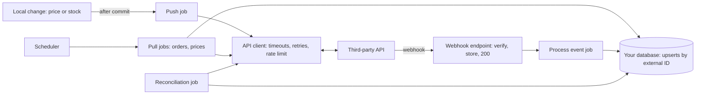

# Third-Party API Integration

> **Tier:** T1 (know cold) · **Related:** [Background jobs with Sidekiq](../05-ruby-on-rails/09-background-jobs-sidekiq.md), [Background processing patterns](06-background-processing-patterns.md), [Clean architecture (ports and adapters)](02-clean-architecture.md), [E-commerce domain](07-ecommerce-domain.md), [Redis](../12-databases/10-redis.md), [Web security](../04-web-fundamentals/07-web-security-owasp.md), [Testing fundamentals](09-testing-fundamentals.md), [Observability and debugging](../14-devops-and-tools/05-observability-and-debugging.md), [CrystalCommerce deep dive](../17-projects-deep-dive/01-crystalcommerce.md)
> **On your resume:** CrystalCommerce at Devntech: you integrated PriceCharting as a sales channel, with background jobs syncing listings, prices, stock and orders, and imported PriceCharting market prices into the catalog so 700+ stores can price inventory from market data.

## Quick revision
- Two shapes: a **data source** you pull from (market prices) and a **sales channel** you push to and pull from (listings, prices and stock out; orders in).
- **Read the docs first:** auth, rate limits and quotas, pagination, identifiers, money and time formats, error codes, idempotency support, webhooks, sandbox, versioning and terms of use.
- **Wrap the API in one client class** (an adapter): base URL, key from credentials, explicit open and read timeouts, typed errors, retries with exponential backoff and **jitter** for safe requests only, redacted logging.
- **Retry:** timeouts, connection errors, 5xx, and 429 after `Retry-After`. **Do not retry:** other 4xx. Retry a POST only with an idempotency key or another dedupe guarantee.
- Short in-process retries for blips; long waits by **rescheduling the job**, never by sleeping in a worker thread.
- **Circuit breaker:** after repeated failures stop calling for a cooldown (open), try one request (half-open), resume when it works (closed).
- **Rate limits:** budget calls on your side with a shared Redis **token bucket** or a dedicated low-concurrency queue; prioritize orders over price refreshes; use bulk endpoints.
- **Pagination:** follow the provider's cursor or next link, checkpoint after each page, keep each job short, dedupe by external ID.
- **Polling vs webhooks:** webhooks are fast and cheap but can be missed, duplicated or reordered; polling is simple but laggy. Production systems use webhooks plus periodic polling or reconciliation.
- **Webhook security:** HTTPS, HMAC signature over the **raw body** checked in constant time, timestamp tolerance against replays, dedupe by event ID, persist then return 2xx fast, process in a job.
- **Data mapping:** store external IDs with a unique `(channel, external_id)`, match products by identifiers before fuzzy titles, map condition grades through a table per channel, keep money in minor units plus currency.
- **Sync state:** per record (`sync_status`, `last_synced_at`, `last_error`) and per integration (cursor, last success, consecutive failures) for resuming, alerting and showing status to users.
- **Reconciliation** jobs repair drift from lost webhooks, exhausted retries and manual edits on the other side.
- **Alert on rates and staleness**, not on single errors; alert immediately on auth failures.
- **Test** with fakes for use cases, WebMock or VCR for the client, contract checks on response shapes, and the provider's sandbox; never call real APIs in CI.
- **Overselling:** your platform is the inventory source of truth; channels get available stock (on hand minus reserved minus buffer), decrements are atomic, and stock changes are pushed within seconds.

## 1. Two shapes of integration

| | Data source (market prices) | Sales channel (marketplace) |
|---|---|---|
| Direction | Pull only | Push listings, prices, stock; pull orders |
| Frequency | Scheduled (nightly, hourly) | Near real time for stock and orders; batched for catalog details |
| Volume | Very large catalogs, bulk-friendly | Per change, bursty |
| Failure impact | Stale prices | Overselling, missed orders, unhappy buyers |
| Main risks | Matching products, quota use | Consistency, idempotency, ordering |



In words: local changes enqueue push jobs after commit; scheduled jobs pull orders and prices; webhooks are verified, stored and processed in jobs; everything goes through one client; a reconciliation job compares both sides and repairs drift. The Sidekiq-specific version (fan-out per store, cursors, checkpoints) is in [background jobs](../05-ruby-on-rails/09-background-jobs-sidekiq.md).

## 2. Read the docs before writing code

| Question | Why it matters |
|---|---|
| How do I authenticate, and where does the key go (header or query)? | Keys in query strings leak into logs and proxies |
| What are the rate limits and daily quotas, per key or per endpoint? Which headers report them? | Decides your throttling design and whether a full sync fits in a night |
| How does pagination work? | Offsets drift; cursors must be stored |
| What is the stable identifier for each entity? Are product codes (UPC, EAN) available? | Matching and upserts |
| How are money, decimals, currencies, time zones and conditions represented? | Mapping bugs are silent |
| Which errors are retryable? Is there idempotency support for writes? | Retry policy and duplicate prevention |
| Are there webhooks? How are they signed and retried? | Latency, security, dedupe |
| Is there a sandbox or test mode? | Safe testing |
| How are versions and deprecations announced? | Avoiding surprise breakage |
| What do the terms allow (caching, display, attribution)? | Legal and contractual limits |

Write the answers down, ask the provider about gaps, and spike calls from a console before designing jobs around assumptions. A quick budget check prevents a bad design: 500,000 listings refreshed one request each at 5 requests per second is 100,000 seconds, about 28 hours, so a "nightly full refresh" cannot work without bulk endpoints or change-only syncs.

## 3. The API client wrapper

One class per provider, used by every job and controller, so timeouts, retries, errors and logging are consistent and the rest of the app never sees raw HTTP. A Ruby version with only the standard library:

```ruby
require "net/http"
require "json"
require "time"

class MarketDataClient
  class Error < StandardError; end
  class ClientError < Error; end                      # 4xx: our request is wrong; retrying will not help
  class ServerError < Error; end                      # 5xx: may succeed later
  class RateLimited < Error
    attr_reader :retry_after
    def initialize(retry_after)
      @retry_after = retry_after
      super("rate limited, retry after #{retry_after}s")
    end
  end

  RETRYABLE    = [Net::OpenTimeout, Net::ReadTimeout, Errno::ECONNRESET, Errno::ECONNREFUSED, ServerError].freeze
  MAX_ATTEMPTS = 3

  def initialize(base_url: ENV.fetch("MARKET_DATA_URL"),
                 api_key: Rails.application.credentials.dig(:market_data, :api_key))
    @base = URI(base_url)
    @api_key = api_key
  end

  # GET is safe to retry. Rate limits are raised to the caller (the job reschedules itself).
  def get(path, params = {})
    attempts = 0
    begin
      attempts += 1
      request(Net::HTTP::Get, path, params)
    rescue *RETRYABLE
      raise if attempts >= MAX_ATTEMPTS
      sleep(backoff(attempts))
      retry
    end
  end

  private

  def request(verb, path, params)
    uri = URI.join(@base, path)
    uri.query = URI.encode_www_form(params) if params.any?
    req = verb.new(uri)
    req["Authorization"] = "Bearer #{@api_key}"       # however the provider expects the key; prefer headers
    req["Accept"] = "application/json"

    res = Net::HTTP.start(uri.host, uri.port, use_ssl: uri.scheme == "https", open_timeout: 3, read_timeout: 10) do |http|
      http.request(req)
    end

    case res
    when Net::HTTPSuccess         then JSON.parse(res.body)
    when Net::HTTPTooManyRequests then raise RateLimited.new(retry_after_seconds(res["Retry-After"]))
    when Net::HTTPServerError     then raise ServerError, "HTTP #{res.code} from #{uri.path}"
    else raise ClientError, "HTTP #{res.code} from #{uri.path}: #{res.body.to_s[0, 200]}"
    end
  end

  def backoff(attempt, base: 0.5, cap: 8.0)
    rand * [cap, base * (2**attempt)].min             # "full jitter": random point in the exponential window
  end

  def retry_after_seconds(header)
    return 30 if header.nil?
    Integer(header, exception: false) || [(Time.httpdate(header) - Time.now).ceil, 1].max
  rescue ArgumentError
    30                                                # unparseable header: fall back to a safe default
  end
end
```

- **Timeouts:** Net::HTTP's defaults are far too long for background workers; a hung connection holds a thread and a database connection. Set connect and read timeouts explicitly.
- **Backoff with jitter:** exponential backoff widens the wait window on each attempt (up to 1 s, 2 s, 4 s, capped at 8 s here); jitter picks a random point in that window so a thousand jobs that failed together do not retry together and knock the provider over again (the thundering herd).
- **What to retry:** timeouts, connection resets, 5xx and, after the indicated wait, 429. Never retry other 4xx (fix the request or the data) and alert on 401 or 403 (a revoked key).
- **Retrying writes:** a POST that timed out may have succeeded. Retry only with an idempotency key header (if the provider supports one), or send your own reference (SKU, order number) and look it up before creating again; treat "already exists" as success.
- **In-process vs job retries:** keep in-process retries to a few seconds total; anything longer (rate limits, outages) belongs to the job system so worker threads are not asleep. Sidekiq's retry behavior is covered in [background jobs](../05-ruby-on-rails/09-background-jobs-sidekiq.md).

### Circuit breaker
| State | Behavior | Moves to |
|---|---|---|
| Closed | Calls go through; failures are counted | Open after N failures in a window |
| Open | Calls fail fast without touching the network | Half-open after a cooldown |
| Half-open | One trial call is allowed | Closed if it succeeds, open again if it fails |

During a provider outage this stops thousands of jobs from each waiting for timeouts, frees your workers, and gives the provider room to recover. Ruby gems such as circuitbox and stoplight, and opossum in Node, implement it; store breaker state in Redis so all processes share it.

## 4. Rate limits

On the server side a limited API answers **429 Too Many Requests**, often with `Retry-After` (seconds or an HTTP date) and sometimes headers reporting remaining quota (names vary by provider). Do not rely on hitting 429s: budget calls on your side.

```ruby
# Shared token bucket in Redis: every Sidekiq process draws from the same budget
class TokenBucket
  SCRIPT = <<~LUA
    local tokens_key = KEYS[1]
    local rate, capacity, now = tonumber(ARGV[1]), tonumber(ARGV[2]), tonumber(ARGV[3])
    local state = redis.call("HMGET", tokens_key, "tokens", "ts")
    local tokens = tonumber(state[1]) or capacity
    local ts = tonumber(state[2]) or now
    tokens = math.min(capacity, tokens + math.max(0, now - ts) * rate)   -- refill for the elapsed time
    local allowed = 0
    if tokens >= 1 then
      tokens = tokens - 1
      allowed = 1
    end
    redis.call("HSET", tokens_key, "tokens", tokens, "ts", now)
    redis.call("EXPIRE", tokens_key, 3600)
    return allowed
  LUA

  def initialize(redis:, key:, rate:, capacity:)
    @redis, @key, @rate, @capacity = redis, key, rate, capacity
  end

  def take?
    @redis.eval(SCRIPT, keys: [@key], argv: [@rate, @capacity, Time.now.to_f]) == 1
  end
end

BUCKET = TokenBucket.new(redis: Redis.new, key: "rl:market_data", rate: 5, capacity: 10)  # 5/s, bursts of 10
raise MarketDataClient::RateLimited.new(1) unless BUCKET.take?   # inside a job: reschedule, do not spin
```

The Lua script runs atomically in Redis, so concurrent workers cannot both take the last token. Passing `now` from each worker assumes their clocks agree; calling Redis's `TIME` inside the script avoids clock skew. Other tools:
- **Throttled queue:** route API jobs to a dedicated queue served by a small fixed number of threads, which caps concurrency simply.
- **Built-in limiters:** Sidekiq Enterprise's `Sidekiq::Limiter`, BullMQ's worker `limiter` option (jobs per duration for the queue).
- **Priorities:** orders and stock first, prices next, catalog details last; reserve part of the budget for interactive actions.
- **Fewer calls:** bulk endpoints, conditional requests (`ETag` with `If-None-Match` returning 304), caching responses the terms allow you to cache, and syncing only what changed.

Fixed and sliding window limiters are shown in [Redis](../12-databases/10-redis.md); the inbound side (limiting your own API) is a [system design case study](../15-system-design/02-case-studies.md).

## 5. Paginating remote APIs

| Style | How | Watch out for |
|---|---|---|
| Page or offset | `?page=3&per_page=100` | Items shift when data changes mid-sync: skips and duplicates |
| Cursor or next token | `?cursor=abc` from the previous response | Store the token; tokens may expire |
| Time window | `?updated_since=...` | Boundary ties and late updates: overlap windows and dedupe |
| Link header | `Link: <...>; rel="next"` | Follow the URL as given instead of building it |

```ruby
# Lazily iterate every item across pages; field names depend on the provider
def each_item(path, params = {})
  return enum_for(:each_item, path, params) unless block_given?
  cursor = nil
  loop do
    body = get(path, params.merge(cursor: cursor).compact)
    body.fetch("items").each { |item| yield item }
    cursor = body["next_cursor"]
    break if cursor.nil?
  end
end
```

Checkpoint the cursor after each page, cap the pages handled per job and re-enqueue with the cursor (short jobs survive deploys), and dedupe by external ID because overlaps happen.

## 6. Polling vs webhooks

| | Polling | Webhooks |
|---|---|---|
| Latency | Up to the polling interval | Seconds |
| Cost | Calls even when nothing changed; uses quota | Calls only on change |
| Your infrastructure | Just a scheduled job | A public HTTPS endpoint, verification, a queue |
| Reliability | You control retries; nothing is "missed" if the cursor is sound | Deliveries can be lost (your downtime, provider gives up), duplicated or out of order |
| Ordering | Follows the cursor | Not guaranteed |
| Good for | Providers without webhooks, bulk data, reconciliation | Orders, payments, status changes |

The robust answer is **both**: webhooks as fast triggers, plus periodic polling or reconciliation as the safety net. A webhook can even be just a nudge ("something changed for store 42") that triggers a pull of the current state, which sidesteps ordering problems.

## 7. Webhook security and processing

1. **HTTPS only**, and a hard-to-guess endpoint path is not security by itself.
2. **Verify the signature:** compute an HMAC (usually SHA-256) of the **raw body** (often with a timestamp) using the shared secret, and compare it to the header in **constant time**. Parsing and re-serializing JSON changes bytes and breaks the check.
3. **Reject stale timestamps** (for example older than five minutes) so a captured request cannot be replayed later.
4. **Dedupe by event ID** with a unique index: insert first, and treat a duplicate insert as "already received".
5. **Persist, enqueue, return 2xx fast.** Providers time out quickly and retry; slow handlers cause duplicate deliveries.
6. **Process asynchronously and idempotently**, and for important state re-fetch the resource from the API instead of trusting an old payload.
7. Return 2xx for event types you ignore, support **two active secrets** during rotation, and use IP allowlists only as an extra layer.

```ruby
class Webhooks::MarketplaceController < ActionController::API   # no CSRF layer in API controllers
  TOLERANCE_SECONDS = 300

  def create
    body      = request.raw_post                                  # exact bytes the provider signed
    timestamp = request.headers["X-Webhook-Timestamp"].to_s       # header names vary by provider
    signature = request.headers["X-Webhook-Signature"].to_s
    return head(:unauthorized) unless valid_signature?(body, timestamp, signature)

    event  = JSON.parse(body)
    record = WebhookEvent.create!(provider: "marketplace", event_id: event.fetch("id"),
                                  event_type: event.fetch("type"), payload: event)   # unique (provider, event_id)
    ProcessWebhookEventJob.perform_async(record.id)
    head :ok
  rescue ActiveRecord::RecordNotUnique
    head :ok                                                      # duplicate delivery, already stored
  rescue JSON::ParserError, KeyError
    head :bad_request
  end

  private

  def valid_signature?(body, timestamp, signature)
    return false if timestamp.empty? || (Time.now.to_i - timestamp.to_i).abs > TOLERANCE_SECONDS
    secret   = Rails.application.credentials.dig(:marketplace, :webhook_secret)
    expected = OpenSSL::HMAC.hexdigest("SHA256", secret, "#{timestamp}.#{body}")
    ActiveSupport::SecurityUtils.secure_compare(expected, signature)
  end
end
```

```ts
// The same check in TypeScript (for example in a Hono route: const raw = await c.req.text())
import { createHmac, timingSafeEqual } from "node:crypto";

export function verifyWebhook(rawBody: string, timestamp: string, signatureHex: string, secret: string): boolean {
  const age = Math.abs(Date.now() / 1000 - Number(timestamp));
  if (!Number.isFinite(age) || age > 300) return false;              // replay window
  const expected = createHmac("sha256", secret).update(`${timestamp}.${rawBody}`).digest();
  const given = Buffer.from(signatureHex, "hex");
  return given.length === expected.length && timingSafeEqual(given, expected);
}
```

Each provider defines its own scheme (header names, what is signed, encoding); follow theirs exactly. Payment providers are a special case covered in [payments and subscriptions](08-payments-and-subscriptions.md).

## 8. Data mapping

- **External IDs:** store the channel's ID next to yours with `UNIQUE (channel, external_id)`; never assume IDs are numeric or stable across environments.
- **Product matching:** match by strong identifiers first (UPC, EAN, ISBN, the provider's product ID), then by normalized attributes (title, platform or set, edition, region) with fuzzy matching such as Postgres `pg_trgm` similarity. Auto-accept above a confidence threshold, send the rest to a human review queue, and persist the match so it is decided once.
- **Condition grades:** collectibles are priced by condition (for example sealed, complete, loose, or professionally graded), and every channel names grades differently. Keep a mapping table per channel instead of `if` chains, and refuse to list items whose grade has no mapping.
- **Money:** store integer minor units plus a currency code; parse provider decimals with `BigDecimal`, never floats; convert currencies with dated rates. See [e-commerce domain](07-ecommerce-domain.md).
- **Time:** store UTC, parse offsets explicitly, and be careful with date-only fields.
- **Text:** strip or sanitize HTML, respect per-channel length limits, check encodings.
- **Raw payloads:** keep the last raw response in a JSONB column for debugging and reprocessing after a mapping fix.

```sql
CREATE TABLE channel_listings (
  id                  bigint GENERATED ALWAYS AS IDENTITY PRIMARY KEY,
  listing_id          bigint NOT NULL REFERENCES listings (id),
  channel             text   NOT NULL,
  external_id         text,                                   -- NULL until the channel accepts it
  channel_price_cents integer,
  sync_status         text   NOT NULL DEFAULT 'pending',      -- pending, synced, failed, delisted
  last_synced_at      timestamptz,
  last_error          text,
  remote_payload      jsonb,
  UNIQUE (channel, external_id),                              -- several NULLs are allowed in Postgres
  UNIQUE (channel, listing_id)
);

CREATE TABLE condition_mappings (
  channel        text NOT NULL,
  internal_grade text NOT NULL,
  external_code  text NOT NULL,
  PRIMARY KEY (channel, internal_grade)
);
```

## 9. Sync state

```sql
CREATE TABLE sync_states (
  store_id             bigint NOT NULL,
  channel              text   NOT NULL,
  resource             text   NOT NULL,          -- 'orders', 'prices', 'listings'
  cursor               text,
  last_success_at      timestamptz,
  last_error_at        timestamptz,
  last_error           text,
  consecutive_failures integer NOT NULL DEFAULT 0,
  PRIMARY KEY (store_id, channel, resource)
);
```

Per-record state (in `channel_listings`) tells you which items failed and why; per-integration state lets jobs resume from a cursor, powers staleness alerts (`last_success_at < now() - interval '1 hour'`), and lets the UI tell a store owner "last synced 5 minutes ago, 3 listings rejected: missing condition".

## 10. A Sidekiq order import job with stock reservation

```ruby
class ImportChannelOrdersJob
  include Sidekiq::Job
  sidekiq_options queue: :channel_api, retry: 8

  def perform(store_id)
    store = Store.find_by(id: store_id) or return
    state = SyncState.find_or_create_by!(store_id: store.id, channel: "marketplace", resource: "orders")

    MarketplaceClient.for(store).each_order(since: state.cursor) do |remote|      # sorted by update time
      Orders::ImportFromChannel.call(store: store, remote: remote)               # idempotent
      state.update!(cursor: remote.fetch("updated_at"))                          # checkpoint per order
    end
    state.update!(last_success_at: Time.current, consecutive_failures: 0, last_error: nil)
  rescue MarketplaceClient::RateLimited => e
    self.class.perform_in(e.retry_after, store_id)                               # wait without burning retries
  rescue MarketplaceClient::Error => e
    state&.update!(last_error: e.message[0, 500], last_error_at: Time.current,
                   consecutive_failures: state.consecutive_failures + 1)
    raise                                                                        # Sidekiq retries with backoff
  end
end

module Orders
  class ImportFromChannel
    def self.call(store:, remote:)
      Order.transaction do
        order = store.orders.create!(channel: "marketplace", external_order_id: remote.fetch("id"), status: :paid)
        remote.fetch("items").each do |item|
          listing = store.listings.find_by!(sku: item.fetch("sku"))
          qty = item.fetch("quantity")
          taken = Listing.where(id: listing.id).where("stock >= ?", qty)
                         .update_all(["stock = stock - ?", qty])                 # atomic; never below zero
          order.items.create!(listing: listing, quantity: qty, oversold: taken.zero?)
        end
        order.update!(status: :needs_review) if order.items.any?(&:oversold)     # a person cancels or sources it
      end
      PushStockToChannelsJob.perform_async(store.id)                             # after commit: update other channels
    rescue ActiveRecord::RecordNotUnique
      nil                                                                        # unique (channel, external_order_id): already imported
    end
  end
end
```

Why it is safe to run twice: the unique index on `(channel, external_order_id)` turns a re-import into a no-op, the cursor only advances after an order is stored, and stock decrements are atomic conditional updates. Prevent two runs for the same store at once with a unique-job lock or an advisory lock ([background processing patterns](06-background-processing-patterns.md)).

## 11. The TypeScript variant

```ts
export class RateLimitedError extends Error {
  constructor(readonly retryAfterSeconds: number) { super(`Rate limited; retry after ${retryAfterSeconds}s`); }
}
class ClientError extends Error {}                              // 4xx: never retried

const sleep = (ms: number) => new Promise((resolve) => setTimeout(resolve, ms));

export async function apiGet<T>(baseUrl: string, path: string, apiKey: string, maxAttempts = 3): Promise<T> {
  for (let attempt = 1; ; attempt++) {
    try {
      const res = await fetch(new URL(path, baseUrl), {
        headers: { Authorization: `Bearer ${apiKey}`, Accept: "application/json" },
        signal: AbortSignal.timeout(10_000),                    // timeouts abort with a TimeoutError
      });
      if (res.status === 429) throw new RateLimitedError(Number(res.headers.get("retry-after")) || 30);
      if (res.status >= 500) throw new Error(`Upstream error ${res.status}`);
      if (!res.ok) throw new ClientError(`Request failed with ${res.status}`);
      return (await res.json()) as T;
    } catch (err) {
      const retryable = !(err instanceof RateLimitedError) && !(err instanceof ClientError);
      if (!retryable || attempt >= maxAttempts) throw err;      // rate limits go back to the queue
      await sleep(Math.random() * Math.min(8_000, 500 * 2 ** attempt));   // full jitter
    }
  }
}
```

With BullMQ, a queue-level limiter caps job throughput (`new Worker("channel-sync", processor, { connection, concurrency: 2, limiter: { max: 5, duration: 1000 } })`); if one job makes several calls, combine it with a shared token bucket.

## 12. Reconciliation, partial failures and alerting

**Drift is normal.** Webhooks get lost, jobs exhaust their retries, someone edits a listing directly on the marketplace, a bug skips a field. A reconciliation job (daily, or hourly for stock) compares both sides per store, using a bulk export or paging through remote listings: missing on either side, price or stock mismatches, records with an old `last_synced_at`. It re-pushes or re-pulls what it can fix and reports the rest.

**Partial failures:** batch endpoints often return a result per item. Record each item's status and error, keep processing the others, and classify:
- transient (timeouts, 5xx): retry later;
- data problems (missing condition, invalid price): mark the record failed and show the store owner what to fix;
- auth or account problems (401, 403): pause the integration for that store and alert immediately.

**Alerting:** on failure rate over a window, on staleness (no successful sync for two intervals), on a growing dead-job set, on a rising share of 429s, and immediately on auth failures. Dashboards per store and channel make "is it us or them?" answerable in a minute.

## 13. Logging with secrets redacted

- Never log API keys, tokens, `Authorization` headers, webhook secrets or unneeded personal data.
- Prefer keys in headers: URLs end up in access logs, proxies and error trackers. If a provider requires a key in the query string, redact it before logging.
- Rails' `config.filter_parameters` filters incoming request parameters in logs; it does nothing for your own outbound HTTP logs.
- Log structured fields: provider, endpoint template, method, status, duration, attempt, store ID, external ID, request ID, and a truncated error body.
- Secrets also leak through error trackers that capture request objects, exception messages that include URLs, and VCR cassettes (filter them).

## 14. Testing integrations

```ruby
RSpec.describe MarketDataClient do
  let(:client) { described_class.new(base_url: "https://api.example.test", api_key: "test-key") }
  before { allow(client).to receive(:sleep) }                    # no real waiting in specs

  it "retries a 503 and then succeeds" do
    stub_request(:get, "https://api.example.test/products/42")
      .to_return({ status: 503 }, { status: 200, body: { id: "42" }.to_json })
    expect(client.get("/products/42")).to eq("id" => "42")
  end

  it "raises RateLimited with the server's Retry-After" do
    stub_request(:get, "https://api.example.test/products/42").to_return(status: 429, headers: { "Retry-After" => "7" })
    expect { client.get("/products/42") }.to raise_error(MarketDataClient::RateLimited) { |e| expect(e.retry_after).to eq(7) }
  end
end
```

- **Use cases:** test with a fake adapter ([clean architecture](02-clean-architecture.md)); fast and deterministic.
- **The client:** WebMock stubs for success, 429, 5xx then success, timeouts and malformed bodies; `WebMock.disable_net_connect!(allow_localhost: true)` so no test can reach the internet.
- **VCR:** record real sandbox responses once and replay them in CI; filter secrets with `filter_sensitive_data`; re-record periodically so cassettes do not fossilize.
- **Contract checks:** validate recorded and periodic live sandbox responses against the shape you depend on, so provider changes fail in CI instead of production. For services you control, consumer-driven contract tools such as Pact go further.
- **Webhooks:** signed fixtures, a duplicate delivery, a bad signature and an expired timestamp.
- **Node:** MSW or nock intercept `fetch` in tests; Vitest fake timers replace real backoff waits.

## 15. Handling external API changes

- Pin the API version (in the URL or a header) and subscribe to the changelog, deprecation notices and status page.
- Be a **tolerant reader:** ignore unknown fields; map unknown enum values (a new condition code) to "unknown" and alert instead of crashing the sync.
- Validate responses at the boundary so a breaking change fails loudly in one place, not as corrupt data three tables away.
- Keep all provider knowledge in the adapter; put a version switch behind a feature flag when migrating.
- Keep raw payloads so you can reprocess records after fixing a mapping.

## 16. Inventory source of truth and overselling across channels

When one physical item is listed on a store's website and on a marketplace, two buyers can purchase the last unit within seconds of each other.

- **One source of truth:** your platform owns inventory; channels receive **available to sell** = on hand minus reserved minus a per-channel buffer.
- **Reserve atomically** when an order arrives from any channel (conditional `UPDATE ... WHERE stock >= qty`), release on cancellation; short-lived cart reservations if checkout is slow.
- **Buffers:** hold back a unit or two on channels with slow sync, or list single-quantity items on one channel at a time.
- **Propagate fast:** every stock change enqueues a push to the other channels within seconds, debounced per listing so a burst of changes becomes one call (a unique job per listing for a short window, or a "dirty" flag swept every minute).
- **Fastest signals first:** order webhooks where available, frequent order polling otherwise.
- **When it still happens:** the atomic decrement fails, the order is flagged, and a clear policy decides (cancel and refund the later order, notify the buyer, or source the item). Track the oversell rate as a metric.

One-of-a-kind collectibles (a specific graded item) are the hardest case because quantity is always one. The database side of atomic decrements is in [transactions and concurrency](../12-databases/06-transactions-and-concurrency.md); the domain view is in [e-commerce](07-ecommerce-domain.md).

## Common pitfalls
- No timeouts, so a hung provider ties up every worker thread.
- Retrying 4xx errors, or POSTs without idempotency, creating duplicates on the other side.
- Retries without jitter, all failing jobs hammering the provider at the same moment.
- Sleeping inside workers for rate limits instead of rescheduling the job.
- Trusting webhook payloads without signature checks, or verifying against re-serialized JSON instead of the raw body.
- Processing webhooks synchronously, then getting duplicate deliveries because responses were slow.
- Offset pagination over data that changes during the sync.
- Matching products by title only, producing wrong prices on the wrong items.
- Floats for money parsed from decimal strings.
- Logging full URLs with API keys in the query string.
- No reconciliation, so drift from lost events is discovered by customers.
- Tests that call the real API, making CI slow, flaky and quota-hungry.

## How to talk about this in an interview
- This is your flagship integration story: CrystalCommerce's PriceCharting work, both as a **sales channel** (listings, prices, stock and orders synced by background jobs) and as a **data source** (market prices imported into the catalog for 700+ stores). Name both shapes; it shows you understand the difference.
- Structure the answer: client wrapper (timeouts, retries, typed errors), rate-limit strategy, jobs and cursors, idempotent upserts by external ID, matching and condition mapping, overselling, reconciliation and monitoring.
- Be precise about what you built versus the general pattern, and never state PriceCharting's endpoints, limits or auth details unless you are sure of them.
- A good phrase: "I treat every third-party call as something that will be slow, fail, rate-limit me and occasionally lie, and design the sync so that retrying anything is safe."

> **Fill in:** which PriceCharting data you synced in each direction, how often each sync ran, and what triggered it (schedule, store action, webhook).

> **Fill in:** how the integration handled rate limits, retries and failures, and how failed listings were surfaced to stores or the team.

> **Fill in:** how products were matched between the catalog and PriceCharting, and how conditions were mapped.

> **Fill in:** how the market price import worked (batch size, upserts, schedule) and how stores used the imported prices.

## Interview questions

**Q1. How would you integrate a rate-limited third-party API?**
Read the limits and quotas first and estimate whether the workload fits. Wrap the API in one client with timeouts, typed errors and jittered retries. Budget calls on your side with a shared Redis token bucket or a dedicated low-concurrency queue, prioritize critical calls, use bulk endpoints and change-only syncs, and on 429 reschedule the job after `Retry-After` instead of sleeping. Monitor 429 rates and staleness.
*Follow-up:* What if the full sync does not fit the quota? Sync only changes, use bulk exports, spread the work over the day, or negotiate a higher limit.

**Q2. What goes into a good API client wrapper?**
A base URL and credentials from configuration, explicit connect and read timeouts, retries with exponential backoff and jitter for safe requests, typed errors (client, server, rate limited, auth), response parsing and validation, redacted structured logging, metrics, and optionally a circuit breaker. The rest of the app calls domain-shaped methods and never touches HTTP.
*Follow-up:* Why one class? Consistency: every caller gets the same timeouts, retries and logging, and tests can replace one object.

**Q3. How do you implement retries correctly?**
Retry only transient failures (timeouts, connection errors, 5xx, and 429 after the indicated delay), with a small attempt cap, exponential backoff and random jitter. Do not retry 4xx. Retry non-idempotent writes only with an idempotency key or a dedupe check. Keep in-process retries short and hand longer waits to the job scheduler.
*Follow-up:* Why jitter? Without it, all clients that failed together retry together and overload the recovering service again.

**Q4. What is a circuit breaker?**
A wrapper that counts failures to a dependency and, past a threshold, opens: calls fail immediately for a cooldown instead of waiting on timeouts. Then it lets one trial call through (half-open) and closes again if it succeeds. It protects your workers and gives the provider time to recover.
*Follow-up:* Where do you keep its state with many processes? In a shared store such as Redis, so every worker sees the same state.

**Q5. How do you throttle calls across many workers on several servers?**
Use a shared budget: a token bucket in Redis implemented as an atomic Lua script that refills tokens over time and lets a call proceed only when a token is available. Alternatively a dedicated queue with fixed low concurrency, or a built-in limiter (Sidekiq Enterprise, BullMQ). Jobs that cannot get a token reschedule themselves.
*Follow-up:* Why Lua? Read, refill and decrement must happen atomically, or two workers can take the same last token.

**Q6. How do you paginate through a large remote dataset reliably?**
Prefer the provider's cursor or next link over offsets, save the cursor after every page, keep each job to a bounded number of pages and re-enqueue with the cursor, dedupe by external ID, and respect rate limits between pages. For time-window APIs, overlap windows slightly and rely on idempotent upserts.
*Follow-up:* Why are offsets dangerous? Inserts and deletes during the sync shift items between pages, causing skips and duplicates.

**Q7. Polling or webhooks?**
Webhooks give low latency and save calls but need a public endpoint, signature verification and dedupe, and they can be lost, duplicated or reordered. Polling is simple and under your control but laggy and quota-hungry. In production use both: webhooks as triggers and polling or reconciliation as a safety net.
*Follow-up:* How do you handle out-of-order webhooks? Compare event timestamps or versions with stored state, or treat the webhook as a nudge and fetch the current state from the API.

**Q8. How do you secure a webhook endpoint?**
HTTPS; verify an HMAC signature computed over the raw request body (and timestamp) with the shared secret using a constant-time comparison; reject timestamps outside a tolerance window to stop replays; dedupe by event ID; persist and return 2xx fast; process asynchronously; re-fetch critical state from the API; support secret rotation.
*Follow-up:* Why the raw body? The signature covers the exact bytes sent; parsed and re-serialized JSON can differ in spacing or key order.

**Q9. Why respond quickly and process webhooks in a job?**
Providers time out quickly and retry on slow or failed responses, so slow handlers cause duplicate deliveries, and heavy work in the request ties up web workers. Storing the event first also makes processing retryable and auditable. If processing fails, the job retries; the stored event can be replayed after a fix.
*Follow-up:* What status for a bad signature? 401 or 400, so the provider's dashboard shows the failure.

**Q10. What does idempotency mean in an integration, and how do you achieve it?**
Running the same operation twice has the same effect as once. Achieve it with upserts keyed on external IDs, unique indexes on external order IDs and webhook event IDs, absolute values instead of increments when syncing state, idempotency keys for writes to the provider, and cursors that only advance after work is stored.
*Follow-up:* Where do duplicates come from? Job retries, re-queued jobs after deploys, duplicate webhook deliveries and overlapping sync windows.

**Q11. How would you match products from an external catalog to yours?**
Use strong identifiers first (UPC, EAN, ISBN, the provider's product ID), then normalized attributes (title, platform or set, edition, region) with fuzzy similarity scoring. Auto-accept high-confidence matches, queue the rest for human review, store matches in a mapping table, and include condition or variant in the key so prices land on the right variant.
*Follow-up:* What is the cost of a wrong match? Wrong prices on real inventory, which is worse than no price, so prefer precision over recall.

**Q12. What sync state would you store, and why?**
Per record: external ID, sync status, last synced time, last error and a raw payload. Per integration and store: cursor, last success time, last error and consecutive failures. It lets jobs resume, powers alerts on staleness and failure streaks, and lets the UI show users what failed and why.
*Follow-up:* What is a good staleness alert? No successful sync for two expected intervals.

**Q13. How do you handle partial failures in a batch sync?**
Record the outcome per item and keep going: transient errors are retried later, data errors mark the record failed with a readable reason for the user, and auth errors pause the integration and alert. One bad item should never fail the whole batch, and reconciliation re-attempts failed items.
*Follow-up:* How do you avoid hiding systematic failures? Alert on failure rates over a window, not just individual errors.

**Q14. How do you test code that calls an external API?**
Use cases with an in-memory fake adapter; the client with WebMock (or MSW and nock in Node) covering success, 429, 5xx then success, timeouts and bad bodies; VCR cassettes recorded against a sandbox with secrets filtered; contract checks on response shapes; signed webhook fixtures including duplicates and bad signatures. Block real network access in CI.
*Follow-up:* Risk of VCR? Stale cassettes that hide API changes; re-record periodically and keep contract checks against the live sandbox.

**Q15. A provider changes its API. How do you protect yourself?**
Pin versions, follow changelogs and deprecation notices, keep all provider knowledge in one adapter, read tolerantly (ignore unknown fields, map unknown enum values to "unknown" with an alert), validate responses at the boundary so failures are loud and local, keep raw payloads for reprocessing, and run contract checks against the sandbox regularly.
*Follow-up:* What is a tolerant reader? Code that only depends on the fields it needs and does not fail when new fields or values appear.

**Q16. How do you prevent overselling when the same stock is sold on several channels?**
Keep one inventory source of truth, publish available stock (on hand minus reservations minus a buffer) to each channel, decrement atomically when any channel's order arrives, push stock changes to other channels within seconds, and prefer webhooks for order signals. When two sales still collide, the failed decrement flags the order and a defined policy (cancel and refund, or source the item) handles it.
*Follow-up:* Why is quantity one the worst case? There is no margin: any sync delay at all can produce two buyers for one item.

## Further reading
- MDN, 429 Too Many Requests and `Retry-After`: https://developer.mozilla.org/docs/Web/HTTP/Status/429
- Node.js `crypto.timingSafeEqual`: https://nodejs.org/api/crypto.html#cryptotimingsafeequala-b
- Ruby `Net::HTTP`: https://ruby-doc.org/stdlib/libdoc/net/http/rdoc/Net/HTTP.html
