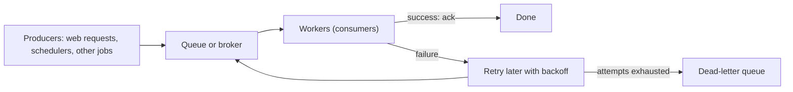

# Background Processing Patterns

> **Tier:** T1 (know cold) · **Related:** [Background jobs with Sidekiq](../05-ruby-on-rails/09-background-jobs-sidekiq.md), [ActiveRecord advanced (locking, outbox)](../05-ruby-on-rails/06-activerecord-advanced.md), [Transactions and concurrency](../12-databases/06-transactions-and-concurrency.md), [Redis](../12-databases/10-redis.md), [Third-party API integration](05-third-party-api-integration.md), [Platform migration strategies](04-platform-migration-strategies.md), [Observability and debugging](../14-devops-and-tools/05-observability-and-debugging.md), [System design case studies](../15-system-design/02-case-studies.md)
> **On your resume:** background jobs across legacy Rails monoliths at Devntech; CrystalCommerce's PriceCharting sync (listings, prices, stock, orders) and market price import; Sidekiq in Colochousing's Rails 7 app; Sidekiq and Redis in your skills.

## Quick revision
- Queues buy fast responses, retries, load leveling, decoupling and scheduling; they cost eventual consistency, duplicates, ordering problems and more operations work.
- **At-most-once:** acknowledge before work, may lose messages. **At-least-once:** acknowledge after work, may duplicate. **Exactly-once delivery** is not achievable end to end; you build **effectively-once** processing from at-least-once delivery plus idempotent consumers.
- **Idempotency patterns:** idempotency keys, a dedupe (inbox) table written in the same transaction as the effect, upserts on natural keys, conditional state transitions (`WHERE status = 'paid'`), absolute values instead of increments.
- **Retries:** transient errors only, exponential backoff with **jitter**, a cap, then a dead-letter queue. Respect `Retry-After`.
- **Poison message:** one that fails every time; after N attempts move it to a **DLQ**, alert, fix, then replay.
- **Ordering** is rarely guaranteed with many workers and retries. Use versions or sequence numbers, re-fetch current state, or serialize per key (SQS FIFO message groups, Kafka partitions keyed by entity).
- **Concurrency control:** unique jobs at enqueue, Postgres advisory locks (`pg_try_advisory_xact_lock`), row locks, `FOR UPDATE SKIP LOCKED` for job claiming, Redis locks for efficiency (not correctness).
- **Cron across servers:** one scheduler, or a scheduler with built-in coordination, plus a per-period run record with a unique key so duplicates do nothing.
- **Fan-out** one job per store or chunk; **fan-in** with batch callbacks (Sidekiq Pro, BullMQ flows, Celery chords) or a completion table plus an atomic "finalize once" claim.
- **Saga:** a multi-step workflow without a distributed transaction; each step has a **compensating action**; do reversible steps first and irreversible ones (emails, captures) last.
- **Long jobs:** chunk, checkpoint a cursor, time-box and re-enqueue, so a deploy or crash repeats at most one chunk.
- **Queues by latency class** (critical, default, low) and by resource (a rate-limited API queue); beware strict priority starving low queues.
- **Backpressure:** when producers outrun consumers, scale consumers within downstream limits, shed or delay low-priority work, slow producers.
- **Monitor queue latency** (age of the oldest job) first, then failure rate, retries, dead set size, duration percentiles and "did the nightly job run".
- **Transactional outbox:** write the business change and an outbox row in one transaction; a relay publishes rows and marks them sent; consumers dedupe. It removes the dual write between the database and the broker.
- **Queue vs log:** job queues delete messages on acknowledgement and spread them across competing workers; logs (Kafka) retain messages, let each consumer group read everything, and support replay.

## 1. Why queues

| Benefit | Example |
|---|---|
| Fast responses | Checkout returns immediately; the confirmation email and invoice PDF happen later |
| Reliability | A failed call to a marketplace API is retried with backoff instead of failing the user's request |
| Load leveling | A spike of 10,000 imported orders waits in a queue instead of overwhelming the database |
| Decoupling | The order service publishes "order paid"; inventory, email and analytics consume it independently |
| Scheduling | Nightly market price imports, monthly rent invoices, reminder emails |
| Isolation | Slow or flaky work runs in separate processes with its own concurrency limits |

The costs: results are not ready when the response returns (eventual consistency), messages can be duplicated, lost (depending on configuration) or reordered, and you now operate brokers, workers, retries and dashboards.

## 2. Producers, brokers and consumers



- **Producer** enqueues a message (job name plus small, serializable arguments, usually IDs).
- **Broker** stores messages until a worker takes them: Redis lists (Sidekiq, BullMQ), database tables (Solid Queue, GoodJob, pg-boss), or a dedicated broker (SQS, RabbitMQ, Kafka).
- **Consumer** takes a message, processes it, then **acknowledges** it (deletes it or commits an offset). Unacknowledged messages become visible again after a **visibility timeout** (SQS) or lease, or are re-queued on shutdown.
- **Concurrency** is threads or processes per worker; **prefetch** is how many messages a consumer holds at once.

## 3. Delivery semantics

| Semantics | How it happens | Failure mode | Fine for |
|---|---|---|---|
| At-most-once | Acknowledge before processing | Crash mid-work loses the message | Metrics, presence pings, cache warming |
| At-least-once | Acknowledge after processing | Crash after the side effect but before the ack reprocesses it | Almost everything, with idempotent consumers |
| Exactly-once | Not achievable end to end over an unreliable network | Systems offer dedupe windows or transactional processing inside their own boundary | Built as at-least-once plus idempotency |

Why duplicates happen even with good tools: a worker crashes after charging a card but before acknowledging; a long job exceeds its visibility timeout and a second worker picks it up; an acknowledgement is lost on the network; a producer retries a publish it thought had failed; a deploy re-queues in-flight jobs. SQS FIFO deduplicates within a five-minute window and Kafka offers transactions for read-process-write within Kafka, but any side effect outside the system (a database row, an email, an HTTP call) still needs an idempotent consumer. Sidekiq is at-least-once, and Celery acknowledges **before** running a task by default unless you set `acks_late`, which shifts it toward at-most-once on worker crashes.

## 4. Idempotency patterns

| Pattern | Use when |
|---|---|
| Idempotency key | Calling an API that supports it (payments); or your own endpoints receiving retries |
| Dedupe (inbox) table | Consuming messages that each have a unique ID |
| Upsert on a natural key | Syncing records (`ON CONFLICT (channel, external_id) DO UPDATE`) |
| Conditional state transition | Workflows: only move `paid` to `shipped` once |
| Absolute values | Syncing state: set `stock = 7` from the source instead of `stock = stock - 1` |
| Claim, then act | Side effects outside the database, such as push notifications ([example](../05-ruby-on-rails/09-background-jobs-sidekiq.md)) |

The inbox pattern makes "record that I processed this message" and "apply the effect" commit or roll back together:

```sql
CREATE TABLE processed_messages (
  consumer     text NOT NULL,
  message_id   text NOT NULL,
  processed_at timestamptz NOT NULL DEFAULT now(),
  PRIMARY KEY (consumer, message_id)
);

BEGIN;
INSERT INTO processed_messages (consumer, message_id) VALUES ('stock-sync', $1)
ON CONFLICT DO NOTHING
RETURNING message_id;                           -- no row returned: a duplicate, so ROLLBACK and acknowledge
UPDATE listings SET stock = $2 WHERE id = $3;   -- the effect, in the same transaction
COMMIT;

-- Conditional transition: running it twice changes nothing the second time
UPDATE orders SET status = 'shipped', shipped_at = now() WHERE id = $1 AND status = 'paid';
```

```ts
// The same inbox pattern with Drizzle
await db.transaction(async (tx) => {
  const fresh = await tx.insert(processedMessages)
    .values({ consumer: "stock-sync", messageId: msg.id })
    .onConflictDoNothing()
    .returning();
  if (fresh.length === 0) return;                          // already processed
  await tx.update(listings).set({ stock: msg.stock }).where(eq(listings.id, msg.listingId));
});
```

Effects outside the database (email, HTTP) cannot join the transaction. Use the provider's idempotency key, or record intent first and make the external step safe to repeat; when neither is possible, decide deliberately between "might happen twice" and "might not happen" and let reconciliation repair the rest.

## 5. Retries with backoff and jitter

| Attempt | Exponential delay (base 1 s, cap 60 s) | With full jitter |
|---|---|---|
| 1 | 2 s | random 0 to 2 s |
| 2 | 4 s | random 0 to 4 s |
| 3 | 8 s | random 0 to 8 s |
| 5 | 32 s | random 0 to 32 s |
| 6+ | 60 s (cap) | random 0 to 60 s |

- **Exponential backoff** gives a struggling dependency room to recover; **jitter** spreads retries so failures that happened together do not retry together (the thundering herd).
- **Classify errors:** retry timeouts, connection errors, 5xx, 429 (after `Retry-After`) and lock timeouts; do not retry validation errors, missing records or bugs. Discard or dead-letter them immediately.
- **Cap attempts** and send exhausted messages to a dead-letter queue; unbounded retries hide problems and waste capacity.
- Knobs by tool: Sidekiq `retry:` and `sidekiq_retry_in`; Active Job `retry_on SomeError, wait: :polynomially_longer, attempts: 5` (the option was named `:exponentially_longer` before Rails 7.1); BullMQ `attempts` with `backoff: { type: "exponential", delay: 1000 }`; Celery `autoretry_for`, `retry_backoff`, `retry_jitter`; SQS visibility timeout plus a redrive policy.

## 6. Poison messages and dead-letter queues

A **poison message** fails every time: bad data, a deleted record, a bug triggered by one input. Without a limit it is retried forever, wasting workers and, in ordered streams, blocking everything behind it.

- After N attempts move it to a **dead-letter queue**: SQS redrive policy with `maxReceiveCount`, RabbitMQ dead-letter exchanges (or the delivery limit on quorum queues), Sidekiq's Dead set, BullMQ's failed set, a DLQ topic in Kafka.
- Alert on DLQ growth; inspect the message and error; fix the code or data; then **replay** (redrive) it, which is safe only because consumers are idempotent.
- Record why messages were discarded; a DLQ nobody reads is just slower data loss.
- In an ordered partition, skip a poison message to a DLQ after a few attempts so the partition keeps moving, and record the skipped offset.

## 7. Ordering guarantees

With several workers, retries and redeliveries, "price changed to 12" can be processed after "price changed to 15" even though it happened first. Options:

| Strategy | How |
|---|---|
| Version or sequence check | Store the version applied; ignore older events |
| Re-fetch current state | The message says "listing 42 changed"; the worker reads the current row or API state |
| Serialize per key | SQS FIFO orders within a message group ID; Kafka orders within a partition, so key by entity ID |
| Commutative updates | Operations whose order does not matter (increment a counter, add to a set) |

```sql
-- Apply a price event only if it is newer than what is stored
UPDATE listings SET price_cents = $1, price_version = $2
WHERE id = $3 AND price_version < $2;
```

Global ordering across all messages is expensive (one consumer at a time); ask whether you really need more than per-entity ordering.

## 8. Concurrency control

| Tool | Guarantees | Notes |
|---|---|---|
| Unique jobs at enqueue | Fewer duplicate jobs | Sidekiq Enterprise, sidekiq-unique-jobs, BullMQ custom `jobId`, Solid Queue concurrency controls; locks expire, so still be idempotent |
| Redis lock (`SET key token NX PX ttl`) | Mutual exclusion while the TTL holds | Good for avoiding duplicate work; not for correctness ([Redis](../12-databases/10-redis.md)) |
| Postgres advisory lock | Mutual exclusion tied to a session or transaction | Transaction-level locks work through PgBouncer transaction pooling |
| Row lock (`FOR UPDATE`) | Serializes writers of the same row | Short critical sections only |
| `FOR UPDATE SKIP LOCKED` | Many workers claim different rows without blocking | How database-backed queues work |

```sql
-- Only one sync per store at a time: (namespace for "channel sync", store id); false if someone holds it
SELECT pg_try_advisory_xact_lock(1001, 42);

-- Claim up to 10 due jobs that no other worker has locked
WITH next_jobs AS (
  SELECT id FROM jobs
  WHERE status = 'queued' AND run_at <= now()
  ORDER BY priority DESC, run_at
  LIMIT 10
  FOR UPDATE SKIP LOCKED
)
UPDATE jobs SET status = 'running', locked_at = now(), attempts = attempts + 1
FROM next_jobs WHERE jobs.id = next_jobs.id
RETURNING jobs.*;
```

Also limit concurrency per resource: a third-party API queue with a few threads, or a per-tenant semaphore so one customer's import cannot occupy every worker. The database details are in [transactions and concurrency](../12-databases/06-transactions-and-concurrency.md).

## 9. Scheduling, and avoiding duplicate cron runs

Plain cron on three app servers runs the nightly job three times. Fixes, often combined:

- **One scheduler process** (a single clock container) that only enqueues work; give it a restart policy since it is a single point of failure.
- **Schedulers with built-in coordination:** sidekiq-cron and Sidekiq Enterprise periodic jobs (Redis), Solid Queue recurring tasks and GoodJob cron (database), BullMQ repeatable jobs (stored in Redis; recent versions call them job schedulers), Celery beat (run exactly one beat instance), a Kubernetes CronJob with `concurrencyPolicy: Forbid` to prevent overlapping runs.
- **A per-period run record** so even a duplicate trigger does nothing:

```sql
CREATE TABLE job_runs (
  job_name   text NOT NULL,
  period     text NOT NULL,                       -- '2026-11' for monthly, '2026-11-03' for daily
  started_at timestamptz NOT NULL DEFAULT now(),
  PRIMARY KEY (job_name, period)
);
INSERT INTO job_runs (job_name, period) VALUES ('monthly-rent-invoices', '2026-11')
ON CONFLICT DO NOTHING
RETURNING job_name;                               -- only the first runner gets a row back
```

Also decide: what happens when a run takes longer than its interval (lock or skip), whether missed runs during downtime are caught up, and which time zone schedules use (in zones with daylight saving time, 02:30 may not exist or may happen twice). Keep the scheduled job tiny: it should only enqueue the real work.

## 10. Batching, fan-out and fan-in

- **Batching:** process items in chunks (upsert 500 rows per statement, send 100 IDs per bulk API call) to cut round trips; handle per-item errors so one bad row does not fail the batch.
- **Fan-out:** a coordinator enqueues one job per store or per chunk: parallelism, failure isolation and short jobs.
- **Fan-in:** run a finalizer when every child is done (send the import report, mark the run complete). Built-in options: Sidekiq Pro batches with callbacks, BullMQ flows (parent and child jobs via `FlowProducer`), Celery chords. A do-it-yourself version must survive duplicate child runs, so record completions with a unique key and let exactly one child claim the finalization:

```ruby
class ImportPriceChunkJob
  include Sidekiq::Job

  def perform(run_id, chunk_no, product_ids)
    MarketPrices::ImportChunk.call(product_ids)                                  # idempotent upserts
    ImportChunk.insert_all([{ import_run_id: run_id, chunk_no: chunk_no }],
                           unique_by: %i[import_run_id chunk_no])                 # a duplicate run adds nothing
    run = ImportRun.find(run_id)                                                 # total_chunks set before fan-out
    return if ImportChunk.where(import_run_id: run_id).count < run.total_chunks

    claimed = ImportRun.where(id: run_id, finalized_at: nil).update_all(finalized_at: Time.current)
    FinalizeImportJob.perform_async(run_id) if claimed == 1                      # exactly one child wins
  end
end
```

A plain counter (`pending = pending - 1`) breaks when a child runs twice, which at-least-once delivery guarantees will eventually happen.

## 11. Sagas and compensating actions

When a workflow spans several services or external APIs, there is no single ACID transaction. A **saga** runs the steps one by one and, if a later step fails, runs **compensating actions** for the steps already done.

| Step | Action (checkout on a store's website) | Compensation |
|---|---|---|
| 1 | Reserve stock | Release the reservation |
| 2 | Authorize the payment | Void the authorization |
| 3 | Book the shipment with the carrier | Cancel the shipment |
| 4 | Capture the payment | Refund it |
| 5 | Send the confirmation email | None possible, which is why it comes last |

- Every step and every compensation must be **idempotent** and retryable; the saga's state is persisted so it resumes after crashes.
- Order steps so reversible ones come first and irreversible ones (sending an email, capturing money) come last.

### Going deeper: orchestration vs choreography
- **Orchestration:** one coordinator (a job driving a state machine stored in the database) calls each step and decides what to compensate. Easy to follow, monitor and change; the coordinator is one more thing to keep healthy.
- **Choreography:** each service reacts to the previous service's event, with no central brain. Fewer central parts and looser coupling, but the overall flow is harder to see, test and debug.

## 12. Long-running and resumable jobs

A job that loops over a million rows for an hour will be interrupted: deploys send `TERM` and wait only a short timeout (25 seconds by default in Sidekiq) before re-queueing, workers crash, and SQS-style leases expire. Design so an interruption repeats at most one small piece:

```ruby
class BackfillBillOrgJob
  include Sidekiq::Job
  TIME_BOX = 20                                           # seconds, under the shutdown timeout

  def perform(after_id = 0)
    deadline = Process.clock_gettime(Process::CLOCK_MONOTONIC) + TIME_BOX
    loop do
      ids = Bill.where(org_id: nil).where("id > ?", after_id).order(:id).limit(1_000).pluck(:id)
      return if ids.empty?                                # finished
      Bill.where(id: ids).update_all("org_id = (SELECT org_id FROM houses WHERE houses.id = bills.house_id)")
      after_id = ids.last                                 # the checkpoint travels in the next job's argument
      break if Process.clock_gettime(Process::CLOCK_MONOTONIC) > deadline
    end
    self.class.perform_async(after_id)                    # continue in a fresh, short job
  end
end
```

- **Chunk** the work, **checkpoint** a cursor (in arguments or a table), **time-box** each run, and keep each chunk idempotent.
- Report progress (a `processed_count` column) so a UI or a person can see it moving.
- Recent Sidekiq versions add iterable jobs and Rails 8.1 adds Active Job continuations, both built around steps and cursors; check their docs before relying on them.

## 13. Priorities and queue design

- **By latency class:** `critical` (payment webhooks, password resets), `default`, `low` (reports, imports). Set a target per queue ("critical waits under 5 seconds").
- **By resource:** a dedicated queue for a rate-limited third-party API with low, fixed concurrency.
- **Strict vs weighted:** strict priority always drains higher queues first and can starve low queues under sustained load; weighted selection (Sidekiq's `-q critical,6 -q default,3 -q low,1`) gives every queue some share.
- **Separate processes** for memory-hungry or slow queues so they cannot delay latency-sensitive work.
- **Few queues:** name them by priority or purpose, not one per job class.
- **Tenant fairness:** split big imports into small chunks interleaved with other work, or cap per-tenant concurrency, so one customer cannot monopolize workers.

## 14. Backpressure

Backpressure is what you do when producers create work faster than consumers finish it, visible as queue latency climbing steadily.

- **Scale consumers,** ideally autoscaling on queue latency rather than CPU, but only up to downstream limits: database connections, third-party rate limits and lock contention cap useful concurrency.
- **Shed or defer** low-priority work (skip a price refresh cycle, pause analytics jobs).
- **Slow the producers:** poll less often, batch more, or answer API clients with 429 or 503 plus `Retry-After`.
- **Stop amplification:** circuit breakers and capped retries keep a failing dependency from multiplying load.
- **Bound queues** where losing or rejecting work is acceptable, so memory does not grow without limit.

## 15. Monitoring

| Signal | Why |
|---|---|
| Queue latency (age of the oldest job) | The user-visible delay; the first thing to alert on |
| Depth and throughput | Whether you are keeping up |
| Failure rate per job class | Spots a broken deploy or dependency |
| Retry set and dead set size | Growing sets mean silent failures |
| Duration percentiles (p50, p95, p99) | Slow jobs hold threads and connections |
| Busy workers vs capacity | Saturation |
| Last successful run of scheduled jobs | A "dead man's switch" alert if the nightly import did not run |

Log each job with its ID, class, tenant, attempt, duration and outcome (never secrets), and propagate a correlation or trace ID from the request that enqueued it so one user action can be followed across web and worker logs. Alerts should fire on sustained conditions (latency above target for 10 minutes, dead set growing) rather than single failures. More in [observability](../14-devops-and-tools/05-observability-and-debugging.md).

## 16. The transactional outbox

"Update the database and publish a message" is a dual write: publish first and a rollback leaves a message about nothing; commit first and a crash loses the message. The outbox makes the message part of the same transaction:

```mermaid
sequenceDiagram
  participant App
  participant DB as Database
  participant Relay as Outbox relay
  participant Broker
  App->>DB: BEGIN; update order; insert outbox row; COMMIT
  Relay->>DB: SELECT unsent rows FOR UPDATE SKIP LOCKED
  Relay->>Broker: publish (message id = outbox row id)
  Relay->>DB: mark rows published
  Note over Broker: consumers dedupe by message id
```

```ruby
Order.transaction do
  order.update!(status: :paid)
  OutboxEvent.create!(aggregate_type: "Order", aggregate_id: order.id, event_type: "order.paid",
                      payload: { order_id: order.id, total_cents: order.total_cents })
end                                                           # both rows commit, or neither does

class OutboxRelayJob                                          # runs every few seconds
  include Sidekiq::Job

  def perform
    OutboxEvent.transaction do
      batch = OutboxEvent.where(published_at: nil).order(:id).limit(100).lock("FOR UPDATE SKIP LOCKED")
      batch.each do |event|
        Broker.publish(event.event_type, event.payload, message_id: event.id)   # stand-in for your broker client
        event.update!(published_at: Time.current)
      end
    end
  end
end
```

- Delivery is **at least once**: if the relay publishes and then crashes before committing, the row is published again, so consumers dedupe by message ID (the inbox pattern from section 4).
- Order per aggregate comes from publishing rows in ID order; parallel relays need partitioning by aggregate.
- **CDC variant:** instead of polling, a log-based tool (Debezium has an outbox event router) streams outbox inserts to the broker.
- Delete or archive published rows regularly and alert on outbox lag (oldest unpublished row).
- Lightweight cousins: enqueue jobs after commit (`after_commit`), or use a database-backed queue whose tables share your database and transaction, which gives the outbox guarantee for jobs directly.

## 17. Tools at a glance

| Tool | Ecosystem | Storage or broker | Notes |
|---|---|---|---|
| Sidekiq | Ruby | Redis | Threads, very fast; Pro and Enterprise add batches, reliable fetch, unique jobs, rate limits, periodic jobs |
| Solid Queue | Ruby (Rails 8 default) | SQL database | `FOR UPDATE SKIP LOCKED`, recurring tasks, concurrency controls; no Redis |
| GoodJob | Ruby (Active Job) | PostgreSQL | Advisory locks, `LISTEN/NOTIFY` for low latency, cron, batches, dashboard |
| Celery | Python | RabbitMQ or Redis | Beat scheduler, chords; set `acks_late` for at-least-once |
| BullMQ | Node | Redis | Delays, retries with backoff, priorities, rate limiter, flows, repeatable jobs |
| pg-boss | Node | PostgreSQL | `SKIP LOCKED` based, scheduling, retries; no extra infrastructure |
| Amazon SQS | Any (managed) | AWS | Standard: at-least-once, best-effort order; FIFO: order per message group, dedupe window; DLQ via redrive |
| RabbitMQ | Any | Broker (AMQP) | Exchanges route to queues, manual acks, prefetch, dead-letter exchanges, quorum queues |
| Kafka | Any | Distributed log | Partitions, consumer groups, offsets, retention and replay; event streaming more than task queues |

| | Queue (Sidekiq, SQS, RabbitMQ) | Log (Kafka) |
|---|---|---|
| After processing | Message is deleted | Message stays until retention expires |
| Consumers | Compete for messages | Each consumer group reads every message |
| Replay | No (except DLQ redrive) | Yes, by resetting offsets |
| Ordering | Weak with many workers | Per partition |
| Best for | Tasks: send this email, sync this store | Event streams, CDC, analytics, many independent consumers |

## Common pitfalls
- Assuming exactly-once and writing non-idempotent consumers (double charges, duplicate emails, doubled stock decrements).
- Retrying everything forever, including validation errors, so the retry queue hides real failures.
- No jitter, so retries synchronize and hammer a recovering dependency.
- Relying on message order with multiple workers and retries.
- Cron on every server, or schedulers with no per-period guard.
- Fan-in counters that break when a child runs twice.
- Hour-long jobs with no checkpoints, restarted from zero after every deploy.
- Strict priorities that starve low queues for days.
- Publishing to a broker inside a database transaction (or after it without an outbox) and losing or inventing events.
- Monitoring only failures, not queue latency, so a backed-up queue goes unnoticed.
- A dead-letter queue nobody watches.

## How to talk about this in an interview
- Your daily work includes background jobs in legacy Rails monoliths, and CrystalCommerce's PriceCharting sync and market price import are background-job systems at real scale (700+ stores). Use them to show patterns: fan-out per store, rate-limited queues, idempotent upserts, checkpoints, retries, reconciliation.
- Lead with semantics: "Sidekiq is at-least-once, so I design every job to be idempotent", then give the concrete technique you used.
- When asked about Kafka, RabbitMQ or SQS, be honest that your production experience is Sidekiq on Redis, then explain the queue vs log difference and when you would choose each.
- The transactional outbox and sagas are senior-flavored topics; explaining them clearly at 1-3 years of experience stands out.

> **Fill in:** one job you wrote or fixed at Devntech (CrystalCommerce or Colochousing), what made it safe to retry, and how you tested that.

> **Fill in:** how jobs were scheduled and monitored on your projects (sidekiq-cron or another scheduler, Sidekiq Web UI, alerts) and one failure you investigated.

> **Fill in:** how the market price import was split into batches and how you knew it had finished.

## Interview questions

**Q1. Why would you put work on a queue, and what does it cost you?**
For fast responses, retries on flaky dependencies, absorbing traffic spikes, decoupling producers from consumers, scheduling and isolating slow work. The costs are eventual consistency, duplicates and reordering to design around, and extra infrastructure to run and monitor.
*Follow-up:* What should never go on a queue? Work whose result the user needs in this response, unless the UI is designed for an asynchronous result.

**Q2. Explain at-most-once, at-least-once and exactly-once delivery.**
At-most-once acknowledges before processing, so a crash loses the message. At-least-once acknowledges after processing, so a crash after the side effect causes a redelivery. Exactly-once delivery cannot be guaranteed end to end; systems offer dedupe windows or transactions inside their own boundary, and you get effectively-once processing by combining at-least-once delivery with idempotent consumers.
*Follow-up:* Which does Sidekiq give you? At-least-once, so jobs must be idempotent.

**Q3. How do you make a consumer idempotent?**
Give each message a unique ID and record it in a processed-messages table in the same transaction as the effect; upsert on natural keys; use conditional updates for state transitions (`WHERE status = 'paid'`); set absolute values instead of applying deltas; pass idempotency keys to external APIs. Then a redelivery is a no-op.
*Follow-up:* What about sending an email? Claim the send with a conditional update first, or use the provider's idempotency features; otherwise accept a rare duplicate deliberately.

**Q4. How should retries work?**
Retry only transient errors, with exponential backoff, random jitter and a maximum number of attempts, honoring `Retry-After` for rate limits. Permanent errors (validation, missing records) are discarded or dead-lettered at once. Retried work must be idempotent.
*Follow-up:* Why jitter? Failures that happened together would otherwise retry together and overload the recovering service.

**Q5. What is a poison message, and what is a dead-letter queue?**
A poison message fails every time it is processed, because of bad data or a bug. After a set number of attempts it is moved to a dead-letter queue so it stops consuming workers or blocking an ordered stream. You alert on DLQ growth, fix the cause, then replay the messages, which is safe because consumers are idempotent.
*Follow-up:* What is the risk of a DLQ? Nobody watches it, so it becomes silent data loss.

**Q6. How do you handle ordering?**
Assume order is not guaranteed with multiple workers and retries. Store versions and ignore older events, have messages carry only IDs and re-fetch current state, or serialize per key with SQS FIFO message groups or Kafka partitions keyed by entity ID. Prefer commutative operations where possible.
*Follow-up:* Why not one worker for everything? It kills throughput; per-key ordering is usually all you need.

**Q7. How do you stop two workers from processing the same thing at the same time?**
Deduplicate at enqueue with unique jobs, take a Postgres advisory lock or row lock for the critical section, claim work with `FOR UPDATE SKIP LOCKED`, and still make the job idempotent because locks expire and processes crash. Redis locks are fine to avoid wasted work but not as a correctness guarantee.
*Follow-up:* Why `pg_try_advisory_xact_lock` over the session version? It is released at transaction end and works with transaction-mode connection poolers.

**Q8. How do you avoid a cron job running once per server?**
Run one scheduler process, or a scheduler that coordinates through Redis or the database (sidekiq-cron, Solid Queue recurring tasks, GoodJob cron, Celery beat as a single instance), and make the job itself guard the period with a unique run record such as `(job_name, '2026-11')` so a duplicate trigger does nothing.
*Follow-up:* What else goes wrong with schedules? Overlapping runs, missed runs during downtime, and daylight saving time.

**Q9. How do you know when a fan-out has finished?**
Use built-in batches (Sidekiq Pro batch callbacks, BullMQ flows, Celery chords) or record each child's completion with a unique key, compare the count with the total set before fan-out, and let exactly one child win an atomic "finalize once" update that enqueues the finalizer.
*Follow-up:* Why not a decrementing counter? A child that runs twice decrements twice and finalizes early.

**Q10. What is a saga?**
A way to run a multi-step business process across services without a distributed transaction: steps execute in sequence, and if one fails, compensating actions undo the completed steps (release stock, refund payment). It can be orchestrated by a coordinator or choreographed through events; every step and compensation must be idempotent and the state persisted.
*Follow-up:* How do you order steps? Reversible steps first, irreversible ones (emails, captures) last.

**Q11. How do you design a long-running job so deploys do not break it?**
Split it into chunks, checkpoint a cursor after each chunk, time-box each run under the shutdown timeout and re-enqueue with the cursor, and keep chunks idempotent so an interruption repeats at most one chunk. Fan out when chunks are independent.
*Follow-up:* What happens on a hard crash? The current chunk is redone from the last checkpoint, which idempotency makes harmless.

**Q12. How would you design queues and priorities for an app?**
A few queues by latency class (critical, default, low) plus dedicated queues for constrained resources such as a rate-limited API, with latency targets per queue. Use weighted rather than strict priority to avoid starvation, separate processes for heavy work, and per-tenant limits so one customer cannot monopolize workers.
*Follow-up:* Why not one queue per job class? Too many queues fragment capacity and complicate tuning and monitoring.

**Q13. What is backpressure, and how do you handle it?**
The situation where producers enqueue faster than consumers can finish, shown by rising queue latency. Scale consumers within downstream limits, shed or delay low-priority work, slow producers (poll less, batch more, return 429 or 503 with `Retry-After`), and use circuit breakers and capped retries so failures do not multiply load.
*Follow-up:* Why might adding workers make it worse? The bottleneck may be the database or an API rate limit, so more workers add contention and errors.

**Q14. What would you monitor for background jobs?**
Queue latency first, then depth and throughput, failure rate per job class, retry and dead set size, duration percentiles, worker saturation, and whether scheduled jobs ran. Logs carry job ID, tenant, attempt and outcome, with a correlation ID from the enqueuing request.
*Follow-up:* Why latency over depth? A thousand fast jobs may be fine; one job waiting ten minutes is what users feel.

**Q15. What is the transactional outbox pattern?**
Instead of writing to the database and then publishing to a broker (a dual write that can lose or invent messages), you insert an outbox row in the same transaction as the business change. A relay reads unsent rows (polling with `SKIP LOCKED`, or CDC), publishes them and marks them sent. Delivery is at least once, so consumers dedupe by message ID.
*Follow-up:* How does it relate to `after_commit` enqueueing? `after_commit` avoids the rollback problem, but a crash between commit and enqueue still loses the job; the outbox does not.

**Q16. Queue or log: when would you pick Kafka over SQS or Sidekiq?**
Pick a queue for tasks where each message should be processed once by one worker and then disappear. Pick a log like Kafka when many independent consumers need the same events, you need replay, ordering per key and high throughput, as in event streaming, CDC pipelines and analytics.
*Follow-up:* What does Kafka cost you? Operating a distributed system, partition planning and consumer offset management.

## Further reading
- Sidekiq wiki (error handling, best practices): https://github.com/sidekiq/sidekiq/wiki
- Active Job basics: https://guides.rubyonrails.org/active_job_basics.html
- PostgreSQL `SELECT ... FOR UPDATE SKIP LOCKED` and advisory locks: https://www.postgresql.org/docs/current/explicit-locking.html
