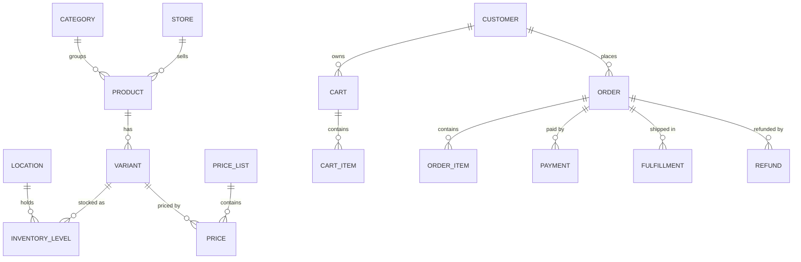
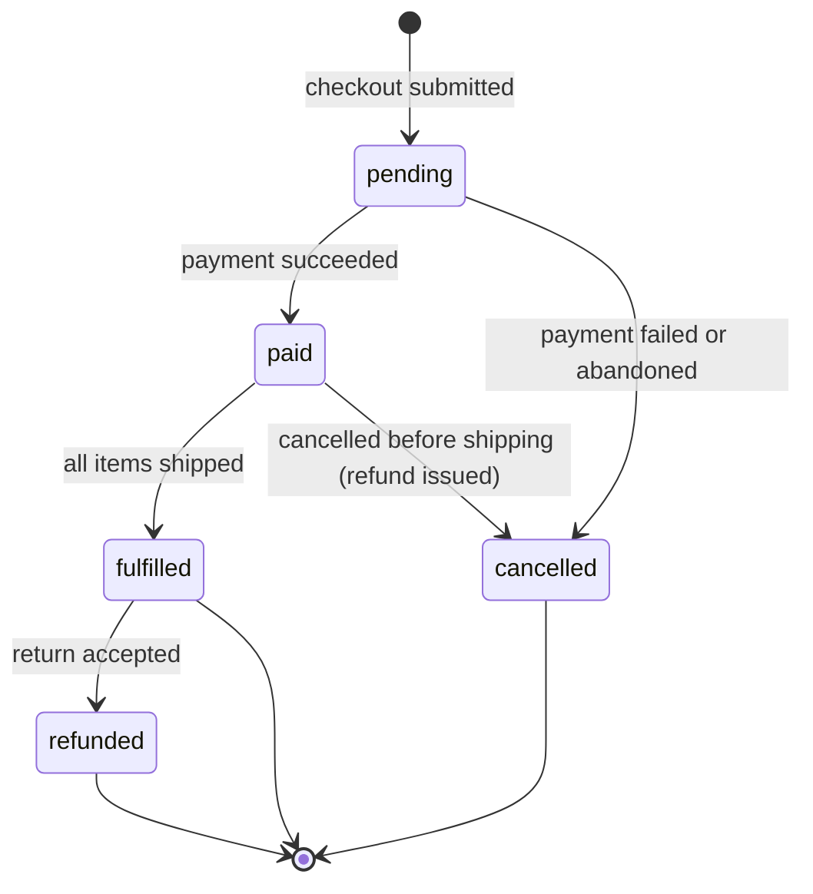

# E-Commerce Domain

> **Tier:** T2 (working knowledge) · **Related:** [Third-party API integration](05-third-party-api-integration.md), [Payments and subscriptions](08-payments-and-subscriptions.md), [Multi-tenancy](03-multi-tenancy.md), [Transactions and concurrency](../12-databases/06-transactions-and-concurrency.md), [ActiveRecord advanced](../05-ruby-on-rails/06-activerecord-advanced.md), [Indexing and query optimization](../12-databases/05-indexing-and-query-optimization.md), [System design from your projects](../15-system-design/03-case-studies-from-your-projects.md), [CrystalCommerce deep dive](../17-projects-deep-dive/01-crystalcommerce.md)
> **On your resume:** CrystalCommerce, a legacy Rails e-commerce platform serving 700+ game stores and 8M+ customers, where you integrated PriceCharting as a sales channel (listings, prices, stock, orders) and imported market prices so stores can price inventory from market data.

## Quick revision
- **Product** is the thing; **variant** is the sellable unit (condition, edition, size) with its own **SKU**, price and stock.
- **Inventory** lives per variant per location: `on_hand` and `reserved`; available to sell = on hand minus reserved (minus channel buffers).
- **Orders and order items are snapshots:** title, SKU, unit price, tax and discount are copied at purchase time; never recompute an old order from live product data.
- **Multi-store platforms:** stores are tenants (`store_id` everywhere); often a shared reference catalog plus store-specific listings, prices and stock.
- **Sales channels:** listing sync, channel-specific prices, order import keyed by `(channel, external_order_id)`, stock sync and an oversell policy.
- **Market-based pricing:** price = percent of market price, then rounding (for example to .99), then floors (cost plus margin, minimum price) and ceilings; manual locks, change thresholds and price history.
- **Collectibles:** condition is part of the variant; market prices differ per condition; graded one-of-a-kind items have quantity one; channels name conditions differently, so map them in a table.
- **Order lifecycle:** a state machine (pending, paid, fulfilled, cancelled, refunded), often with separate payment and fulfillment statuses; guard transitions and log them.
- **Money:** integer minor units (or exact decimals) plus a currency code, never floats; decide rounding rules; allocate remainders so splits add up.
- **Taxes:** inclusive vs exclusive pricing, per-line calculation, snapshot on the order; use a tax service when rules get complex.
- **Stock concurrency:** atomic conditional decrements or reservation counters, a `CHECK (stock >= 0)` safety net, expiring reservations.
- **Search:** Postgres full-text and `pg_trgm` go far; dedicated engines for relevance and facets on big catalogs, fed by jobs.
- **Large catalogs:** indexes that match filters (`store_id` first), keyset pagination, caching and CDN, batched imports with upserts, read replicas for reports.

## 1. Core entities



| Entity | Key fields | Notes |
|---|---|---|
| Product | title, description, category, images | Not directly sellable when it has variants |
| Variant (SKU) | sku (unique per store), barcode, condition or options | The unit you stock, price and sell |
| Category | name, parent_id | A tree; products may sit in several categories |
| Inventory level | variant_id, location_id, on_hand, reserved | Per warehouse or shop floor |
| Price list and price | list (retail, wholesale, channel), currency, amount, validity dates | Different prices per audience or channel |
| Cart and cart item | token or customer, variant, quantity | Mutable, often anonymous, expires |
| Order and order item | number, status, totals; item snapshot of title, SKU, unit price, tax | Immutable record of what was bought |
| Payment | amount, provider reference, status | An order can have several (retries, split payments) |
| Fulfillment | items, carrier, tracking number | Partial shipments are normal |
| Refund or return | items, amount, reason, restock flag | Money back and stock back are separate decisions |
| Customer and address | account or guest; addresses | Addresses are copied onto the order too |

## 2. Multi-store platforms

When one platform hosts hundreds of independent shops, each **store is a tenant**: `store_id` on every store-owned row, store-scoped queries, uniqueness per store (`UNIQUE (store_id, sku)`), and per-store settings (currency, taxes, shipping rules, domain, theme). Isolation techniques are in [multi-tenancy](03-multi-tenancy.md).

A common shape is a **shared reference catalog** (one canonical record per product, maintained centrally and matched to external catalogs once) plus **store listings** (each store's variants, conditions, stock and prices):

```sql
CREATE TABLE catalog_products (                 -- global: one row per real-world product
  id         bigint GENERATED ALWAYS AS IDENTITY PRIMARY KEY,
  title      text NOT NULL,
  platform   text,
  upc        text UNIQUE
);
CREATE TABLE store_listings (                   -- per store: what this shop actually sells
  id                 bigint GENERATED ALWAYS AS IDENTITY PRIMARY KEY,
  store_id           bigint NOT NULL REFERENCES stores (id),
  catalog_product_id bigint NOT NULL REFERENCES catalog_products (id),
  condition          text   NOT NULL,
  sku                text   NOT NULL,
  price_cents        integer NOT NULL CHECK (price_cents >= 0),
  stock              integer NOT NULL DEFAULT 0 CHECK (stock >= 0),
  UNIQUE (store_id, sku)
);
CREATE INDEX store_listings_store_product_idx ON store_listings (store_id, catalog_product_id);
```

The platform operator also needs cross-store views (top products, platform revenue) and protection from noisy neighbors (one store's 200,000-row import should not slow everyone).

## 3. Sales channels and marketplaces

Selling the same inventory on an external marketplace adds five flows:
- **Listing sync:** publish, update and delist listings; store `(channel, external_id)` and a sync status per listing.
- **Channel prices:** often the store price plus a markup to cover marketplace fees, or a separate price list.
- **Order import:** pull or receive channel orders and create internal orders with `channel` and a unique `external_order_id`, so a re-import is a no-op.
- **Inventory sync:** publish available stock after every change, quickly and debounced.
- **Overselling policy:** what happens when two channels sell the last unit.

The integration mechanics (client, rate limits, webhooks, reconciliation) are in [third-party API integration](05-third-party-api-integration.md).

## 4. Pricing from market data

Collectible prices move with the market, so stores import market prices and apply rules instead of editing thousands of prices by hand.

| Rule | Example |
|---|---|
| Percent of market | 90% of the market price for this condition |
| Overrides | Different percent per category or condition |
| Rounding | Nearest price ending in .99, or nearest 0.25 |
| Floors | Never below cost plus a minimum margin, never below an absolute minimum |
| Ceilings | Never above a maximum (or above the market price) |
| Locks | Manually priced items are skipped |
| Change threshold | Only update when the change exceeds, say, 2%, to avoid churn and channel API calls |

```ruby
class PricingRule
  def initialize(percent:, floor_cents: 0, ceiling_cents: nil, charm: false, min_margin_cents: 0)
    @percent, @floor_cents, @ceiling_cents = percent, floor_cents, ceiling_cents
    @charm, @min_margin_cents = charm, min_margin_cents
  end

  # All values are integer cents; no floats anywhere.
  def price_for(market_cents:, cost_cents: 0)
    price = (market_cents * @percent + 50) / 100                  # percent of market, rounded half up
    price = nearest_99(price) if @charm
    price = [price, @floor_cents, cost_cents + @min_margin_cents].max
    @ceiling_cents ? [price, @ceiling_cents].min : price
  end

  private

  def nearest_99(cents)                                          # 1240 -> 1199, 1250 -> 1299
    return cents if cents < 100
    lower = (cents / 100) * 100 - 1
    upper = lower + 100
    (cents - lower) < (upper - cents) ? lower : upper
  end
end

PricingRule.new(percent: 90, charm: true, min_margin_cents: 200).price_for(market_cents: 2500, cost_cents: 1500)
# => 2299 (90% of 25.00 is 22.50, nearest .99 is 22.99, above cost plus margin of 17.00)
```

Around the rule: run repricing as a batched job after each market price import, store **price history** (old price, new price, source, rule, time) for audit and charts, let stores preview changes before applying them, and push changed prices to channels through the debounced sync.

## 5. Collectibles specifics

- **Condition is part of the variant:** the same product in sealed, complete and loose condition has three SKUs, three stocks and three market prices. Professionally graded items carry a grade and a certificate number.
- **One-of-a-kind items:** a specific graded copy has quantity one, its own photos and its own listing; overselling risk is highest here.
- **Vocabularies differ:** each channel and price source names conditions differently, so keep mapping tables per source instead of conditionals in code, and refuse to price or list unmapped conditions.
- **Volatility:** prices change often, so imports and repricing are scheduled, and history matters when a customer asks why a price changed.
- **Trade-ins:** stores that buy inventory from customers usually price offers as a lower percentage of market, using the same rule machinery.

## 6. Order lifecycle as a state machine



Real systems often keep **separate** `payment_status` (pending, authorized, paid, partially refunded, refunded) and `fulfillment_status` (unfulfilled, partial, fulfilled) because they change independently. Side effects hang off transitions: reserve stock on placement, release it on cancellation, restock on return when the item is resellable, notify the customer, inform the channel.

```ruby
class Order < ApplicationRecord
  enum :status, { pending: "pending", paid: "paid", fulfilled: "fulfilled",
                  cancelled: "cancelled", refunded: "refunded" }
  TRANSITIONS = { "pending" => %w[paid cancelled], "paid" => %w[fulfilled cancelled],
                  "fulfilled" => %w[refunded] }.freeze

  def transition_to!(to)
    from = status
    raise InvalidTransition, "#{from} -> #{to}" unless TRANSITIONS.fetch(from, []).include?(to.to_s)
    transaction do
      moved = Order.where(id: id, status: from).update_all(status: to.to_s, updated_at: Time.current)
      raise StaleTransition, "order #{id} is no longer #{from}" if moved.zero?   # a concurrent change won
      order_events.create!(from_status: from, to_status: to.to_s)                # audit trail
    end
    reload
  end
end
```

The conditional `UPDATE ... WHERE status = from` makes the transition safe under concurrency and retries; gems such as AASM and state_machines offer a DSL for the same idea.

## 7. Money

```ruby
0.1 + 0.2                # => 0.30000000000000004 (binary floats cannot represent most decimals)
BigDecimal("19.99") * 3  # => 0.5997e2, exact

def allocate(total_cents, parts)            # split so the pieces always add up to the total
  base, remainder = total_cents.divmod(parts)
  Array.new(parts) { |i| i < remainder ? base + 1 : base }
end
allocate(1000, 3)        # => [334, 333, 333]
```

- **Representation:** integer minor units (`price_cents`) or exact decimals (`NUMERIC(12,2)` with `BigDecimal`), never floats. JavaScript has the same float problem (`0.1 + 0.2 !== 0.3`), so APIs should send integer cents.
- **Currency travels with the amount:** store a currency code next to every amount; some currencies have zero decimals (JPY) and some three (KWD), so the minor-unit exponent depends on the currency.
- **Rounding:** decide where (per line or per order) and how (half up or half even, also called banker's rounding), and apply it consistently; allocation prevents lost or extra cents when splitting totals, discounts or bills.
- **Taxes:** VAT-style prices are usually tax-inclusive for consumers in Europe, US sales tax is added at checkout; rates depend on jurisdiction and product type; compute per line, snapshot onto the order, and use a tax service once rules multiply.
- **Multiple currencies:** keep the original currency and amount, plus the converted amount, the rate and its date.
- **Libraries:** the money and money-rails gems (`monetize :price_cents`), Dinero.js in JavaScript, `Intl.NumberFormat` for display.

## 8. Stock concurrency

Two customers (or a customer and a marketplace order) buying the last unit at the same moment is a race condition. Defenses, all detailed in [transactions and concurrency](../12-databases/06-transactions-and-concurrency.md):

```sql
-- Sell: atomic conditional decrement; no row back means not enough stock
UPDATE variants SET on_hand = on_hand - $2 WHERE id = $1 AND on_hand >= $2 RETURNING on_hand;

-- Reserve at checkout, convert or release later
UPDATE variants SET reserved = reserved + $2 WHERE id = $1 AND on_hand - reserved >= $2;

-- Safety net, whatever the code does
ALTER TABLE variants ADD CONSTRAINT stock_sane CHECK (on_hand >= 0 AND reserved >= 0 AND reserved <= on_hand);
```

- **When to reserve:** at add-to-cart (great UX, ties up stock), at checkout start (common), or only at payment (simplest, more failed checkouts). Reservations need an expiry, tracked in a `stock_reservations` table with `expires_at`, and a job that releases expired ones.
- **Multi-item orders:** lock or update variants in a consistent order (by ID) to avoid deadlocks.
- **Channels:** publish available stock after every change and handle collisions with a policy ([third-party API integration](05-third-party-api-integration.md)).

## 9. Search and filtering

- **Postgres first:** full-text search with a `tsvector` column and a GIN index; `pg_trgm` for typo-tolerant title matching; B-tree indexes for filters; facet counts with `GROUP BY`. See [PostgreSQL](../12-databases/04-postgresql.md).
- **Dedicated engines** (Elasticsearch or OpenSearch, Meilisearch, Typesense) once you need relevance tuning, fast facets over millions of items or autocomplete. Feed them from jobs on every change plus periodic full reindexes, accept slight staleness, and always filter by store on the server.
- **Faceted navigation:** category, platform, condition, price range, in stock; filters live in the URL so pages are shareable and crawlable.

## 10. Large-catalog performance

- **Indexes that match queries:** `(store_id, category_id, price_cents)` for browsing, partial indexes such as `WHERE on_hand > reserved` for in-stock pages, trigram indexes for search ([indexing](../12-databases/05-indexing-and-query-optimization.md)).
- **Keyset pagination** for deep pages instead of large offsets.
- **No N+1** on product grids: preload variants, images and prices.
- **Caching:** fragment caching for product cards (invalidated by touching on price or stock changes), a CDN for images and anonymous pages.
- **Background imports:** CSV or API imports in batches with `upsert_all`, `COPY` for initial loads, heavy callbacks skipped or deferred, search reindexed afterwards.
- **Denormalized columns** (lowest price, total stock per product) maintained by jobs or triggers for listing pages.
- **Read replicas** for browsing and reporting traffic.

## 11. Reporting

```sql
-- Daily gross sales per channel for one store, in the store's own time zone
SELECT date_trunc('day', o.placed_at AT TIME ZONE s.time_zone) AS day,
       o.channel,
       SUM(oi.quantity * oi.unit_price_cents) AS gross_cents
FROM orders o
JOIN order_items oi ON oi.order_id = o.id
JOIN stores s ON s.id = o.store_id
WHERE o.store_id = $1 AND o.status IN ('paid', 'fulfilled')
GROUP BY 1, 2
ORDER BY 1;
```

- Report from **order item snapshots**, not live product prices; record refunds as their own rows so history stays accurate.
- "Sales on Monday" depends on the store's time zone; store timestamps in UTC and convert per store.
- Keep heavy reports off the primary: a read replica, daily rollup tables, materialized views refreshed by a job (`REFRESH MATERIALIZED VIEW CONCURRENTLY` requires a unique index), or a warehouse for platform-wide analytics.

## Common pitfalls
- Floats for money, or amounts without a currency.
- Order items that reference the live product price instead of a snapshot, so old invoices change.
- Check-then-decrement stock in application code (read, compare, write) under concurrency.
- Reservations that never expire, slowly hiding stock.
- Global uniqueness of SKUs on a multi-store platform.
- Repricing jobs that push every tiny change to channels, burning API quota.
- Order status changed with plain `update!` from several places, skipping guards and audit logs.
- Reports run on the primary database during business hours.
- Rounding taxes inconsistently between cart, order and invoice.

## How to talk about this in an interview
- CrystalCommerce gives you real domain vocabulary: a multi-store platform (700+ game stores, 8M+ customers), sales-channel sync with PriceCharting, and market price imports that let stores price from market data. Use it to show you understand products, variants, conditions, stock and pricing, not just CRUD.
- Talk about the hard parts: snapshots on orders, money in cents, atomic stock updates across channels, and pricing rules with rounding and floors.
- Keep the line between what you built and how such platforms typically work clear; the pricing rule above is an illustration, not CrystalCommerce's code.

> **Fill in:** how stores used imported market prices (automatic rules, suggestions, manual review) and what options they had (percentages, rounding, floors).

> **Fill in:** how conditions were represented in the CrystalCommerce catalog and mapped to PriceCharting.

> **Fill in:** one performance or data-correctness issue you worked on in the legacy platform (a slow query, an import, a stock mismatch) and what you changed.

## Interview questions

**Q1. How would you model products, variants and SKUs?**
A product holds shared data (title, description, images, category); variants are the sellable units defined by options such as condition or edition, each with its own SKU, price and stock. Inventory sits per variant per location, and orders reference variants while snapshotting their details.
*Follow-up:* When is a product with no options still useful? Give it a single default variant so all stock and pricing code works the same way.

**Q2. Why snapshot data on order items?**
An order is a legal and financial record of what was sold at what price. Products get renamed, repriced or deleted; if order items joined live data, old orders and invoices would silently change. Copy title, SKU, unit price, tax and discounts at purchase time.
*Follow-up:* What about addresses? Copy them onto the order too; customers edit their address book later.

**Q3. How would you model a platform hosting hundreds of independent stores?**
Treat each store as a tenant: `store_id` on every store-owned row, store-scoped queries and per-store uniqueness, per-store settings for currency, taxes and domains. Often add a shared reference catalog matched to external sources once, with store listings holding each store's condition, stock and price.
*Follow-up:* What is the operator-level risk? One large store's imports or traffic slowing others, so rate limit and fan out per store.

**Q4. How would you price inventory from market data?**
Import market prices per product and condition, then apply rules: a percentage of market, rounding (for example to .99), floors (cost plus margin, a minimum price) and ceilings, skipping manually locked items and ignoring changes below a threshold. Run it as a batched job, keep price history, and push changes to channels.
*Follow-up:* Why a change threshold? Tiny fluctuations would otherwise churn prices and waste channel API calls.

**Q5. How do you represent condition grades for collectibles?**
As part of the variant (each condition has its own SKU, stock and market price), with graded one-of-a-kind items as quantity-one listings carrying grade and certificate details. Each external source names conditions differently, so map them through tables per source and refuse to price unmapped conditions.
*Follow-up:* Why not a free-text condition field? It cannot be mapped, filtered or priced reliably.

**Q6. Describe an order lifecycle and how you implement transitions safely.**
Pending, paid, fulfilled, then possibly refunded; cancelled before fulfillment; often with separate payment and fulfillment statuses. Implement transitions as guarded methods using a conditional update (`WHERE status = 'paid'`) inside a transaction that also writes an audit event, and trigger side effects (stock release, notifications) from transitions.
*Follow-up:* Why the conditional update? Two concurrent requests or a retried job cannot both apply the same transition.

**Q7. Why store money as integer cents?**
Binary floats cannot represent most decimal amounts exactly, so sums drift (`0.1 + 0.2` is not `0.3`). Integer minor units, or exact decimals, make arithmetic exact; you store a currency code with every amount, define rounding rules, and allocate remainders so splits add up to the total.
*Follow-up:* How do you split 10.00 three ways? 3.34, 3.33 and 3.33, distributing the remainder cent deterministically.

**Q8. How do you handle taxes and multiple currencies?**
Know whether prices are tax-inclusive (typical for EU consumers) or exclusive (US sales tax), compute tax per line with consistent rounding, snapshot it on the order, and use a tax service when jurisdictions multiply. For currencies, keep the original amount and currency plus any converted amount with the rate and date used.
*Follow-up:* Why store the rate? To explain and reproduce the converted amount later, for refunds and accounting.

**Q9. How do you prevent overselling?**
Decrement stock with one atomic conditional statement (`UPDATE ... WHERE on_hand >= qty`), or reserve with a counter that respects `on_hand - reserved`, add a check constraint as a safety net, expire reservations, and with external channels keep one source of truth, publish available stock quickly and give imported orders unique external IDs.
*Follow-up:* Why not read the stock, check it in Ruby and save? Two requests can read the same value and both succeed.

**Q10. How would you implement search and filtering for a large catalog?**
Start with Postgres: full-text search with a GIN index, `pg_trgm` for typo tolerance, composite indexes for filters and `GROUP BY` for facet counts, always scoped by store. Move to a search engine when relevance, facets or scale demand it, fed by jobs on change plus full reindexes.
*Follow-up:* What is the trade-off of a search engine? Another system to run and keep in sync, with slightly stale results.

**Q11. How do you keep a large catalog fast?**
Indexes that match real filters with the store first, partial indexes for in-stock browsing, keyset pagination, preloading to avoid N+1, fragment caching and a CDN, batched imports with upserts, denormalized summary columns, and read replicas for browsing and reports.
*Follow-up:* How do you find what to fix? Slow-query logs and `EXPLAIN ANALYZE` on the most frequent pages first.

**Q12. How would you build sales reports without hurting the main database?**
Query order item snapshots on a read replica, or pre-aggregate into daily rollup tables or materialized views refreshed by a job; for platform-wide analytics, export to a warehouse. Convert timestamps to each store's time zone before grouping by day.
*Follow-up:* What does `REFRESH MATERIALIZED VIEW CONCURRENTLY` need? A unique index on the view, and it lets reads continue during the refresh.

## Further reading
- PostgreSQL full-text search: https://www.postgresql.org/docs/current/textsearch.html
- PostgreSQL `pg_trgm`: https://www.postgresql.org/docs/current/pgtrgm.html
- Rails `enum`: https://api.rubyonrails.org/classes/ActiveRecord/Enum.html
