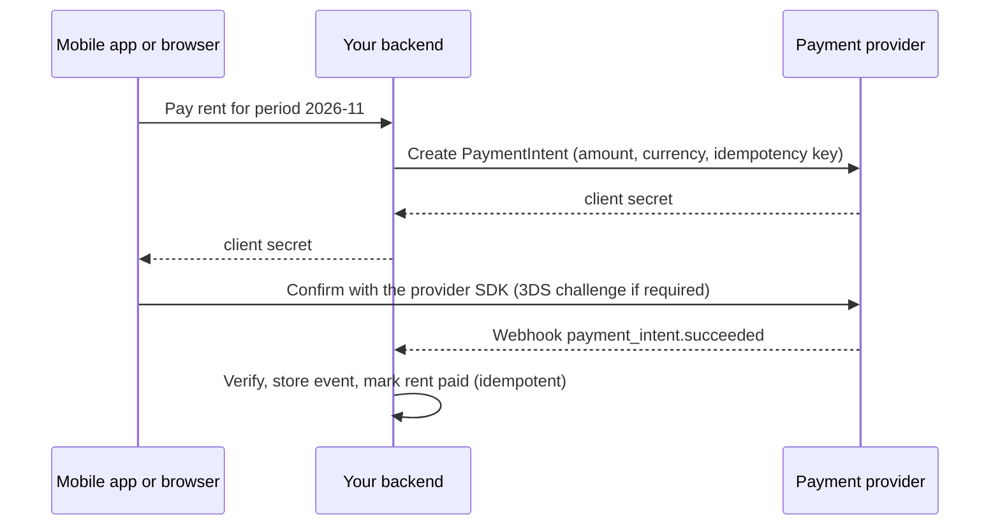
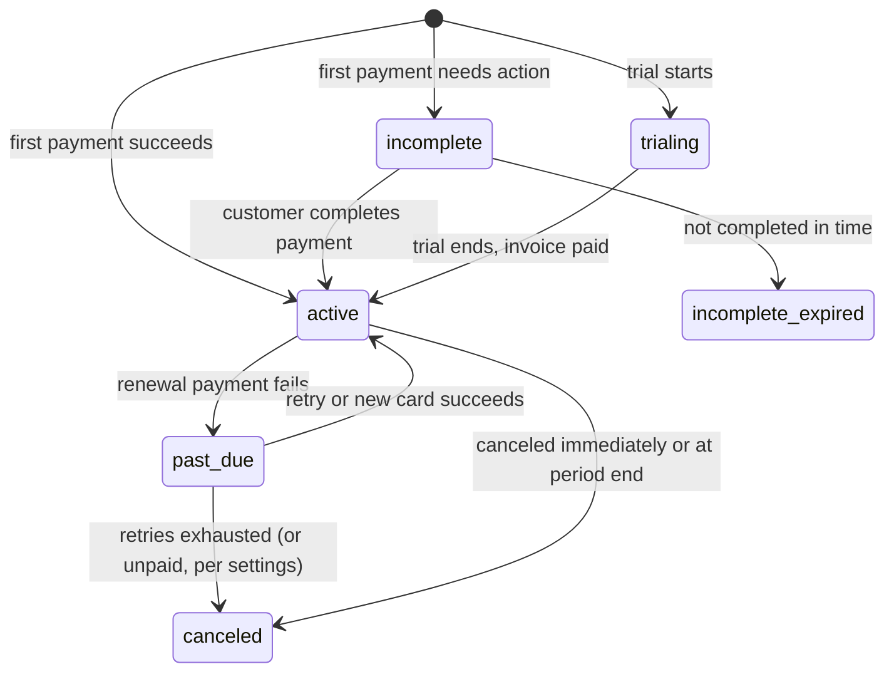

# Payments and Subscriptions

> **Tier:** T2 (working knowledge) · **Related:** [Payments and split bills in React Native](../08-react-native-expo/06-payments-and-split-bills.md), [E-commerce domain (money)](07-ecommerce-domain.md), [Transactions and concurrency (double payments)](../12-databases/06-transactions-and-concurrency.md), [Third-party API integration (webhooks)](05-third-party-api-integration.md), [Background processing patterns](06-background-processing-patterns.md), [LMS project patterns](../10-python-django/07-lms-project-patterns.md), [Coloc resident app deep dive](../17-projects-deep-dive/03-coloc-resident-app.md), [LMS deep dive](../17-projects-deep-dive/05-lms-coursera-clone.md)
> **On your resume:** rent payments and split bills in the Coloc resident app (React Native, Expo) for Colochousing at Devntech; subscriptions in the LMS (Coursera clone) you proposed and built at PureLogics with DRF and React.

## Quick revision
- **Players:** cardholder, merchant, payment service provider (PSP), acquirer, card network, issuer. The PSP (Stripe, Adyen and others) hides most of this.
- **Authorization** asks the issuer to approve and hold funds; **capture** actually takes them (immediately, later or partially). Holds expire after a limited number of days; **void** cancels an authorization, **refund** returns captured money, a **chargeback** is a dispute through the issuer.
- **Stripe model:** Customer, PaymentMethod, **PaymentIntent** (one payment's lifecycle), **SetupIntent** (save a method for later), Checkout (hosted page) or Elements (embedded fields), Billing with Products, Prices, Subscriptions and Invoices.
- **Webhooks are the source of truth:** payments finish asynchronously (3DS, bank debits, renewals), and redirects get lost. Verify the signature on the raw body, dedupe by event ID, return 2xx fast, process in a job, re-fetch objects when order matters.
- **Idempotency keys** on every create call so a retried request cannot charge twice; derive them from your own record.
- **Subscription statuses:** trialing, active, past_due, canceled, unpaid, plus incomplete states for a first payment that needs action. Gate access on your mirrored status, with a grace period during dunning.
- **Dunning:** automatic retries, emails and in-app prompts to update the card, then cancel or mark unpaid.
- **Trials, proration, cancel at period end** and a self-service customer portal are standard billing features.
- **SCA (EEA, UK):** strong customer authentication via 3D Secure; PaymentIntents move to `requires_action`; authenticate once when saving a card so later merchant-initiated renewals can usually run off-session.
- **PCI DSS:** hosted pages and provider fields keep card numbers off your servers, shrinking compliance to the simplest questionnaire. Never log or store card numbers or CVC.
- **Money:** integer minor units plus currency (Stripe amounts are in the smallest unit: 1000 = EUR 10.00).
- **Rent collection:** due dates, proration, deposits, late fees, partial payments; bank debits such as SEPA Direct Debit confirm in days and can be reversed for weeks.
- **Reconciliation:** compare your records, the PSP and the bank daily. A **double-entry ledger** records every movement as balanced, immutable entries.
- **Testing:** test-mode keys, published test cards, a CLI to forward and trigger webhooks, test clocks for renewals, fakes behind an adapter.

## 1. How a card payment works

| Party | Role |
|---|---|
| Cardholder | Pays with a card or wallet |
| Merchant | Your business (the store, the co-living operator, the course platform) |
| PSP or gateway | Collects payment details, talks to the networks, gives you an API and webhooks |
| Acquirer | The merchant's bank that receives card payments |
| Card network | Visa, Mastercard: routes authorizations and settlement |
| Issuer | The cardholder's bank: approves or declines, runs 3D Secure, handles disputes |

The flow: the customer submits payment details to the PSP; the issuer **authorizes** and places a hold; the merchant **captures** (right away for digital goods and subscriptions, later for ship-then-charge); funds are cleared and settled; the PSP pays out to your bank minus fees. Authorizations expire after a limited period (often around a week for online card payments; check your provider), so delayed capture needs care.



## 2. Stripe concepts (the usual reference model)

| Object | Purpose |
|---|---|
| Customer | Your user at the provider; holds saved payment methods and billing details |
| PaymentMethod | A card, bank account or wallet, referenced by ID (safe to store) |
| PaymentIntent | One payment attempt from creation to success, with statuses such as `requires_payment_method`, `requires_action`, `processing`, `requires_capture`, `succeeded`, `canceled` |
| SetupIntent | Saves and authenticates a payment method for future charges without charging now |
| Checkout Session | A hosted, provider-built payment page for one-off payments or subscriptions |
| Elements / Payment Element | Embeddable UI components inside your own page; the mobile SDKs play the same role in apps |
| Product and Price | What you sell and how much, one-off or recurring (monthly, yearly) |
| Subscription and Invoice | Recurring billing: each period generates an invoice that is paid or fails |
| Event and webhook endpoint | Notifications of everything that happens, delivered to your server |

| | Checkout (hosted page) | Elements (embedded) |
|---|---|---|
| Build effort | Lowest: redirect and handle the result | More: you build the page around the fields |
| Control over UX | Limited branding | Full control of layout and flow |
| Payment methods, 3DS, address collection | Handled for you | Mostly handled, more wiring |
| Card data on your servers | Never | Never (fields are provider-hosted) |

```ruby
# Rails: create a PaymentIntent for a rent payment; the app confirms it with the provider's SDK
intent = Stripe::PaymentIntent.create(
  { amount: rent_payment.amount_cents, currency: "eur", customer: resident.stripe_customer_id,
    metadata: { rent_payment_id: rent_payment.id } },
  { idempotency_key: "rent-payment-#{rent_payment.id}" }          # a retried request cannot create a second payment
)
render json: { client_secret: intent.client_secret }
```

```python
# Django/DRF: start a subscription with a hosted Checkout page
session = stripe.checkout.Session.create(
    mode="subscription",
    customer=request.user.profile.stripe_customer_id,
    line_items=[{"price": plan.stripe_price_id, "quantity": 1}],
    subscription_data={"trial_period_days": 7},
    success_url="https://lms.example.com/billing/success?session_id={CHECKOUT_SESSION_ID}",
    cancel_url="https://lms.example.com/pricing",
)
return Response({"url": session.url})
```

## 3. Subscriptions: plans, invoices, trials and proration

- A **Product** is the plan ("Pro"), a **Price** is an amount, currency and interval; a **Subscription** links a customer to prices and generates an **Invoice** every period.
- **Trials:** `trial_period_days` or an explicit end date; decide whether to collect a card upfront. A `customer.subscription.trial_will_end` event arrives a few days before the end, a good moment to remind users.
- **Proration:** switching plans mid-cycle credits unused time and charges the new plan; `proration_behavior` controls whether to create prorations, skip them or invoice immediately.
- **Cancellation:** at period end (`cancel_at_period_end: true`, access continues until then) or immediately (optionally with a prorated refund).
- **Self-service:** a provider-hosted customer portal lets users update cards, switch plans and cancel without custom UI.
- **Mirror locally:** store the subscription ID, status, price, current period end and `cancel_at_period_end`, updated from webhooks, so access checks never call the provider. Where the period end lives has moved between Stripe API versions (onto subscription items in recent versions), so check the version you pin.

## 4. Subscription lifecycle and access gating



| Status | Meaning | Typical access |
|---|---|---|
| trialing | In the free trial | Yes |
| active | Paid and current | Yes |
| past_due | Latest renewal failed; retries running | Yes during a short grace period, with a banner |
| unpaid | Retries exhausted but subscription kept open | No (invoices accumulate) |
| canceled | Ended | No (after period end if canceled at period end) |
| incomplete | First payment requires action | No |

**Dunning** is the recovery process: automatic retries spread over days (Stripe's Smart Retries choose timing), emails and push notifications asking the user to update the card, an in-app banner, then cancellation or `unpaid` according to your settings.

```python
from datetime import timedelta
from django.db import models
from django.utils import timezone
from rest_framework.permissions import BasePermission

class Subscription(models.Model):
    GRACE = timedelta(days=3)
    user = models.OneToOneField("auth.User", on_delete=models.CASCADE)
    stripe_subscription_id = models.CharField(max_length=255, unique=True)
    status = models.CharField(max_length=32)                 # mirrored from webhooks
    current_period_end = models.DateTimeField(null=True)

    def grants_access(self, now=None) -> bool:
        now = now or timezone.now()
        if self.status in ("active", "trialing"):
            return True
        if self.status == "past_due" and self.current_period_end:
            return now < self.current_period_end + self.GRACE  # grace period while dunning runs
        return False

class HasActiveSubscription(BasePermission):
    def has_permission(self, request, view):
        sub = getattr(request.user, "subscription", None)    # missing relation or anonymous user -> None
        return bool(sub and sub.grants_access())
```

## 5. Webhooks as the source of truth

Never mark something paid because the browser landed on a success URL: users close tabs, 3D Secure and bank debits finish later, and renewals happen with no user present. The provider's events decide.

| Event | Typical handling |
|---|---|
| `checkout.session.completed` | Link the customer and subscription; for one-off payments check the session's payment status |
| `payment_intent.succeeded` / `payment_intent.payment_failed` | Mark the payment paid or failed; notify the user |
| `invoice.paid` / `invoice.payment_failed` | Extend access, or start dunning |
| `customer.subscription.updated` / `customer.subscription.deleted` | Mirror status, price and period end |
| `charge.refunded`, `charge.dispute.created` | Record refunds; alert on disputes |

```ruby
class Webhooks::StripeController < ActionController::API
  def create
    event = Stripe::Webhook.construct_event(
      request.raw_post, request.headers["Stripe-Signature"],
      Rails.application.credentials.dig(:stripe, :webhook_secret)
    )
    record = PaymentEvent.create!(provider: "stripe", event_id: event.id, event_type: event.type,
                                  payload: JSON.parse(request.raw_post))      # unique index on event_id
    ProcessStripeEventJob.perform_async(record.id)
    head :ok
  rescue JSON::ParserError, Stripe::SignatureVerificationError
    head :bad_request
  rescue ActiveRecord::RecordNotUnique
    head :ok                                                                  # duplicate delivery
  end
end

class ProcessStripeEventJob
  include Sidekiq::Job

  def perform(payment_event_id)
    record = PaymentEvent.find(payment_event_id)
    return if record.processed_at                                             # idempotent
    object = record.payload.dig("data", "object")
    case record.event_type
    when "payment_intent.succeeded" then RentPayments::MarkPaid.call(provider_ref: object["id"])
    when "customer.subscription.updated", "customer.subscription.deleted"
      Billing::SyncSubscription.call(object["id"])          # re-fetch the latest state, so event order does not matter
    end
    record.update!(processed_at: Time.current)
  end
end
```

The provider retries failed deliveries for a long time (days in live mode at Stripe) and does not guarantee order, so handlers must be idempotent, tolerant of unknown event types (return 2xx) and safe when an older event arrives after a newer one. The generic webhook checklist is in [third-party API integration](05-third-party-api-integration.md).

## 6. Idempotency keys and double charges

- Send an `Idempotency-Key` on every create call (payments, refunds, subscriptions). The provider stores the first result for that key for a period (at least 24 hours at Stripe) and replays it for retries.
- Derive the key from your own record (`rent-payment-#{id}`) so every retry of the same intent reuses it; use a new key only for a genuinely new attempt, because a reused key replays the earlier failure.
- Combine it with a local guard: a unique index such as one succeeded payment per lease per period, plus a short locked claim before calling the provider (worked examples in [transactions and concurrency](../12-databases/06-transactions-and-concurrency.md) and [ActiveRecord advanced](../05-ruby-on-rails/06-activerecord-advanced.md)).

## 7. SCA and 3D Secure in Europe

- **Strong Customer Authentication** (from the EU's PSD2 rules, with similar rules in the UK) requires two of: something you know, something you have, something you are, for many online payments in the region.
- **3D Secure 2** implements it: the issuer may approve frictionlessly or challenge the customer in their banking app. A PaymentIntent then sits in `requires_action` and the client SDK runs the challenge when confirming.
- **Recurring payments:** authenticate once when saving the card (a SetupIntent for off-session use, or the first payment set up for future usage); later renewals are merchant-initiated and usually exempt, but the issuer can still demand authentication. Then the payment fails with an authentication-required error and you bring the customer back on-session by email or push.
- **Liability shift:** for authenticated payments, fraud-related chargeback liability generally moves to the issuer.
- Exemptions and rules evolve; follow your provider's current SCA guidance.

## 8. Refunds and disputes

- **Refunds:** full or partial, to the original payment method, taking days to reach the customer; processing fees are often not returned (provider-specific). Record refund rows, update the payment and order status, decide restocking separately, and use idempotency keys here too.
- **Disputes (chargebacks):** the cardholder disputes with their issuer, the funds are pulled back plus a dispute fee, and you have a deadline to submit evidence (receipts, delivery proof, usage logs, accepted terms). Alert on `charge.dispute.created`.
- **Prevention:** a recognizable statement descriptor, receipts, easy cancellation and refunds, 3D Secure, and the provider's fraud tools.

## 9. PCI DSS scope

PCI DSS is the card industry's security standard for anyone who stores, processes or transmits card data. Your burden depends on whether card numbers touch your systems:

| Integration | Card data path | Typical scope |
|---|---|---|
| Hosted page (Checkout) or provider fields (Elements, mobile SDKs) | Customer device straight to the PSP | Smallest self-assessment (SAQ A for fully outsourced e-commerce) |
| Your page posts card numbers to your server | Through your servers | Much larger (SAQ D): network, storage, logging, audits |

Store only provider IDs (customer, payment method), never card numbers, and never store CVC at all; keep card data out of logs, analytics and error trackers. PCI DSS v4.x tightened requirements around scripts on payment pages, so check current guidance with your provider.

## 10. Money handling

Amounts go to providers as integers in the currency's smallest unit (1000 = EUR 10.00; zero-decimal currencies such as JPY have no minor unit). Keep integer cents and a currency code everywhere, allocate remainders when splitting (a 1000-cent bill shared by three residents is 334, 333 and 333), and record the provider's fee and net amount from its balance data for accounting. Details in [e-commerce domain](07-ecommerce-domain.md).

## 11. Recurring rent collection

- **Schedule and amounts:** monthly due dates, proration for mid-month move-ins and move-outs, deposits held separately with refund rules, late fees by policy, partial payments and payment plans.
- **Cards:** need SCA on setup and fail when cards expire, so prompt for updates before renewal dates.
- **Bank debits** (SEPA Direct Debit in the eurozone): the payer signs a mandate; confirmation is asynchronous and takes days (the payment sits in `processing`); failures such as insufficient funds arrive later by webhook; payers can request a refund of an authorized debit for weeks afterwards (eight weeks under the SEPA Core scheme at the time of writing; confirm with your provider). Fees are usually lower than cards for large amounts.
- **Local methods:** in Belgium Bancontact is widely used; plain bank transfers need payment references and matching against bank statements.
- **Split bills between roommates:** each resident pays a share; decide who covers a missing share and how remainder cents are assigned ([split bills](../08-react-native-expo/06-payments-and-split-bills.md)).
- **Reminders and receipts:** idempotent jobs send due-date reminders and receipts; the rent roll (expected) is reconciled against payments received.

## 12. Reconciliation and double-entry ledgers

There are three views of the truth: your database, the PSP and the bank. They drift through missed webhooks, refunds issued in the provider dashboard, disputes, fees and currency conversion. A daily job lists the provider's transactions for the day, matches them to local records by provider ID and metadata, repairs what it can by re-fetching, and flags the rest; payouts are matched to bank deposits.

A **double-entry ledger** records every money movement as a transaction with two or more entries whose debits equal credits. Entries are append-only (corrections are reversing entries), and balances are sums of entries.

| Event | Debit | Credit |
|---|---|---|
| Rent invoiced, EUR 600 | Resident receivable 600 | Rent revenue 600 |
| Card payment succeeds | PSP clearing 600 | Resident receivable 600 |
| Provider fee, EUR 9 | Payment fees 9 | PSP clearing 9 |
| Payout to bank, EUR 591 | Bank 591 | PSP clearing 591 |

```sql
CREATE TABLE ledger_entries (
  id             bigint GENERATED ALWAYS AS IDENTITY PRIMARY KEY,
  transaction_id bigint NOT NULL REFERENCES ledger_transactions (id),
  account        text   NOT NULL,             -- 'resident_receivable:42', 'rent_revenue', 'psp_clearing'
  amount_cents   bigint NOT NULL,             -- positive = debit, negative = credit
  currency       char(3) NOT NULL
);
-- Invariant per transaction: SELECT transaction_id FROM ledger_entries GROUP BY 1 HAVING SUM(amount_cents) <> 0 returns nothing
```

After the payout, PSP clearing is back to zero (600 - 9 - 591), which is exactly the kind of check reconciliation automates.

## 13. Testing payments

- Use **test-mode keys** in development and staging only; live keys never leave production secrets.
- Published **test cards** cover the paths: `4242 4242 4242 4242` succeeds, `4000 0025 0000 3155` requires 3D Secure, `4000 0000 0000 9995` is declined for insufficient funds.
- The Stripe CLI forwards real test events to your laptop (`stripe listen --forward-to localhost:3000/webhooks/stripe`) and fires specific ones (`stripe trigger payment_intent.succeeded`).
- **Test clocks** simulate time for subscriptions: trial endings, renewals and failed renewals without waiting a month.
- Put the provider SDK behind an adapter and use a fake in unit tests; test webhook handlers with signed fixtures, duplicate deliveries, out-of-order events and bad signatures.

## Common pitfalls
- Granting access or marking payments paid from the client redirect instead of webhooks.
- Verifying webhook signatures against parsed and re-serialized JSON instead of the raw body.
- Non-idempotent webhook handlers that extend a subscription twice or send two receipts.
- Creating payments without idempotency keys, so a mobile retry charges twice.
- Calling the provider inside a database transaction that holds locks for seconds.
- Checking access by calling the provider's API on every request instead of a mirrored status.
- Floats for amounts, or forgetting zero-decimal currencies.
- Ignoring `requires_action`, so 3D Secure payments silently never complete.
- Logging full webhook payloads or request bodies that contain personal data.
- No reconciliation, so dashboard refunds and disputes never reach your records.

## How to talk about this in an interview
- You have two payment stories: rent payments and split bills in the Coloc resident app (React Native, Expo), and subscriptions with role-based dashboards in the PureLogics LMS. Use them to show you know the full loop: client confirmation, server-side intents, webhooks as truth, idempotency and access gating.
- If you did not choose the provider or build the webhook layer yourself, say which part you did (screens, API endpoints, status handling) and explain the rest as how you would design it.
- Mention money as integer cents and double-payment prevention unprompted; both signal production awareness.

> **Fill in:** which payment provider the Coloc app used for rent payments, and how a payment flowed from the app to the Rails API and back (intent creation, confirmation, webhook).

> **Fill in:** how split bills were calculated and settled (shares, remainders, who pays whom) and which parts you built.

> **Fill in:** which provider and subscription model the LMS used (plans, trials, cancellation), and how access to paid courses was enforced in DRF.

## Interview questions

**Q1. What is the difference between authorization and capture?**
Authorization asks the issuer to approve the amount and place a hold on the customer's funds; capture actually collects them. You can capture immediately (digital goods, subscriptions) or later and partially (ship-then-charge). Uncaptured authorizations expire after a limited period, and canceling one is a void, not a refund.
*Follow-up:* When would you separate them? When the final amount or availability is confirmed after checkout, such as shipping physical goods.

**Q2. What are PaymentIntents and SetupIntents?**
A PaymentIntent tracks one payment from creation to success, moving through statuses like `requires_payment_method`, `requires_action` (for 3D Secure), `processing` and `succeeded`. A SetupIntent saves and authenticates a payment method for future use without charging, which makes later off-session charges (renewals, monthly rent) far more likely to succeed under SCA.
*Follow-up:* Who confirms the PaymentIntent? Usually the client SDK with the client secret, so authentication challenges can be shown to the user.

**Q3. Hosted Checkout or embedded Elements?**
Checkout is fastest to build and handles payment methods, 3D Secure and address collection on a provider page, with limited branding. Elements gives full control of the page with provider-hosted fields. Both keep card numbers off your servers, so PCI scope stays minimal.
*Follow-up:* What changes in a mobile app? You use the provider's native SDK and payment sheet, which plays the same role.

**Q4. Why are webhooks the source of truth for payments?**
Payments complete asynchronously (3D Secure, bank debits, retries) and renewals happen with no user present, while client redirects can be lost when users close the app or tab. Only the provider's events reliably say what happened, so state changes such as "paid" or "subscription active" come from verified webhooks.
*Follow-up:* What do you show on the success page then? A "processing" state that updates when the webhook has been handled.

**Q5. How do you process Stripe webhooks safely?**
Verify the signature with the SDK against the raw request body and the endpoint secret, insert the event with a unique event ID (duplicates return 200), enqueue a job and respond quickly, then process idempotently, re-fetching the object from the API when ordering matters. Return 2xx for event types you ignore and alert on repeated failures.
*Follow-up:* Why re-fetch? Events can arrive out of order; the current object from the API is authoritative.

**Q6. What is an idempotency key, and how do you choose one?**
A unique key sent with a create request; the provider stores the first result and returns it for any retry with the same key, so network retries cannot create duplicate charges. Derive it from your own record (for example the rent payment ID) so all retries share it, and pair it with local unique constraints and claims.
*Follow-up:* When should the key change? Only for a genuinely new attempt, because a reused key replays the old result, including a failure.

**Q7. Walk me through a subscription's lifecycle.**
It starts trialing or active (or incomplete if the first payment needs action). Each period an invoice is generated; success keeps it active. A failed renewal moves it to past_due while dunning retries and emails the user; recovery returns it to active, otherwise it becomes canceled or unpaid depending on settings. Users can cancel immediately or at period end.
*Follow-up:* What do you store locally? Subscription ID, status, price, current period end and the cancel-at-period-end flag, all updated from webhooks.

**Q8. How do you gate access, and what happens during past_due?**
Access checks read the locally mirrored status: active and trialing grant access; past_due grants access for a short grace period after the period end while dunning runs, with an in-app banner; unpaid, canceled and incomplete do not. Never call the provider on every request.
*Follow-up:* Why a grace period? Many failures are expired cards fixed within days; cutting access instantly hurts paying customers.

**Q9. What is SCA, and how does it affect recurring payments?**
Strong Customer Authentication, required in the EEA and UK for many online payments, means two-factor verification, typically through 3D Secure. You authenticate when the card is saved; later merchant-initiated renewals are usually exempt, but if the issuer still requires authentication the payment fails and you bring the customer back on-session to complete it.
*Follow-up:* What does the API show? A PaymentIntent in `requires_action`, which the client SDK resolves.

**Q10. How do refunds and disputes work?**
Refunds return captured money, fully or partially, to the original method and take days to arrive; you record them and update order or payment status. A dispute is raised by the cardholder with their issuer: funds are pulled back with a fee, and you can submit evidence before a deadline. Clear descriptors, receipts, easy refunds and 3D Secure reduce disputes.
*Follow-up:* Is a refund the same as a void? No: a void cancels an uncaptured authorization; a refund reverses a capture.

**Q11. What is PCI DSS scope, and how do hosted fields reduce it?**
PCI DSS applies to systems that store, process or transmit card data. With a hosted page or provider-hosted fields, card numbers go directly from the customer's device to the provider and never touch your servers, so you qualify for the simplest self-assessment. Handling raw card numbers yourself brings your servers, network and logs into scope.
*Follow-up:* What may you store? Provider IDs for customers and payment methods, never card numbers or CVC.

**Q12. How would you reconcile payments, and what is double-entry bookkeeping?**
A daily job compares your records with the provider's transactions and payouts with bank deposits, matching by provider IDs, repairing missed webhooks and flagging the rest. Double entry records each money movement as balanced debits and credits across accounts in an append-only ledger, so balances are sums of entries and every transaction nets to zero.
*Follow-up:* How do you correct a ledger mistake? Post a reversing entry; never edit or delete existing entries.

**Q13. How do you test payment flows?**
Test-mode keys, the provider's published test cards for success, 3D Secure and declines, the CLI to forward and trigger webhooks locally, test clocks to simulate renewals and trial ends, a fake behind an adapter for unit tests, and webhook tests covering signatures, duplicates and out-of-order events.
*Follow-up:* What must never happen in tests? Live keys or real card data anywhere outside production.

## Further reading
- Stripe docs, PaymentIntents and webhooks: https://docs.stripe.com/payments/payment-intents
- Stripe Billing, subscription lifecycle: https://docs.stripe.com/billing/subscriptions/overview
- Stripe idempotent requests: https://docs.stripe.com/api/idempotent_requests
