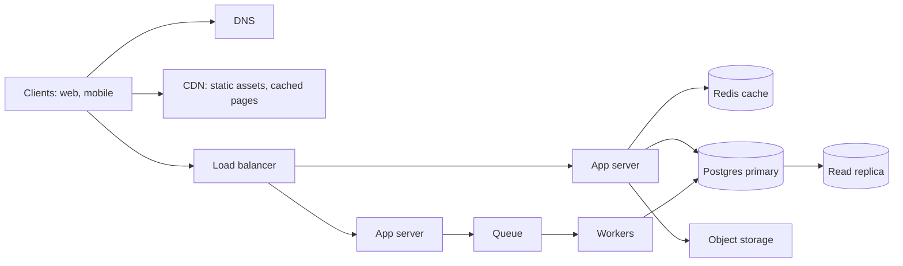

# System Design Fundamentals

> **Tier:** T2 (working knowledge) · **Related:** [Classic case studies](02-case-studies.md), [Case studies from your projects](03-case-studies-from-your-projects.md), [Monolith vs microservices](../13-architecture-and-practices/01-mvc-and-layered-architecture.md), [Background processing patterns](../13-architecture-and-practices/06-background-processing-patterns.md), [Caching and performance](../04-web-fundamentals/08-caching-and-performance.md), [How the web works](../04-web-fundamentals/01-how-the-web-works.md), [Redis](../12-databases/10-redis.md), [PostgreSQL](../12-databases/04-postgresql.md), [Indexing](../12-databases/05-indexing-and-query-optimization.md), [Observability](../14-devops-and-tools/05-observability-and-debugging.md)
> **On your resume:** CrystalCommerce (a platform serving 700+ stores and 8M+ customers, with background-job syncs to PriceCharting), Colochousing (16K+ users, 24K+ applications, a mobile app for 400+ residents) and a multi-tenant platform migration: real systems you can reason about when asked to design or scale something.

## Quick revision
- At 1-3 years of experience, interviewers want **structure and trade-offs**, not distributed-systems research: clarify, estimate, sketch, deep-dive one or two parts, name bottlenecks.
- **Framework:** requirements (functional and non-functional) -> estimates -> API -> data model -> high-level design -> deep dives -> trade-offs, bottlenecks and failure modes.
- **Estimates:** a day is about 10^5 seconds; 1 million requests per day is about 12 per second; multiply the average by 2-3 for peak.
- **Load balancers:** L4 routes connections (fast, content-blind); L7 routes HTTP requests (paths, hosts, headers, TLS termination). Algorithms: round robin, weighted, least connections, hashing.
- **Stateless app servers** (sessions in cookies or Redis, files in object storage, work in queues) make horizontal scaling and deploys easy.
- **Caching:** browser, CDN, application (Redis), database. Cache-aside with TTLs; invalidate on writes; protect against stampedes; namespace keys per tenant.
- **SQL by default** for relational data and transactions; NoSQL for specific access patterns, flexible documents or massive horizontal scale.
- **Replication** copies the same data (read scaling, availability) but adds **replication lag**; **sharding** splits data across servers (write and storage scaling) but complicates joins, transactions and rebalancing.
- **Scale in order:** indexes and query fixes, caching, read replicas, vertical scaling, partitioning, and only then sharding.
- **CAP:** during a network partition you choose consistency or availability. **PACELC** adds: otherwise you trade latency against consistency. Choose per feature: money and stock consistent, feeds and counters eventually consistent.
- **Nines:** 99.9% allows about 8.8 hours of downtime a year, 99.99% about 53 minutes. Serial dependencies multiply availability down; redundancy raises it.
- **Vertical scaling** is simple but capped; **horizontal scaling** needs statelessness and partitioning but grows much further.
- **Observability:** structured logs with correlation IDs, metrics (rate, errors, duration), traces, alerts tied to user-facing symptoms.
- **Latency ladder:** memory (about 100 ns) is far faster than SSD (tens of microseconds), which is far faster than a network round trip in a datacenter (about 0.5 ms) or across continents (100+ ms).

## 1. What the interview expects at your level

You are not expected to design a global search engine or explain consensus algorithms. You are expected to:
- ask clarifying questions before drawing anything, and state assumptions;
- start with a simple design that works, then scale the parts that need it;
- know why each component exists and what it costs;
- estimate roughly enough to justify decisions ("one Postgres server handles this");
- discuss failure modes (what if the cache, the queue or a third-party API is down?);
- take hints, change course gracefully and be honest about what you do not know.

Prompts are often "design X" (a URL shortener, a notification service) or "how would you scale the project on your resume?". Both use the same framework.

## 2. The framework

| Step | What you do | Time (45 min) |
|---|---|---|
| 1. Requirements | Functional: core use cases and what is out of scope. Non-functional: scale, latency, availability, consistency, durability, security, cost | 5 min |
| 2. Estimates | Users, requests per second (average and peak), read/write ratio, storage, bandwidth | 3-5 min |
| 3. API | Main endpoints or procedures with key parameters and responses | 5 min |
| 4. Data model | Entities, keys, relationships, indexes, choice of store | 5 min |
| 5. High-level design | Boxes and arrows: clients, load balancer, app servers, database, cache, queue, workers, object storage | 10 min |
| 6. Deep dives | One or two hard parts, often chosen by the interviewer | 10-15 min |
| 7. Wrap-up | Trade-offs, bottlenecks, failure modes, monitoring, what you would do next | 5 min |

Useful phrases: "Before I design, let me confirm the requirements", "I'll start simple and scale the bottleneck", "The trade-off here is...", "If this component fails, the user sees...".

## 3. Back-of-envelope estimation

| Fact | Value |
|---|---|
| Seconds in a day | 86,400, about 10^5 |
| 1 million requests per day | about 12 per second |
| 100 million requests per day | about 1,200 per second |
| Peak traffic | usually 2-3 times the average |
| 1 KB x 1 million | 1 GB |
| 1 MB x 1 million | 1 TB |

Worked example: 1 million daily active users each make 20 API requests a day, so 20 million requests per day, about 230 per second on average and roughly 700 at peak. With 90% reads, that is about 630 reads and 70 writes per second at peak. If each user creates 1 KB of new data daily, storage grows by 1 GB a day, about 365 GB a year.

The conclusion is what matters: "a single well-indexed Postgres primary handles 70 writes per second easily; add a cache and a read replica for reads; no sharding needed". If users upload 100,000 images a day at 500 KB each, that is 50 GB a day, which belongs in object storage behind a CDN, not in the database.

## 4. Building blocks



### 4.1 DNS and CDN
DNS maps names to IP addresses with cached answers (TTL); managed DNS can route by geography or latency and fail over between regions. A **CDN** caches static assets and cacheable responses at edge locations close to users, guided by `Cache-Control` headers; use versioned asset URLs so deploys never need manual purges. CDNs also absorb traffic spikes and some attacks.

### 4.2 Load balancers

| | L4 (transport) | L7 (application) |
|---|---|---|
| Sees | IPs, ports, TCP connections | HTTP: paths, hosts, headers, cookies |
| Can do | Fast connection forwarding | Path and host routing, TLS termination, header-based rules, retries |
| Cost | Very low overhead | More processing per request |

Algorithms: round robin, weighted round robin (bigger servers get more), least connections (good for uneven request durations), and hashing on a client or key (stickiness, cache affinity; consistent hashing limits reshuffling when servers change). Health checks remove failing instances. Sticky sessions are a smell: make servers stateless instead.

### 4.3 Stateless application servers
A server is stateless when it keeps nothing about users between requests: sessions in signed cookies or Redis, uploads in object storage, background work in a queue. Then any server can handle any request, you can add or remove servers freely, and a rolling deploy does not log anyone out.

### 4.4 Caching
Cache at several layers: the browser (`Cache-Control`, `ETag`), the CDN, the application (Redis or Memcached) and the database's own buffer cache.

- **Cache-aside** (the default): read from the cache; on a miss, read the database and store the result with a TTL; on writes, update the database and delete the key.
- **Write-through:** write to the cache and the database together (fresh reads, slower writes). **Write-behind:** write to the cache and flush later (fast, but risks losing writes).
- **Invalidation:** TTLs as a backstop, explicit deletes on writes, versioned keys (`v2`, `updated_at` in the key).
- **Stampede:** when a hot key expires, thousands of requests hit the database at once; use a lock or single-flight so one request recomputes, refresh early, and add jitter to TTLs.
- **What to cache:** hot, expensive data that tolerates brief staleness. Never mix tenants or users in a key that should be private.

```ruby
# Cache-aside in Rails: the key changes when the store changes, and expires anyway after 5 minutes
Rails.cache.fetch(["store-page", store.id, store.updated_at.to_i], expires_in: 5.minutes) do
  StorePage.build(store)
end
```

More in [caching and performance](../04-web-fundamentals/08-caching-and-performance.md) and [Redis](../12-databases/10-redis.md).

### 4.5 SQL vs NoSQL

| | SQL (PostgreSQL, MySQL) | NoSQL (MongoDB, DynamoDB, Cassandra, Redis) |
|---|---|---|
| Model | Tables, relations, constraints | Documents, key-value, wide-column, graph |
| Transactions | ACID across tables | Varies: single-item by default, some support multi-document transactions |
| Queries | Flexible SQL, joins, aggregations | Optimized for known access patterns |
| Scaling | Vertical plus read replicas; sharding is manual | Many scale horizontally by design |
| Pick when | Relational data, integrity, reporting (most business apps) | Flexible documents, huge write volume, simple key lookups, caching |

Default to Postgres unless a specific access pattern or scale requirement argues otherwise; it also handles JSON documents well.

### 4.6 Replication and read replicas
The primary accepts writes and streams changes (Postgres's WAL) to replicas, which serve reads. Replication is usually **asynchronous**, so replicas lag behind by milliseconds to seconds. A user who updates their profile and immediately reloads may see old data from a replica (a **read-your-writes** problem). Fixes: read from the primary for a short window after a user writes (Rails' automatic role switching does this with a configurable delay), send critical reads to the primary, and monitor lag. Synchronous replication avoids lag at the cost of write latency. If the primary dies, a replica is promoted; with asynchronous replication the last few writes may be lost.

### 4.7 Sharding and partitioning
**Partitioning** splits a big table inside one database (Postgres range, list or hash partitioning) for easier maintenance and partition pruning. **Sharding** splits data across several database servers by a **shard key**:

| Strategy | How | Trade-off |
|---|---|---|
| Range | Users A to M on shard 1, N to Z on shard 2 | Simple, but hot spots (recent data, popular ranges) |
| Hash | `hash(key) mod N` | Even spread; range queries and adding shards are harder (consistent hashing helps) |
| Directory | A lookup table maps keys to shards | Flexible moves; one more lookup to keep available |
| Tenant | Each organization lives on one shard | Natural for SaaS; big tenants can outgrow a shard |

Costs: cross-shard joins and transactions, rebalancing, hot keys and globally unique IDs (UUIDs or time-ordered IDs). Shard last, after indexes, caching, replicas, a bigger machine and partitioning.

| | Replication | Sharding |
|---|---|---|
| Data | Same data on every node | Each node holds a subset |
| Scales | Reads and availability | Writes and storage |
| Main problem | Replication lag, failover | Cross-shard queries, rebalancing |
| Often | Combined: each shard has replicas | |

### Going deeper: consistent hashing
With `hash(key) mod N`, adding one server changes N, so almost every key moves to a different server (a cache would lose nearly all hits at once). Consistent hashing places servers and keys on the same hash ring and assigns each key to the next server clockwise, so adding or removing a server moves only about 1/N of the keys. Each server usually gets many **virtual nodes** on the ring so load spreads evenly. It is used by distributed caches, some load balancers and partitioned databases.

### 4.8 The other blocks
- **Indexes:** B-tree indexes turn scans into logarithmic lookups; composite index column order matters; every index slows writes ([indexing](../12-databases/05-indexing-and-query-optimization.md)).
- **Queues and workers:** move slow or unreliable work out of requests, absorb spikes and retry failures ([background processing patterns](../13-architecture-and-practices/06-background-processing-patterns.md)).
- **Object storage** (S3-compatible): cheap, durable storage for files; clients upload and download directly with presigned URLs; the database stores only keys and metadata.
- **Search engines** (Elasticsearch or OpenSearch, Meilisearch, Typesense): inverted indexes for relevance, typo tolerance and facets; the database stays the source of truth and the index updates asynchronously.
- **Rate limiting:** token bucket or sliding window counters in Redis protect APIs, returning 429 with `Retry-After` ([case study](02-case-studies.md)).

## 5. Consistency, CAP and PACELC in plain words

- **Strong consistency:** every read sees the latest write. **Eventual consistency:** copies converge if writes stop; meanwhile some reads are stale.
- **CAP:** when the network splits nodes apart (a partition), a distributed system must either refuse or delay some requests to stay consistent (CP) or keep answering with possibly stale data (AP). Partitions will happen, so the real choice is what to do during one.
- **PACELC:** if there is a Partition, choose Availability or Consistency; Else, in normal operation, choose lower Latency or stronger Consistency (synchronous replication buys consistency with latency).
- **Choose per feature:** payments, bookings and stock levels need strong consistency (one primary database, transactions, constraints); feeds, like counts, search indexes and analytics can be eventually consistent.
- Practical guarantees users notice: **read-your-writes** (I see my own changes) and **monotonic reads** (data never appears to go back in time).

## 6. Availability and the nines

| Availability | Downtime per year | Downtime per 30 days |
|---|---|---|
| 99% | 3.65 days | 7.2 hours |
| 99.9% | 8.76 hours | 43.2 minutes |
| 99.99% | 52.6 minutes | 4.3 minutes |
| 99.999% | 5.3 minutes | 26 seconds |

- Components in **series** multiply: an app at 99.9% depending on a database at 99.9% is at most about 99.8%.
- **Redundancy** in parallel raises availability: two independent 99% instances where either suffices give about 99.99%.
- How you get there: multiple instances across availability zones, health checks and automatic failover, replicas, timeouts and circuit breakers, graceful degradation (serve cached data when a dependency is down), safe deploys (rolling, canary, feature flags, fast rollback) and tested backups.
- **SLI** (what you measure, such as successful request ratio), **SLO** (your target, such as 99.9% monthly), **SLA** (the contractual promise), and the **error budget** (the allowed 0.1%) that balances reliability against shipping speed.

## 7. Vertical vs horizontal scaling

| | Vertical (scale up) | Horizontal (scale out) |
|---|---|---|
| How | A bigger machine: more CPU, RAM, faster disks | More machines behind a load balancer |
| Pros | Simple; no code changes | Grows much further; tolerates machine failures |
| Cons | Hard ceiling, single point of failure, resizing may need downtime | Needs stateless services, load balancing and data partitioning |
| Typical | Databases first | Web and worker tiers |

Monolith vs microservices is a related decision: most systems at this scale run a (modular) monolith scaled horizontally, splitting services only for clear scaling or team reasons ([details](../13-architecture-and-practices/01-mvc-and-layered-architecture.md)).

## 8. Observability

- **Logs:** structured (JSON) with request ID, user, tenant and job ID, so one action can be traced across web servers and workers.
- **Metrics:** for services, RED (rate, errors, duration); for resources, USE (utilization, saturation, errors); plus business metrics (orders per minute, sync lag).
- **Traces:** distributed tracing (OpenTelemetry) follows a request through services, queues and databases to find where time goes.
- **Alerts** on user-facing symptoms tied to SLOs (error rate, latency, queue latency), not on every CPU spike; dashboards for diagnosis. More in [observability](../14-devops-and-tools/05-observability-and-debugging.md).

## 9. Approximate latency numbers

Classic figures, rounded; modern hardware is faster for memory and SSDs, but the ratios are what matter.

| Operation | Roughly |
|---|---|
| L1 cache reference | 1 ns |
| Main memory reference | 100 ns |
| Compress 1 KB with a fast codec | a few microseconds |
| Read 1 MB sequentially from memory | tens to a few hundred microseconds |
| Random 4 KB read from an SSD | tens to about 150 microseconds |
| Round trip within a datacenter | 0.5 ms |
| Read 1 MB sequentially from an SSD | 0.1 to 1 ms |
| Redis GET or a simple indexed Postgres query over the network | about 1 ms or less |
| Hard disk seek | 5 to 10 ms |
| Round trip between continents | 100 to 200 ms |

Lessons: keep hot data in memory, avoid chatty calls across regions, batch round trips, and remember that an N+1 query pattern of 100 queries at 1 ms each adds 100 ms to a page.

## Common pitfalls
- Drawing boxes before clarifying requirements and scale.
- Jumping to microservices, Kafka and sharding for a system that fits on one database.
- Estimating without concluding anything from the numbers.
- Adding a cache without an invalidation plan, or caching private data under shared keys.
- Forgetting replication lag when reads go to replicas.
- Ignoring failure modes: what happens when the queue, cache or a third-party API is down.
- Treating CAP as a property of a whole system instead of a per-feature choice.
- Monologuing for 40 minutes instead of checking in with the interviewer.

## How to talk about this in an interview
- Be honest: you have not designed a large distributed system end to end, but you have worked inside real ones. CrystalCommerce serves 700+ stores and 8M+ customers with background syncs to an external API; Colochousing has a web app, a REST API, background jobs and a mobile app; and you contributed to a multi-tenant platform migration.
- When given a generic prompt, apply the framework out loud and connect choices to experience: "on CrystalCommerce, syncs ran as background jobs, so here I'd also queue the external calls".
- Prefer simple, well-justified designs and show you know the next scaling step and its cost.
- Use your own projects as practice prompts ([case studies from your projects](03-case-studies-from-your-projects.md)).

> **Fill in:** the infrastructure you saw on CrystalCommerce or Colochousing (hosting, database setup, Redis, CDN, number of app and worker processes) so you can describe a real deployment accurately.

> **Fill in:** one performance or scaling problem you saw at Devntech (a slow page, a growing queue, a heavy import) and how it was handled.

## Interview questions

**Q1. How do you approach a system design question?**
Clarify functional and non-functional requirements and scope; estimate traffic, storage and read/write ratio; define the API and data model; sketch a simple high-level design; deep-dive into the hardest one or two parts; then discuss trade-offs, bottlenecks, failure modes and monitoring. I check in with the interviewer at each step.
*Follow-up:* What if the interviewer gives no numbers? Propose reasonable assumptions, state them and design for them.

**Q2. How would you estimate requests per second and storage?**
Daily active users times actions per user gives requests per day; divide by about 100,000 seconds for the average and multiply by 2-3 for peak. Storage is new records per day times average record size, projected over the retention period. For example, 20 million requests a day is about 230 per second, roughly 700 at peak.
*Follow-up:* Why bother? The numbers decide whether one database is enough, whether you need caching, and where files should live.

**Q3. What is the difference between L4 and L7 load balancing?**
L4 balances TCP connections using addresses and ports, very fast but content-blind. L7 understands HTTP, so it can route by path or host, terminate TLS, inspect headers and retry. Common algorithms are round robin, weighted, least connections and hashing for affinity, with health checks removing bad servers.
*Follow-up:* Why avoid sticky sessions? They pin users to servers, unbalance load and lose sessions when a server dies; stateless servers avoid all of that.

**Q4. Why should application servers be stateless?**
So any server can handle any request: you can scale out, replace failed instances and deploy without losing user data. Keep sessions in signed cookies or Redis, files in object storage and background work in queues.
*Follow-up:* Where would WebSocket connections live? On specific servers by necessity, with shared state (presence, messages) in Redis or a database so any server can take over.

**Q5. How would you add caching to a slow endpoint, and what can go wrong?**
Measure first, then cache-aside in Redis: look up a key, on a miss load from the database and store with a TTL, and delete or version the key on writes; add HTTP caching or a CDN for public pages. Risks: stale data, invalidation bugs, stampedes when hot keys expire, memory pressure, and private data leaking through shared keys.
*Follow-up:* How do you prevent a stampede? Let one request recompute under a lock or single-flight, refresh early, and add jitter to expirations.

**Q6. SQL or NoSQL?**
SQL by default for business data: relations, constraints, transactions and flexible queries, with replicas for reads. NoSQL when the access pattern is simple and known (key lookups), documents are naturally nested and schema-flexible, or write volume needs horizontal scaling beyond a single primary.
*Follow-up:* Can Postgres store documents? Yes, JSONB with GIN indexes covers many document use cases while keeping transactions.

**Q7. What is the difference between replication and sharding?**
Replication keeps copies of the same data on several nodes to scale reads and survive failures, at the cost of replication lag. Sharding splits data across nodes by a shard key to scale writes and storage, at the cost of cross-shard queries, transactions and rebalancing. Large systems combine them.
*Follow-up:* When would you shard? Only after indexes, caching, replicas, vertical scaling and partitioning stop being enough.

**Q8. What problems do read replicas introduce?**
Replication lag: reads may return stale data, breaking read-your-writes. Fix it by routing a user's reads to the primary shortly after they write, keeping critical reads on the primary and monitoring lag. Failover can also lose recent writes when replication is asynchronous.
*Follow-up:* How does Rails help? Its multiple-database support can switch reads to the primary for a configurable delay after a write.

**Q9. Explain CAP in plain words.**
When a network partition separates nodes, a distributed system must choose between staying consistent (refusing or delaying some requests) and staying available (answering, possibly with stale data). PACELC adds that even without partitions you trade latency against consistency. In practice you choose per feature: strong consistency for money and stock, eventual consistency for feeds and counters.
*Follow-up:* Is a single Postgres primary CP or AP? With one node there is no partition between replicas to choose over; adding async replicas makes replica reads eventually consistent.

**Q10. What does 99.99% availability mean, and how would you get there?**
About 53 minutes of downtime a year, or 4 minutes a month. You need redundancy at every layer (multiple app instances across zones, database replicas with automatic failover), health checks, timeouts and circuit breakers, graceful degradation, safe deploys with fast rollback, and monitoring tied to an SLO.
*Follow-up:* Why do dependencies matter? Availability multiplies across serial dependencies, so a 99.9% third-party API caps that feature unless you degrade gracefully.

**Q11. Vertical or horizontal scaling?**
Vertical scaling (a bigger machine) is simple and often the right first step, especially for databases, but has a ceiling and remains a single point of failure. Horizontal scaling (more machines) grows further and tolerates failures but requires stateless services, load balancing and, for data, partitioning.
*Follow-up:* What do you scale horizontally first? The stateless web and worker tiers.

**Q12. What would you monitor in a new system?**
Request rate, error rate and latency percentiles per endpoint; queue latency and job failures; database health (connections, slow queries, replication lag); cache hit ratio; saturation of CPU and memory; and business metrics. Alerts fire on user-facing symptoms against SLOs, with structured logs and traces for diagnosis.
*Follow-up:* Why latency percentiles rather than averages? Averages hide the slow tail that real users experience.

## Further reading
- PostgreSQL high availability and replication: https://www.postgresql.org/docs/current/high-availability.html
- Rails multiple databases (read replicas, automatic role switching): https://guides.rubyonrails.org/active_record_multiple_databases.html
- Redis as a cache: https://redis.io/docs/latest/
