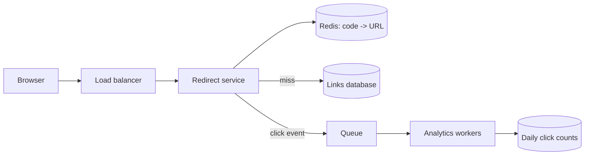
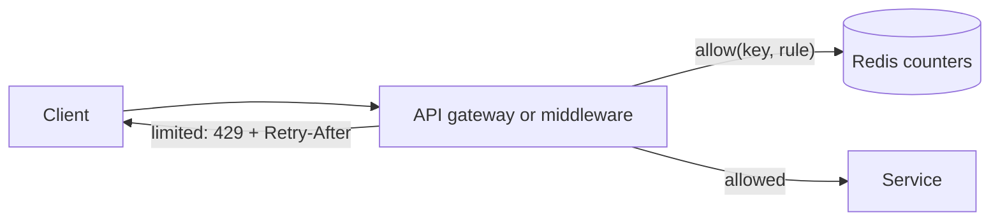
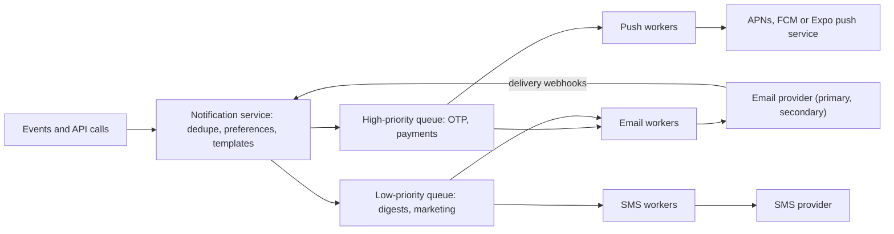
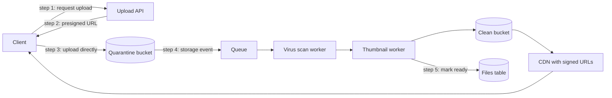
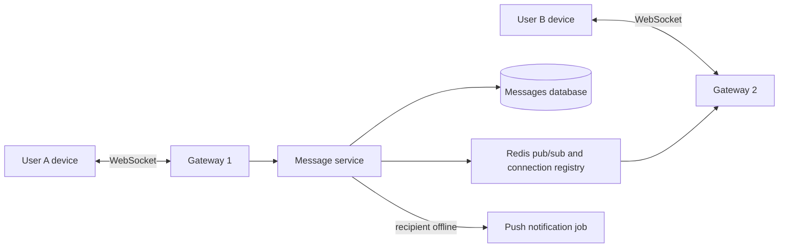

# System Design Case Studies

> **Tier:** T2 (working knowledge) · **Related:** [System design fundamentals](01-fundamentals.md), [Case studies from your projects](03-case-studies-from-your-projects.md), [Background processing patterns](../13-architecture-and-practices/06-background-processing-patterns.md), [Third-party API integration](../13-architecture-and-practices/05-third-party-api-integration.md), [Redis](../12-databases/10-redis.md), [Realtime and WebSockets](../04-web-fundamentals/09-realtime-websockets.md), [Push notifications in Expo](../08-react-native-expo/05-push-notifications.md), [Rails Action Cable and Active Storage](../05-ruby-on-rails/15-actioncable-mailer-activestorage.md)
> **On your resume:** push notifications in the Coloc resident app, rate-limited third-party syncs (PriceCharting) and background jobs at Devntech: the building blocks behind these classic prompts.

## Quick revision
- **URL shortener:** read-heavy; base62 codes (7 characters give about 3.5 trillion combinations) from a counter, hashing with collision checks, or pre-generated keys; 302 if you need analytics, 301 if you want caching; Redis in front of the database; clicks recorded asynchronously.
- **Rate limiter:** token bucket (bursts allowed, smooth average) or sliding window counter (accurate, constant memory) in Redis with an atomic Lua script; 429 with `Retry-After`; decide fail-open vs fail-closed.
- **Notification service:** events -> preferences and templates -> per-channel priority queues -> provider workers; idempotency keys per event, user and channel; retries, dead-letter queue, provider failover, per-user and per-provider rate limits.
- **File uploads:** presigned URLs so clients upload straight to object storage; multipart for big files; quarantine, virus scan and thumbnail jobs; serve through a CDN with signed URLs for private files.
- **Chat:** WebSocket gateways, a Redis connection registry plus pub/sub for cross-server delivery, persist before publishing, time-sortable message IDs, client message IDs for idempotent sends, read receipts as a per-member pointer, presence via heartbeats with TTLs, push notifications when offline.

## 1. URL shortener

**Requirements.** Create a short link (optional custom alias and expiry), redirect fast, count clicks. Non-functional: about 100 reads per write, redirects in a few milliseconds server-side, redirects highly available.

**Estimates.** 100 million new links a month is about 40 writes per second; 100 times more reads is about 4,000 redirects per second. Five years of links (6 billion at about 500 bytes) is about 3 TB. Base62 with 7 characters gives 62^7, about 3.5 trillion codes.

**API.**
- `POST /api/links { long_url, custom_alias?, expires_at? }` returns `{ code, short_url }`
- `GET /{code}` returns a 301 or 302 with `Location: long_url`
- `GET /api/links/{code}/stats` returns click counts

**Data model.** `links(code PRIMARY KEY, long_url, user_id, created_at, expires_at)` and `link_daily_clicks(code, day, clicks)` filled by workers.

| Key generation | How | Trade-off |
|---|---|---|
| Hash and truncate | First 7 base62 characters of a hash of the URL | Collisions: check and retry with a salt |
| Counter plus base62 | A database sequence or ID ranges handed to each server | Unique and short, but sequential codes are guessable; obfuscate with a reversible shuffle (for example the Sqids library) |
| Pre-generated keys | A key service fills a table of unused random codes; servers claim batches | Fast and collision-free; another component to run |

```ts
const ALPHABET = "0123456789abcdefghijklmnopqrstuvwxyzABCDEFGHIJKLMNOPQRSTUVWXYZ";

export function toBase62(id: bigint): string {
  if (id === 0n) return "0";
  let code = "";
  for (let n = id; n > 0n; n /= 62n) code = ALPHABET[Number(n % 62n)] + code;
  return code;                                            // toBase62(125n) === "21"
}
```

**301 vs 302.** A 301 (permanent) is cached by browsers, so repeat clicks never reach you: less load, but no analytics and no way to change the target. A 302 (or 307) sends every click through you: accurate analytics and editable links. Shorteners with analytics usually choose 302.



**Scaling notes.** Stateless redirect servers; Redis cache-aside for hot codes with LRU eviction; also cache "not found" briefly so scanners cannot hammer the database; read replicas; shard by code hash only at very large scale. Custom aliases rely on the primary-key uniqueness. Rate limit link creation and scan target URLs for malware to stop abuse.

**Likely follow-ups.** Same long URL twice: return the existing code (a unique index on a URL hash per user) or create a new one; expired links: a TTL check at redirect plus a cleanup job; enumeration: random or shuffled codes and rate limits.

## 2. Rate limiter

**Requirements.** Limit each client (API key, user or IP) to N requests per window, for example 100 per minute, per endpoint or plan; consistent across many servers; adds about a millisecond at most; tells clients when to retry.

**Where.** At the API gateway or edge, or as middleware in each service (Rack::Attack and Rails 7.2's controller `rate_limit` in Rails, middleware in Hono or Express), with counters in a shared Redis.

**API and data model.** Internally, one call: `allow(client_key, rule)` returns `{ allowed, remaining, reset_at }`. Rules (`plan`, `endpoint`, `limit`, `window`) live in configuration or a small table cached in memory; counters live in Redis under keys such as `rl:{api_key}:{endpoint}` with a TTL of about two windows, so idle clients cost nothing.



| Algorithm | Idea | Pros | Cons |
|---|---|---|---|
| Fixed window | Counter per client per minute | Simplest, one key | Up to twice the limit around window edges |
| Sliding window log | Sorted set of request timestamps | Exact | Memory grows with traffic |
| Sliding window counter | Current count plus the previous window's count weighted by overlap | Accurate enough, constant memory | Approximation |
| Token bucket | Tokens refill at a rate up to a capacity; each request takes one | Allows short bursts, smooth average | Two parameters to tune |
| Leaky bucket | Requests drain from a queue at a fixed rate | Smooth output | Bursts wait or drop |

Fixed window and sliding log examples are in [Redis](../12-databases/10-redis.md); a token bucket in Lua is in [third-party API integration](../13-architecture-and-practices/05-third-party-api-integration.md). A sliding window counter, atomic in one script and stored in one hash per client:

```ts
import Redis from "ioredis";
const redis = new Redis();

const SLIDING_WINDOW = `
local key, limit, window, now = KEYS[1], tonumber(ARGV[1]), tonumber(ARGV[2]), tonumber(ARGV[3])
local idx = math.floor(now / window)
local s = redis.call("HMGET", key, "idx", "cur", "prev")
local sidx, cur, prev = tonumber(s[1]), tonumber(s[2]) or 0, tonumber(s[3]) or 0
if sidx ~= idx then
  if sidx == idx - 1 then prev = cur else prev = 0 end
  cur = 0
end
local weight = 1 - (now - idx * window) / window
if prev * weight + cur >= limit then return 0 end
redis.call("HSET", key, "idx", idx, "cur", cur + 1, "prev", prev)
redis.call("EXPIRE", key, window * 2)
return 1
`;

export async function allow(clientId: string, limit = 100, windowSeconds = 60): Promise<boolean> {
  const now = Date.now() / 1000;          // reading Redis TIME inside the script avoids app-server clock skew
  return (await redis.eval(SLIDING_WINDOW, 1, `rl:${clientId}`, limit, windowSeconds, now)) === 1;
}
```

**Responses.** `429 Too Many Requests` with `Retry-After`; many APIs also send remaining-quota headers (the `X-RateLimit-*` family is common; standard `RateLimit` headers are being defined by the IETF).

**Distributed concerns.**
- **Atomicity:** read and update in one Lua script (or `MULTI`), or concurrent servers both admit the last request.
- **Redis failure:** fail open (allow traffic) for ordinary endpoints, fail closed for sensitive ones such as login; run Redis with a replica.
- **Latency:** keep Redis close; a small in-memory pre-limit per server can absorb floods.
- **Clock skew** between app servers distorts windows; use one clock (Redis `TIME`).
- **Hot keys and multi-region:** one giant client concentrates load on one key; across regions, enforce per-region limits or sync counts asynchronously.

**Likely follow-ups.** Brute-force login protection (limit per account and per IP), different limits per pricing plan (rules stored per plan, cached in memory), and testing (fake clock, concurrent requests in a test).

## 3. Notification service

**Requirements.** Send email, SMS, push and in-app notifications triggered by product events (order shipped, rent due, new house event); templates with variables and languages; user preferences (per type and channel, quiet hours); retries without duplicates; scheduled sends; delivery tracking; provider failover. Estimate: 10 million a day is about 116 per second on average, with much higher bursts during campaigns, so queues absorb the spikes.

**API and events.** Services publish events (`rent.due`, `order.shipped`) or call `POST /notifications { user_id, type, data, idempotency_key, send_at? }`. Users read `GET /me/notifications` (in-app inbox) and manage `PUT /me/notification-preferences`.

**Data model.**
- `notifications(id, idempotency_key UNIQUE, user_id, type, channel, status, provider, provider_message_id, attempts, send_at, sent_at)`
- `templates(type, channel, locale, version, subject, body)`
- `preferences(user_id, type, channel, enabled)` and `device_tokens(user_id, platform, token, last_seen_at)`



**Key decisions.**
- **Idempotency:** the key is derived from event, user and channel (`rent.due:payment-123:user-9:push`); a unique index makes retried events and duplicate deliveries no-ops.
- **Preferences and quiet hours** are checked before enqueueing; non-urgent messages wait until morning in the user's time zone.
- **Priority:** separate queues so a million-message campaign cannot delay a password reset or payment receipt.
- **Retries** with backoff and jitter, then a dead-letter queue; permanent errors (invalid address, unregistered device token) stop retries and clean up data.
- **Provider failover:** a circuit breaker per provider and a secondary provider for email or SMS.
- **Rate limits** per provider (their quotas) and per user (no more than N marketing messages a day).
- **Tracking:** provider callbacks update status; opens and clicks for email; unsubscribe links where the law requires them.

**Likely follow-ups.** How do you avoid sending twice when a worker crashes after the provider accepted the message? (Idempotency key with the provider if supported; otherwise mark "sending" before the call and accept rare duplicates.) How do you handle a provider outage? (Breaker opens, fail over, queue drains later.)

## 4. File upload service

**Requirements.** Users upload images, documents and videos (up to several GB) from web and mobile; uploads resume after network drops; files are virus-scanned; images get thumbnails; private files are protected; downloads are fast worldwide.

**API.**
- `POST /uploads { filename, content_type, size }` returns `{ upload_id, presigned_url or multipart part URLs, expires_in }`
- The client uploads **directly** to object storage with that URL.
- `POST /uploads/{id}/complete` (or a storage event) starts processing.
- `GET /files/{id}` returns metadata and a short-lived signed download URL.

**Data model.** `files(id, owner_id, org_id, storage_key, status, content_type, size, checksum, variants, created_at)` with status `pending`, `scanning`, `ready` or `rejected`, and `variants` holding thumbnail keys.



**Key decisions.**
- **Presigned URLs** keep large uploads off your app servers; they expire quickly and are bound to a key and content type, and presigned POST policies can enforce a size range.
- **Multipart uploads** split big files into parts uploaded in parallel and retried individually, which also gives resumability (S3 parts are at least 5 MB except the last).
- **Never trust the client:** check the real type from the file's magic bytes, enforce size limits, generate random storage keys, scan before anything else touches the file, and strip location metadata from photos.
- **Serving:** public files through a CDN; private files through short-lived signed URLs after an authorization check, scoped by owner or tenant.
- **Cleanup:** lifecycle rules delete abandoned uploads in the quarantine bucket.
- In Rails, Active Storage direct uploads implement the presigned flow; an Expo app can upload a local file to the presigned URL with `fetch`.

**Likely follow-ups.** Proxying uploads through the app (simpler, but ties up servers and bandwidth); deduplicating identical files by checksum; videos (multipart upload plus a transcoding pipeline producing streaming formats).

## 5. Basic chat

**Requirements.** One-to-one and small group chats (a house group, for example), real-time delivery, history with pagination, sent, delivered and read receipts, presence (online, last seen), push notifications when offline, several devices per user. Estimate: 1 million daily users sending 40 messages each is 40 million messages a day, about 460 per second, roughly 12 GB of text a day.

**API.** A WebSocket connection authenticated with a token carries events: `message.send { conversation_id, client_message_id, body }` acknowledged with the server ID and timestamp, `message.new` pushed to members, `receipt.read { conversation_id, last_read_message_id }`. History uses REST: `GET /conversations/{id}/messages?before={message_id}&limit=50`.

**Data model.**
- `conversations(id, kind)`; `conversation_members(conversation_id, user_id, last_read_message_id, muted)`
- `messages(id, conversation_id, sender_id, body, client_message_id, created_at)` with an index on `(conversation_id, id)` and `UNIQUE (sender_id, client_message_id)` so a resent message is stored once



**Key decisions.**
- **Gateways hold connections;** a Redis registry maps users to gateways and pub/sub fans messages out to whichever gateway holds the recipient's sockets (Action Cable's Redis adapter works this way). The load balancer must support WebSockets.
- **Persist, then publish,** so an acknowledged message is never lost; offline recipients get a push notification instead.
- **Ordering:** server-assigned, time-sortable IDs (or a per-conversation sequence) define order; clients sort by them and dedupe by `client_message_id` after reconnects.
- **Receipts:** store a per-member `last_read_message_id` pointer instead of a row per message per reader; "delivered" works the same way.
- **Presence:** clients send heartbeats; a Redis key with a TTL per user means "online"; broadcast presence only to people who share an open conversation.
- **Reconnects:** the client asks for messages after the last ID it has.
- **Storage growth:** Postgres with partitioning goes a long way; very large systems move messages to wide-column stores.

**Likely follow-ups.** A group of 10,000 members (fan out on read instead of pushing every message to every member), message search (a search index fed asynchronously), and end-to-end encryption (usually out of scope at this level; mention that the server would store only ciphertext).

## Common pitfalls
- Designing for billions of users when the stated scale fits one database.
- URL shortener: forgetting collisions, enumeration or the 301 caching trade-off.
- Rate limiter: non-atomic read-then-write in Redis, or no decision about Redis being down.
- Notifications: no idempotency key, one shared queue for urgent and bulk messages, retrying permanent failures.
- File uploads: streaming gigabytes through app servers, trusting client content types, public buckets for private files.
- Chat: publishing before persisting, per-message receipt rows, assuming all users of a conversation are connected to the same server.
- Skipping failure modes and monitoring in the wrap-up.

## How to talk about this in an interview
- These prompts map onto your experience: rate limits and retries from the PriceCharting sync, background jobs and idempotency from Devntech's Rails apps, push notifications from the Coloc resident app. Mention the link briefly, then design properly.
- Keep the first design simple and say what you would add at the next order of magnitude.
- Be explicit about what you have built versus what you are designing on the spot; interviewers respect that.

> **Fill in:** how push notifications were sent in the Coloc app (Expo push service or direct FCM and APNs, triggered by which backend jobs) so you can use it in the notification design.

> **Fill in:** any rate-limit, upload or realtime feature you touched at Devntech or in your internships, to use as a concrete anchor.

## Interview questions

**Q1. How would you generate short codes for a URL shortener?**
Either encode a unique counter in base62 (short and collision-free, but guessable unless shuffled), hash the URL and take 7 base62 characters (check for collisions and retry with a salt), or pre-generate random unused keys and hand out batches. Seven base62 characters give about 3.5 trillion codes.
*Follow-up:* How do you hand out counter values from many servers? Give each server a block of IDs (a range) from a central sequence so they never collide.

**Q2. Should redirects be 301 or 302?**
A 301 is permanent and cached by browsers, which cuts load but hides repeat clicks from analytics and prevents changing the target. A 302 or 307 sends every click through your service, giving accurate analytics and editable links. With analytics as a requirement, use 302.
*Follow-up:* How do you keep 302s cheap? Cache code lookups in Redis and record clicks asynchronously through a queue.

**Q3. Which rate-limiting algorithm would you choose?**
A token bucket when short bursts are fine but the average must be capped, or a sliding window counter for accurate per-window limits with constant memory. Fixed windows are simplest but allow double bursts at edges; sliding logs are exact but memory-hungry.
*Follow-up:* What do you return when limited? 429 with `Retry-After` and quota headers.

**Q4. How do you make a rate limiter work across many servers?**
Keep counters in a shared Redis and update them atomically in a Lua script so concurrent requests cannot both pass; use a single clock source; decide whether to fail open or closed if Redis is down; keep Redis close to the app for latency; consider per-region limits for multi-region setups.
*Follow-up:* Why not counters in each server's memory? Each server would allow the full limit, so the real limit becomes N times larger.

**Q5. How does a notification system avoid duplicates and survive provider failures?**
Each notification has an idempotency key from event, user and channel with a unique index, so retries and duplicate events are no-ops. Workers retry transient errors with backoff, dead-letter persistent failures, and a circuit breaker per provider fails over to a secondary provider during outages.
*Follow-up:* What if the worker crashes after the provider accepted the message? Use the provider's idempotency support where available; otherwise record a "sending" state first and accept a rare duplicate.

**Q6. How do you keep a marketing blast from delaying critical notifications?**
Separate queues by priority with dedicated or weighted workers, rate limits per provider and per user, and scheduling bulk sends over time. Password resets and payment receipts never share a queue with campaigns.
*Follow-up:* And respecting users? Check preferences and quiet hours before enqueueing, and include unsubscribe options.

**Q7. How should clients upload large files?**
Directly to object storage using short-lived presigned URLs issued by the API after validating size and type, with multipart uploads for big files so parts upload in parallel and retry individually. The API stores metadata and processes the file asynchronously after upload.
*Follow-up:* Why not upload through the app server? It ties up application processes and bandwidth for the whole transfer and scales poorly.

**Q8. How do you keep uploaded files safe?**
Upload to a quarantine area, scan for malware before anything else touches the file, verify the real file type from its bytes, enforce size limits, use random keys, keep private files in private buckets served through short-lived signed URLs after an authorization check, and strip sensitive metadata such as photo locations.
*Follow-up:* How do you scope access in a multi-tenant app? Check that the file's tenant matches the user's current organization before signing a URL.

**Q9. How do chat messages reach users connected to different servers?**
Each gateway holds WebSocket connections; the message service persists the message, then publishes it through Redis pub/sub or a broker; the gateway holding the recipient's connection pushes it down. A registry in Redis tracks which gateway each user is on; offline users get a push notification.
*Follow-up:* What happens on reconnect? The client requests messages after the last ID it received.

**Q10. How do you implement read receipts and presence efficiently?**
Store one `last_read_message_id` per member per conversation instead of a row per message per reader, and derive "seen" from it. For presence, clients send heartbeats that refresh a Redis key with a short TTL, and presence changes are broadcast only to users who share an open conversation.
*Follow-up:* Why not write a row for every read? Group chats multiply rows by members and messages, creating huge write volume for little value.

## Further reading
- MDN, HTTP redirections: https://developer.mozilla.org/docs/Web/HTTP/Redirections
- Redis scripting with Lua: https://redis.io/docs/latest/develop/interact/programmability/eval-intro/
- Rails Active Storage direct uploads: https://guides.rubyonrails.org/active_storage_overview.html
