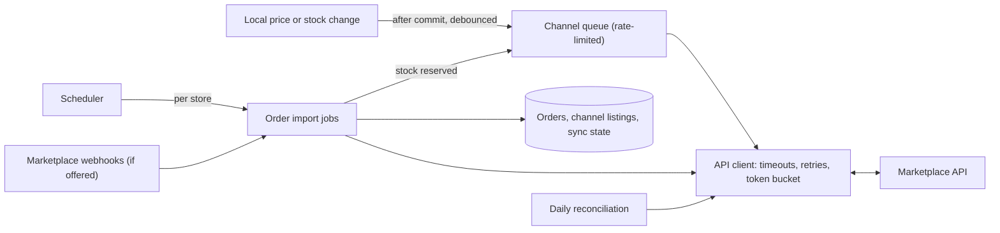
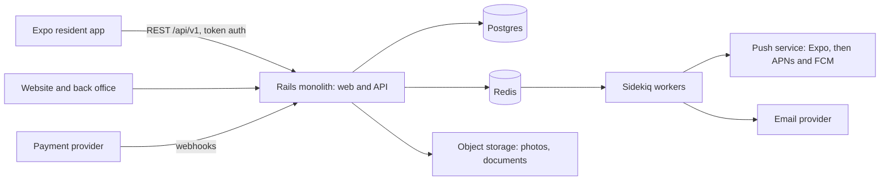

# System Design Case Studies From Your Projects

> **Tier:** T2 (working knowledge) · **Related:** [System design fundamentals](01-fundamentals.md), [Classic case studies](02-case-studies.md), [Third-party API integration](../13-architecture-and-practices/05-third-party-api-integration.md), [Multi-tenancy](../13-architecture-and-practices/03-multi-tenancy.md), [Platform migration strategies](../13-architecture-and-practices/04-platform-migration-strategies.md), [Payments and subscriptions](../13-architecture-and-practices/08-payments-and-subscriptions.md), [E-commerce domain](../13-architecture-and-practices/07-ecommerce-domain.md), [CrystalCommerce](../17-projects-deep-dive/01-crystalcommerce.md), [Colochousing web and API](../17-projects-deep-dive/02-colochousing-web-and-api.md), [Coloc resident app](../17-projects-deep-dive/03-coloc-resident-app.md), [Multi-tenant migration](../17-projects-deep-dive/04-multi-tenant-platform-migration.md), [LMS](../17-projects-deep-dive/05-lms-coursera-clone.md)
> **On your resume:** CrystalCommerce (700+ stores, 8M+ customers, PriceCharting sync and market price import), Colochousing (16K+ users, 65 houses in 8 cities, 24K+ applications, a resident app for 400+ residents, a multi-tenant migration) and the PureLogics LMS with subscriptions.

Interviewers love "design something like what you built". The designs below are **illustrative**: typical ways to build such systems, to practice the framework and to compare with what you saw. They are not descriptions of the real CrystalCommerce, Colochousing or PureLogics systems; the fill-in prompts connect them to what you actually did.

## Quick revision
- **Marketplace sync:** debounced push jobs for listing, price and stock changes; scheduled or webhook-driven order import; one rate-limited client with a shared budget prioritizing orders and stock; upserts by `(channel, external_id)`; atomic stock reservations; daily reconciliation; staleness alerts.
- **Market price import:** one guarded nightly run, fan-out into chunks, matching through a persisted mapping table, upserts that skip unchanged prices, append-only price history, fan-in finalizer, then per-store repricing and channel pushes.
- **Co-living platform:** a Rails monolith with a versioned REST API for the Expo app, Postgres, Sidekiq and Redis; idempotent rent payments confirmed by webhooks; push fan-out jobs; modest scale, so correctness beats distribution.
- **Multi-tenant migration:** shared schema with `org_id` plus memberships and roles; a strangler migration routed at the edge; legacy sync APIs with cursors and tombstones; ID mapping; per-entity ownership and verified cutovers; the SEO-sensitive marketplace page handled carefully.
- **LMS with protected video:** DRF and React, transcoding to HLS, private storage, short-lived signed URLs or cookies issued only after an access check, subscription status mirrored from payment webhooks, progress upserts.

## 1. Syncing a multi-store catalog with an external marketplace

**Prompt:** "Hundreds of stores sell on your platform. Design the integration that lists their inventory on an external marketplace and keeps listings, prices, stock and orders in sync."

**Requirements.** Stores opt in and choose what to list; listings are published, updated and delisted; channel prices follow rules; stock changes reach the marketplace within a minute or two; marketplace orders are imported within minutes, never twice; sync status and errors are visible per listing. Constraints: provider rate limits, hundreds of stores, possibly millions of listings.



**Data model.**
- `channel_accounts(store_id, channel, enabled, settings)`: credentials live in encrypted storage, not in plain columns.
- `channel_listings(listing_id, channel, external_id, channel_price_cents, sync_status, last_synced_at, last_error)` with `UNIQUE (channel, external_id)`.
- `orders(store_id, channel, external_order_id, status)` with `UNIQUE (channel, external_order_id)`.
- `sync_states(store_id, channel, resource, cursor, last_success_at, consecutive_failures)`.

**Key decisions and trade-offs.**
- **Push vs batch:** push each change for freshness, but debounce per listing (a burst of edits becomes one call) so the quota survives.
- **Rate limits:** one shared token bucket per API key; priorities orders > stock > prices > descriptions; per-store fairness so one 200,000-listing store cannot starve the rest.
- **Polling vs webhooks:** use order webhooks if the provider offers them, with polling as the safety net; otherwise poll orders frequently with a cursor.
- **Idempotency:** upserts by external ID, absolute stock values, unique external order IDs, cursors advanced only after work is stored.
- **Overselling:** publish available stock (on hand minus reserved minus a buffer), reserve atomically when any order arrives, push the new stock to other channels immediately, and flag collisions for a person to resolve.
- **Monitoring:** failure and 429 rates, staleness per store, dead jobs, oversell count; a per-store status page.

**Follow-ups to expect.**
- *The marketplace is down for two hours.* The circuit breaker opens, jobs back off, stock pushes coalesce to the latest value, the backlog drains within the rate limit afterwards, and reconciliation verifies.
- *A new store lists 200,000 items.* Bulk endpoints if available, otherwise spread over hours at low priority, with a progress bar.
- *How do you know it works?* Reconciliation diffs and staleness alerts, not the absence of errors.

> **Fill in:** what the PriceCharting sales-channel sync covered in each direction (listings, prices, stock, orders), what triggered each sync, and which parts you built.

> **Fill in:** how rate limits, failures and overselling were handled in practice, and what was monitored.

## 2. Importing market prices into a large catalog

**Prompt:** "Every night, import market prices for millions of catalog products from a price-data API so stores can price their inventory from market data."

**Requirements.** Fetch prices per product and condition, match them to the catalog, keep current prices and history, trigger each store's repricing rules, and show stores what changed. Constraints: finish within the night, respect API quotas, safe to re-run, no impact on daytime traffic.

**Design.**
1. A scheduler starts one run per night, guarded by a unique `(job_name, date)` run record.
2. A coordinator selects products to refresh (tracked products, those in stock first) and fans out chunks of IDs.
3. Chunk workers fetch prices (bulk endpoints if offered, otherwise within the shared token bucket), map them through persisted product matches, and upsert.
4. Each chunk records completion; the last one to finish claims the finalizer with an atomic update.
5. The finalizer fans out repricing per store; repricing applies the store's rules in batches and pushes changed prices to sales channels.

```sql
CREATE TABLE market_prices (
  catalog_product_id bigint  NOT NULL,
  condition          text    NOT NULL,
  source             text    NOT NULL,
  price_cents        integer NOT NULL,
  currency           char(3) NOT NULL,
  fetched_at         timestamptz NOT NULL,
  PRIMARY KEY (catalog_product_id, condition, source)
);

INSERT INTO market_prices AS mp (catalog_product_id, condition, source, price_cents, currency, fetched_at)
VALUES ($1, $2, $3, $4, $5, now())
ON CONFLICT (catalog_product_id, condition, source) DO UPDATE
SET price_cents = EXCLUDED.price_cents, fetched_at = EXCLUDED.fetched_at
WHERE mp.price_cents IS DISTINCT FROM EXCLUDED.price_cents;   -- unchanged prices cause no write
```

Price history is an append-only table written only when a price changes, partitioned by month with a retention policy. Product matches live in `product_matches(catalog_product_id, source, external_product_id, confidence, matched_by)`, decided once by identifiers, then fuzzy matching, then human review.

**Trade-offs.**
- **Full refresh vs change feed:** if the provider offers "changed since", sync only changes; otherwise prioritize what matters (in-stock items) within the quota.
- **Batch size:** bigger batches cut round trips; smaller ones limit the blast radius of failures and keep transactions short. For very large loads, `COPY` into a staging table and merge with one `INSERT ... SELECT ... ON CONFLICT`.
- **Bad data:** reject changes beyond a sanity threshold (for example a tenfold jump) into a review queue; floors and ceilings protect stores either way.

**Follow-ups to expect.**
- *The import dies halfway.* Chunks are idempotent and recorded, so the rerun processes only missing chunks and the finalizer still runs once.
- *Why would stores trust automatic prices?* Rule previews, manual locks, change thresholds and visible history.

> **Fill in:** how the PriceCharting market price import worked: schedule, batching, how products were matched, and how stores used the imported prices.

## 3. A co-living platform with a resident mobile app

**Prompt:** "Design the backend for a co-living company: a website where people find rooms and apply, and a mobile app where residents see house events and tasks, split bills, pay rent and get push notifications."

**Scale context.** Thousands of users, dozens of houses, tens of thousands of applications, hundreds of active app users: a well-built monolith on one Postgres database is plenty. The hard parts are correctness (money, double taps), mobile API design and reliable notifications, not distribution.

**Requirements.** Public house and room listings with availability; an application flow (submit, review, accept, lease); resident features (events with RSVPs, recurring tasks, bills split between housemates, rent payments with history and receipts, push notifications); an admin back office. Non-functional: secure mobile auth, payment correctness, compatibility with older app versions still installed, privacy of personal data.



**Data model (core).** `houses(city_id)`, `rooms(house_id)`, `applications(user_id, room_id, status)`, `leases(user_id, room_id, starts_on, ends_on, rent_cents)`, `rent_payments(lease_id, period, amount_cents, status, provider_ref)` with one succeeded payment per lease and period enforced by a partial unique index, `events` and `event_attendees`, `tasks` and `task_assignments`, `bills` and `bill_shares(bill_id, user_id, amount_cents, settled_at)`, `device_tokens(user_id, platform, token)`. A fuller entity diagram is in [DBMS fundamentals](../12-databases/01-dbms-fundamentals.md).

**Key decisions.**
- **Mobile API:** versioned paths, short-lived access tokens plus refresh tokens kept in secure storage on the device, cursor pagination, one error format, idempotency keys on payment and bill creation, and a minimum-supported-version check so very old apps are asked to update.
- **Payments:** the server creates the payment with an idempotency key, the app confirms with the provider's SDK, and only the verified webhook marks rent paid ([payments](../13-architecture-and-practices/08-payments-and-subscriptions.md)).
- **Jobs:** rent reminders scheduled per lease and period and guarded against duplicates; push fan-out per house event; bill notifications; webhook processing; application emails.
- **Split bills:** store each share (with remainder cents assigned deterministically) rather than recomputing, so history survives residents moving out.
- **Realtime:** push notifications plus pull-to-refresh are enough for a house feed; WebSockets only if chat-like features arrive.
- **Growth across cities:** cities are just a dimension; more houses mean more rows, not new architecture. If the company starts serving other operators, that is multi-tenancy (case 4).

**Follow-ups to expect.** A double tap on "Pay" (idempotency key, locked claim, unique index); invalid push tokens (remove them when the push service reports them unregistered); a resident leaving mid-month with unpaid shares (shares stay owed; proration rules for rent); an API change that would break old app versions (add fields, never remove or rename within a version).

> **Fill in:** which Colochousing features you built on the Rails side and in the Coloc app (events, tasks, split bills, rent payments, push notifications, EAS releases), and how the app talked to the API.

> **Fill in:** how rent payments and push notifications actually flowed end to end, and which provider each used.

## 4. Migrating to a multi-tenant SaaS

**Prompt:** "The company wants its single-operator Rails app to become a multi-tenant TypeScript SaaS that other operators can use. Design the target and the migration, without downtime and without losing search traffic."

**Target design.** TanStack Start for server-rendered pages and server functions, oRPC procedures for the API with middleware that resolves the session, the active organization and the user's membership, Drizzle repositories that always filter by `org_id`, Postgres with a shared schema (optionally RLS as a safety net), and a job runner for syncs and notifications. Organizations, memberships with roles, and super-admin tooling come first ([multi-tenancy](../13-architecture-and-practices/03-multi-tenancy.md)).

**Data model.** `organizations`, `memberships(org_id, user_id, role)` and global `users`; every tenant table carries `org_id NOT NULL` with uniques and foreign keys that include it, plus a `legacy_id` (unique) for synced rows; `sync_states(entity, cursor, last_success_at)` and an `id_mappings(entity, legacy_id, new_id)` table support the migration.

| Phase | What moves | How data flows |
|---|---|---|
| 0. Foundations | Orgs, memberships, roles, auth with an active org | Legacy data imported once into the first org |
| 1. Public marketplace page | Read-only, SEO-sensitive pages | New platform renders from data synced through legacy sync APIs |
| 2. Resident and staff features | Slice by slice behind flags | Ownership of each entity moves after verification |
| 3. Back office and retirement | Remaining screens, then the legacy app is switched off | Sync code removed after the final cutover |

**Migration mechanics** (details in [platform migration strategies](../13-architecture-and-practices/04-platform-migration-strategies.md)):
- **Strangler routing at the edge:** migrated paths go to the new platform, everything else to Rails.
- **Sync:** Rails exposes read-only sync endpoints per entity with `(updated_at, id)` cursors and a tombstones endpoint; jobs in the new platform upsert by `legacy_id` with a stale-version guard.
- **Ownership:** one writer per entity per phase; the other side is a read-only mirror.
- **SEO:** same URLs or exact 301s, SSR with full metadata, updated sitemaps, monitoring of crawl errors and organic traffic.
- **Auth:** a shared session or token scheme, or a one-time handoff link, during coexistence.
- **Verification and cutover:** per-org reconciliation of counts and checksums, rehearsed cutovers, flags per org, a written rollback plan.

**Trade-offs.** Shared schema vs database per tenant (few, large operators with strict contracts might justify separate databases); pull sync APIs vs CDC (simpler and keeps the legacy database private vs lower latency); migrating the read-only marketplace first (low risk, high SEO stakes) vs a write-heavy feature first (more learning, more risk).

**Follow-ups to expect.** Handling deletes (tombstones), testing isolation (two-org tests, RLS checks), what happens to writes made in the new system if you roll back, and how you keep org scoping from being forgotten in new procedures (middleware plus scoped repositories plus tests).

> **Fill in:** your concrete parts: which Rails sync APIs you built (entities, cursor, auth), what the marketplace page migration involved, and how org-scoped access control was implemented and tested.

## 5. An LMS with subscriptions and protected video

**Prompt:** "Design a Coursera-like platform: instructors publish video courses, learners subscribe to access them, and each role gets its own dashboard."

**Requirements.** Roles (learner, instructor, admin) with role-based dashboards; catalog, enrollment, lessons (video, text, quizzes) and progress tracking; subscription plans with trials and cancellation; only entitled users can watch; playback resumes where it stopped and works on slow connections.

**Design.** A React front end talks to a DRF API (sessions or JWT via djangorestframework-simplejwt) backed by Postgres; Celery workers handle emails, transcoding triggers and certificates. Instructors upload raw videos to private object storage through presigned URLs; a transcoding step (FFmpeg workers or a managed video service) produces HLS renditions in several bitrates; a CDN serves them. The payment provider's webhooks keep a local subscription status current.

**Data model.** `users(role)`, `courses(instructor_id, status)`, `lessons(course_id, position, free_preview, video_asset_id)`, `video_assets(status, hls_path, duration_seconds)`, `enrollments(user_id, course_id)`, `plans`, `subscriptions(user_id, status, current_period_end)`, `lesson_progress(user_id, lesson_id, position_seconds, completed_at)` with `UNIQUE (user_id, lesson_id)` so progress updates are upserts.

**Protecting video.**
- The bucket is private; there are no permanent public URLs.
- A playback endpoint checks access (free preview, or an active subscription plus enrollment, or the course's instructor) and returns a short-lived signed URL, or sets signed cookies, which suit HLS because a playlist references many segment files.
- Short expirations mean a lapsed subscription loses access at the next token request; rate limit token issuance and cap concurrent streams per account to discourage sharing.
- Stronger protection needs DRM (Widevine, FairPlay, PlayReady) through a managed service; a visible watermark with the user's ID deters leaks. No scheme stops screen recording completely, so say what each layer buys.
- Access checks reuse the subscription logic from [payments and subscriptions](../13-architecture-and-practices/08-payments-and-subscriptions.md) as a DRF permission class.

**Trade-offs.** Self-hosted transcoding (cheaper per minute, more operations) vs a managed video service (faster to ship, priced per minute); signed URLs (simple, good enough for most courses) vs DRM (stronger, more cost and complexity); progress writes every few seconds (accurate) vs on pause and exit (fewer writes).

**Follow-ups to expect.** Uploading a 2 GB lecture (multipart presigned uploads, see the [file upload case](02-case-studies.md)); a subscription that lapses mid-lesson (the current token expires soon and renewal is refused); instructor dashboards (aggregated enrollments and completion rates, precomputed by jobs).

> **Fill in:** how your LMS implemented subscriptions (provider, plans, trial and cancellation handling), role-based dashboards and access control in DRF, and how video was stored and served.

## Common pitfalls
- Presenting an illustrative design as the real system's architecture; say "here's how I'd design it" and separate it from what you built.
- Over-scaling: proposing Kafka and sharding for platforms whose numbers fit one Postgres database.
- Skipping the boring, decisive parts: idempotency, rate limits, reconciliation, monitoring.
- Forgetting the mobile-specific concerns (old app versions, flaky networks, token storage) in the co-living design.
- Describing video "protection" as absolute; explain the layers and their limits.
- Treating a migration as a one-off script instead of a sync, verify and cut over process.

## How to talk about this in an interview
- These are your best system design answers because you can anchor every choice in real work: syncs and rate limits at CrystalCommerce, payments, notifications and a mobile API at Colochousing, multi-tenancy and sync APIs in the platform migration, subscriptions in the LMS.
- Structure each answer with the framework from [fundamentals](01-fundamentals.md): requirements, numbers, API, data model, design, deep dive, trade-offs.
- Use the resume numbers for scale context (700+ stores, 8M+ customers; 16K+ users, 65 houses, 24K+ applications, 400+ app residents), and never invent others.
- Say "we" for team decisions and "I" for your parts, and offer to go deeper on the parts you built.

## Interview questions

**Q1. Design the sync between a multi-store platform and an external marketplace.**
Local changes enqueue debounced push jobs after commit; orders come in through webhooks or cursor-based polling per store; all calls go through one client with timeouts, retries and a shared token bucket that prioritizes orders and stock; writes are upserts keyed by external IDs; stock is reserved atomically and pushed to other channels at once; a daily reconciliation repairs drift and alerts fire on staleness.
*Follow-up:* What is the first metric you would dashboard? Time since the last successful sync per store, because silent staleness is the most common failure.

**Q2. How do you prevent overselling between a store's website and a marketplace?**
Keep one inventory source of truth, publish available stock with a buffer, decrement atomically when any order arrives, push stock changes to other channels within seconds, prefer webhooks for marketplace orders, and flag the rare collision for a defined resolution such as cancel and refund.
*Follow-up:* Why is a one-of-a-kind collectible hardest? Quantity one leaves no margin for any delay.

**Q3. How would you import market prices for millions of products every night?**
One guarded run per night fans out into idempotent chunks; workers fetch within the quota, map through persisted product matches and upsert only changed prices; history is append-only on change; a fan-in finalizer triggers per-store repricing and channel pushes. Reruns process only missing chunks.
*Follow-up:* How do you protect stores from bad data? Sanity thresholds that hold suspicious jumps for review, plus price floors and ceilings.

**Q4. Design the backend for a co-living resident app.**
A Rails monolith with a versioned REST API, Postgres, Redis and Sidekiq; token auth for the app; tables for houses, rooms, leases, rent payments, events, tasks, bills and shares; idempotent rent payments confirmed by webhooks; push fan-out and reminder jobs; minimum-version checks for old app installs. At this scale the focus is correctness and UX, not distribution.
*Follow-up:* How do you stop a double rent payment? Idempotency key from the app, a locked claim on the lease and period, a partial unique index on succeeded payments, and the provider's idempotency support.

**Q5. How would you evolve that platform when it starts serving other operators?**
Introduce organizations, memberships and roles; add `org_id` to every tenant table with composite uniques and foreign keys; scope every query through middleware and repositories, with RLS as a safety net; then migrate incrementally with a strangler approach, sync APIs, per-entity ownership and verified cutovers.
*Follow-up:* Which page would you migrate first? A read-only public page such as the marketplace: low write risk, but plan the SEO carefully.

**Q6. How do you protect paid course videos?**
Private storage, HLS renditions through a CDN, and a playback endpoint that checks entitlement and issues short-lived signed URLs or cookies; rate limits and concurrent-stream caps discourage sharing; DRM and watermarks for stronger protection, while acknowledging that screen recording cannot be fully prevented.
*Follow-up:* What happens when a subscription lapses mid-course? The next token request fails the entitlement check, and existing tokens expire within minutes.

**Q7. How does subscription access control work in an LMS?**
The payment provider is the source of truth through webhooks, which update a local subscription status and period end; a permission class grants access for active or trialing subscriptions (plus a short grace period when past due) combined with enrollment, and dashboards and video tokens use the same check.
*Follow-up:* Why not ask the provider on each request? Latency, rate limits and an outage dependency; the mirrored status is fast and kept current by webhooks.

**Q8. Which of these designs would you change first if traffic grew tenfold?**
For the sync, the rate-limit budget and per-store fairness (more stores compete for the same quota); for the co-living app, caching public listing pages behind a CDN and scaling workers; for the LMS, CDN capacity and transcoding throughput. Databases at these scales usually need indexes and read replicas before anything more drastic.
*Follow-up:* How do you decide? Measure first: queue latency, slow queries and provider quota usage show the real bottleneck.

## Further reading
- PostgreSQL `INSERT ... ON CONFLICT`: https://www.postgresql.org/docs/current/sql-insert.html
- Django REST Framework permissions: https://www.django-rest-framework.org/api-guide/permissions/
- TanStack Start overview: https://tanstack.com/start/latest
